## 0. Introduction

In object detection, the task was to find where an object of interest is in a photo (bounding box) and what that object is (class). 

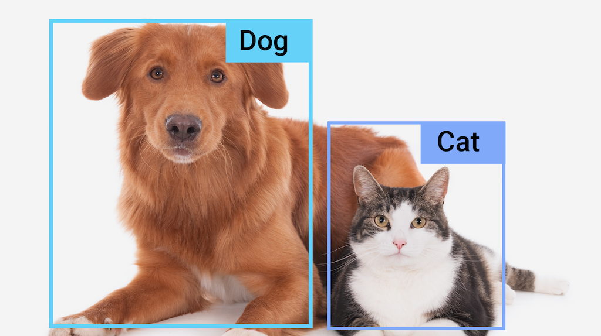

But there are clearly moments when a box isn't enough. The cat is inside the box, yes, but the box doesn't contain only the cat. Besides the cat, it also holds background and part of the dog. If you ask "exactly where does the cat end?", a rectangular box alone can't answer — that's its limitation. 

Image segmentation is the technique built to solve exactly this problem. It examines every single pixel and traces the object's outline as it is.

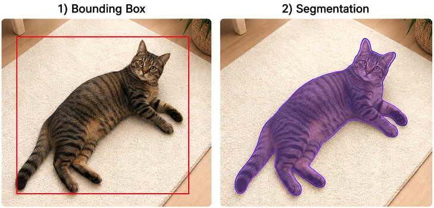

Because a box wraps an object in a rectangle, objects that aren't rectangular — a cat lying at an angle, a winding road — let a lot of background into the box. Segmentation, on the other hand, pinpoints only the pixels that belong to the object, so it can leave that unnecessary information out.

Tracing <u>**the exact boundary of a tumor in a medical image**</u>, letting <u>**a self-driving car tell the road from the sidewalk**</u>, <u>**cleanly removing just the background from a photo**</u> — once you can divide regions pixel by pixel, there's far more you can do.

## 1. Three Kinds of Image Segmentation

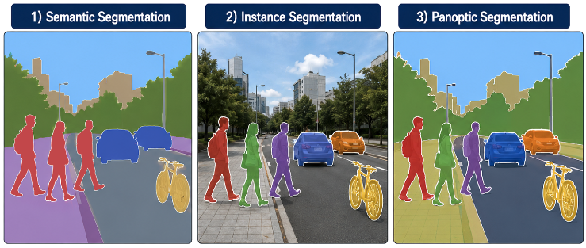

- **Semantic segmentation**: Distinguishes only each pixel's class. Two people are both just "person". 

    It's mainly used where the composition of the whole scene matters and individual objects don't need to be told apart. Analyzing how much of a <u>**satellite image**</u> is farmland, city, or forest, or <u>**finding a tumor region as a whole**</u> in a medical image, falls into this category.

- **Instance segmentation**: Distinguishes individual objects even within the same class (person 1, person 2). 

    It's used where each object must be counted or tracked. Counting <u>**how many people entered a store**</u>, <u>**following a specific vehicle frame by frame**</u> in a video, or <u>**counting cells**</u> in a cell image falls into this category.

- **Panoptic segmentation**: Combines the two above. Countable things (objects that can be told apart, like people and cars) are handled one by one Instance-style, while uncountable things (closer to background, like sky and road) are handled as a single mass Semantic-style. Think of it as an approach that tries to understand the entire scene without missing anything.

    It's used where both object separation and background understanding are needed, and the representative case is <u>**autonomous driving**</u>. A car has to separate and track the car ahead and the car beside it individually (Instance), while also grasping the road, sidewalk, and sky as regions (Semantic).

## 2. What Segmentation Requires

To do segmentation, you must predict <u>**a class for every pixel**</u>. Feeding a whole photo in and pulling a single result out, like the CNN we used for classification, won't give the result we want. 

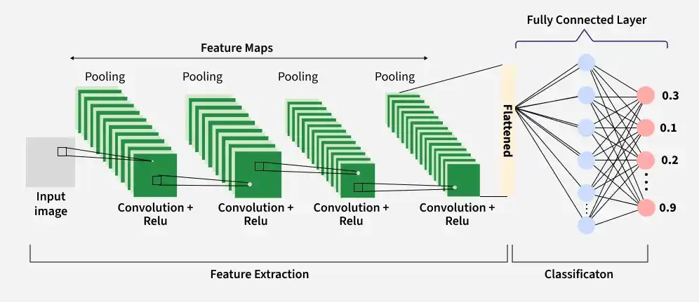

> 📌 **What a classification CNN does**
>
> Let's recall what an image-classification CNN looks like. When an input image comes in, the feature map shrinks step by step through convolution and pooling. An image that was 224×224 gets smaller — 112×112, 56×56 — and in exchange, "what features this image has" piles up in the filters. Finally, through a Fully Connected Layer, it outputs a single label like "cat 90%, dog 10%".
>
> The key point of this structure is that it gradually throws away information about where the cat is in the photo (localization) and keeps only "what it is". In fact, <u>**recognizing whether this is a photo of a cat no matter where the cat is in it is what helps classification**</u>.

Since segmentation has to predict a class for each pixel, <u>**spatial information — "what is at this location"**</u> — has to stay alive all the way to the end. On top of that, the output must be <u>**the same size as the input**</u>, not a single label. Put in a 224×224 image, and a 224×224 "per-pixel class prediction map" has to come out.

> 📌 **Summary**
>
> - An ordinary classification CNN can't perform image segmentation. 
> - **Solution 1:** <u>**Sliding-Window CNN: a classification CNN per pixel**</u>
>     - **Feature**: Performs conv+FC classification per patch (window). 
>     - **Problem**: Far too much convolution is duplicated.
> - **Solution 2:** <u>**FCN (Fully Convolutional Network)**</u>
>     - **Feature 1**: Removes duplicated computation with conv over the whole input image + 1x1 conv.
>     - **Feature 2**: Produces an output the same size as the input via up-sampling. 
>     - **Feature 3**: Fuses the boundary information of shallow feature maps with the semantic information of deep feature maps via skip connections. 
>     - **Drawback 1**: Too few up-sampling steps — i.e., the size is enlarged too much at once — so boundary information collapses.
>     - **Drawback 2**: The skip connection is done by addition (summation), so information of different nature (abstract semantic information and fine spatial information) gets mixed together, diluting or distorting each one's own characteristics. 
> - **Solution 3:** <u>**U-Net**</u>
>     - **Feature 1**: The contracting path and the expansive path have the same number of levels.
>     - **Feature 2**: Skip connections are implemented as concatenation (concat).
>     - **Feature 3**: Preserves boundary information with the overlap-tile strategy & mirroring extrapolation. 
>     - **Feature 4**: Uses elastic deformation and a weighted loss to perform strongly even with little data. 

## 3. Solutions

### 3.1. Sliding-window CNN

This algorithm is a cornerstone of early deep-learning-based image segmentation and object detection.

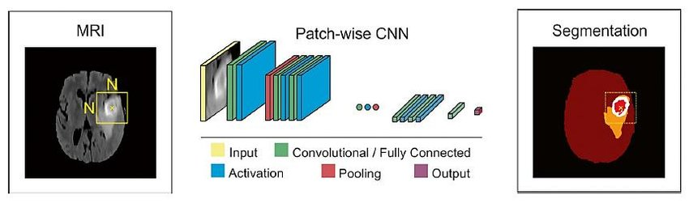

**1. How it works**

- **Patch-based extraction:** Rather than processing the entire input image at once, it sets <u>**a small square patch of fixed size**</u>.
- **Pixel-wise classification:** As the window <u>**slides one pixel at a time**</u> from the top-left of the image to the bottom-right, it predicts the label of the pixel at the exact center of the window. 
- **Independent analysis:** Each cut-out patch passes through the CNN model independently, then goes through a <u>**Fully Connected Layer**</u> to produce the classification for each pixel. In other words, the patch's position itself becomes the location information, and the model predicts the class of the pixel at that location.

This approach showed state-of-the-art accuracy for its time, but it had <u>**a fatal structural limitation**</u>.

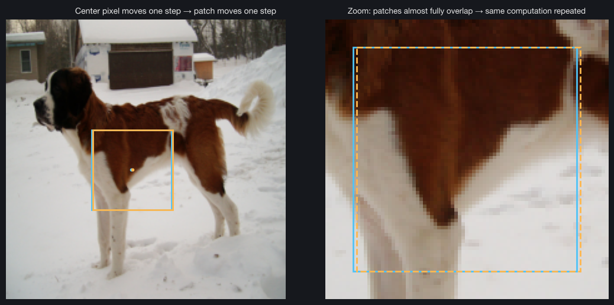

- The photo above is 224x224, made up of 50,176 pixels. So segmenting this one photo requires <u>**50,176 CNN inferences**</u>. 
- And if inferring one patch (64x64) takes 0.60ms, then <u>**segmenting one photo takes 30.1 seconds**</u>. Medical images in particular tend to have quite high resolution per image, and with medical imaging data on the order of 100 TiB, in bad cases this can take years. 
- In this case, <u>**the sky-blue and yellow patches overlap by 98.4%**</u>, an inefficiency that means repeating up to 98.4% of the computation every time. 

#### 3.1.1. Why is overlapping patches inefficient?

Let's say we have a simple 5x5 original image and run a Sliding Window CNN with a single 4x4 patch. 

1. **CNN**

    A small classification CNN that **takes one 4×4 patch and outputs 2 class scores (cat / background) for the patch's center**.

    | Layer | What it does | Size per patch |
    | --- | --- | --- |
    | conv | 3×3 kernel, 2 filters | 4×4×1 → **2×2×2** |
    | FC1 | 8 values → 3 values | 2×2×2 = 8 → **3** |
    | FC2 | 3 values → 2 class scores | 3 → **2** |

    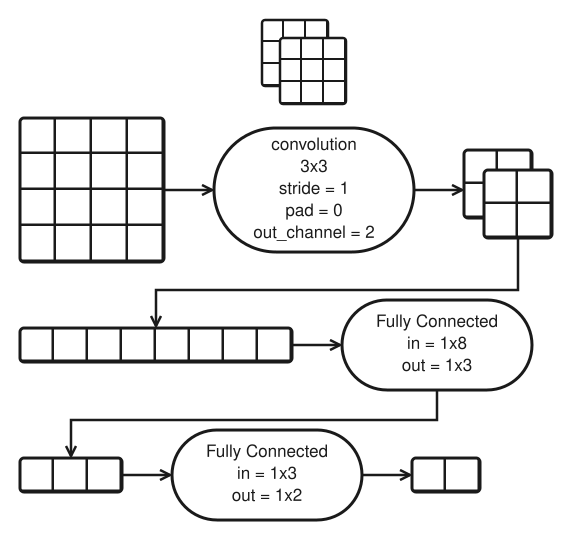

2. **Run CNN classification for each patch**

    Sliding a 4×4 patch one step at a time over a 5×5 image yields 4 patches. 

    | Patch | Region cut from the original |
    | --- | --- |
    | A | rows 0\~3, cols 0\~3 |
    | B | rows 0\~3, cols 1\~4 |
    | C | rows 1\~4, cols 0\~3 |
    | D | rows 1\~4, cols 1\~4 |

    The entire CNN runs separately for each of these four patches.

    - Patch A → conv → [2×2×2] → FC1 → [1x3] → FC2 → [1x2]
    - Patch B → (same process repeated)
    - Patch C → (same process repeated)
    - Patch D → (same process repeated)

3. **Duplicated computation**

    If you write out the conv computations of patches A and B in **original image coordinates**, you can spot the following.

    - Cell (0,1) of patch A's conv output (blue) = the kernel applied to **rows 0\~2, cols 1\~3** of the original image
    - Cell (0,0) of patch B's conv output (blue) = the kernel applied to **rows 0\~2, cols 1\~3** of the original image

    The two cells' values are <u>**completely duplicated.**</u> And cell (0,0) of patch A's conv output and cell (0,0) of patch B's conv output <u>**overlap by 2/3**</u>. It's the same kernel multiplied over the same 9 pixels of the original image, yet it's computed twice just because each patch passes through the CNN separately. Counting per pixel of the original image, there are pixels recomputed not just twice but dozens of times. 

    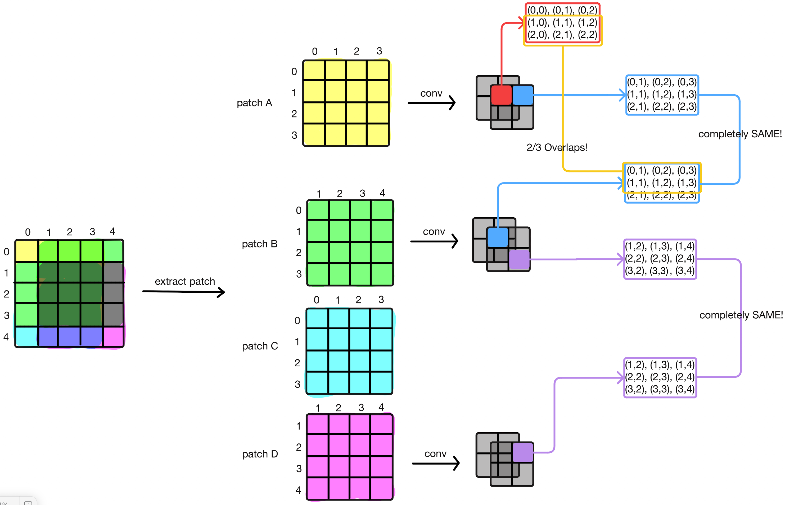

    | Conv layer workload | Sliding window | Actually distinct values |
    | --- | --- | --- |
    | Number of conv outputs | 8 per patch × 4 patches = **32** | 3×3 original positions × 2 filters = **18** |
    | Multiplications (9 per output) | 288 | 162 |

    This example is small, so the difference is less than 2×. But slide a 64×64 patch one pixel at a time and it **overlaps 98.4%** with its neighbor, and in a deep network this duplication repeats at every layer, so most of the computation ends up repeated thousands or tens of thousands of times.

### 3.2. FCN: Fully Convolutional Network

The Sliding-Window CNN approach was quite plausible. To preserve location information while classifying a single pixel, it <u>**uses the information of the pixels within the patch**</u> and produces, as the final result, <u>**a per-pixel class classification whose prediction size (H×W) equals the input size**</u>. But reaching that goal required an inefficient <u>**patch-wise CNN + Fully Connected**</u> classification.

> 📌 **NOTE: Using Fully Connected doesn't automatically mean losing location information.**
>
> The real problem with the Sliding window CNN is **not the loss of location information.** Location is preserved by "where the patch (window) was placed". In other words, the patch's position itself is the location information. Location information within each patch is of course lost through the Fully Connected layer, but from the perspective of the whole image, it isn't lost. 

FCN proposes two approaches to raise <u>**computational efficiency**</u> while keeping the goals of <u>**preserving location information**</u> and <u>**per-pixel prediction**</u>. 

1. **Don't run conv per patch.**
2. **Replace the Fully Connected Layer with convolution.**

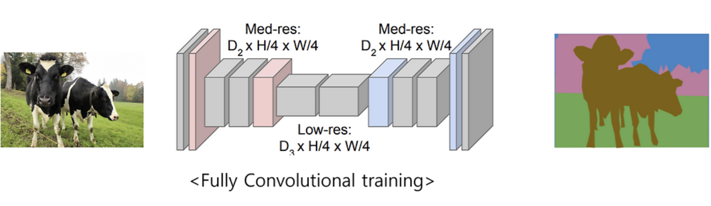

Let's now walk through, step by step, how FCN overcame the inefficiency. 

1. **Premises**

    - Suppose a **5x5 image is filled with values from 1\~25, from (0,0) to (4,4)**.
    - Assume the kernel is 3x3 and all ones. Then one convolution result is **the sum of the 9 numbers inside the 3x3 window**. 
    - We'll name each 3x3 window of the original image by its top-left corner coordinate. For example, **window (0,1) is the window covering rows 0\~2, cols 1\~3 of the original**. 

    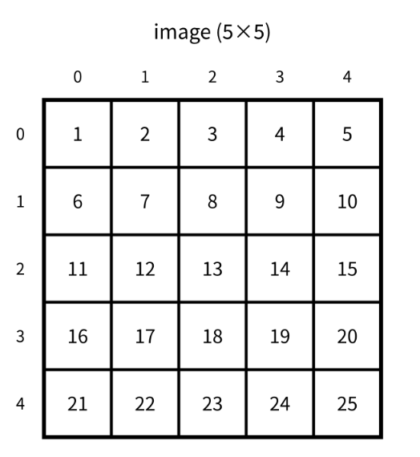 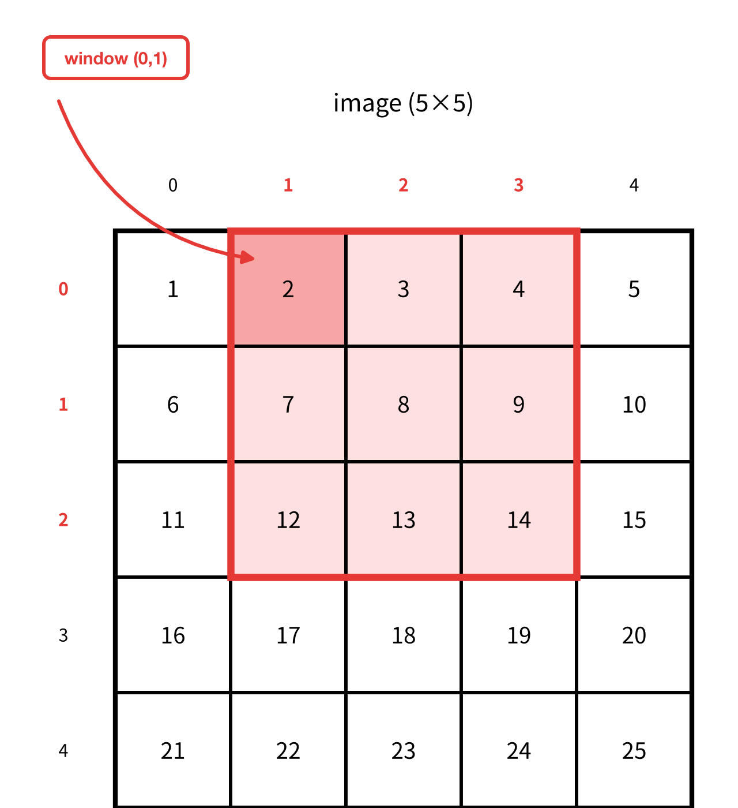 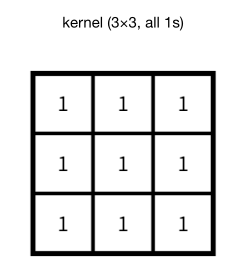

2. **Map the windows each patch computes to original coordinates**

    Running a 3×3 conv inside a 4×4 patch yields a 2×2 feature map, i.e., 4 values. 

    **Patch A** (original rows 0\~3, cols 0\~3, starting at (0,0))

    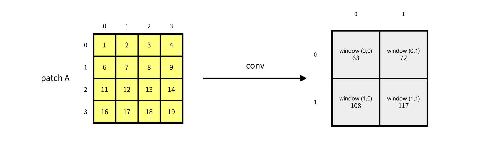

    **Patch B** (original rows 0\~3, cols 1\~4, starting at (0,1))

    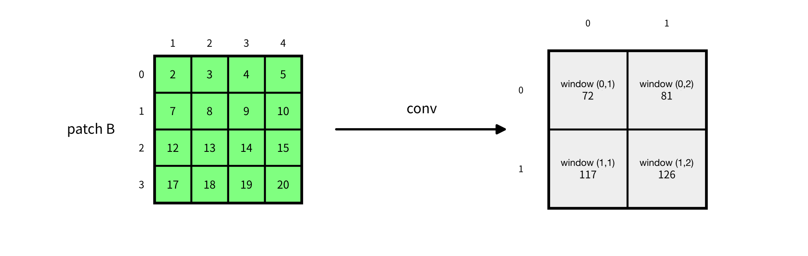

    **Patch C** (original rows 1\~4, cols 0\~3, starting at (1,0))

    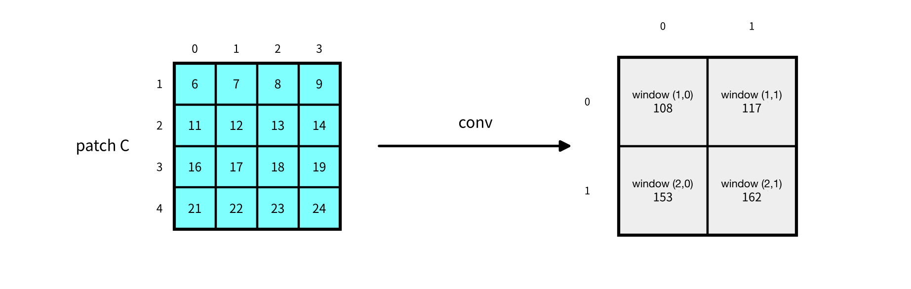

    **Patch D** (original rows 1\~4, cols 1\~4, starting at (1,1))

    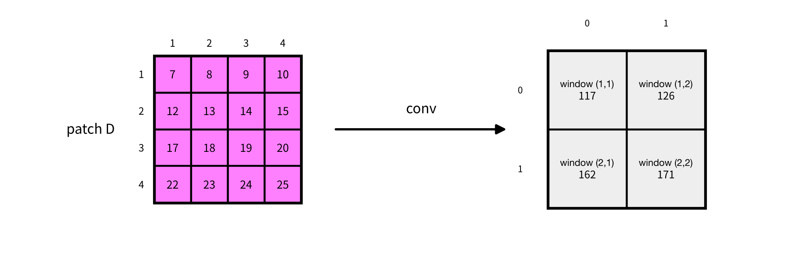

3. **Count the duplicates among windows computed by the four patches**

    | Window | Value | Computed by | Times computed |
    | --- | --- | --- | --- |
    | (0,0) | 63 | A | 1 |
    | (0,1) | 72 | A, B | 2 |
    | (0,2) | 81 | B | 1 |
    | (1,0) | 108 | A, C | 2 |
    | **(1,1)** | **117** | **A, B, C, D** | **4** |
    | (1,2) | 126 | B, D | 2 |
    | (2,0) | 153 | C | 1 |
    | (2,1) | 162 | C, D | 2 |
    | (2,2) | 171 | D | 1 |
    |  |  | Total | **16** |

    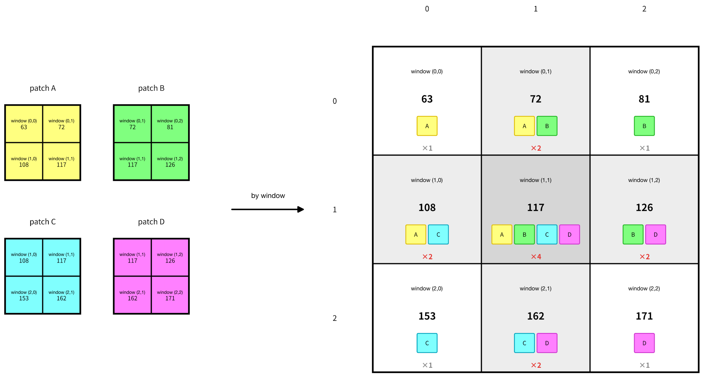

    The four patches computed convolution 16 times in total, but <u>**only 9 of them were distinct**</u>, and 7 were duplicates. In particular, the convolution for window (1,1) was duplicated four times.

4. **Removing the duplicates**

    To remove the duplicates, we just compute **each of the 9 distinct windows exactly once**. How can we get the results of computing those 9 windows?

    <u>**A single 3x3 conv (stride=1, pad=0) on the original 5x5 image**</u> would give us the result of computing all 9 windows once each, in one go, right?

    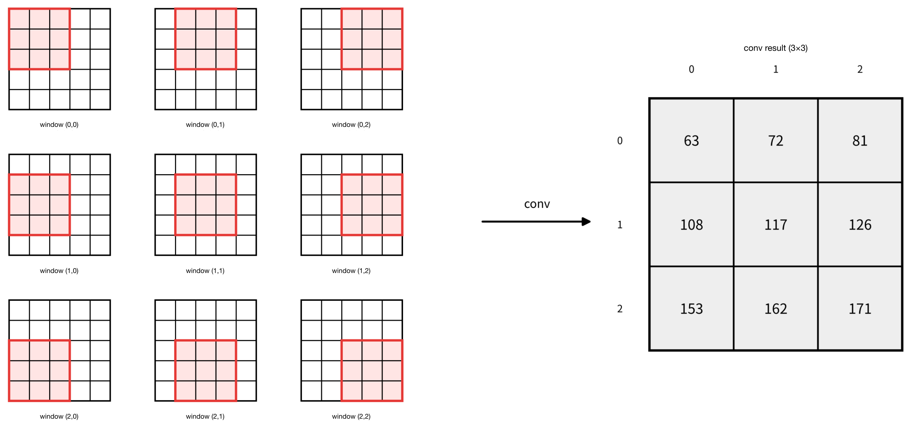

    Looking closely at the conv result, you can see it contains the conv results of patches A\~D. 

    - Patch A's conv result = top-left 2×2 part
    - Patch B's conv result = top-right 2×2 part
    - Same for patches C and D.

    Now the problem is the FC layer. FC1 takes a <u>**1x8 input**</u>, so it can't directly accept a 3×3×2 map. Do we have to cut it into 2×2×2 pieces per patch and feed each one in?

5. **Turn Fully Connected into Convolution!**

    This is where the name FCN (Fully Convolution Network) comes from. 

    Remember section 3.1.1. We flattened each patch's feature map (2x2x2) into 1x8, then passed it through FC1 to get a 1x3 matrix. For this, FC1 had an 8x3 weight matrix. In other words, in the original Sliding Window approach, each of the 4 patch feature maps had to go through the FC separately. 

    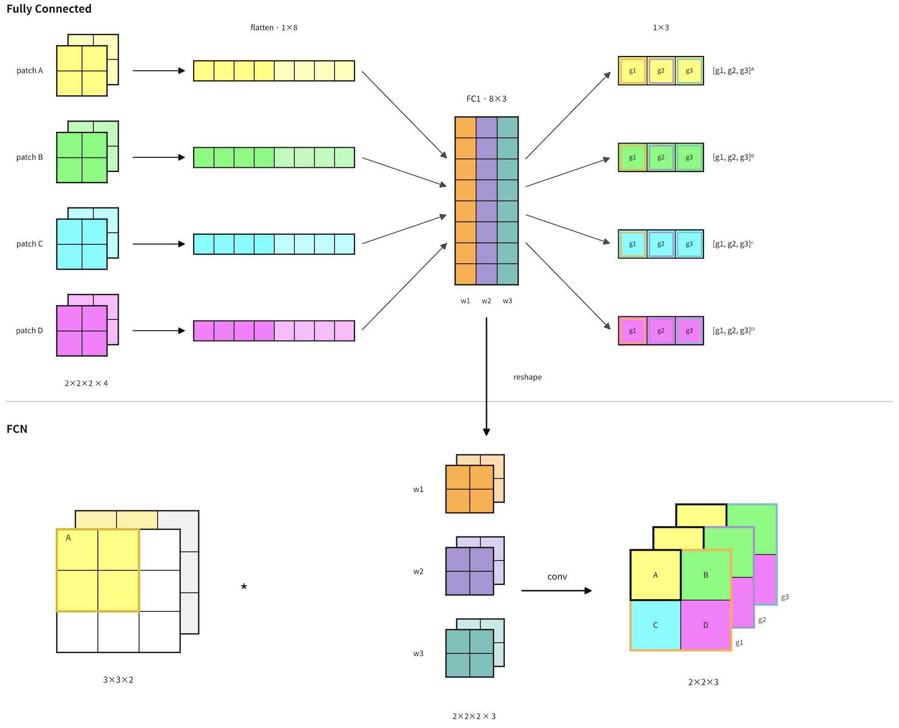

    FCN, however, turns that 8x3 weight matrix into 3 sets of 2x2x2 kernels. 

    That is, <u>**in FCN, applying (3x3 conv) x 2 sets → 3x3x2 feature map → (2x2 conv) x 3 sets to the whole original image**</u> ultimately produces a <u>**2x2x3 feature map**</u>. 

    What the Sliding Window CNN had to do by passing each of the 4 patches through CNN + FC, FCN finishes with just two convs on the single original image. 

6. **The final classification FC: 1x1 convolution**

    In section 3.1.1, FC2 took a 3-element vector [g1, g2, g3] as input and output a vector of the patch's cat score and background score. This was done separately for each patch. 

    $$
    \text{Cat score of patch A} = u1·g1ᴬ + u2·g2ᴬ + u3·g3ᴬ
    $$

    $$
    \text{Cat score of patch B} = u1·g1ᴮ + u2·g2ᴮ + u3·g3ᴮ
    $$

    ![Top: for each patch, [g1, g2, g3] goes into FC2 (3×2) to produce cat and background scores. Bottom: turning FC2's weights into two 1×1 kernels and convolving the 2×2×3 map yields a 2×2×2 score map](./image/fc2-to-1x1-conv.en.png)

    FCN, however, performs the same computation with a <u>**1x1 filter**</u>. At each location, it acts as a per-pixel classifier that "looks at this location's feature vector and decides its class".

7. **Comparing the results**

    |  | Sliding window | FCN |
    | --- | --- | --- |
    | Input | 4 separate 4×4 patches | One 5×5 image |
    | conv | Per patch (32 values, incl. duplicates) | Once over the whole (18 values) |
    | FC1 | 8→3 per patch | 2×2 conv, 2 channels→3 channels |
    | FC2 | 3→2 per patch | **1×1 conv**, 3 channels→2 channels |
    | Output | 4 score pairs | 2×2×2 score map |

    It's also worth noting that FCN removes only the duplication in the conv layers, while the FC layers' workload stays the same. That's because the duplication was concentrated in the lower conv layers to begin with. Also, since the network has no FC layers, **the input size constraint disappears too.** 

What we've looked at so far is merely <u>**how to compute per-location classification results**</u>. 

By convolving the whole image and replacing the Fully Connected Layers with fully convolutional layers, we could <u>**eliminate the inefficiently repeated computation**</u> and output results <u>**in a format that carries spatial information, like a heat map**</u>. 

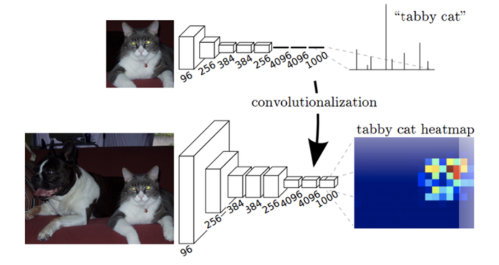

<u>**The result obtained this way is just a Coarse Score Map smaller than the input**</u>. As we saw in the simple example, we took a 5x5 image as input and got per-class scores in the form of a 2x2x2 map. The output isn't yet the same size as the input. 

An actual FCN with a VGG16 backbone goes through 5 poolings, so <u>**the output is 1/32 of the input**</u>. 

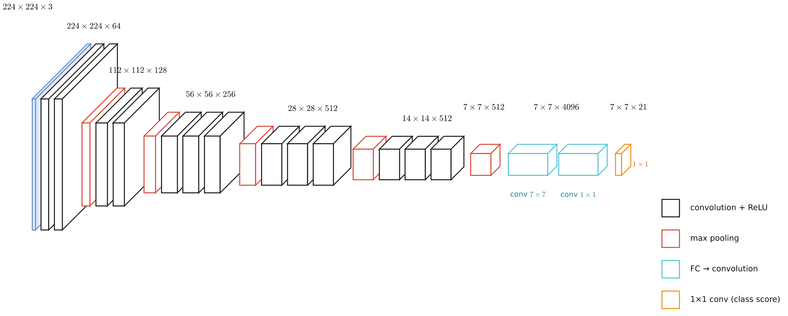

So the output of step 6 of a real FCN is a coarse score map (<u>Coarse Score Map)</u> of size **(H/32) × (W/32) × number of classes**. For a 500×500 image, you get roughly a 16×16 score map, with each cell representing a 32×32 region of the original (receptive field). In this state, you can't tell at which pixel the tip of the cat's ear ends. 

### 3.2.1. UpSampling

That's why upsampling is needed. The goal is <u>**to enlarge the (H/32)×(W/32)×C encoder output to H×W×C, the original image size**</u>. There are broadly two methods. 

1. **Interpolation: a non-learned method**

    - **nearest**: Fills each new location by copying the value of the single nearest existing pixel. 

        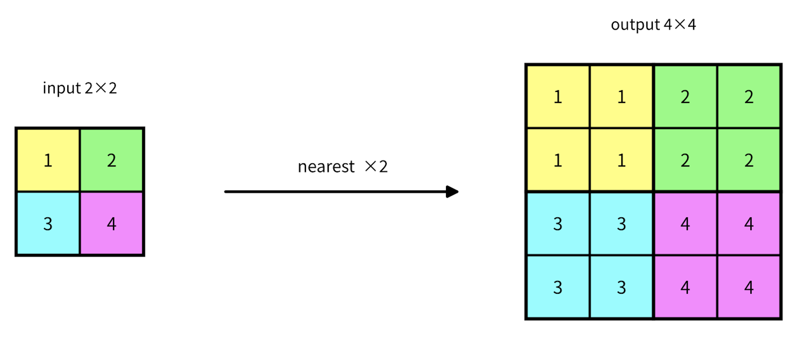

    - **bilinear**: For each output cell, blends the four surrounding input cells with weights proportional to distance.

        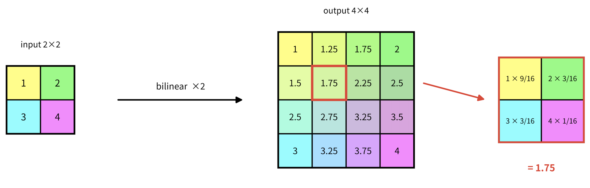

2. **Transposed convolution ("deconvolution"): a learned method**

    The 2015 FCN used transposed convolution with the idea of <u>**learning the upsampling too**</u>. The network can learn "how to enlarge the small map so it gets closer to the ground-truth mask".

    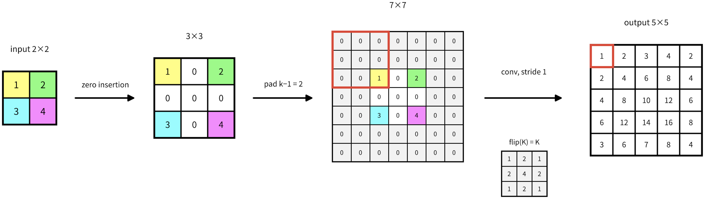

    - The FCN paper **initialized this deconvolution layer to the same values as bilinear interpolation** and then trained it. The design is "do at least as well as bilinear, and leave room to improve from there". That said, even the FCN paper trained only the intermediate ×2 upsampling and fixed the final upsampling to bilinear.

    > 📌 **Drawback of transposed convolution: checkerboard artifacts**
    >
    > Transposed convolution produces checkerboard patterns when the kernel size isn't divisible by the stride. Modern implementations use bilinear interpolation together with conv, preventing the checkerboard effect while still leaving room for learning.

### 3.2.2. Skip-Connection

What happens if you enlarge a 1/32-size score map 32× in one go? Look at the rightmost column of the image below. Compared to the green outline (GT), the sky-blue outline (prediction) is terrible. <u>**Fine location information already discarded by pooling can't be revived by upsampling**</u>. On the other hand, you can see that the shallower — less pooled — the layer you upsample from, the closer the predicted boundary gets to the GT boundary. 

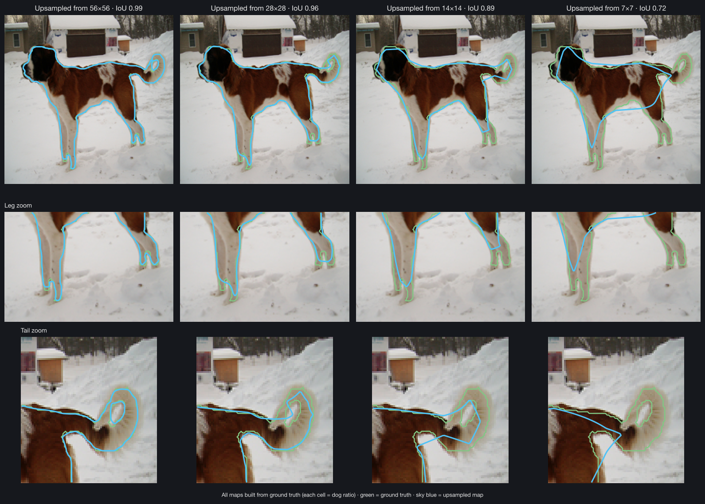

So it adopted <u>**the idea of borrowing information from shallower conv layers that are less pooled, i.e., less compressed (skip connection)**</u>.

| Layer | Resolution | Strength |
| --- | --- | --- |
| Deep layer (after pool5) | 1/32 | Knows **what** well (semantics) |
| Middle layer (pool4) | 1/16 | In between |
| Shallow layer (pool3) | 1/8 | Knows **where** well (location, boundary) |

 When learning about CNNs, we learned that convolution compresses spatial size while increasing channels, capturing many features of the whole image in compressed form. The deeper you go, the more the network figures out what the photo means, while location and boundary information is lost. So what if we could use <u>**the location and boundary information preserved in shallow layers together with the semantic information obtained in deep layers**</u>? To do this, FCN combines (summation $\Sigma$) the location information of shallow layers with the semantic information of deep layers. 

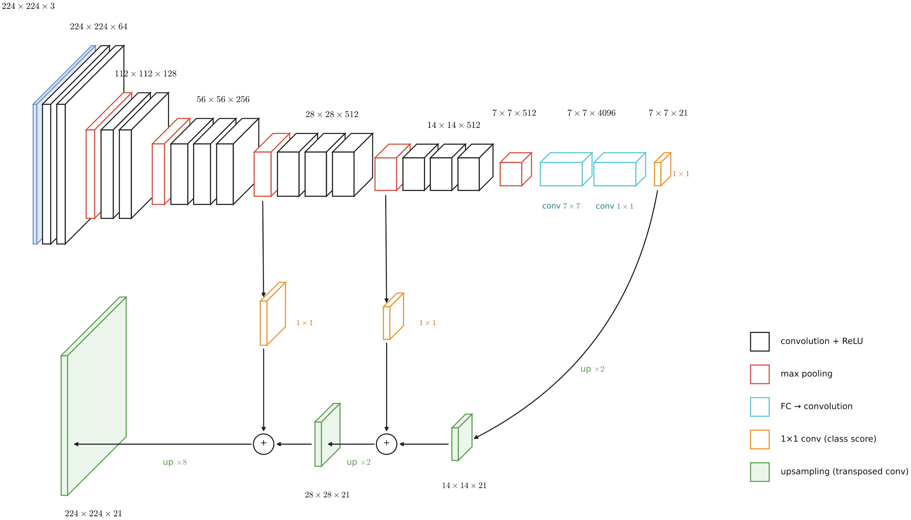

1. Upsample the 1/32 score map 2× to match the 1/16 size.
2. Apply a **1×1 conv** to the pool4 feature (512 channels) to turn it into as many channels as there are classes (21 for PASCAL).
3. **Add the two element-wise (sum)**. This is possible because their size and channel count now match.
4. Repeat the same process once more down to pool3 (1/8), then upsample 8× at the end.

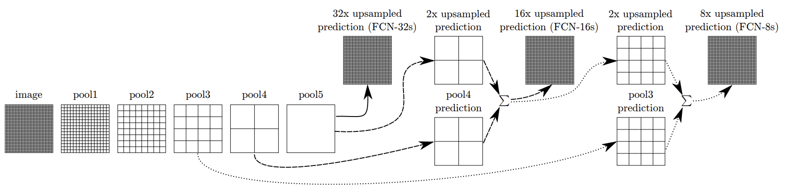

You can see that the model with skip connections (FCN-8s) is much closer to the GT than the one without (FCN-32s). 

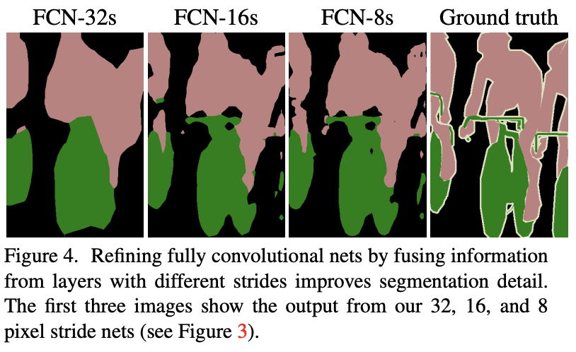

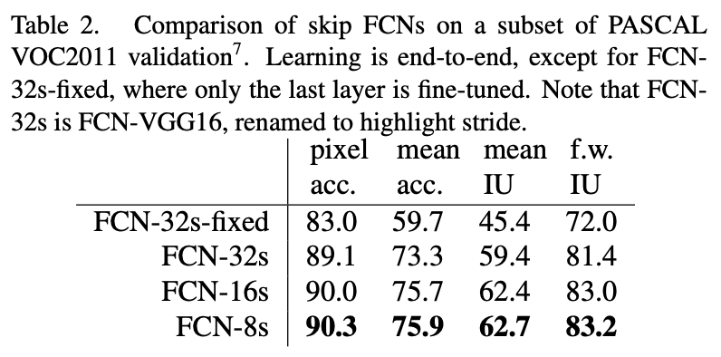

Performance-wise, FCN-8s is also much better than the others. 

### 3.2.3. Limitations of FCN-8s

FCN-8s was a model that overcame the limitations of earlier segmentation models. Even so, it had a few drawbacks. 

- **Information loss during upsampling:** It enlarges the high-dimensional feature maps shrunk by pooling using simple bilinear interpolation or transposed convolution. In this abrupt decoding process, fine spatial information can be lost. 
- **Blurry boundaries**: Although it introduced a skip architecture that adds some information from the encoder's shallow layers, the information is combined by simple addition, and the steps that restore the size to the original are sparse (5 poolings but only 2 skip connections), so it couldn't restore precise pixel-level object boundaries and the boundaries got smeared.

## 4. Enter UNet

UNet is an evolution of FCN that appeared in the same year FCN came out (2015). This model was built for medical imaging. 

- In medical image analysis (cells, tissue, CT, MRI, etc.), a single-pixel error can significantly affect the diagnosis. Combining context information that knows <u>**what**</u> an object is with location information that tells <u>**exactly where**</u> it is and where its boundary lies was extremely important. Also, because cells touch each other, <u>**the thin boundaries between adjoining objects**</u> must be captured precisely.
- In addition, unlike general computer vision datasets (ImageNet, COCO), medical images have the practical limitation that expert manual labeling is very expensive and <u>**the data itself is hard to obtain**</u>. 

So UNet arrived introduced as "a network and training strategy that makes strong use of data augmentation". 

> *we present a network and training strategy that relies on the strong use of data augmentation to use the available annotated samples more efficiently.*

|  | FCN-8s | U-Net |
| --- | --- | --- |
| What's passed to the decoder | **Class scores** (already compressed to 21 channels) | **The whole feature map** (64\~512 channels) |
| How they're merged | Addition (sum) | **Concatenation (concat)** then 3×3 conv twice |
| Number of merges | 2 (pool4, pool3) | **4** (every stage) |
| Upsampling | ×2, ×2, then **×8 all at once** at the end | **×2 at each stage**, four times |
| Decoder | Almost none | **Symmetric to the encoder. A deep path** |

> *“One important modification in our architecture is that in the upsampling part we have also a large number of feature channels, which allow the network to propagate context information to higher resolution layers.”*

FCN **summarizes the information into 21 channels (class scores)** before passing it to the decoder. U-Net **keeps features with hundreds of channels as they are** all the way to the decoder. The core of U-Net is that the decoder can draw "boundaries" while holding rich information about "what it is".

### 4.1. UNet's Structure: U-Shaped Architecture

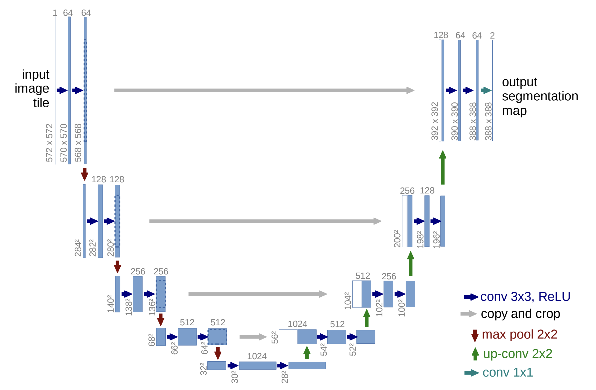

U-Net consists of the **contracting path (encoder)** on the left, the **expansive path (decoder)** on the right, and **skip connections** linking the two at the same level. 

I'll explain using the 572x572 input image mentioned in the paper.

1. **Contracting path**

    Each stage of the contracting path consists of <u>**(3×3 conv (pad=0) + ReLU) twice → one 2×2 max pooling (stride=2)**</u>. At each stage, the channels double and the size halves.

    | Level | After conv ×2 | Channels | After pooling |
    | --- | --- | --- | --- |
    | 1 | 572 → 570 → **568** | 64 | 284 |
    | 2 | 284 → 282 → **280** | 128 | 140 |
    | 3 | 140 → 138 → **136** | 256 | 68 |
    | 4 | 68 → 66 → **64** | 512 | 32 |
    | 5 (bottom) | 32 → 30 → **28** | 1024 | – |

    With no padding, each 3×3 conv trims 1 pixel off each edge — **2 pixels in total per dimension**. It's the same phenomenon as the 5×5 image turning into a 3×3 feature map in step 4 of section 3.2. The feature maps of size **568, 280, 136, 64**, shown in bold, are the ones that will later be passed over via skip connections.

2. **Expansive path**

    Each stage of the expansive path consists of <u>**(2×2 up-conv (size ×2, channels ÷2) → crop the encoder feature at the same level and concat → (3×3 conv + ReLU) twice**</u>. 

    | Level | up-conv | skip (before → after crop) | Channels after concat | After conv ×2 |
    | --- | --- | --- | --- | --- |
    | 4 | Size: 28 → **56**<br>Channels: 1024 → 512 | 64 → 56 (512) | 1024 | 56 → 54 → **52** |
    | 3 | Size: 52 → **104**<br>Channels: 512 → 256 | 136 → 104 (256) | 512 | 104 → 102 → **100** |
    | 2 | Size: 100 → **200**<br>Channels: 256 → 128 | 280 → 200 (128) | 256 | 200 → 198 → **196** |
    | 1 | Size: 196 → **392**<br>Channels: 128 → 64 | 568 → 392 (64) | 128 | 392 → 390 → **388** |

    At the end, a **1×1 conv** turns each pixel's 64-channel vector into the number of classes (2 in the paper), producing a **388×388×2** output. It plays the same role as the per-pixel classifier we saw in step 6 of section 3.2.

3. **Skip Connection**

    FCN-8s matched size and channels and then **added (sum)**. U-Net **concatenates (concat)** along the channel dimension.

    - **sum**: The two pieces of information get mixed into one cell. So every channel of the two features being merged must carry the same meaning.
    - **concat**: Keeps the encoder's location information (e.g., 64 channels) and the decoder's semantic information (e.g., 64 channels) unmixed, **bundled side by side and preserved as 128 channels**. How to mix the two can then be **decided by learning** in the two 3×3 convs right after.

    Repeating this at every resolution (1/8, 1/4, 1/2, 1) lets boundary information be restored precisely, one stage at a time.

    > 🤔 **Why is crop needed?**
    >
    > Looking at the table above, the encoder feature coming over through the skip (e.g., 64×64) is bigger than the decoder feature (56×56). That's because the decoder side has been trimmed more by the unpadded convs. So <u>**the center of the encoder feature is cropped**</u> to match the size.
    >
    > > *“The cropping is necessary due to the loss of border pixels in every convolution.”*
    >
    > Let's take as an example concatenating level 4 with level 5 (the bottom).
    >
    > - At level 4, the feature size right before pooling is **64×64**
    > - This feature goes down to the bottom and comes back up: pool → 32x32 → two convs → 28x28 → up-conv → **56×56**.
    >
    > They meet at the same level 4, but the sizes differ — 64x64 and 56x56 — so they can't be concatenated as is. So we **use only the central 56×56 of the encoder feature**.
    >
    > **🤔 Why crop the center of the encoder feature map?**
    >
    > Encoder level 4 has 64 cells, decoder level 4 has 56. There are 9 positions from which 56 cells can be cut from the encoder: `[0:56]`, `[1:57]`, …, `[8:64]`. Out of these, <u>**why crop exactly at `[4:60]`**</u> to concat with the decoder?
    >
    > If we roughly sketch the pooling from UNet level 4 to level 5 and the two convs at level 5, it looks like the figure below. (Only the first 10 of encoder level 4's 64 pixels are shown.)
    >
    > 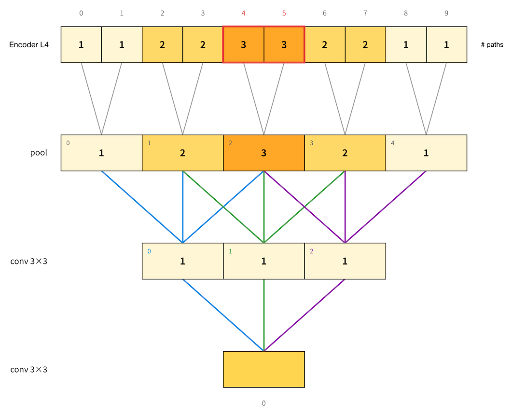
    >
    > The figure shows that level 5's second conv referenced pixels 4 and 5 of encoder level 4 most often. Pixels 0, 1 and 8, 9 at both ends of encoder level 4 were referenced only once. 
    >
    > Now let's look at all 64 pixels of encoder level 4.
    >
    > 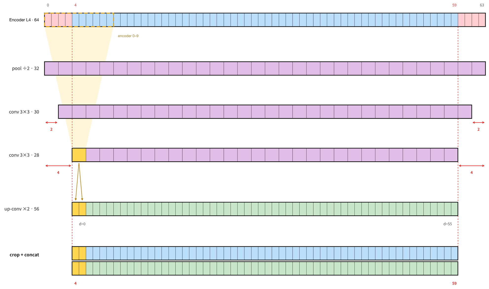
    >
    > So decoder level 4's pixels 0 and 1 can be seen as <u>**"mainly a summary of the area around encoder pixels 4\~5"**</u>. It varies with the learned weights, but on average the influence concentrating toward the center is commonly observed. This is called the <u>**effective receptive field**</u>, and it usually takes a Gaussian shape.
    >
    > A skip connection is a device for attaching <u>**the fine details of the area a decoder pixel summarizes**</u>. So we should pair encoder level 4's pixels 4 and 5, which are reflected the most, with decoder level 4's pixels 0 and 1. Working out, not only for decoder pixels 0 and 1 but <u>**for all 56 pixels, which part of encoder level 4 had the most influence**</u>, you can see that the center of the encoder's 64, `[4:60]`, should be cropped and concatenated.  

4. **Overlap-tile Strategy & Mirroring Extrapolate**

    Because UNet is image segmentation specialized for medical imaging, there were a few problems it had to deal with. 

    1. Feeding a very high-resolution medical image into the network all at once causes <u>**GPU OOM**</u>.
        - So the image is fed into the network in smaller units. 
        - At this point, forcibly shrinking the image would lose information about tiny cells and tissue. So the strategy is to cut the image into <u>**tiles**</u> and feed those in. 
    2. <u>**Cell boundaries at the image border**</u> must also be predicted with high performance.
        - But if you cut tiles to fit exactly without overlap and feed them into UNet, <u>**the edges of each tile lack surrounding context**</u>, and prediction performance drops sharply.
            - Because of how convolution works, information near the corners of the input contributes less to the output than information elsewhere.
    3. When processing <u>**the outermost edge tiles of the original image**</u>, there's no outside context left to reference. The edge is the end of the photo, after all. 
    4. Image segmentation requires <u>**the input and output images to be the same size**</u>. 

    To solve these, it uses the <u>**Overlap-tile Strategy**</u> and <u>**Mirroring Extrapolate**</u>.

    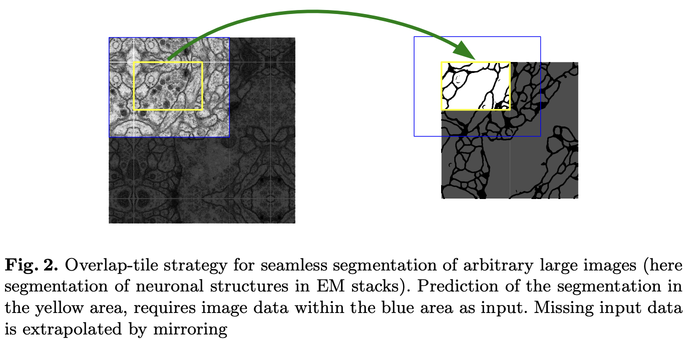

    1. **Overlap-tile Strategy**

        When cutting the image into tiles, cut them **so they overlap** and feed them in. So when predicting the next tile, part of the previous tile's edge region is included (overlapped) in the input.

    2. **Mirroring Extrapolate**

        Tiles are cut after expanding the input data by <u>**filling the missing outer region by reflecting it, as in a mirror**</u>.

    > 📌 **NOTE**
    >
    > In the architecture proposed in the UNet paper, each tile's input and its corresponding output aren't exactly the same size. The segmentation outputs of multiple tiles are stitched together to make the original size. 

    **Let's go over the overall flow of the Overlap-tile Strategy.**

    1. **First, decide** <u>**the number of poolings**</u> **and** <u>**the size of the deepest layer (bottleneck)**</u>**.**
        - This is decided when implementing the model architecture. 
        - The paper chose 4 poolings. Since it's downscaled 4 times, the bottleneck size must be at least a multiple of $2^4 = 16$ to avoid fractions.
        - Choose a bottleneck size among multiples of 16 that fits GPU memory. The paper chose 32. 
    2. **Then** <u>**the input size**</u> **and** <u>**the output size**</u> **are determined.**
        - The moment **'4 poolings'** and **'bottleneck size 32'** are fixed, working backward up the network, the formulas <u>**automatically derive an input of 572 and an output of 388**</u>.
    3. **Set up the grid over the whole image and the padding.**

        Divide the whole original image into a grid of tiles in units of the output size ($388 \times 388$).

        - At this point, the edge grid cells lack surrounding context (margin), so they can't form a $572 \times 572$ input.
        - To solve this, apply <u>**mirroring padding**</u> to the four outer sides of the original image by the missing margin, enlarging the original image itself a little in advance.

            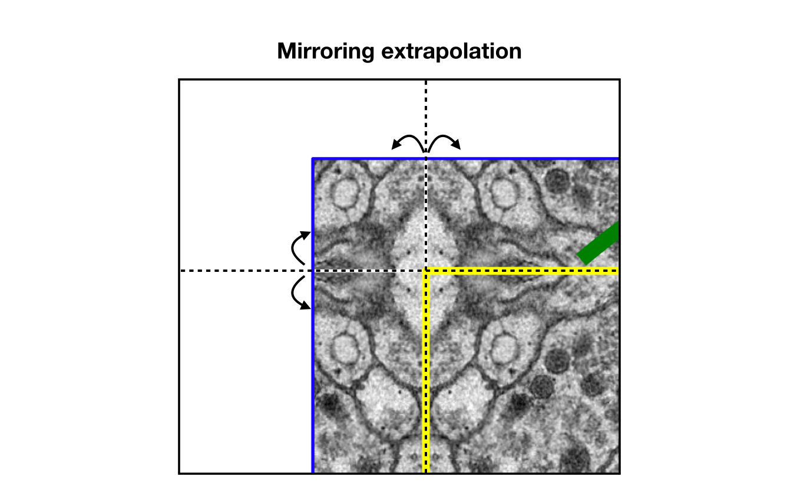

    4. **Extract input tiles while moving by the output size (Sliding & Cropping)**

        **Moving (stride) only by the output tile size (388 pixels)** over the prepared image, cut out the needed **input tile size (**$572 \times 572$**)** at each position and feed it into the network.

        - **Input perspective:** Since the window moves only by $388$, the $572$-size input tiles **overlap** each other, creating a 184-pixel overlapping region.
        - **Output perspective:** The $388 \times 388$ segmentation maps that come out of the network don't overlap at all.
    5. **Assemble the final segmentation map**

        Stitch the $388 \times 388$ output pieces from the network together **seamlessly (mosaic)** in grid order to complete the final segmentation map at exactly the same resolution as the original image.

### 4.2. How UNet Is Trained

1. **Data augmentation: elastic deformation**

    > *As for our tasks there is very little training data available, we use excessive data augmentation by applying elastic deformations to the available training images.*

    The paper calls elastic deformation the **“key concept”** for learning from few labels.

    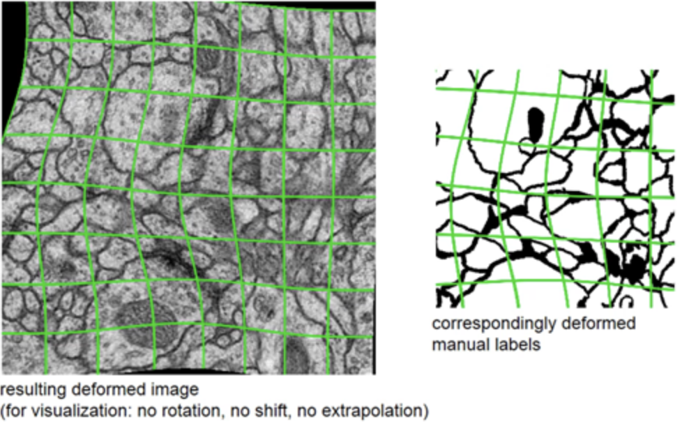

    The most common variations in cells and tissue are exactly this kind of **squashing and bending**. Since you can generate endless realistic-looking photos, it has the effect of using unlimited data without experts drawing more labels. Besides this, it also used shift, rotation, and brightness augmentations, and **dropout** at the end of the contracting path.

2. **Weighted loss: giving weight to the boundaries between touching cells**

    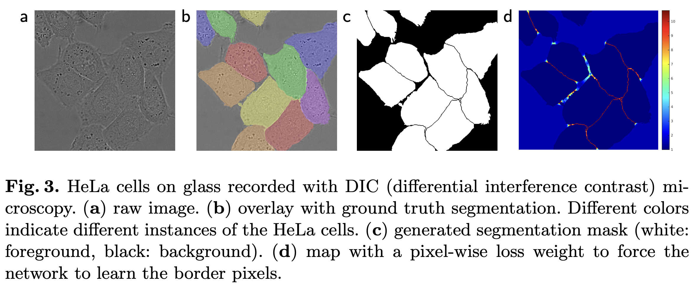

    > *Another challenge in many cell segmentation tasks is the separation of touching objects of the same class; see Figure 3. To this end, we propose the use of a weighted loss, where the separating background labels between touching cells obtain a large weight in the loss function.*

    The output goes through a per-pixel softmax and is trained with **a weighted cross entropy**.

    $$
    p_k(\mathbf{x}) = \frac{\exp(a_k(\mathbf{x}))}{\sum_{k'=1}^{K}\exp(a_{k'}(\mathbf{x}))}, \qquad E = -\sum_{\mathbf{x}\in\Omega} w(\mathbf{x})\,\log p_{\ell(\mathbf{x})}(\mathbf{x})
    $$

    The key is <u>**the weight map**</u> $w(x)$. It's precomputed for each ground-truth mask before training.

    $$
    w(\mathbf{x}) = w_c(\mathbf{x}) + w_0 \cdot \exp\!\left(-\frac{(d_1(\mathbf{x}) + d_2(\mathbf{x}))^2}{2\sigma^2}\right), \qquad w_0 = 10,\ \sigma \approx 5\text{px}
    $$

    - $w_c$: Corrects the imbalance in pixel counts per class (since background is far more common).
    - $d_1, d_2$: The distances from that pixel to **the nearest cell boundary** and **the second-nearest cell boundary**.

    | Pixel location | d1 + d2 | Extra weight w0·exp(...) |
    | --- | --- | --- |
    | Narrow gap between two cells (d1=1, d2=2) | 3 | 10 × e^(−9/50) ≈ **8.4** |
    | A bit away from the gap (d1=4, d2=6) | 10 | 10 × e^(−100/50) ≈ **1.4** |
    | Background far from cells (d1=10, d2=10) | 20 | 10 × e^(−400/50) ≈ **0.003** |

    **The closer a background pixel is to a narrow gap where two cells nearly touch, the more important — up to about 10× — it is treated in the loss**. It's a device that forces the network to pay attention to boundaries that are so few in pixel count they'd easily be ignored in ordinary training.

### 4.3. UNet's Performance

U-Net validated its performance in two biomedical imaging competitions. The results are even more impressive when you keep in mind that both had only **20\~35 training images**.

1. **ISBI 2012 electron microscopy (EM) neuronal structure segmentation**

    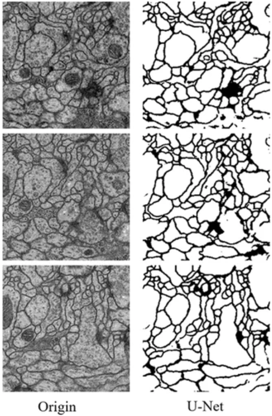

    The task is to separate neurons one by one along the cell membranes in electron-microscope images. The training set is **30** images of 512×512. There are three evaluation metrics, and lower is better for all of them.

    | Metric | Meaning |
    | --- | --- |
    | **Warping error** | Topological errors where cells are wrongly **split or merged**. Missing a single membrane merges two cells into one, so it measures how continuously the boundaries were captured. |
    | **Rand error** | The rate at which, picking two pixels, "same cell or different cells" is judged differently from the ground truth |
    | **Pixel error** | The rate of pixels that are wrong |

    U-Net took **1st place with a warping error of 0.000353**, with no pre- or post-processing other than averaging predictions over 7 rotated versions of the input. That's lower than the 0.000420 of the **sliding window CNN** covered in section 3.1, and it also led on rand error (0.0504 → 0.0382). It surpassed the previous approach in both accuracy and speed.

    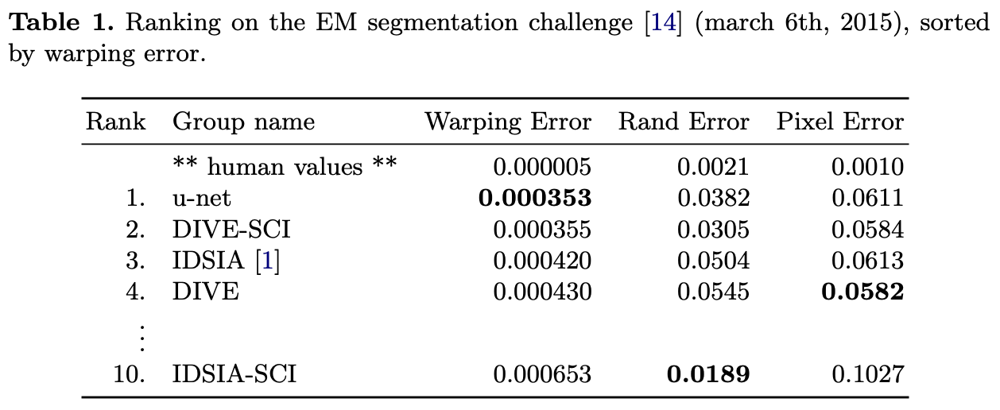

    That said, it wasn't 1st on every metric. The table is sorted by warping error, and on rand error and pixel error, DIVE-SCI in 2nd place is lower. It's more accurate to say U-Net's strength lay in **its ability to keep boundaries unbroken and separate cells correctly**. 

2. **ISBI 2015 cell tracking challenge: light-microscopy cell segmentation**

    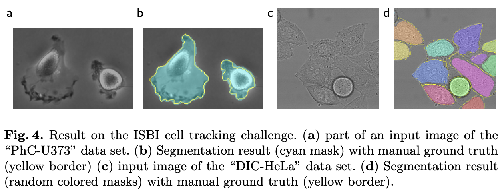

    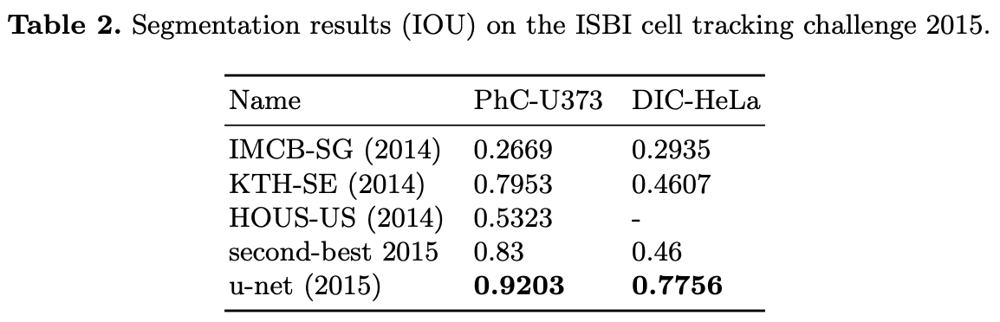

    | Dataset | Training images | U-Net | 2nd place (2015) |
    | --- | --- | --- | --- |
    | PhC-U373 (phase contrast microscopy) | 35 (partially labeled) | **92.0%** | 83% |
    | DIC-HeLa (differential interference contrast microscopy) | 20 (partially labeled) | **77.6%** | 46% |

    On DIC-HeLa in particular, where cell boundaries are blurry, it scored **more than 30 percentage points higher than 2nd place**. Figure 4 (b) overlays U-Net's prediction (cyan mask) with the human-drawn ground truth (yellow border), and even cells touching each other are well separated.

3. **Efficiency**

    - **Training**: about **10 hours** on a single NVIDIA Titan GPU (6GB)
    - **Inference**: **under 1 second** to segment one 512×512 image

    Compared with the sliding window approach of section 3.1 taking 30.1 seconds per $224 \times 224$ photo, it was a model that met all the practical conditions of medical imaging: little data, few resources, and high speed.

### 4.4. Implementing UNet

Library implementations differ from the original paper in a few ways. Going over the differences first makes the code easier to read.

|  | Original paper (2015) | Modern implementations |
| --- | --- | --- |
| conv padding | None (572 → 388) | **padding=1** (input and output the same size) |
| Normalization | None | **BatchNorm** added |
| Matching skip sizes | crop | Mostly unnecessary; `F.pad` if misaligned |
| Upsampling | 2×2 up-conv (transposed convolution) | bilinear or nearest **interpolation + conv** is common (avoids checkerboard, section 3.2.1) |
| Encoder | Trained from scratch | ImageNet **pretrained backbone** available |

1. **milesial/Pytorch-UNet: the textbook implementation that ports the paper's structure as is**

    - :github: [milesial/Pytorch-UNet — unet/unet_model.py](https://github.com/milesial/Pytorch-UNet/blob/master/unet/unet_model.py)
    - :github: [milesial/Pytorch-UNet — unet/unet_parts.py](https://github.com/milesial/Pytorch-UNet/blob/master/unet/unet_parts.py)

    | Block | What it does | Corresponds to (section 4.1) |
    | --- | --- | --- |
    | `DoubleConv` | (3×3 conv → BN → ReLU) × 2 | The two convs of each stage |
    | `Down` | MaxPool2d(2) → DoubleConv | One stage of the contracting path |
    | `Up` | Upsample → match size with `F.pad` → `torch.cat` → DoubleConv | One stage of the expansive path |
    | `OutConv` | 1×1 conv | The final per-pixel classifier |

    ```python
    class DoubleConv(nn.Module):
        """(convolution => [BN] => ReLU) * 2"""

        def __init__(self, in_channels, out_channels, mid_channels=None):
            super().__init__()
            if not mid_channels:
                mid_channels = out_channels
            self.double_conv = nn.Sequential(
                nn.Conv2d(in_channels, mid_channels, kernel_size=3, padding=1, bias=False),
                nn.BatchNorm2d(mid_channels),
                nn.ReLU(inplace=True),
                nn.Conv2d(mid_channels, out_channels, kernel_size=3, padding=1, bias=False),
                nn.BatchNorm2d(out_channels),
                nn.ReLU(inplace=True)
            )

        def forward(self, x):
            return self.double_conv(x)

    class Down(nn.Module):
        """Downscaling with maxpool then double conv"""

        def __init__(self, in_channels, out_channels):
            super().__init__()
            self.maxpool_conv = nn.Sequential(
                nn.MaxPool2d(2),
                DoubleConv(in_channels, out_channels)
            )

        def forward(self, x):
            return self.maxpool_conv(x)

    class Up(nn.Module):
        """Upscaling then double conv"""

        def __init__(self, in_channels, out_channels, bilinear=True):
            super().__init__()

            # if bilinear, use the normal convolutions to reduce the number of channels
            if bilinear:
                self.up = nn.Upsample(scale_factor=2, mode='bilinear', align_corners=True)
                self.conv = DoubleConv(in_channels, out_channels, in_channels // 2)
            else:
                self.up = nn.ConvTranspose2d(in_channels, in_channels // 2, kernel_size=2, stride=2)
                self.conv = DoubleConv(in_channels, out_channels)

        def forward(self, x1, x2):
            x1 = self.up(x1)
            # input is CHW
            diffY = x2.size()[2] - x1.size()[2]
            diffX = x2.size()[3] - x1.size()[3]

            x1 = F.pad(x1, [diffX // 2, diffX - diffX // 2,
                            diffY // 2, diffY - diffY // 2])
            # if you have padding issues, see
            # https://github.com/HaiyongJiang/U-Net-Pytorch-Unstructured-Buggy/commit/0e854509c2cea854e247a9c615f175f76fbb2e3a
            # https://github.com/xiaopeng-liao/Pytorch-UNet/commit/8ebac70e633bac59fc22bb5195e513d5832fb3bd
            x = torch.cat([x2, x1], dim=1)
            return self.conv(x)

    class OutConv(nn.Module):
        def __init__(self, in_channels, out_channels):
            super(OutConv, self).__init__()
            self.conv = nn.Conv2d(in_channels, out_channels, kernel_size=1)

        def forward(self, x):
            return self.conv(x)

    class UNet(nn.Module):
        def __init__(self, n_channels, n_classes, bilinear=False):
            super(UNet, self).__init__()
            self.n_channels = n_channels
            self.n_classes = n_classes
            self.bilinear = bilinear

            self.inc = (DoubleConv(n_channels, 64))
            self.down1 = (Down(64, 128))
            self.down2 = (Down(128, 256))
            self.down3 = (Down(256, 512))
            factor = 2 if bilinear else 1
            self.down4 = (Down(512, 1024 // factor))
            self.up1 = (Up(1024, 512 // factor, bilinear))
            self.up2 = (Up(512, 256 // factor, bilinear))
            self.up3 = (Up(256, 128 // factor, bilinear))
            self.up4 = (Up(128, 64, bilinear))
            self.outc = (OutConv(64, n_classes))

        def forward(self, x):
            x1 = self.inc(x)
            x2 = self.down1(x1)
            x3 = self.down2(x2)
            x4 = self.down3(x3)
            x5 = self.down4(x4)
            x = self.up1(x5, x4)
            x = self.up2(x, x3)
            x = self.up3(x, x2)
            x = self.up4(x, x1)
            logits = self.outc(x)
            return logits
    ```

2. **segmentation_models.pytorch (smp): the de facto standard in practice. Swaps the encoder for a pretrained backbone**

    - :github: [qubvel-org/segmentation_models.pytorch](https://github.com/qubvel-org/segmentation_models.pytorch)

    ```python
    import segmentation_models_pytorch as smp

    model = smp.Unet(
        encoder_name="resnet34",        # choose encoder, e.g. mobilenet_v2 or efficientnet-b7
        encoder_weights="imagenet",     # use `imagenet` pre-trained weights for encoder initialization
        in_channels=1,                  # model input channels (1 for gray-scale images, 3 for RGB, etc.)
        classes=3,                      # model output channels (number of classes in your dataset)
    )
    ```

    ```python
    class Unet(SegmentationModel):
    		@supports_config_loading
        def __init__(
            self,
            encoder_name: str = "resnet34",
            encoder_depth: int = 5,
            encoder_weights: Optional[str] = "imagenet",
            decoder_use_norm: Union[bool, str, Dict[str, Any]] = "batchnorm",
            decoder_channels: Sequence[int] = (256, 128, 64, 32, 16),
            decoder_attention_type: Optional[str] = None,
            decoder_interpolation: str = "nearest",
            in_channels: int = 3,
            classes: int = 1,
            activation: Optional[Union[str, Callable]] = None,
            aux_params: Optional[dict] = None,
            **kwargs: dict[str, Any],
        ):
            super().__init__()

            decoder_use_batchnorm = kwargs.pop("decoder_use_batchnorm", None)
            if decoder_use_batchnorm is not None:
                warnings.warn(
                    "The usage of decoder_use_batchnorm is deprecated. Please modify your code for decoder_use_norm",
                    DeprecationWarning,
                    stacklevel=2,
                )
                decoder_use_norm = decoder_use_batchnorm

            self.encoder = get_encoder(
                encoder_name,
                in_channels=in_channels,
                depth=encoder_depth,
                weights=encoder_weights,
                **kwargs,
            )

            add_center_block = encoder_name.startswith("vgg")

            self.decoder = UnetDecoder(
                encoder_channels=self.encoder.out_channels,
                decoder_channels=decoder_channels,
                n_blocks=encoder_depth,
                use_norm=decoder_use_norm,
                add_center_block=add_center_block,
                attention_type=decoder_attention_type,
                interpolation_mode=decoder_interpolation,
            )

            self.segmentation_head = SegmentationHead(
                in_channels=decoder_channels[-1],
                out_channels=classes,
                activation=activation,
                kernel_size=3,
            )

            if aux_params is not None:
                self.classification_head = ClassificationHead(
                    in_channels=self.encoder.out_channels[-1], **aux_params
                )
            else:
                self.classification_head = None

            self.name = "u-{}".format(encoder_name)
            self.initialize()
    ```

    ```python
    class UnetDecoderBlock(nn.Module):
        """A decoder block in the U-Net architecture that performs upsampling and feature fusion."""

        def __init__(
            self,
            in_channels: int,
            skip_channels: int,
            out_channels: int,
            use_norm: Union[bool, str, Dict[str, Any]] = "batchnorm",
            attention_type: Optional[str] = None,
            interpolation_mode: str = "nearest",
        ):
            super().__init__()
            self.interpolation_mode = interpolation_mode
            self.conv1 = md.Conv2dReLU(
                in_channels + skip_channels,
                out_channels,
                kernel_size=3,
                padding=1,
                use_norm=use_norm,
            )
            self.attention1 = md.Attention(
                attention_type, in_channels=in_channels + skip_channels
            )
            self.conv2 = md.Conv2dReLU(
                out_channels,
                out_channels,
                kernel_size=3,
                padding=1,
                use_norm=use_norm,
            )
            self.attention2 = md.Attention(attention_type, in_channels=out_channels)

        def forward(
            self,
            feature_map: torch.Tensor,
            target_height: int,
            target_width: int,
            skip_connection: Optional[torch.Tensor] = None,
        ) -> torch.Tensor:
            feature_map = F.interpolate(
                feature_map,
                size=(target_height, target_width),
                mode=self.interpolation_mode,
            )
            if skip_connection is not None:
                feature_map = torch.cat([feature_map, skip_connection], dim=1)
                feature_map = self.attention1(feature_map)
            feature_map = self.conv1(feature_map)
            feature_map = self.conv2(feature_map)
            feature_map = self.attention2(feature_map)
            return feature_map

    class UnetCenterBlock(nn.Sequential):
        """Center block of the Unet decoder. Applied to the last feature map of the encoder."""

        def __init__(
            self,
            in_channels: int,
            out_channels: int,
            use_norm: Union[bool, str, Dict[str, Any]] = "batchnorm",
        ):
            conv1 = md.Conv2dReLU(
                in_channels,
                out_channels,
                kernel_size=3,
                padding=1,
                use_norm=use_norm,
            )
            conv2 = md.Conv2dReLU(
                out_channels,
                out_channels,
                kernel_size=3,
                padding=1,
                use_norm=use_norm,
            )
            super().__init__(conv1, conv2)

    class UnetDecoder(nn.Module):
        """The decoder part of the U-Net architecture.

        Takes encoded features from different stages of the encoder and progressively upsamples them while
        combining with skip connections. This helps preserve fine-grained details in the final segmentation.
        """

        def __init__(
            self,
            encoder_channels: Sequence[int],
            decoder_channels: Sequence[int],
            n_blocks: int = 5,
            use_norm: Union[bool, str, Dict[str, Any]] = "batchnorm",
            attention_type: Optional[str] = None,
            add_center_block: bool = False,
            interpolation_mode: str = "nearest",
        ):
            super().__init__()

            if n_blocks != len(decoder_channels):
                raise ValueError(
                    "Model depth is {}, but you provide `decoder_channels` for {} blocks.".format(
                        n_blocks, len(decoder_channels)
                    )
                )

            # remove first skip with same spatial resolution
            encoder_channels = encoder_channels[1:]
            # reverse channels to start from head of encoder
            encoder_channels = encoder_channels[::-1]

            # computing blocks input and output channels
            head_channels = encoder_channels[0]
            in_channels = [head_channels] + list(decoder_channels[:-1])
            skip_channels = list(encoder_channels[1:]) + [0]
            out_channels = decoder_channels

            if add_center_block:
                self.center = UnetCenterBlock(
                    head_channels,
                    head_channels,
                    use_norm=use_norm,
                )
            else:
                self.center = nn.Identity()

            # combine decoder keyword arguments
            self.blocks = nn.ModuleList()
            for block_in_channels, block_skip_channels, block_out_channels in zip(
                in_channels, skip_channels, out_channels
            ):
                block = UnetDecoderBlock(
                    block_in_channels,
                    block_skip_channels,
                    block_out_channels,
                    use_norm=use_norm,
                    attention_type=attention_type,
                    interpolation_mode=interpolation_mode,
                )
                self.blocks.append(block)

        def forward(self, features: List[torch.Tensor]) -> torch.Tensor:
            # spatial shapes of features: [hw, hw/2, hw/4, hw/8, ...]
            spatial_shapes = [feature.shape[2:] for feature in features]
            spatial_shapes = spatial_shapes[::-1]

            features = features[1:]  # remove first skip with same spatial resolution
            features = features[::-1]  # reverse channels to start from head of encoder

            head = features[0]
            skip_connections = features[1:]

            x = self.center(head)

            for i, decoder_block in enumerate(self.blocks):
                # upsample to the next spatial shape
                height, width = spatial_shapes[i + 1]
                skip_connection = skip_connections[i] if i < len(skip_connections) else None
                x = decoder_block(x, height, width, skip_connection=skip_connection)

            return x
    ```

---

## 📚 References

- [U-Net clearly explained | Image Segmentation with AI](https://www.youtube.com/watch?v=oxcgx75k6yU)
- [Object detection task guide  |  Google AI Edge  |  Google for Developers](https://developers.google.com/edge/mediapipe/solutions/vision/object_detector)
- [Introduction to Convolution Neural Network - GeeksforGeeks](https://www.geeksforgeeks.org/machine-learning/introduction-convolution-neural-network/)
- [U-Net Explained: The CNN That Revolutionized Image Segmentation](https://medium.com/@shreeyacofficial/u-net-explained-the-cnn-that-revolutionized-image-segmentation-0007f2c89063)
- [arxiv.org](https://arxiv.org/pdf/1411.4038): FCN
- [Fully Convolutional Networks | TJHSST Machine Learning Club](https://tjmachinelearning.com/lectures/1718/fcn/)
- [arxiv.org](https://arxiv.org/pdf/1505.04597): UNet
- [Fully Convolutional Networks for Semantic Segmentation](https://gaussian37.github.io/vision-segmentation-fcn/)
- [milesial/Pytorch-UNet](https://github.com/milesial/Pytorch-UNet)
- [qubvel-org/segmentation_models.pytorch](https://github.com/qubvel-org/segmentation_models.pytorch)
- [Deep Learning for Image Segmentation: U-Net Architecture](https://www.comet.com/site/blog/deep-learning-for-image-segmentation-u-net-architecture/)
