## 0. 들어가며

객체 인식(Object Detection)에서는 사진 안에서 내가 관심있는 객체가 있는 위치(bounding box)와 그 객체가 무엇인지(Class) 맞추는 작업을 진행했습니다. 


그런데 박스로는 부족한 순간이 분명히 있습니다. 고양이가 박스 안에 있긴 한데, 그 박스 안에는 정확히 고양이만 있는 게 아니죠. 고양이 말고도 배경과 강아지의 일부도 섞여있습니다. “고양이에 해당하는 부분이 정확히 어디까지인가” 를 물으면, 네모난 박스 만으로는 답할 수 없다는 게 한계입니다. 

Image Segmentation이 바로 이 문제를 해결하기 위한 기술입니다. 픽셀 하나하나를 따져서 물체의 윤곽을 그대로 따내는 거죠.


박스는 물체를 직사각형으로 감싸기 때문에, 비스듬히 누운 고양이나 구불구불한 도로처럼 네모나지 않은 물체에서는 박스 안에 배경이 많이 들어옵니다. 반면 Segmentation 은 물체에 해당하는 픽셀만 정확히 짚어내기 때문에 그런 불필요한 정보들을 포함하지 않을 수 있습니다.

<u>**의료 영상에서 종양의 정확한 경계**</u>를 따거나, <u>**자율주행 차가 도로와 인도를 구분**</u>하거나, <u>**사진에서 배경만 깔끔하게 지우는 일**</u> 등, 픽셀 단위로 영역을 나누면 할 수 있는 일이 훨씬 많아집니다.

## 1. Image Segmentation의 세 종류


- **Semantic segmentation**: 픽셀의 클래스만 구분합니다. 사람 두 명은 둘 다 그냥 "사람"입니다. 

    개체를 굳이 구분할 필요 없이 장면 전체의 구성이 중요한 곳에서 주로 쓰입니다. <u>**위성 영상**</u>에서 농지, 도시, 숲이 각각 얼마나 차지하는지 분석하거나, 의료 영상에서 <u>**종양 영역을 통째로 찾아내는 문제**</u>가 여기에 해당합니다.

- **Instance segmentation**: 같은 클래스 안에서도 개체를 구분합니다(사람1, 사람2). 

    개체 하나하나를 세거나 추적해야 하는 곳에서 쓰입니다. <u>**매장에 사람이 몇 명**</u> 들어왔는지 세거나, 영상에서 <u>**특정 차량을 프레임마다 따라가거나**</u>, 세포 이미지에서 <u>**세포 개수를 세는 문제**</u>가 여기에 해당합니다.

- **Panoptic segmentation**: 위 두 가지를 합친 것입니다. 셀 수 있는 것(사람, 차처럼 개체로 구분되는 것)은 Instance 방식으로 따로따로, 셀 수 없는 것(하늘, 도로처럼 배경에 가까운 것)은 Semantic 방식으로 한 덩어리로 처리합니다. 장면 전체를 빠짐없이 이해하려는 방식이라고 보면 됩니다.

    개체 구분과 배경 이해가 둘 다 필요한 곳에서 쓰이고, 대표적인 게 <u>**자율주행**</u>입니다. 차는 앞차와 옆차를 개별로 구분해 추적해야 하고(Instance), 동시에 도로와 인도, 하늘은 영역으로 파악해야 하기 때문입니다(Semantic).

## 2. Segmentation의 요구 조건

Segmentation을 하기 위해서는 <u>**픽셀마다 클래스**</u>를 예측해야 합니다. Classification 과제에서 사용했던 CNN처럼 사진 한 장을 통째로 넣어서 결과 하나를 뽑아내서는 원하는 결과를 얻을 수 없는 겁니다. 


> 📌 **분류 CNN이 하는 일**
>
> 이미지를 분류하는 CNN 이 어떻게 생겼는지 떠올려볼게요. 입력 이미지가 들어오면, 합성곱과 풀링을 거치며 특징 맵의 크기가 점점 줄어들죠. 224×224 였던 이미지가 112×112, 56×56 으로 작아지는 대신, “이 이미지에 어떤 특징이 있는지” 가 필터에 차곡차곡 쌓입니다. 그리고 마지막에 Fully Connected Layer를 거쳐 “고양이 90%, 강아지 10%” 같은 라벨 하나를 내놓게 되죠.
>
> 이 구조의 핵심은 고양이가 사진의 어디에 있는 지(Localization)에 대한 정보를 점점 버리고, 대신 “무엇인지” 만 남긴다는 겁니다. 오히려 <u>**고양이가 사진 어디에 위치하든 상관없이 이 사진이 고양이 사진인 지 아닌 지를 알아보는 게 분류**</u>에는 유리하죠.

Segmentation은 픽셀마다 클래스 예측을 해야 하니까, <u>**“이 위치에 무엇이 있는지” 라는 공간 정보**</u>가 끝까지 살아 있어야 합니다. 게다가 출력도 라벨 하나가 아니라 <u>**입력과 같은 크기의 출력**</u>이어야 합니다. 224×224 이미지를 넣으면, 224×224 짜리 “픽셀별 클래스 예측 맵”이 나와야 하죠.

> 📌 **총정리**
>
> - 일반적인 Classification CNN으로는 Image Segmentation 과제를 수행하지 못한다. 
> - **해결책 1:** <u>**Sliding-Window CNN: 픽셀별로 분류 CNN**</u>
>     - **특징**: 패치(윈도우)별로 conv+FC 분류를 수행한다. 
>     - **문제점**: Convolution 연산이 너무 많이 중복된다.
> - **해결책 2:** <u>**FCN(Fully Convolutional Network)**</u>
>     - **특징 1**: 입력 이미지 전체에 대한 conv + 1x1 conv로 중복되는 연산을 제거한다.
>     - **특징 2**: Up-Sampling으로 입력과 같은 크기의 출력을 생성한다. 
>     - **특징 3**: Skip-Connection으로 얕은 피처맵의 경계정보와 깊은 피처맵의 의미정보를 융합한다. 
>     - **단점 1**: Up-Sampling 횟수가 너무 적어서, 즉 크기를 한 번에 많이 키워서 경계정보가 무너진다.
>     - **단점 2**: Skip-Connection이 더하기(Summation)으로 진행돼서 서로 다른 성격의 정보(추상적 의미 정보와 세부 공간 정보)가 한데 섞이면서 고유의 특징이 희석되거나 왜곡된다. 
> - **해결책 3:** <u>**U-Net**</u>
>     - **특징 1**: Contracting path와 Expansive path의 층 수가 같다.
>     - **특징 2**: Skip-Connection이 이어붙이기(Concat)으로 구현된다.
>     - **특징 3**: Overlap-tile Strategy & Mirroring Extrapolate 로 경계 정보를 보존한다. 
>     - **특징 4**: elastic deformation과 weighted loss를 사용해서 적은 데이터에서도 강한 성능을 보인다. 

## 3. 해결책

### 3.1. Sliding-window CNN

이 알고리즘은 초기 딥러닝 기반 Image Segmentation 및 Object Detection 분야의 초석인 알고리즘입니다.


**1. 주요 작동 원리**

- **패치 기반 추출 (Patch-based extraction):** 입력 이미지 전체를 한 번에 처리하는 것이 아니라, <u>**고정된 크기의 작은 사각형 패치**</u>를 설정합니다.
- **픽셀 단위 분류 (Pixel-wise classification):** 윈도우가 이미지의 top-left부터 bottom-right까지 <u>**한 픽셀씩 이동(Sliding)**</u>하면서, 해당 윈도우 정중앙에 위치한 픽셀의 라벨을 예측합니다. 
- **독립적 분석:** 잘려 나간 개별 패치들은 각각 독립적으로 CNN 모델을 통과한 뒤, <u>**Fully Connected Layer**</u>를 거쳐 각 픽셀의 분류 결과를 도출합니다. 즉, 패치의 위치가 곧 위치정보가 되어 해당 위치의 픽셀 클래스를 예측하는 겁니다.

이 방식은 당대 최고 수준의 정확도를 보여주었으나, <u>**치명적인 구조적 한계**</u>를 가졌습니다.

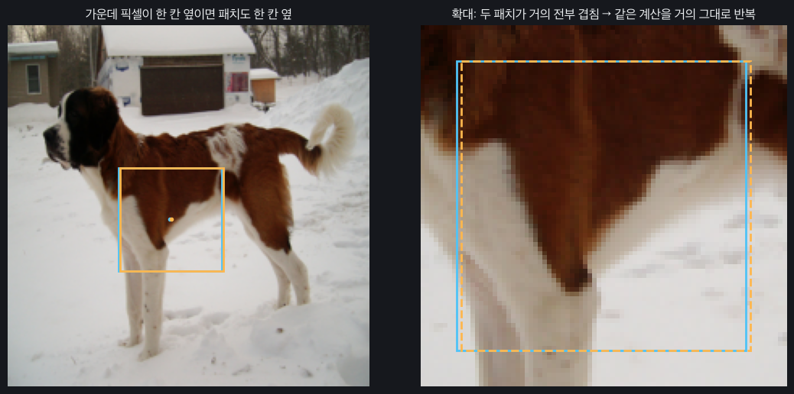

- 위 사진 한 장은 224x224로, 픽셀 50,176개로 이루어져있습니다. 즉, 이 사진 하나에 Segmentation을 하기 위해서는 <u>**50,176번의 CNN 추론**</u>이 필요한 거죠. 
- 그리고 패치 하나(64x64) 추론하는 데에 0.60ms가 걸린다 치면, <u>**사진 한 장 Segmentation 하는 데에 30.1초**</u>가 걸리는 겁니다. 심지어 의료영상은 사진 하나에 해상도가 상당히 높은 편인데, 100 TiB 단위의 의료 영상, 이런 경우에는 심하면 몇 년이 걸리기도 하는 거죠. 
- 그리고 이 경우 <u>**하늘색 패치와 노란색 패치가 겹치는 비율은 98.4%**</u>로, 매번 최대 98.4%의 연산을 반복해야 한다는 비효율이 있습니다. 

#### 3.1.1. 패치가 겹치는 게 왜 비효율적일까요?

간단하게 5x5 원본 이미지가 있고, 4x4 패치 하나로 Sliding Window CNN을 수행한다고 해봅시다. 

1. **CNN**

    **4×4 패치 하나를 받아, 그 패치 중앙의 클래스(고양이 / 배경) 점수 2개를 내는** 작은 분류 CNN입니다.

    | 층 | 하는 일 | 패치 하나 기준 크기 |
    | --- | --- | --- |
    | conv | 3×3 커널, 필터 2개 | 4×4×1 → **2×2×2** |
    | FC1 | 8개 값 → 3개 값 | 2×2×2 = 8 → **3** |
    | FC2 | 3개 값 → 클래스 점수 2개 | 3 → **2** |

    

2. **패치마다 CNN 분류 작업 수행**

    5×5 이미지에서 4×4 패치를 한 칸씩 밀면 패치가 4개 나옵니다. 

    | 패치 | 원본에서 잘라낸 영역 |
    | --- | --- |
    | A | 0\~3행, 0\~3열 |
    | B | 0\~3행, 1\~4열 |
    | C | 1\~4행, 0\~3열 |
    | D | 1\~4행, 1\~4열 |

    이 네 개의 패치마다 CNN 전체를 따로 실행합니다.

    - 패치 A → conv → [2×2×2] → FC1 → [1x3] → FC2 → [1x2]
    - 패치 B → (같은 과정 반복)
    - 패치 C → (같은 과정 반복)
    - 패치 D → (같은 과정 반복)

3. **중복 연산 발생**

    패치 A와 B의 conv 계산을 **원본 이미지 좌표**로 풀어 쓰면 아래와 같은 현상을 발견할 수 있습니다.

    - 패치 A의 conv 출력 (0,1) 칸(파란색) = 원본 이미지 **0\~2행, 1\~3열**에 커널을 얹은 값
    - 패치 B의 conv 출력 (0,0) 칸(파란색) = 원본 이미지 **0\~2행, 1\~3열**에 커널을 얹은 값

    두 칸의 계산값이 <u>**완전히 중복됩니다.**</u> 그리고 패치A의 conv 출력 (0,0)칸과 패치 B의 conv 출력 (0,0)칸은 <u>**2/3가 겹칩니다**</u>. 원본 이미지 9개 픽셀에 똑같은 커널을 곱한 값인데, 패치별로 CNN을 통과시킨다는 이유 하나만으로 두 번 계산되는 거죠. 원본 이미지의 각 픽셀을 기준으로 세면, 두 번뿐만 아니라 수십번 다시 계산되는 픽셀이 존재하는 겁니다. 

    

    | conv 층 계산량 | Sliding window | 실제로 서로 다른 값 |
    | --- | --- | --- |
    | conv 출력값 개수 | 패치당 8개 × 4패치 = **32개** | 원본 위치 3×3 × 필터 2 = **18개** |
    | 곱셈 횟수 (출력값 하나당 9번) | 288번 | 162번 |

    이 예제는 작아서 차이가 2배도 안 됩니다. 하지만 64×64 패치를 1픽셀씩 밀면 이웃 패치와 **98.4%가 겹치고**, 깊은 네트워크에서는 이 중복이 층마다 반복돼서 결국 대부분의 계산이 수천 수만 번씩 반복되는 셈입니다.

### 3.2. FCN: Fully Convolutional Network

Sliding-Window CNN의 접근은 아주 그럴듯했어요. 위치정보를 지키는 동시에 한 픽셀의 클래스를 분류하기 위해서 <u>**패치 내 픽셀의 정보를 활용**</u>해서 <u>**예측의 크기(size, HxW)가 입력의 크기와 같은 픽셀별 클래스 분류**</u>를 최종 결과로 낸다는 겁니다. 하지만 이 목표를 달성하기 위해서 비효율적인 <u>**패치 단위 CNN + Fully Connected**</u> 분류가 필요했던 것이었죠.

> 📌 **NOTE: Fully Connected를 쓴다고 무조건 위치정보가 소실되는 건 아닙니다.**
>
> Sliding window CNN의 진짜 문제는 **위치 정보 소실이 아닙니다.** 위치는 "패치(윈도우)를 어디에 놓았는가"로 보존됩니다. 즉, 패치의 위치 자체가 위치정보입니다. 물론 각 패치 안에서의 위치정보는 Fully Connected로 인해서 소실되겠지만, 전체 이미지 관점에서 보면 소실되지 않는다는 겁니다. 

FCN은 <u>**위치 정보 보존**</u>과 <u>**픽셀단위 예측**</u>이라는 목적을 보존하면서 <u>**연산의 효율성**</u>을 올리기 위해 두 접근법을 제시합니다. 

1. **패치 단위로 conv를 하지 말자.**
2. **Fully Connected Layer를 Convolution 연산으로 대치하자.**


이제부터 어떻게 FCN이 비효율을 극복했는 지 차근차근 살펴보겠습니다. 

1. **전제조건**

    - **5x5 이미지에 픽셀값이 (0,0)부터 (4,4)까지 1\~25 사이의 값**으로 채워져있다고 해보겠습니다.
    - 커널은 3x3고, 모두 1인 커널로 가정하겠습니다. 그러면 convolution 연산 결과 하나는 **3x3 창 안의 숫자 9개를 모두 더한 값**이 됩니다. 
    - 원본 이미지의 3x3 창을 왼쪽 위 모서리 좌표로 부르겠습니다. 예를 들어, **창 (0,1)은 원본 0\~2 row, 1\~3 col을 덮는 창**입니다. 

     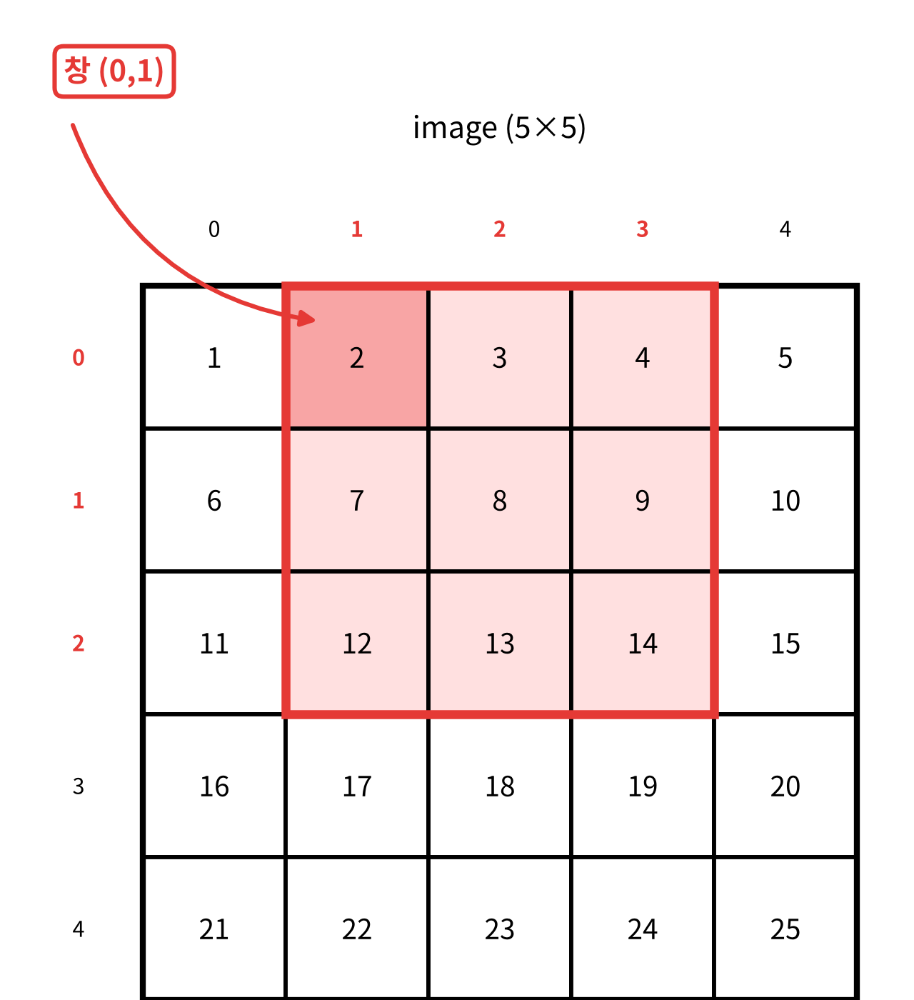 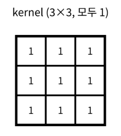

2. **각 패치가 계산하는 창을 원본 좌표로 옮겨보기**

    4×4 패치 안에서 3×3 conv를 돌리면 2×2 피처맵, 즉 4개의 값이 나옵니다. 

    **패치 A** (원본 0\~3행, 0\~3열, 시작점 (0,0))

    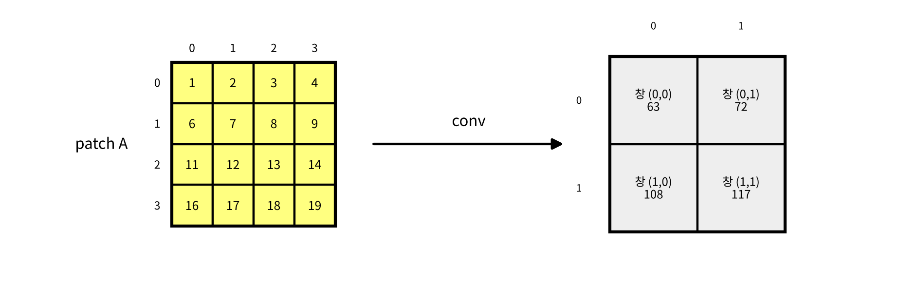

    **패치 B** (원본 0\~3행, 1\~4열, 시작점 (0,1))

    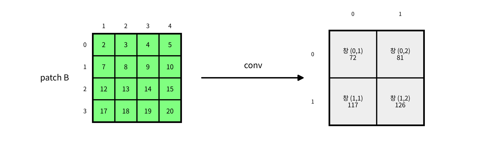

    **패치 C** (원본 1\~4행, 0\~3열, 시작점 (1,0))

    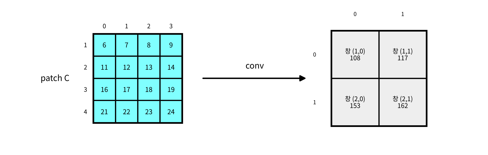

    **패치 D** (원본 1\~4행, 1\~4열, 시작점 (1,1))

    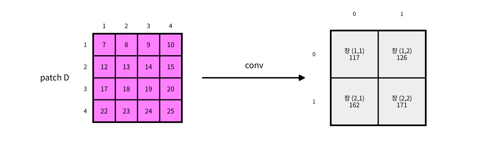

3. **네 개의 패치가 계산한 창들의 중복 세어보기**

    | 창 | 값 | 계산한 패치 | 계산 횟수 |
    | --- | --- | --- | --- |
    | (0,0) | 63 | A | 1 |
    | (0,1) | 72 | A, B | 2 |
    | (0,2) | 81 | B | 1 |
    | (1,0) | 108 | A, C | 2 |
    | **(1,1)** | **117** | **A, B, C, D** | **4** |
    | (1,2) | 126 | B, D | 2 |
    | (2,0) | 153 | C | 1 |
    | (2,1) | 162 | C, D | 2 |
    | (2,2) | 171 | D | 1 |
    |  |  | 합계 | **16번** |

    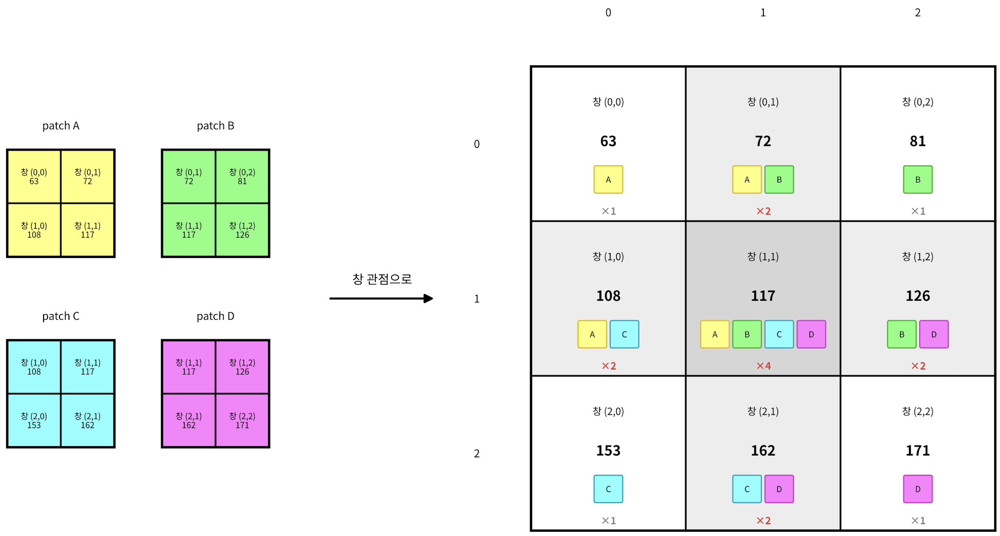

    네 패치에서 총 convolution 연산을 16번 계산했지만 <u>**서로 다른 연산은 9번뿐**</u>이었고, 7번이 중복되었습니다. 특히 창(1,1)에 대한 convolution은 네 번이나 중복되네요.

4. **중복 없애기**

    중복을 없애려면 **서로 다른 창 9개를 각각 한 번씩만** 계산하면 됩니다. 9개 창을 계산한 결과를 얻으려면 어떻게 하면 될까요?

    <u>**원본 5x5 이미지에 3x3 conv(stride=1, pad=0) 한 번**</u> 하면 9개의 창을 한 번씩 계산한 결과를 한 번에 얻을 수 있겠네요?

    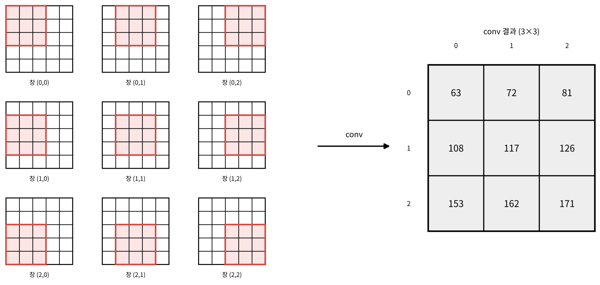

    conv결과를 자세히 보니, 여기에 패치 A\~D의 conv 결과가 모두 들어 있는 걸 볼 수 있네요. 

    - 패치 A의 conv 결과 = 왼쪽 위 2×2 부분
    - 패치 B의 conv 결과 = 오른쪽 위 2×2 부분
    - 패치 C, D도 마찬가지.

    이제 문제는 FC 층입니다. FC1은 <u>**1x8 입력**</u>을 받는 층이라 3×3×2 맵을 바로 받을 수 없습니다. 패치별로 2×2×2씩 잘라서 각각 넣어야 할까요?

5. **Fully Connected를 Convolution으로!**

    여기서 FCN(Fully Convolution Network)의 이름의 유래가 나옵니다. 

    3.1.1.절을 기억해보세요. 각각의 패치의 피처맵(2x2x2)을 1x8로 flatten한 다음, FC1에 통과시켜서 1x3 행렬로 만들었죠. 이를 위해 FC1에는 8x3 가중치 행렬이 존재했죠. 즉, 기존 Sliding Window 방식에서는 각 패치의 피처맵 4개에 대해서 각각 FC를 통과시켜야 했습니다. 

    

    하지만 FCN에서는 그 8x3 가중치 행렬을 2x2x2 커널 3쌍으로 바꿔서 사용합니다. 

    즉, <u>**FCN에서는 원본 이미지 전체에 대해 (3x3 conv) x 2쌍 → 3x3x2 피처맵 → (2x2 conv) x 3쌍**</u>을 하면 결과적으로 <u>**2x2x3 피처맵**</u>이 나오는 겁니다. 

    Sliding Window CNN에서 패치 4개에 대해서 각각 CNN + FC를 통과시켜야 했던 걸, FCN에서는 원본 이미지 하나에 conv 두 번으로 끝내버릴 수 있게 된 거죠. 

6. **마지막 분류 FC: 1x1 convolution**

    3.1.1.절에서, FC2는 3개짜리 벡터[g1, g2, g3]를 입력으로 받고, 그 패치가 고양이일 점수와 배경일 점수 벡터를 뱉어냈죠. 이건 패치 하나당 각각 이루어졌습니다. 

    $$
    \text{패치A의 고양이점수} = u1·g1ᴬ + u2·g2ᴬ + u3·g3ᴬ
    $$

    $$
    \text{패치B의 고양이점수} = u1·g1ᴮ + u2·g2ᴮ + u3·g3ᴮ
    $$

    ![위: 패치마다 [g1, g2, g3]를 FC2(3×2)에 넣어 고양이·배경 점수를 낸다. 아래: FC2 가중치를 1×1 커널 2개로 바꿔 2×2×3 맵에 conv하면 2×2×2 점수 지도가 나온다](./image/fc2-to-1x1-conv.ko.png)

    하지만 FCN에서는 <u>**1x1 필터**</u>를 사용해서 똑같은 연산을 수행합니다. 위치마다 "이 위치의 특징 벡터를 보고 클래스를 판정하는" 픽셀별 분류기 역할을 하는 거죠.

7. **결과 비교**

    |  | Sliding window | FCN |
    | --- | --- | --- |
    | 입력 | 4×4 패치 4개를 따로 | 5×5 이미지 한 장 |
    | conv | 패치마다 (값 32개, 중복 포함) | 전체에 한 번 (값 18개) |
    | FC1 | 패치마다 8→3 | 2×2 conv, 2채널→3채널 |
    | FC2 | 패치마다 3→2 | **1×1 conv**, 3채널→2채널 |
    | 출력 | 점수 쌍 4개 | 2×2×2 점수 지도 |

    FCN에서는 conv 층의 중복만 사라지고 FC 층 계산량은 그대로라는 점도 눈여겨볼 만합니다. 중복은 원래 아래쪽 conv 층에 몰려 있었기 때문입니다. 또한 네트워크에 FC가 없으니 **입력 크기 제약도 사라집니다.** 

지금까지 살펴본 건, <u>**위치별 분류 결과를 계산하는 방법**</u>일 뿐입니다. 

전체 이미지에 대한 합성곱과 Fully Connected Layer를 Fully Convolution Layer로 바꿈으로써 <u>**비효율적으로 반복되던 계산을 없애**</u>고, 출력을 <u>**heat map과 같이 공간정보를 담은 형식**</u>으로 뱉어낼 수 있었죠. 


<u>**이렇게 얻은 결과는 입력보다 작은 크기의 Coarse Score Map**</u>일 뿐입니다. 앞선 간단한 예시에서 본 대로, 5x5 이미지를 입력으로 받아서 2x2x2 맵의 형태로 각 클래스별 점수를 얻은 것입니다. 아직 출력이 입력과 동일한 크기가 아닙니다. 

실제 VGG16을 백본으로 하는 FCN은 5번의 풀링으로 <u>**출력이 입력의 1/32**</u>가 됩니다. 


그래서 실제 FCN의 6단계 출력은 **(H/32) × (W/32) × 클래스 수** 크기의 거친 점수 지도(<u>Coarse Score Map)</u>입니다. 500×500 이미지라면 대략 16×16 Score Map이 나오는 거고, 한 칸이 원본의 32×32 영역을 나타냅니다(Receptive Field). 이 상태로는 고양이 귀 끝이 어느 픽셀에서 끝나는지 알 수 없는 거죠. 

### 3.2.1. UpSampling

그래서 업샘플링이 필요합니다. 목표는 <u>**(H/32)×(W/32)×C 인코더 출력을 원본 이미지 크기인 H×W×C로 키우는 것**</u>입니다. 방법은 크게 두가지입니다. 

1. **보간(Interpolation): 학습되지 않는 방식**

    - **nearest**: 새로 만들 위치에서 가장 가까운 1개의 기존 픽셀 값을 그대로 가져와 채우는 방식입니다. 

        

    - **bilinear**: 출력 칸마다 주변 입력 네 칸을 거리에 비례한 가중치로 섞습니다.

        

2. **전치 합성곱(transposed convolution, “deconvolution”): 학습되는 방식**

    2015년 FCN은 <u>**업샘플링도 학습하자**</u>는 생각으로 전치 합성곱을 사용했습니다. 네트워크가 "작은 지도를 어떻게 키워야 정답 마스크에 가까워지는지"를 신경망이 배울 수 있는 거죠.

    

    - FCN 논문은 이 deconvolution 층을 **bilinear 보간과 같은 값으로 초기화**하고 학습시켰습니다. "최소한 bilinear만큼은 하고, 거기서 더 나아질 여지를 준다"는 설계입니다. 다만 FCN 논문에서도 중간의 ×2 업샘플링만 학습시켰고, 마지막 업샘플링은 bilinear로 고정했습니다.

    > 📌 **전치합성곱의 단점: 체커보드 무늬**
    >
    > 전치 합성곱은 커널 크기가 stride로 나누어 떨어지지 않으면 체커보드 무늬가 생기는 현상이 있습니다. 요즘 구현은 bilinear 보간과 conv를 같이 써줌으로써 체커보드 현상을 막으면서 학습의 여지도 남겨주는 방식으로 구현하고 있습니다.

### 3.2.2. Skip-Connection

1/32 크기의 Score map을 한 번에 32배로 키우면 어떻게 될까요? 아래 사진의 가장 오른쪽을 봐주세요. GT인 초록색 테두리에 비해 예측인 하늘색 테두리가 형편없다는 걸 알 수 있습니다. <u>**풀링에서 이미 버려진 세밀한 위치 정보는 업샘플링으로는 되살릴 수 없는 거죠**</u>. 반면에 풀링이 덜 된 얕은 층에서 업샘플링 할 수록 GT 경계선과 예측 경계선이 비슷해지는 것을 볼 수 있습니다. 

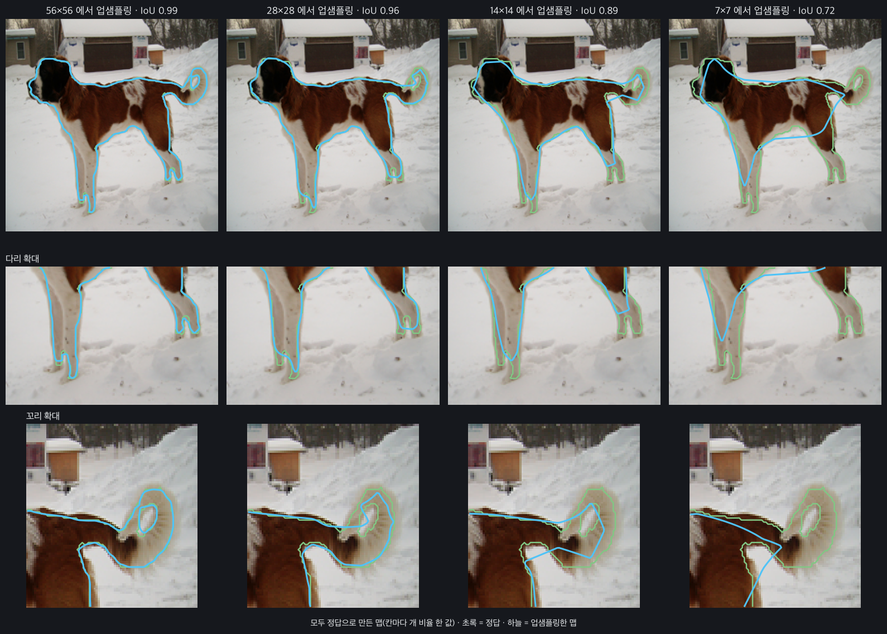

그래서 <u>**Pooling이 덜 된, 즉 덜 압축된, 얕은 conv 층의 정보를 빌려오는 아이디어(Skip-Connection)**</u>를 채용했습니다.

| 층 | 해상도 | 강점 |
| --- | --- | --- |
| 깊은 층 (pool5 이후) | 1/32 | **무엇인지** 잘 앎 (의미) |
| 중간 층 (pool4) | 1/16 | 중간 |
| 얕은 층 (pool3) | 1/8 | **어디인지** 잘 앎 (위치, 경계) |

 CNN을 배울 때, convolution 연산으로 크기는 압축하고 채널 수는 키우면서 이미지 전체의 여러 특징을 압축해서 획득할 수 있다고 배웠습니다. 깊으면 깊을 수록 사진이 무엇을 의미하는 지 알아냄과 동시에 위치 및 경계정보는 소실되는 거죠. 그러면 <u>**얕은 층에서 보존되고 있는 위치 및 경계정보와 깊은 층에서 얻은 의미 정보를 동시**</u>에 쓸 수 있다면 어떨까요? 이를 위해 FCN에서는 얕은 층의 위치 정보와 깊은 층의 의미 정보를 합쳐서(Summation $\Sigma$) 활용합니다. 


1. 1/32 점수 지도를 2배 업샘플링해 1/16 크기로 맞춥니다.
2. pool4 feature(512채널)에 **1×1 conv**를 적용해 클래스 수만큼의 채널(PASCAL은 21)로 바꿉니다.
3. 둘을 **원소별로 더합니다(sum)**. 크기와 채널 수가 같아졌기 때문에 더할 수 있습니다.
4. 같은 과정을 pool3(1/8)까지 한 번 더 반복한 뒤, 마지막에 8배 업샘플링합니다.


Skip-Connection을 적용한 모델(FCN-8s)이 그렇지 않은 모델(FCN-32s)보다 훨씬 GT와 가까운 것을 확인할 수 있습니다. 


성능도 FCN-8s가 다른 것들보다 훨씬 좋네요. 

### 3.2.3. FCN-8s의 한계

FCN-8s는 기존 Segmentation 모델의 한계를 극복한 모델이었습니다. 하지만 이에도 몇가지 단점이 있었습니다. 

- **업샘플링 과정에서의 정보 손실:** Pooling 과정을 거치며 작아진 고차원 특징 맵을 단순 Bilinear Interpolation이나 Transposed Convolution을 사용해 키웁니다. 이 급격한 디코딩 과정에서 미세한 공간 정보가 누락될 수 있습니다. 
- **경계선이 흐려지는 현상(Blurry)**: 인코더의 얕은(Shallow) 레이어 정보를 일부 더해주는 Skip Architecture를 도입하긴 했으나, 정보의 결합이 단순 덧셈(Addition)으로 이루어지고 크기를 원본으로 복원하는 단계가 듬성듬성(Pooling은 5번하지만 Skip-Connection은 2번)해서 정밀한 픽셀 단위의 객체 경계를 복원하지 못하고 경계가 뭉개지는 현상이 있었습니다.

## 4. UNet의 등장

UNet은 FCN 이 나온 같은 해(2015년)에 등장한, FCN 의 발전형 모델입니다. 이 모델은 의료 영상을 위해 만들어졌습니다. 

- 의료 영상(세포, 조직, CT, MRI 등) 분석에서는 픽셀 하나의 오차가 진단 결과에 큰 영향을 미칩니다. 객체가 <u>**무엇(What)**</u>인지 아는 문맥 정보(Context)뿐만 아니라, 그 객체가 <u>**정확히 어디(Where)**</u>에 위치하고 경계선이 어디인지 알려주는 위치 정보의 결합이 극도로 중요했습니다. 또 세포끼리 맞닿아 있어 <u>**붙어 있는 객체 사이의 얇은 경계**</u>를 정확히 잡아야 합니다.
- 또한, 일반 컴퓨터 비전 데이터셋(ImageNet, COCO)과 달리, 의료 영상은 전문가의 수작업 라벨링 비용이 매우 높고 <u>**데이터 자체를 구하기 어렵다**</u>는 현실적인 한계가 있습니다. 

그래서 UNet은 “데이터 증강을 강하게 활용하는 네트워크와 학습 전략”이라는 소개와 함께 등장합니다. 

> *we present a network and training strategy that relies on the strong use of data augmentation to use the available annotated samples more efficiently.*

|  | FCN-8s | U-Net |
| --- | --- | --- |
| 디코더에 넘겨주는 것 | **클래스 점수** (21채널로 이미 압축됨) | **feature map 전체** (64\~512채널) |
| 합치는 방식 | 더하기 (sum) | **이어 붙이기 (concat)** 후 3×3 conv 두 번 |
| 합치는 횟수 | 2번 (pool4, pool3) | **4번** (모든 단계) |
| 업샘플링 | ×2, ×2 후 마지막에 **×8을 한 번에** | 단계마다 **×2씩** 네 번 |
| 디코더 | 거의 없음 | 인코더와 **대칭. 깊은 경로** |

> *“One important modification in our architecture is that in the upsampling part we have also a large number of feature channels, which allow the network to propagate context information to higher resolution layers.”*

FCN은 디코더로 넘기기 전에 정보를 **21개 채널(클래스 점수)로 요약**해 버립니다. U-Net은 **수백 채널짜리 feature를 그대로** 디코더까지 유지합니다. 디코더가 "무엇인지"에 대한 풍부한 정보를 갖고 “경계”를 그릴 수 있게 된 것이 U-Net의 핵심입니다.

### 4.1. UNet의 구조: U-Shaped Architecture


U-Net은 왼쪽의 <strong>수축 경로(Contracting path, 인코더)</strong>와 오른쪽의 **확장 경로(Expansive path, 디코더)**, 그리고 둘을 같은 높이에서 잇는 **skip connection**으로 이루어집니다. 

논문에서 언급하고 있는 572x572 입력 이미지를 기준으로 설명하겠습니다.

1. **Contracting path**

    Contracting path의 각 단계는 <u>**(3×3 conv(pad=0) + ReLU) 두 번 → 2×2 max pooling(stride=2) 한 번**</u>으로 이루어져있습니다. 단계마다 채널은 2배, 크기는 절반이 됩니다.

    | 층 | conv ×2 이후 | 채널 | pooling 이후 |
    | --- | --- | --- | --- |
    | 1 | 572 → 570 → **568** | 64 | 284 |
    | 2 | 284 → 282 → **280** | 128 | 140 |
    | 3 | 140 → 138 → **136** | 256 | 68 |
    | 4 | 68 → 66 → **64** | 512 | 32 |
    | 5 (바닥) | 32 → 30 → **28** | 1024 | – |

    padding이 없으니 3×3 conv를 한 번 할 때마다 가장자리가 1픽셀씩, 가로세로 합쳐 **2픽셀씩 줄어듭니다**. 3.2절 4번에서 5×5 이미지가 3×3 feature map으로 변한 것과 같은 현상입니다. 굵게 표시한 **568, 280, 136, 64** 크기의 feature map이 나중에 skip connection으로 넘어갈 feature map입니다.

2. **Expansive path**

    Expansive path의 각 단계는 <u>**(2×2 up-conv(크기 ×2, 채널 ÷2) → 같은 높이의 인코더 feature를 crop해서 concat → (3×3 conv + ReLU) 두 번**</u>으로 이루어져있습니다. 

    | 층 | up-conv | skip (crop 전 → 후) | concat 후 채널 | conv ×2 이후 |
    | --- | --- | --- | --- | --- |
    | 4 | 크기: 28 → **56**<br>채널: 1024 → 512 | 64 → 56 (512) | 1024 | 56 → 54 → **52** |
    | 3 | 크기: 52 → **104**<br>채널: 512 → 256 | 136 → 104 (256) | 512 | 104 → 102 → **100** |
    | 2 | 크기: 100 → **200**<br>채널: 256 → 128 | 280 → 200 (128) | 256 | 200 → 198 → **196** |
    | 1 | 크기: 196 → **392**<br>채널: 128 → 64 | 568 → 392 (64) | 128 | 392 → 390 → **388** |

    마지막에 **1×1 conv**가 각 픽셀의 64채널 벡터를 클래스 수(논문에서는 2)로 바꿔 **388×388×2** 출력을 냅니다. 3.2절 6번에서 본 픽셀별 분류기와 같은 역할입니다.

3. **Skip Connection**

    FCN-8s는 크기와 채널을 맞춘 뒤 **더했습니다(sum)**. U-Net은 채널 방향으로 **이어 붙입니다(concat)**.

    - **sum**: 두 정보가 한 칸에 섞여 버립니다. 그래서 합쳐지는 두 feature의 모든 채널이 같은 의미를 가져야 합니다.
    - **concat**: 인코더의 위치 정보(예: 64채널)와 디코더의 의미 정보(예: 64채널)를 섞지 않고 **나란히 묶어서 128채널로 보존**합니다. 둘을 어떻게 섞을지는 바로 뒤의 3×3 conv 두 개가 **학습으로 결정**할 수 있습니다.

    이 과정을 모든 해상도(1/8, 1/4, 1/2, 1)에서 반복하니, 경계 정보를 한 단계씩 정교하게 복원할 수 있습니다.

    > 🤔 **왜 crop이 필요할까요?**
    >
    > 위 표를 보면 skip으로 넘어오는 인코더 feature(예: 64×64)가 디코더 feature(56×56)보다 큽니다. padding 없는 conv 때문에 디코더 쪽이 더 많이 깎였기 때문입니다. 그래서 <u>**인코더 feature의 가운데를 잘라(crop)**</u> 크기를 맞춥니다.
    >
    > > *“The cropping is necessary due to the loss of border pixels in every convolution.”*
    >
    > 4층과 5층(바닥층)을 concat하는 상황을 예시로 들어 보겠습니다.
    >
    > - 4층에서 pooling 직전 feature size는 **64×64**입니다
    > - 이 feature는 바닥층까지 내려갔다 올라옵니다: pool → 32x32 → conv 두 번 → 28x28 → up-conv → **56×56**.
    >
    > 같은 4층에서 만났는데 크기가 64x64와 56x56으로 다르니 그대로 concat할 수 없습니다. 그래서 인코더 feature의 **가운데 56×56만 잘라 씁니다**.
    >
    > **🤔 왜 인코더 피처맵의 가운데를 자를까요?**
    >
    > 인코더 4층은 64칸, 디코더 4층은 56칸입니다. 56칸을 잘라낼 수 있는 위치는 인코더의 `[0:56]`, `[1:57]`, …, `[8:64]` 총 9가지입니다. 이 중 <u>**왜 꼭 `[4:60]` 위치를 crop**</u>해서 디코더와 concat할까요?
    >
    > UNet 4층에서 5층으로 넘어가는 pooling과 5층에서 일어나는 두 번의 conv를 그림으로 간략하게 그려보면 아래와 같이 표현할 수 있습니다. (인코더 4층의 64픽셀 중 앞 10픽셀만 표현했습니다)
    >
    > 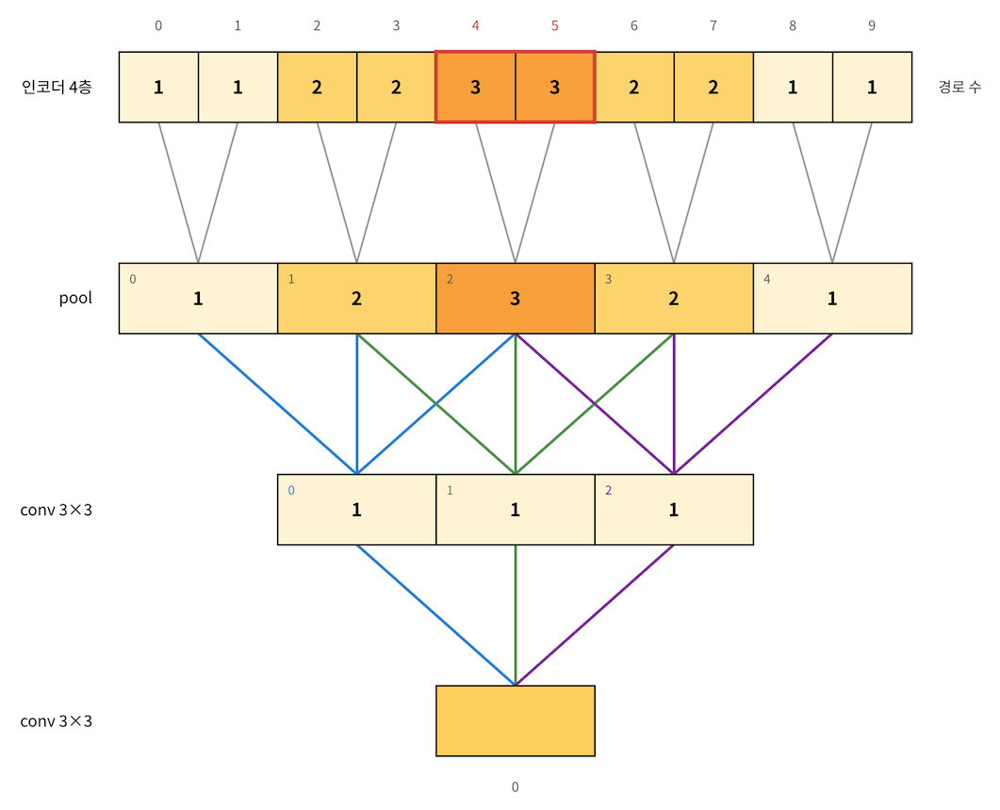
    >
    > 이 그림을 보면, 5층 두번째 conv는 인코더 4층의 4번, 5번 픽셀의 정보를 가장 자주 참조했다는 걸 알 수 있습니다. 인코더 4층의 양 끝인 0, 1과 8, 9번 픽셀은 한 번만 참조되었네요. 
    >
    > 이제 전체 인코더 4층의 64픽셀 전체로 봐보겠습니다.
    >
    > 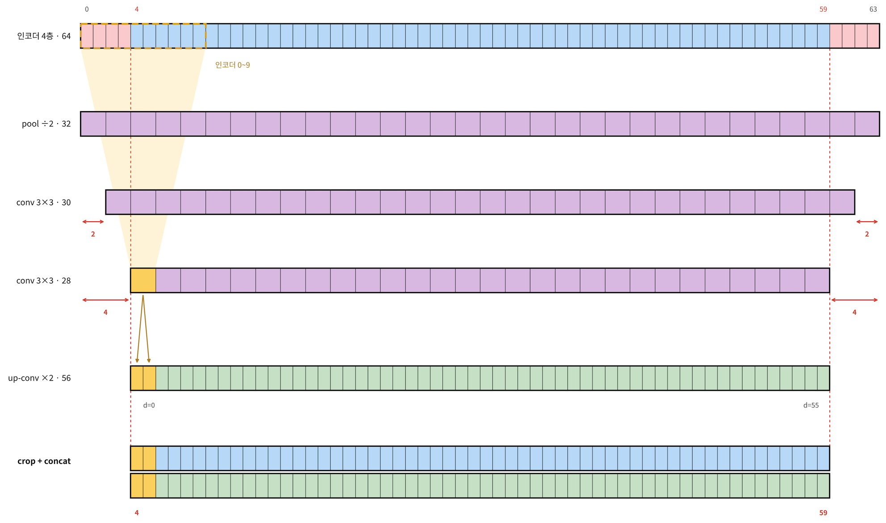
    >
    > 즉 디코더 4층의 0번, 1번 픽셀은 <u>**"주로 인코더 4\~5번 부근에 대한 요약"**</u>이라고 볼 수 있습니다. 학습된 가중치마다 차이는 있지만, 평균적으로 영향력이 가운데로 몰리는 현상은 일반적으로 관찰됩니다. 이를 <u>**effective receptive field**</u>라고 하고, 보통 가우시안 모양으로 나타납니다.
    >
    > skip connection은 <u>**디코더 픽셀이 요약하고 있는 곳의 세밀한 정보**</u>를 붙여 주려는 장치입니다. 그러니 가장 많이 반영된 인코더 4층의 4, 5번 픽셀과 디코더 4층의 0, 1번 픽셀을 짝지어야 합니다. 디코더 4층의 0, 1번 픽셀 뿐만 아니라 <u>**56개 픽셀 모두에 대해서 인코더 4층의 어떤 부분이 가장 영향력을 많이 주었나**</u>를 따져보면, 인코더 64의 가운데인 `[4:60]`을 crop해서 concat해야 한다는 걸 알 수 있습니다.  

4. **Overlap-tile Strategy & Mirroring Extrapolate**

    의료영상에 특화된 이미지 세그멘테이션이라는 UNet의 특성상, 처리해야 하는 문제가 몇 있었습니다. 

    1. 해상도가 매우 큰 의료영상 이미지를 네트워크에 한 번에 입력하면 <u>**GPU OOM**</u> 문제가 발생합니다.
        - 그래서 이미지를 작은 단위로 줄여서 네트워크에 넣습니다. 
        - 이 때, 이미지의 크기를 강제로 줄이면 미세한 세포나 조직의 정보가 손실됩니다. 따라서 이미지를 <u>**타일(Tile) 형태**</u>로 잘라서 입력하는 전략을 사용합니다. 
    2. 이미지 <u>**가장자리(Border)에 있는 세포 경계**</u>도 높은 성능으로 예측할 수 있어야 합니다.
        - 하지만 타일로 자를 때, 겹치지 않게 딱 맞춰 잘라서 UNet에 넣으면, <u>**타일의 가장자리 부분은 주변 문맥 정보가 부족**</u>하여 예측 성능이 급격히 떨어집니다.
            - convolution의 특성상, 입력의 모서리 부근의 정보는 다른 부분의 정보보다 출력에 개입되는 정도가 더 적기 때문입니다.
    3. <u>**원본 이미지의 맨 바깥쪽 가장자리 타일**</u>을 처리할 때는 더 이상 참조할 바깥쪽 문맥 정보가 없습니다. 가장자리는 사진의 끝이기 때문이죠. 
    4. 이미지 세그멘테이션은 <u>**입력 이미지와 출력 이미지의 크기가 같아**</u>야 합니다. 

    이를 해결하기 위해서 <u>**Overlap-tile Strategy**</u>와 <u>**Mirroring Extrapolate**</u>를 활용합니다.

    

    1. **Overlap-tile Strategy**

        이미지를 타일(Tile) 형태로 자를 때 **서로 겹치도록(Overlap)** 잘라서 입력으로 넣습니다. 따라서 다음 타일을 예측할 때 이전 타일의 가장자리 영역을 일정 부분 포함(Overlap)하여 입력되게 됩니다.

    2. **Mirroring Extrapolate**

        부족한 바깥쪽 영역을 <u>**거울에 비춘 것처럼 반사하여 채워 넣는 방식**</u>으로 입력 데이터를 확장하여 타일을 자릅니다.

    > 📌 **NOTE**
    >
    > UNet 논문에서 제안한 아키텍처에서는 각각의 타일 입력과 그 타일에 대응하는 출력의 크기가 정확히 맞지 않습니다. 여러 타일의 세그멘테이션 출력들을 이어붙여서 원본 크기로 만드는 겁니다. 

    **Overlap-tile Strategy의 전체적인 흐름을 짚어보겠습니다.**

    1. **우선** <u>**풀링(Pooling) 횟수**</u>**와** <u>**가장 깊은 층(Bottleneck)의 크기**</u>**를 결정합니다.**
        - 이는 모델 아키텍처를 구현할 때 정합니다. 
        - 논문에서는 Pooling 4로 결정했습니다. 4번 축소되므로, Bottleneck의 크기는 최소한 $2^4 = 16$의 배수가 되어야 소수점이 안 생깁니다.
        - Bottleneck의 크기는 16의 배수 중 GPU 메모리에 적당한 크기를 선택합니다. 논문에서는 이 크기를 32로 결정했습니다. 
    2. **그러면** <u>**입력 사이즈**</u>**와** <u>**출력 사이즈**</u>**가 정해집니다.**
        - <strong>'Pooling 4번'</strong>과 <strong>'병목 크기 32'</strong>가 결정되는 순간, 위로 거꾸로 타고 올라가면서 수식에 의해 <u>**입력 572, 출력 388이 자동으로 유도**</u>됩니다.
    3. **전체 이미지 격자(Grid) 및 패딩을 구성합니다.**

        원본 이미지 전체를 출력 크기($388 \times 388$)단위의 타일 격자로 나눕니다.

        - 이때, 가장자리 격자들은 주변 문맥(Margin)이 부족하여 $572 \times 572$ 입력을 만들 수 없습니다.
        - 이를 해결하기 위해 원본 이미지의 4개 외곽 면에 부족한 마진만큼 <u>**거울 반사 패딩(Mirroring Padding)**</u>을 적용하여 원본 이미지 자체를 미리 조금 키워둡니다.

            

    4. **출력 크기만큼 이동하며 입력 타일 추출 (Sliding & Cropping)**

        준비된 이미지 위를 <strong>출력 타일 크기(388 픽셀)만큼만 이동(Stride)</strong>하면서, 각 위치에서 필요한 <strong>입력 타일 크기($572 \times 572$)</strong>를 잘라내 네트워크에 입력합니다.

        - **입력 관점:** 윈도우가 $388$만큼만 이동하므로, $572$ 크기의 입력 타일들은 서로 <strong>오버랩(Overlap)</strong>되며 중복되는 영역이 184픽셀만큼 생깁니다.
        - **출력 관점:** 네트워크 연산을 거쳐 나온 $388 \times 388$ 크기의 segmentation map들은 서로 전혀 겹치지 않습니다.
    5. **최종 세그멘테이션 지도 조립**

        네트워크에서 출력된 $388 \times 388$ 크기의 결과 조각들을 격자 순서대로 **빈틈없이 이어 붙여(Mosaic)** 원본 이미지와 똑같은 해상도의 최종 segmentation map을 완성합니다.

### 4.2. UNet 학습 방법

1. **데이터 증강: 탄성변형(elastic deformation)**

    > *As for our tasks there is very little training data available, we use excessive data augmentation by applying elastic deformations to the available training images.*

    논문은 Elastic Deformation을 적은 라벨로 학습하는 <strong>“key concept”</strong>이라고 부릅니다.

    

    세포와 조직에서 가장 흔한 변이가 바로 이런 **찌그러짐과 휘어짐**입니다. 현실적으로 일어날 법한 사진을 무한히 만들 수 있으니, 전문가가 라벨을 더 그리지 않아도 데이터를 무한으로 쓰는 효과가 있는 거죠. 이 밖에 이동, 회전, 밝기 변화 증강과, contraction path 끝에서 **dropout**도 썼습니다.

2. **weighted loss: 맞닿아있는 세포 사이의 경계에 가중치를 주기**

    

    > *Another challenge in many cell segmentation tasks is the separation of touching objects of the same class; see Figure 3. To this end, we propose the use of a weighted loss, where the separating background labels between touching cells obtain a large weight in the loss function.*

    출력은 픽셀마다 softmax를 거친 뒤, **가중치를 곱한 cross entropy**로 학습합니다.

    $$
    p_k(\mathbf{x}) = \frac{\exp(a_k(\mathbf{x}))}{\sum_{k'=1}^{K}\exp(a_{k'}(\mathbf{x}))}, \qquad E = -\sum_{\mathbf{x}\in\Omega} w(\mathbf{x})\,\log p_{\ell(\mathbf{x})}(\mathbf{x})
    $$

    핵심은 <u>**가중치 맵**</u> $w(x)$입니다. 학습 전에 정답 마스크마다 미리 계산해 둡니다.

    $$
    w(\mathbf{x}) = w_c(\mathbf{x}) + w_0 \cdot \exp\!\left(-\frac{(d_1(\mathbf{x}) + d_2(\mathbf{x}))^2}{2\sigma^2}\right), \qquad w_0 = 10,\ \sigma \approx 5\text{px}
    $$

    - $w_c$: 클래스별 픽셀 수 불균형을 보정합니다(배경이 훨씬 많으니까요).
    - $d_1, d_2$: 그 픽셀에서 **가장 가까운 세포 경계**와 **두 번째로 가까운 세포 경계**까지의 거리입니다.

    | 픽셀 위치 | d1 + d2 | 추가 가중치 w0·exp(...) |
    | --- | --- | --- |
    | 두 세포 사이 좁은 틈 (d1=1, d2=2) | 3 | 10 × e^(−9/50) ≈ **8.4** |
    | 틈에서 조금 떨어진 곳 (d1=4, d2=6) | 10 | 10 × e^(−100/50) ≈ **1.4** |
    | 세포에서 먼 배경 (d1=10, d2=10) | 20 | 10 × e^(−400/50) ≈ **0.003** |

    두 세포가 맞닿을 듯한 **좁은 틈의 배경 픽셀일수록 loss에서 최대 약 10배 더 중요하게** 다뤄집니다. 픽셀 수로는 아주 적어서 그냥 학습하면 무시되기 쉬운 경계를, 네트워크가 반드시 신경 쓰게 만드는 장치인 거죠.

### 4.3. UNet의 성능

U-Net은 두 가지 생물의학 영상 대회에서 성능을 검증했습니다. 두 대회 모두 학습 이미지가 **20\~35장**에 불과했다는 점을 기억하고 보면 결과가 더 인상적입니다.

1. **ISBI 2012 전자현미경(EM) 신경 구조 분할**

    

    전자현미경 사진에서 세포막을 따라 신경 세포들을 하나하나 분리하는 과제입니다. 학습 이미지는 512×512 **30장**입니다. 평가 지표는 세 가지이고, 모두 낮을수록 좋습니다.

    | 지표 | 의미 |
    | --- | --- |
    | **Warping error** | 세포가 잘못 **쪼개지거나 합쳐진** 위상(topology) 오류. 세포막 하나를 놓치면 두 세포가 하나로 합쳐지므로, 경계를 얼마나 끊김 없이 잡았는지를 봅니다. |
    | **Rand error** | 픽셀 두 개를 골랐을 때 "같은 세포인지, 다른 세포인지"를 정답과 다르게 판단한 비율 |
    | **Pixel error** | 픽셀 단위로 틀린 비율 |

    U-Net은 입력을 7가지로 회전시켜 예측한 결과를 평균 내는 것 외에는 별도의 전처리나 후처리 없이 **warping error 0.000353으로 1위**를 차지했습니다. 3.1절에서 다룬 **sliding window CNN**의 0.000420보다 낮고, rand error(0.0504 → 0.0382)에서도 앞섰습니다. 정확도와 속도 모두에서 이전 방식을 넘어선 셈입니다.

    

    다만 모든 지표에서 1위였던 것은 아닙니다. 표가 warping error 기준으로 정렬되어 있고, rand error와 pixel error는 2위인 DIVE-SCI가 더 낮습니다. U-Net의 강점은 **경계를 끊기지 않게 이어서 세포를 올바르게 분리하는 능력**에 있었다고 보는 게 정확합니다. 

2. **ISBI 2015 세포 추적 챌린지: 광학 현미경 세포 분할**

    

    

    | 데이터셋 | 학습 이미지 | U-Net | 2위 (2015) |
    | --- | --- | --- | --- |
    | PhC-U373 (위상차 현미경) | 35장 (일부만 라벨) | **92.0%** | 83% |
    | DIC-HeLa (미분간섭 현미경) | 20장 (일부만 라벨) | **77.6%** | 46% |

    특히 세포 경계가 흐릿한 DIC-HeLa에서 **2위보다 30%p 이상 높은** 결과를 냈습니다. Figure 4의 (b)는 U-Net의 예측(하늘색 마스크)과 사람이 그린 정답(노란 테두리)을 겹쳐 보여주는데, 서로 맞닿은 세포들도 잘 분리되어 있습니다.

3. **효율성**

    - **학습**: NVIDIA Titan GPU(6GB) 한 장으로 약 **10시간**
    - **추론**: 512×512 이미지 한 장 분할에 **1초 미만**

    3.1절의 sliding window 방식이 $224 \times 224$ 사진 한 장에 30.1초씩 걸리던 것과 비교하면, 적은 데이터·적은 자원·빠른 속도라는 의료 영상의 현실적 조건을 모두 만족한 모델이었습니다.

### 4.4. UNet의 구현

라이브러리 구현은 원 논문과 다른 점이 몇 가지 있습니다. 먼저 차이를 짚고 넘어가면 코드를 읽기 쉬워집니다.

|  | 원 논문 (2015) | 요즘 구현 |
| --- | --- | --- |
| conv padding | 없음 (572 → 388) | **padding=1** (입력과 출력 크기 같음) |
| 정규화 | 없음 | **BatchNorm** 추가 |
| skip 크기 맞추기 | crop | 대부분 필요 없음, 어긋나면 `F.pad` |
| 업샘플링 | 2×2 up-conv (전치 합성곱) | bilinear 또는 nearest **보간 + conv**가 흔함 (체커보드 회피, 3.2.1절) |
| 인코더 | 처음부터 학습 | ImageNet **사전학습 백본** 사용 가능 |

1. **milesial/Pytorch-UNet: 논문 구조를 그대로 옮긴 정석 구현**

    - :github: [milesial/Pytorch-UNet — unet/unet_model.py](https://github.com/milesial/Pytorch-UNet/blob/master/unet/unet_model.py)
    - :github: [milesial/Pytorch-UNet — unet/unet_parts.py](https://github.com/milesial/Pytorch-UNet/blob/master/unet/unet_parts.py)

    | 블록 | 하는 일 | 4.1절 대응 |
    | --- | --- | --- |
    | `DoubleConv` | (3×3 conv → BN → ReLU) × 2 | 각 단계의 conv 두 번 |
    | `Down` | MaxPool2d(2) → DoubleConv | 수축 경로 한 단계 |
    | `Up` | 업샘플링 → `F.pad`로 크기 맞춤 → `torch.cat` → DoubleConv | 확장 경로 한 단계 |
    | `OutConv` | 1×1 conv | 마지막 픽셀별 분류기 |

    ```python
    class DoubleConv(nn.Module):
        """(convolution => [BN] => ReLU) * 2"""

        def __init__(self, in_channels, out_channels, mid_channels=None):
            super().__init__()
            if not mid_channels:
                mid_channels = out_channels
            self.double_conv = nn.Sequential(
                nn.Conv2d(in_channels, mid_channels, kernel_size=3, padding=1, bias=False),
                nn.BatchNorm2d(mid_channels),
                nn.ReLU(inplace=True),
                nn.Conv2d(mid_channels, out_channels, kernel_size=3, padding=1, bias=False),
                nn.BatchNorm2d(out_channels),
                nn.ReLU(inplace=True)
            )

        def forward(self, x):
            return self.double_conv(x)

    class Down(nn.Module):
        """Downscaling with maxpool then double conv"""

        def __init__(self, in_channels, out_channels):
            super().__init__()
            self.maxpool_conv = nn.Sequential(
                nn.MaxPool2d(2),
                DoubleConv(in_channels, out_channels)
            )

        def forward(self, x):
            return self.maxpool_conv(x)

    class Up(nn.Module):
        """Upscaling then double conv"""

        def __init__(self, in_channels, out_channels, bilinear=True):
            super().__init__()

            # if bilinear, use the normal convolutions to reduce the number of channels
            if bilinear:
                self.up = nn.Upsample(scale_factor=2, mode='bilinear', align_corners=True)
                self.conv = DoubleConv(in_channels, out_channels, in_channels // 2)
            else:
                self.up = nn.ConvTranspose2d(in_channels, in_channels // 2, kernel_size=2, stride=2)
                self.conv = DoubleConv(in_channels, out_channels)

        def forward(self, x1, x2):
            x1 = self.up(x1)
            # input is CHW
            diffY = x2.size()[2] - x1.size()[2]
            diffX = x2.size()[3] - x1.size()[3]

            x1 = F.pad(x1, [diffX // 2, diffX - diffX // 2,
                            diffY // 2, diffY - diffY // 2])
            # if you have padding issues, see
            # https://github.com/HaiyongJiang/U-Net-Pytorch-Unstructured-Buggy/commit/0e854509c2cea854e247a9c615f175f76fbb2e3a
            # https://github.com/xiaopeng-liao/Pytorch-UNet/commit/8ebac70e633bac59fc22bb5195e513d5832fb3bd
            x = torch.cat([x2, x1], dim=1)
            return self.conv(x)

    class OutConv(nn.Module):
        def __init__(self, in_channels, out_channels):
            super(OutConv, self).__init__()
            self.conv = nn.Conv2d(in_channels, out_channels, kernel_size=1)

        def forward(self, x):
            return self.conv(x)

    class UNet(nn.Module):
        def __init__(self, n_channels, n_classes, bilinear=False):
            super(UNet, self).__init__()
            self.n_channels = n_channels
            self.n_classes = n_classes
            self.bilinear = bilinear

            self.inc = (DoubleConv(n_channels, 64))
            self.down1 = (Down(64, 128))
            self.down2 = (Down(128, 256))
            self.down3 = (Down(256, 512))
            factor = 2 if bilinear else 1
            self.down4 = (Down(512, 1024 // factor))
            self.up1 = (Up(1024, 512 // factor, bilinear))
            self.up2 = (Up(512, 256 // factor, bilinear))
            self.up3 = (Up(256, 128 // factor, bilinear))
            self.up4 = (Up(128, 64, bilinear))
            self.outc = (OutConv(64, n_classes))

        def forward(self, x):
            x1 = self.inc(x)
            x2 = self.down1(x1)
            x3 = self.down2(x2)
            x4 = self.down3(x3)
            x5 = self.down4(x4)
            x = self.up1(x5, x4)
            x = self.up2(x, x3)
            x = self.up3(x, x2)
            x = self.up4(x, x1)
            logits = self.outc(x)
            return logits
    ```

2. **segmentation_models.pytorch (smp): 실무 표준. 인코더를 사전학습 백본으로 교체**

    - :github: [qubvel-org/segmentation_models.pytorch](https://github.com/qubvel-org/segmentation_models.pytorch)

    ```python
    import segmentation_models_pytorch as smp

    model = smp.Unet(
        encoder_name="resnet34",        # choose encoder, e.g. mobilenet_v2 or efficientnet-b7
        encoder_weights="imagenet",     # use `imagenet` pre-trained weights for encoder initialization
        in_channels=1,                  # model input channels (1 for gray-scale images, 3 for RGB, etc.)
        classes=3,                      # model output channels (number of classes in your dataset)
    )
    ```

    ```python
    class Unet(SegmentationModel):
    		@supports_config_loading
        def __init__(
            self,
            encoder_name: str = "resnet34",
            encoder_depth: int = 5,
            encoder_weights: Optional[str] = "imagenet",
            decoder_use_norm: Union[bool, str, Dict[str, Any]] = "batchnorm",
            decoder_channels: Sequence[int] = (256, 128, 64, 32, 16),
            decoder_attention_type: Optional[str] = None,
            decoder_interpolation: str = "nearest",
            in_channels: int = 3,
            classes: int = 1,
            activation: Optional[Union[str, Callable]] = None,
            aux_params: Optional[dict] = None,
            **kwargs: dict[str, Any],
        ):
            super().__init__()

            decoder_use_batchnorm = kwargs.pop("decoder_use_batchnorm", None)
            if decoder_use_batchnorm is not None:
                warnings.warn(
                    "The usage of decoder_use_batchnorm is deprecated. Please modify your code for decoder_use_norm",
                    DeprecationWarning,
                    stacklevel=2,
                )
                decoder_use_norm = decoder_use_batchnorm

            self.encoder = get_encoder(
                encoder_name,
                in_channels=in_channels,
                depth=encoder_depth,
                weights=encoder_weights,
                **kwargs,
            )

            add_center_block = encoder_name.startswith("vgg")

            self.decoder = UnetDecoder(
                encoder_channels=self.encoder.out_channels,
                decoder_channels=decoder_channels,
                n_blocks=encoder_depth,
                use_norm=decoder_use_norm,
                add_center_block=add_center_block,
                attention_type=decoder_attention_type,
                interpolation_mode=decoder_interpolation,
            )

            self.segmentation_head = SegmentationHead(
                in_channels=decoder_channels[-1],
                out_channels=classes,
                activation=activation,
                kernel_size=3,
            )

            if aux_params is not None:
                self.classification_head = ClassificationHead(
                    in_channels=self.encoder.out_channels[-1], **aux_params
                )
            else:
                self.classification_head = None

            self.name = "u-{}".format(encoder_name)
            self.initialize()
    ```

    ```python
    class UnetDecoderBlock(nn.Module):
        """A decoder block in the U-Net architecture that performs upsampling and feature fusion."""

        def __init__(
            self,
            in_channels: int,
            skip_channels: int,
            out_channels: int,
            use_norm: Union[bool, str, Dict[str, Any]] = "batchnorm",
            attention_type: Optional[str] = None,
            interpolation_mode: str = "nearest",
        ):
            super().__init__()
            self.interpolation_mode = interpolation_mode
            self.conv1 = md.Conv2dReLU(
                in_channels + skip_channels,
                out_channels,
                kernel_size=3,
                padding=1,
                use_norm=use_norm,
            )
            self.attention1 = md.Attention(
                attention_type, in_channels=in_channels + skip_channels
            )
            self.conv2 = md.Conv2dReLU(
                out_channels,
                out_channels,
                kernel_size=3,
                padding=1,
                use_norm=use_norm,
            )
            self.attention2 = md.Attention(attention_type, in_channels=out_channels)

        def forward(
            self,
            feature_map: torch.Tensor,
            target_height: int,
            target_width: int,
            skip_connection: Optional[torch.Tensor] = None,
        ) -> torch.Tensor:
            feature_map = F.interpolate(
                feature_map,
                size=(target_height, target_width),
                mode=self.interpolation_mode,
            )
            if skip_connection is not None:
                feature_map = torch.cat([feature_map, skip_connection], dim=1)
                feature_map = self.attention1(feature_map)
            feature_map = self.conv1(feature_map)
            feature_map = self.conv2(feature_map)
            feature_map = self.attention2(feature_map)
            return feature_map

    class UnetCenterBlock(nn.Sequential):
        """Center block of the Unet decoder. Applied to the last feature map of the encoder."""

        def __init__(
            self,
            in_channels: int,
            out_channels: int,
            use_norm: Union[bool, str, Dict[str, Any]] = "batchnorm",
        ):
            conv1 = md.Conv2dReLU(
                in_channels,
                out_channels,
                kernel_size=3,
                padding=1,
                use_norm=use_norm,
            )
            conv2 = md.Conv2dReLU(
                out_channels,
                out_channels,
                kernel_size=3,
                padding=1,
                use_norm=use_norm,
            )
            super().__init__(conv1, conv2)

    class UnetDecoder(nn.Module):
        """The decoder part of the U-Net architecture.

        Takes encoded features from different stages of the encoder and progressively upsamples them while
        combining with skip connections. This helps preserve fine-grained details in the final segmentation.
        """

        def __init__(
            self,
            encoder_channels: Sequence[int],
            decoder_channels: Sequence[int],
            n_blocks: int = 5,
            use_norm: Union[bool, str, Dict[str, Any]] = "batchnorm",
            attention_type: Optional[str] = None,
            add_center_block: bool = False,
            interpolation_mode: str = "nearest",
        ):
            super().__init__()

            if n_blocks != len(decoder_channels):
                raise ValueError(
                    "Model depth is {}, but you provide `decoder_channels` for {} blocks.".format(
                        n_blocks, len(decoder_channels)
                    )
                )

            # remove first skip with same spatial resolution
            encoder_channels = encoder_channels[1:]
            # reverse channels to start from head of encoder
            encoder_channels = encoder_channels[::-1]

            # computing blocks input and output channels
            head_channels = encoder_channels[0]
            in_channels = [head_channels] + list(decoder_channels[:-1])
            skip_channels = list(encoder_channels[1:]) + [0]
            out_channels = decoder_channels

            if add_center_block:
                self.center = UnetCenterBlock(
                    head_channels,
                    head_channels,
                    use_norm=use_norm,
                )
            else:
                self.center = nn.Identity()

            # combine decoder keyword arguments
            self.blocks = nn.ModuleList()
            for block_in_channels, block_skip_channels, block_out_channels in zip(
                in_channels, skip_channels, out_channels
            ):
                block = UnetDecoderBlock(
                    block_in_channels,
                    block_skip_channels,
                    block_out_channels,
                    use_norm=use_norm,
                    attention_type=attention_type,
                    interpolation_mode=interpolation_mode,
                )
                self.blocks.append(block)

        def forward(self, features: List[torch.Tensor]) -> torch.Tensor:
            # spatial shapes of features: [hw, hw/2, hw/4, hw/8, ...]
            spatial_shapes = [feature.shape[2:] for feature in features]
            spatial_shapes = spatial_shapes[::-1]

            features = features[1:]  # remove first skip with same spatial resolution
            features = features[::-1]  # reverse channels to start from head of encoder

            head = features[0]
            skip_connections = features[1:]

            x = self.center(head)

            for i, decoder_block in enumerate(self.blocks):
                # upsample to the next spatial shape
                height, width = spatial_shapes[i + 1]
                skip_connection = skip_connections[i] if i < len(skip_connections) else None
                x = decoder_block(x, height, width, skip_connection=skip_connection)

            return x
    ```

---

## 📚 참고자료

- [U-Net clearly explained | Image Segmentation with AI](https://www.youtube.com/watch?v=oxcgx75k6yU)
- [Object detection task guide  |  Google AI Edge  |  Google for Developers](https://developers.google.com/edge/mediapipe/solutions/vision/object_detector)
- [Introduction to Convolution Neural Network - GeeksforGeeks](https://www.geeksforgeeks.org/machine-learning/introduction-convolution-neural-network/)
- [U-Net Explained: The CNN That Revolutionized Image Segmentation](https://medium.com/@shreeyacofficial/u-net-explained-the-cnn-that-revolutionized-image-segmentation-0007f2c89063)
- [arxiv.org](https://arxiv.org/pdf/1411.4038): FCN
- [Fully Convolutional Networks | TJHSST Machine Learning Club](https://tjmachinelearning.com/lectures/1718/fcn/)
- [arxiv.org](https://arxiv.org/pdf/1505.04597): UNet
- [Fully Convolutional Networks for Semantic Segmentation](https://gaussian37.github.io/vision-segmentation-fcn/)
- [milesial/Pytorch-UNet](https://github.com/milesial/Pytorch-UNet)
- [qubvel-org/segmentation_models.pytorch](https://github.com/qubvel-org/segmentation_models.pytorch)
- [Deep Learning for Image Segmentation: U-Net Architecture](https://www.comet.com/site/blog/deep-learning-for-image-segmentation-u-net-architecture/)
