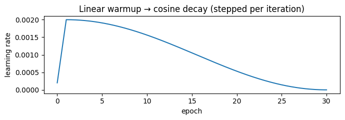
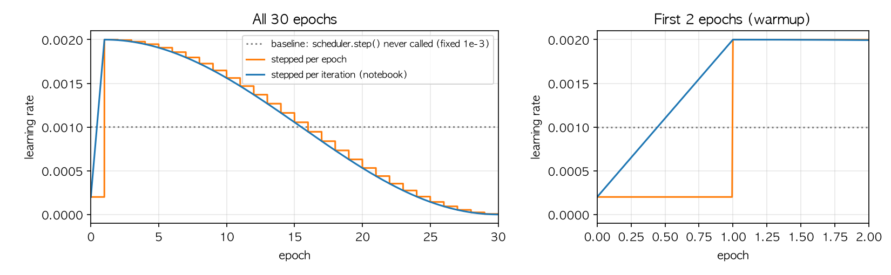
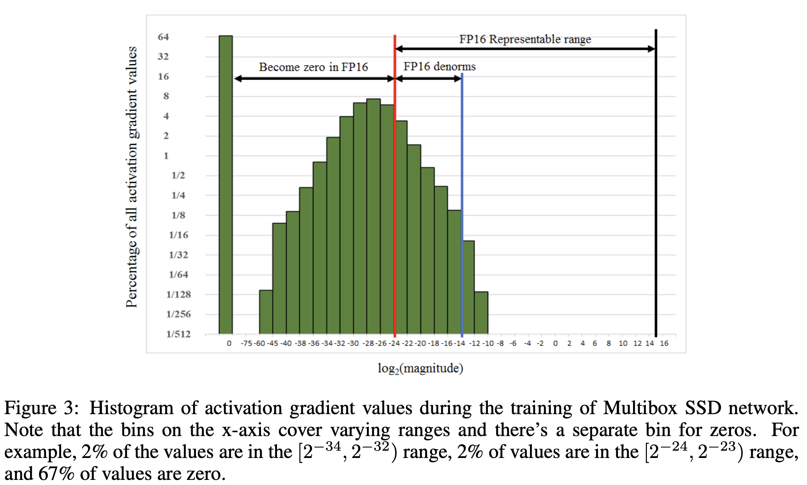
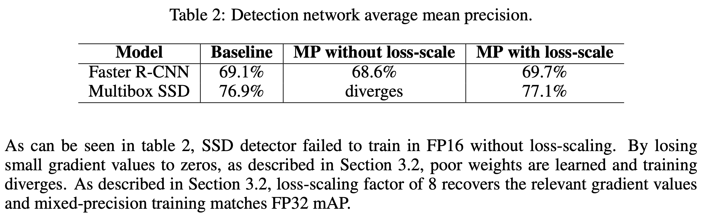
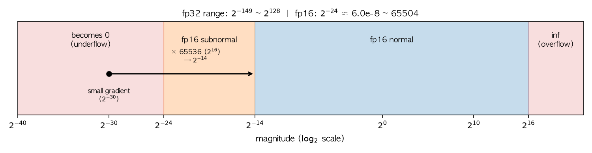
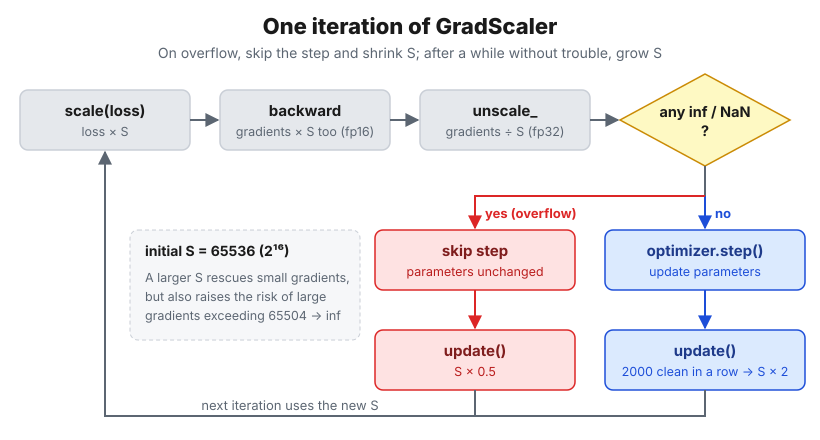

## 0. Introduction

In Codeit Mission 7, I transfer-learned a COCO-pretrained SSD300 to detect dog and cat faces. While fixing the baseline notebook I was handed, I found code like this.

```python
# Define optimizer and loss
optimizer = torch.optim.SGD(model.parameters(), lr=0.001, momentum=0.9, weight_decay=0.0005)
lr_scheduler = torch.optim.lr_scheduler.StepLR(optimizer, step_size=3, gamma=0.1)

for epoch in range(num_epochs):
    model.train()
    for images, targets in tqdm(train_loader, desc="Training"):
        ...
        loss_dict = model(images, targets)
        losses = sum(loss for loss in loss_dict.values())

        optimizer.zero_grad()
        losses.backward()
        optimizer.step()
    # ← lr_scheduler.step() is nowhere to be found

    # Validation Phase
    ...
```

> 📌 **NOTE**
>
> This post is based on the training code of the Mission 7 experiment notebook ([`experiment.ipynb`](https://github.com/raewoo0908/codeit_face_obj_detection)) and the source of the installed PyTorch 2.13.0.
>
> The full story of replacing the classification head is covered separately in the [SSD classification head replacement](/posts/ai/ssd-classification-head-replacement) post.

The baseline created a `StepLR` scheduler and then never called `scheduler.step()` anywhere in the training loop. So for all 30 epochs, <u>**the learning rate stayed fixed at its initial value of 1e-3**</u>. No error, no warning. A scheduler is not something that "just runs once you create it."

So this question came up.

> 🤔 **What exactly do the optimizer and the scheduler each do, such that training ran just fine without ever calling the scheduler?**

While answering that question, we'll also look at <u>**AMP (Automatic Mixed Precision)**</u>, which lives in the same training loop.

> 📌 **Summary**
>
> 1. The optimizer **updates the parameters** with gradients; the scheduler **changes just one number**, `optimizer.param_groups[i]["lr"]`. That's why training still runs without calling the scheduler (only the LR stays fixed).
> 2. Pass only `requires_grad=True` parameters to the optimizer. PyTorch SGD skips parameters whose grad is `None`, but if a grad is left as a zero tensor, even frozen parameters move through weight decay and momentum.
> 3. Implement Warmup → Cosine with a single `LambdaLR` and step it **every iteration**. Stepping every epoch turns a 1-epoch warmup into "a staircase."
> 4. fp16 has a narrow range ($2^{-24}$ to 65504), so small gradients become 0. **GradScaler** scales the loss up before backward, scales it back (unscale), and if there's an inf/NaN, skips that step and lowers the scale.
> 5. AMP caveats:
>       - Enable it only on CUDA and keep one code path with `enabled=`.
>       - Cast evaluation outputs back with `.float()`.
>       - `unscale_` before clipping.
>       - Save the **scaler state** in checkpoints too.
> 6. Even if GradScaler skips a step, the scheduler moves forward one notch. Skipping on the first iteration triggers a warning; skipping later passes silently.

## 1. How Do the Optimizer and the Scheduler Split the Work?

### 1.1. The optimizer changes parameters; the scheduler changes one number

One iteration of a training loop looks roughly like this.

```python
loss = model(images, targets)   # 1. forward + loss
optimizer.zero_grad()           # 2. clear previous gradients
loss.backward()                 # 3. compute gradients (fill p.grad)
optimizer.step()                # 4. update parameters
scheduler.step()                # 5. set the LR for the next iteration
```

Of these, only step 4, `optimizer.step()`, actually changes the model. For SGD, it computes the following for each parameter $\theta$.

- $g$: this iteration's gradient (`p.grad`)
- $\lambda$: weight decay, $\mu$: momentum, $\eta$: learning rate
- $v$: momentum buffer (state the optimizer keeps separately for each parameter)

$$
\begin{aligned}
g &\leftarrow g + \lambda\theta \\
v &\leftarrow \mu v + g \\
\theta &\leftarrow \theta - \eta v
\end{aligned}
$$

So what does the scheduler do? <u>**The scheduler changes only the $\eta$ in this formula.**</u> Look at `LRScheduler._update_lr` in the PyTorch source (`torch/optim/lr_scheduler.py`) and that really is the only thing it does.

```python
def _update_lr(self, epoch=None):
    with _enable_get_lr_call(self):
        if epoch is None:
            self.last_epoch += 1          # bump the internal counter by one
            values = self.get_lr()        # compute the LR for that counter
    ...
    for param_group, lr in zip(self.optimizer.param_groups, values, strict=True):
        _update_param_group_val(param_group, "lr", lr)   # overwrite the optimizer's "lr" value
```

Let's check it directly.

```python
import torch
from torch import nn

model = nn.Linear(2, 1)
optimizer = torch.optim.SGD(model.parameters(), lr=2e-3, momentum=0.9, weight_decay=5e-4)
scheduler = torch.optim.lr_scheduler.LambdaLR(optimizer, lambda step: 0.5 ** step)

print("right after creation lr =", optimizer.param_groups[0]["lr"])
model(torch.ones(1, 2)).sum().backward()
optimizer.step()
scheduler.step()
print("after one step       lr =", optimizer.param_groups[0]["lr"])
print("values the scheduler doesn't touch:",
      {k: v for k, v in optimizer.param_groups[0].items() if k in ("momentum", "weight_decay")})
print("optimizer.state keys:", list(next(iter(optimizer.state.values())).keys()))
```

```text
right after creation lr = 0.002
after one step       lr = 0.001
values the scheduler doesn't touch: {'momentum': 0.9, 'weight_decay': 0.0005}
optimizer.state keys: ['momentum_buffer']
```

Only `lr` changed from 0.002 to 0.001; momentum, weight decay, and the momentum buffer are managed by the optimizer independently of the scheduler.

Now we can answer the question we started with. <u>**If you never call the scheduler, `param_groups[0]["lr"]` simply stays at its initial value, and the optimizer keeps updating parameters with that LR.**</u> That's why training "ran just fine," and also why there was no warning at all.

> 💡 **The scheduler is the optimizer's assistant**
>
> As an analogy, the optimizer is the driver and the scheduler is the navigation system in the passenger seat telling it "slow down now." Even without turning on the navigation (= never calling `step()`), the car still drives. It just keeps going at the speed it started with all the way to the end.

### 1.2. Why pass only `requires_grad=True` parameters?

This experiment used <u>**Feature Extraction (FE)**</u>: freeze the backbone and train only the head. Out of 23,879,570 parameters in total, only 935,634 (about 3.9%) are trained. I built the optimizer like this.

```python
def build_optimizer(model: nn.Module, train: TrainConfig) -> torch.optim.Optimizer:
    """Pass only the trainable parameters to SGD."""
    trainable = [p for p in model.parameters() if p.requires_grad]
    return torch.optim.SGD(trainable, lr=train.learning_rate, momentum=train.momentum,
                           weight_decay=train.weight_decay)
```

The notebook notes that this "prevents weight decay from being applied to frozen parameters and avoids creating unnecessary optimizer state." But is that really so? I deliberately passed all parameters, frozen ones included, to check.

```python
import torch
from torch import nn

torch.manual_seed(0)
backbone, head = nn.Linear(4, 4), nn.Linear(4, 2)
backbone.requires_grad_(False)          # freeze the backbone
model = nn.Sequential(backbone, head)

# deliberately pass every parameter, frozen ones included, to the optimizer
optimizer = torch.optim.SGD(model.parameters(), lr=0.1, momentum=0.9, weight_decay=5e-4)
before = backbone.weight.clone()

model(torch.randn(8, 4)).sum().backward()
print("backbone.weight.grad:", backbone.weight.grad)
optimizer.step()
print("① grad=None        → backbone changed?", not torch.equal(before, backbone.weight),
      "| momentum state created?", backbone.weight in optimizer.state)

backbone.weight.grad = torch.zeros_like(backbone.weight)   # what if grad is 0 instead of None?
optimizer.step()
print("② grad=zero tensor → backbone changed?", not torch.equal(before, backbone.weight),
      "| change:", (before - backbone.weight).abs().max().item())
```

```text
backbone.weight.grad: None
① grad=None        → backbone changed? False | momentum state created? False
② grad=zero tensor → backbone changed? True | change: 2.3871660232543945e-05
```

The answer is half and half.

- **①** Frozen parameters still have `grad` equal to `None` after backward, and PyTorch's SGD <u>**skips parameters whose grad is `None` entirely.**</u> No weight decay, no momentum buffer. In other words, in this case passing everything gives the same result.
- **②** But if grad is a <u>**tensor filled with zeros**</u> rather than `None`, it's a different story. Even with a zero gradient, the weight decay term $\lambda\theta$ is added, so <u>**the backbone you believed was frozen slowly shrinks.**</u>

A grad gets left as a zero tensor when you use `zero_grad(set_to_none=False)`, or when you freeze parameters that were being trained partway through. My experiment notebook uses `zero_grad(set_to_none=True)`, so it doesn't hit ②.

```python
# Excerpt from inside train_one_epoch()
optimizer.zero_grad(set_to_none=True) # set_to_none=True: sets the model's accumulated gradients to None instead of filling them with 0.
scaler.scale(loss).backward()
scaler.step(optimizer)
scaler.update()
scheduler.step()
```

But if you <u>**pass only the trainable parameters to the optimizer in the first place, the need to reason about those conditions disappears altogether.**</u> It also has the benefit of making "what this optimizer trains" explicit in the code.

## 2. Let's Build a Warmup → Cosine Schedule with `LambdaLR`

### 2.1. Why warmup and cosine?

Fixing the LR as the baseline did has two shortcomings.

1. **Early in training**: the newly created classification head is randomly initialized, so the gradients in the first few iterations can be large and unstable. Using a large LR from the very start can send parameters flying off somewhere odd. So we add a <u>**warmup**</u> that starts with a small LR and gradually raises it to the target LR. [Goyal et al. (2017)](https://arxiv.org/abs/1706.02677) used this for large-batch training and describe it like this.

   > *develop a new warmup scheme that overcomes optimization challenges early in training.*

2. **Late in training**: keeping a large LR near the optimum makes you keep circling around it. So the LR has to come down gradually, and instead of `StepLR`, which drops it in abrupt stairs, I used <u>**cosine decay**</u>, which lowers it smoothly to 0 along a cosine curve. The formula proposed in the [SGDR paper](https://arxiv.org/abs/1608.03983) (Loshchilov & Hutter, 2016) is as follows.

$$
\eta_t = \eta_{min} + \frac{1}{2}(\eta_{max} - \eta_{min})\left(1 + \cos\left(\frac{T_{cur}}{T_{i}}\pi\right)\right)
$$

- $T_{cur}$: number of steps elapsed in the decay phase so far, $T_i$: total number of steps in the decay phase
- When $T_{cur} = 0$, $\cos 0 = 1$, giving $\eta_{max}$; when $T_{cur} = T_i$, $\cos\pi = -1$, giving $\eta_{min}$



In other words, you get an S-shaped curve that descends slowly at first, quickly in the middle, and slowly again at the end.

### 2.2. Implementation: a factor function + `LambdaLR`

`LambdaLR` is a scheduler where you only pass <u>**"a function that takes the step number and returns the factor to multiply the initial LR by."**</u> Looking at the source, `get_lr()` really just computes `base_lr * lmbda(self.last_epoch)`.

```python
def warmup_cosine_factor(step: int, warmup_steps: int, total_steps: int, warmup_start_factor: float) -> float:
    """LR factor at step (0-based): linear warmup followed by cosine decay."""
    if step < warmup_steps:
        return warmup_start_factor + (1.0 - warmup_start_factor) * step / warmup_steps
    progress = (step - warmup_steps) / max(1, total_steps - warmup_steps)
    return 0.5 * (1.0 + math.cos(math.pi * min(1.0, progress)))


def build_warmup_cosine_scheduler(optimizer, steps_per_epoch: int, train: TrainConfig):
    """Warmup + cosine scheduler stepped per iteration."""
    warmup_steps = train.warmup_epochs * steps_per_epoch
    total_steps = train.max_epochs * steps_per_epoch
    return torch.optim.lr_scheduler.LambdaLR(
        optimizer, lambda step: warmup_cosine_factor(step, warmup_steps, total_steps, train.warmup_start_factor))
```

The settings (`TrainConfig`) are as follows.

| Item | Value |
| --- | --- |
| `learning_rate` | 2e-3 |
| `warmup_epochs` | 1 |
| `warmup_start_factor` | 0.1 (warmup starting LR = 2e-4) |
| `max_epochs` | 30 |
| train images / batch size | 2,571 images / 16 |

### 2.3. Let's compute it by hand

First, the step counts.

- Iterations per epoch: $\lceil 2571 / 16 \rceil = \lceil 160.69 \rceil = 161$
- `warmup_steps` $= 1 \times 161 = 161$
- `total_steps` $= 30 \times 161 = 4830$ (`max_epochs` = 30)

Now let's compute the factor at a few steps.

1. **step 0 (start of training)**: within warmup, so

   $$0.1 + 0.9 \times \frac{0}{161} = 0.1 \quad\rightarrow\quad \text{LR} = 2\text{e-}4$$

2. **step 80 (middle of warmup)**:

   $$0.1 + 0.9 \times \frac{80}{161} = 0.1 + 0.4472 = 0.5472 \quad\rightarrow\quad \text{LR} \approx 1.094\text{e-}3$$

3. **step 161 (end of warmup, start of cosine)**: `step < warmup_steps` becomes false, so it switches to the cosine formula.

   $$\text{progress} = \frac{161 - 161}{4830 - 161} = 0 \quad\rightarrow\quad 0.5 \times (1 + \cos 0) = 1.0 \quad\rightarrow\quad \text{LR} = 2\text{e-}3$$

4. **step 2495 (middle of cosine)**:

   $$\text{progress} = \frac{2495 - 161}{4669} = 0.4999 \quad\rightarrow\quad 0.5 \times (1 + \cos(0.4999\pi)) \approx 0.5002 \quad\rightarrow\quad \text{LR} \approx 1.0\text{e-}3$$

5. **step 4829 (last iteration)**: progress $\approx 1$, so the factor is $0.0$ and the LR is effectively 0.

It connects to exactly 1.0 at the end of warmup and is exactly half at the middle of cosine. Let's check whether this calculation matches the actual training log. I had the LR recorded every epoch during training. Epoch $e$ starts at step $(e-1) \times 161$.

| epoch | starting step | hand-computed LR | notebook `lr_at_start` |
| --- | --- | --- | --- |
| 1 | 0 | 0.000200 | 0.0002 |
| 2 | 161 | 0.002000 | 0.0020 |
| 16 | 2415 | 0.001054 | 0.0011 |
| 30 | 4669 | 0.000006 | 0.0000 |

Comparing all 30 epochs, every value matched to four decimal places.

### 2.4. Why step every iteration instead of every epoch?

The example in the official PyTorch docs calls `scheduler.step()` outside the epoch loop. In my experiment notebook this time, however, I called it **inside `train_one_epoch`, every iteration**. Why?

I plotted the LR when stepping the same factor function in both ways.



Look at the zoomed-in graph on the right.

- **Blue line (per iteration)**: during the 161 iterations of the first epoch, it rises diagonally from 2e-4 to 2e-3.
- **Orange line (per epoch)**: it stays at 2e-4 for the whole first epoch, then the moment epoch 1 ends, it <u>**jumps tenfold to 2e-3.**</u>

Warmup is the idea of "raising the LR gradually," but if the warmup is 1 epoch and you step every epoch, <u>**the warmup collapses into a single stair step.**</u> That's no different from not warming up at all. In the left graph too, the orange cosine becomes a 30-step staircase. So the shorter the warmup, the more you need per-iteration stepping. The dotted line is the baseline's fixed LR.

> 📌 **NOTE: Make a habit of plotting the LR before training**
>
> My experiment notebook has a function that draws the schedule before training. The habit of **checking visually, before training starts,** that the scheduler behaves as intended can prevent silent bugs.
>
> 

<details>
<summary>Plot code</summary>

```python
import math

import matplotlib.pyplot as plt
import numpy as np


def factor(step, warmup_steps, total_steps, start=0.1):
    if step < warmup_steps:
        return start + (1.0 - start) * step / warmup_steps
    progress = (step - warmup_steps) / max(1, total_steps - warmup_steps)
    return 0.5 * (1.0 + math.cos(math.pi * min(1.0, progress)))


SPE, EPOCHS, LR = 161, 30, 2e-3      # 2,571 images / batch 16 = 161 iterations
steps = np.arange(SPE * EPOCHS)
per_iter = [LR * factor(s, SPE, SPE * EPOCHS) for s in steps]
per_epoch = [LR * factor(s // SPE, 1, EPOCHS) for s in steps]   # same function stepped per epoch

fig, axes = plt.subplots(1, 2, figsize=(11, 3.4), gridspec_kw={"width_ratios": [3, 2]})
for ax, xmax, title in [(axes[0], EPOCHS, "All 30 epochs"), (axes[1], 2, "First 2 epochs (warmup)")]:
    ax.plot(steps / SPE, [1e-3] * len(steps), color="gray", ls=":", label="baseline: scheduler.step() never called (fixed 1e-3)")
    ax.plot(steps / SPE, per_epoch, color="tab:orange", label="stepped per epoch")
    ax.plot(steps / SPE, per_iter, color="tab:blue", label="stepped per iteration (notebook)")
    ax.set_xlim(0, xmax)
    ax.set_xlabel("epoch")
    ax.set_ylabel("learning rate")
    ax.set_title(title)
    ax.grid(alpha=0.3)
axes[0].legend(fontsize=8, loc="upper right")
plt.tight_layout()
plt.show()
```

</details>

## 3. What Is AMP, and What Does It Protect?

So far we've focused on "how to adjust the LR" at every iteration. Now let's look at another mechanism in the same training loop: AMP.

> 🤔 **What is AMP (Automatic Mixed Precision)?**
>
> A training approach that **automatically picks** float32 (fp32, high precision) or float16 (fp16, low precision) for each operation and mixes them. In PyTorch it consists of two tools.
>
> - `torch.autocast`: picks fp16/fp32 for each operation.
> - `torch.amp.GradScaler`: keeps small gradients from becoming 0 in fp16.

> 📌 **One-line summary**
>
> Using fp16 for speed and memory makes small gradients become 0, so the training signal disappears. So we scale the loss up only during backward to lift the gradients into the fp16 range, then move them to fp32 and scale them back, updating with the original values.

### 3.1. Why train in fp16 at all?

fp16 is risky, but we use it because the payoff is large.

- **Speed**: modern GPUs have dedicated fp16 matrix-multiply units (Tensor Cores). The same conv and linear operations run several times faster than in fp32.
- **Memory**: each value is 2 bytes, half of fp32. Storing activations at half the size lets you grow the batch or fit a bigger model.

If fp32 is a big notebook that can hold about seven significant digits, fp16 is a small sticky note that holds only about three. The sticky note is light and quick to write on, but <u>**if you try to write a very small number, there isn't enough room and it becomes 0.**</u>

So AMP is <u>**a strategy of using the "fast but narrow fp16" as much as possible, and protecting only the risky spots with fp32.**</u>

### 3.2. What breaks in training when you switch to fp16?

First, let's see how narrow fp16 is.

```python
import torch

print("fp16 max          :", torch.finfo(torch.float16).max)
print("70000     → fp16  :", torch.tensor(70000.).half().item())

smallest = torch.tensor(2**-24).half()
print("2^-24     → fp16  :", smallest.item())
print("2^-24 ÷ 2 → fp16  :", (smallest / 2).item())
print("1e-8      → fp16  :", torch.tensor(1e-8).half().item())
```

```text
fp16 max          : 65504.0
70000     → fp16  : inf
2^-24     → fp16  : 5.960464477539063e-08
2^-24 ÷ 2 → fp16  : 0.0
1e-8      → fp16  : 0.0
```

- **The large end**: the maximum is <u>**65504**</u>. 70000, which is larger, becomes `inf` (<u>**overflow**</u>).
- **The small end**: $2^{-24} \approx 5.96\text{e-}8$ survives, but half of it becomes 0. So the smallest positive number fp16 can represent is <u>**$2^{-24}$**</u>, and anything smaller becomes 0 (<u>**underflow**</u>). That's also why `1e-8` turned into `0.0`.

> 📌 **NOTE**: `torch.finfo` has no field that reports $2^{-24}$, so I checked it by feeding the value in directly. `finfo`'s `tiny` is $2^{-14}$; the difference is covered in 'Learn more' at the end of this section.

In training, what runs into this range is <u>**the gradients in backward**</u>. Forward activations are usually a comfortable size like 0.01 to 100, but very small gradients are common.

1. **The loss is averaged over the batch**: each sample's share shrinks to 1/batch size.
2. **The chain rule is a chain of multiplications**: derivatives smaller than 1 multiply layer after layer, so values shrink the deeper you go.
3. **The loss shrinks as training progresses**: and the gradients shrink with it.

When these shrunken gradients drop below $2^{-24}$, they become 0. From a training perspective, that means <u>**the signal "move this parameter a little in this direction" quietly disappears.**</u> In other words, when gradients vanish, training can break down.

As it happens, the textbook example of this problem is the very SSD used here. The [Mixed Precision Training paper](https://arxiv.org/abs/1710.03740) (Micikevicius et al., 2017) collected the distribution of Multibox SSD's activation gradients and wrote:

> *Note that much of the FP16 representable range was left unused, while many values were below the minimum representable range and became zeros.*



In fact, SSD diverged when trained as-is in the fp16 range.



### 3.3. The fix: write it in a different unit, then convert back (loss scaling)

In fp16, gradients that were too small were hard to represent. So we use <u>**an approach that changes only the unit the gradients are written in for a while (scaling), computes the gradients within the range fp16 can represent, and converts back right before updating the weights.**</u>



The figure above spreads the range from Section 3.2 out on a $\log_2$ scale. The blue band is the range fp16 represents properly; the red band on the left is the region where values become 0. A $2^{-30}$ gradient sits in the red band and would become 0 as-is, but multiplying it by $2^{16} = 65536$ moves it to $2^{-14}$, bringing it inside the blue band. This is exactly the principle AMP uses.

- **Intuitively:**

  Imagine a ledger that only holds three decimal places (= fp16).

  | | Value written in the ledger | Result |
  | --- | --- | --- |
  | Written in m (before scaling) | 0.0004 m | `0.000` → lost |
  | Written in mm (after scaling) | 0.4 mm | `0.4` → survives |

  We wrote the same length in the same fp16 ledger, but changing the unit let it survive. Then we move it to a big ledger that holds dozens of decimal places (= fp32) and divide by 1000, getting back the original 0.0004 m. We didn't tamper with the length; by changing the unit, we let the value survive in both ledgers.

- **Rigorously:** changing the unit doesn't interfere with training at all.

  1. **The gradient is proportional to the loss.** Differentiation passes constant factors straight through.

     $$
     \frac{\partial (S \cdot L)}{\partial \theta} = S \cdot \frac{\partial L}{\partial \theta}
     $$

     Backward is the chain rule, a chain of multiplications, so the $S$ multiplied into the loss at the start travels down attached <u>**equally to every gradient in every layer.**</u>

  2. **Multiplying by a power of two introduces zero error.** An fp16 number has the form `1.xxx × 2^exponent`, so multiplying by $2^{16}$ just adds 16 to the exponent without changing a single significand bit.

     $$
     1.5 \times 2^{-30} \;\xrightarrow{\times 2^{16}}\; 1.5 \times 2^{-14} \;\xrightarrow{\div 2^{16}}\; 1.5 \times 2^{-30}
     $$

     With no rounding, multiplying and then dividing gives back exactly the original value. That's why we multiply by a clean power of two like 65536 (= $2^{16}$) as the scale.

  3. **Scale up only in the dangerous zone, scale back in a safe place.** You might wonder, "If we divide again, won't it just become 0 again?" What passes through while scaled up are the <u>**intermediate gradients**</u> computed in fp16 during backward, which is where underflow actually happens. Where we scale back is the parameters' `.grad`, and since the master parameters are stored in fp32 in AMP, `.grad` is <u>**fp32**</u> too. fp32 represents values down to $10^{-38}$, so scaling back to the original scale is perfectly safe.

The paper reports that for SSD, scaling by just 8x (exponent +3) was enough to recover fp32 accuracy.

### 3.4. How does it play out within one iteration?

In the training loop I wrote it like this.

```python
with torch.autocast(device_type="cuda", dtype=torch.float16):
    loss = sum(model(images, targets).values())   # forward → compute loss
scaler.scale(loss).backward()   # backward with the loss scaled (× S), since it could be lost in fp16 → gradients are scaled too
scaler.step(optimizer)          # unscale (÷ S) and update the parameters
scaler.update()                 # adjust S for the next iteration
```

Unfolding what happens inside these few lines, in order:

```
① forward (autocast)     conv/matmul in fp16, sensitive ops like softmax/loss in fp32
② loss × S               scaler.scale(loss)      ← change the unit (initial S = 65536)
③ backward               all intermediate gradients are computed in fp16, S times larger
                         → a value that was 2^-30 and would have become 0 survives as 2^-14
④ param.grad (fp32)      master parameters are fp32, so gradients collect in the fp32 ledger
⑤ ÷ S                    unscale inside scaler.step() → gradients at their original size
⑥ inf/NaN check          if there's even one, skip this step
⑦ optimizer.step()       update the fp32 parameters with the true gradients
⑧ scaler.update()        if skipped, S × 0.5; after 2000 clean steps in a row, S × 2
```

The key is ③. <u>**The gradients pass through the zone where they are smallest and the range is narrowest in a larger unit,**</u> and at ⑤ they are moved to the wide fp32 and scaled back.

> 🤔 **Which operations does autocast in ① run in fp16, and which in fp32?**
>
> It's decided per operation type. Summarizing the CUDA list in the PyTorch docs:
>
> | To fp16 (heavy, less sensitive to precision) | To fp32 (adds many small values, or uses exp/log) |
> | --- | --- |
> | `matmul`, `linear`, `conv2d`, `bmm` … | `softmax`, `cross_entropy`, `smooth_l1_loss`, `sum`, `exp`, `log` … |
>
> Both functions the SSD loss uses (classification `cross_entropy`, box regression `smooth_l1_loss`) are on the fp32 side. <u>**Heavy operations run fast, sensitive operations run accurately.**</u> The lists differ slightly per device (CUDA/CPU), so check the list for your actual environment in the [PyTorch AMP docs](https://docs.pytorch.org/docs/stable/amp.html). autocast only needs to wrap the forward pass and the loss; backward automatically runs in the same dtype as forward.

> 🤔 **Why skip the step at ⑥, and shrink or grow S at ⑧?**
>
> 1. **A bigger $S$ isn't always better.** Multiplying by $S$ doesn't just enlarge the small gradients; <u>**it enlarges the large gradients just as much.**</u> If you keep growing $S$ to lift the small end above $2^{-24}$, the large end can cross the opposite limit, 65504, and become `inf` (overflow). So $S$ has to be "large enough to rescue small gradients, yet small enough that large gradients don't overflow."
> 2. **But you can't know that right $S$ in advance.** It differs from model to model, and it shifts as gradient magnitudes change during training. So GradScaler doesn't fix $S$; <u>**it tries first, looks at the result, and adjusts.**</u>
> 3. **If it overflowed (⑥), this step is thrown away.** Updating with even one `inf` or `NaN` in the gradients turns that parameter into `inf`/`NaN`, and it never comes back. The whole model breaks. So an iteration with overflowing gradients doesn't update at all. Even if it skips once, the next batch teaches it again, which is far better than breaking the model itself.
> 4. **If it overflowed (⑧), $S$ is halved.** It means $S$ was too large. The next iteration tries again with the smaller $S$.
> 5. **If it hasn't overflowed for a while (⑧), $S$ is doubled.** After 2000 clean steps in a row, $S$ may be smaller than necessary. A small $S$ raises the risk of small gradients dropping back to 0, so it tries a bit larger.
>



> 🤔 **Isn't an initial scale of 65536 too large?**
>
> Yes. And PyTorch knows it. The `GradScaler` docstring says:
>
> > *The scale factor often causes infs/NaNs to appear in gradients for the first few iterations as its value calibrates. `scaler.step` will skip the underlying `optimizer.step()` for these iterations.*
>
> The strategy is to start large on purpose and halve on overflow until it finds the right value. The judgment is that the cost of starting large and skipping a few steps is cheaper than starting small and losing gradients to underflow.

### 3.5. When is it effective?

**When it's effective** — all three of the following conditions must apply.

1. **When training in fp16**: this problem comes from fp16's narrow range.
2. **On a CUDA GPU**: both fp16's speed gains and GradScaler assume CUDA (Section 4.1).
3. **When the model's gradients actually fall below $2^{-24}$**: deep networks and detection models like SSD, whose loss splits into several terms, are typical. If the gradients are large enough to begin with, it makes little difference, but since that's hard to know in advance, leaving it on is standard.

**When it's unnecessary**

- **When training in fp32**: the range goes down to $10^{-38}$, so underflow practically never happens.
- **When training in bf16**: bf16 cuts precision but keeps 8 exponent bits, the same as fp32. Its range equals fp32's, so small gradients don't become 0, and bf16 AMP doesn't use GradScaler.

> 🤔 **What does loss scaling not solve?**
>
> 1. **Overflow in forward**: scaling the loss does nothing for activations exceeding 65504. autocast reduces this by running overflow-prone operations (`exp`, `sum`, `softmax`, etc.) in fp32.
> 2. **Update precision**: in fp16, `1 + 1e-4` just becomes `1`. This problem of small updates getting buried in large weights is prevented by the <u>**fp32 master weights**</u> in ⑦. It's not scaling's job.
> 3. **When the gradients span more than fp16 can hold**: fp16 holds a span of roughly $2^{-24}$ to $2^{16}$. If the gap between the largest and smallest gradients is wider than that, one end gets cut off whatever $S$ you choose. Scale up and the large end becomes `inf`; scale down and the small end becomes 0. GradScaler lowering $S$ every time an `inf` appears is the process of compromising at that boundary.

<details>
<summary>Learn more: the structure of an fp16 number — normalized and subnormal numbers</summary>

Checking the ranges of fp16 and fp32 with `torch.finfo` gives this.

```python
f16, f32 = torch.finfo(torch.float16), torch.finfo(torch.float32)
print("fp16 max", f16.max, "| smallest normal", f16.tiny, "| eps", f16.eps)
print("fp32 max", f32.max, "| smallest normal", f32.tiny, "| eps", f32.eps)
```

```text
fp16 max 65504.0 | smallest normal 6.103515625e-05 | eps 0.0009765625
fp32 max 3.4028234663852886e+38 | smallest normal 1.1754943508222875e-38 | eps 1.1920928955078125e-07
```

The main text gave fp16's lower limit as $2^{-24} \approx 6\text{e-}8$, but `tiny` in the output is $6.1\text{e-}5$ ($2^{-14}$). Both are right. It's because there are two ways of writing numbers near 0.

| Zone | Range | State |
| --- | --- | --- |
| 0 | below $2^{-24}$ | lost |
| Subnormal | $2^{-24}$ to $2^{-14}$ | alive, but precision is eroded |
| Normalized | $2^{-14}$ to 65504 | intact (relative error about 0.05% or less) |

- **Normalized numbers** have the form `1.xxxxxxxxxx × 2^exponent`, so they always have the same 11 significant bits regardless of size. `tiny` is the smallest normalized number.
- The exponent can't go below $-14$, so anything smaller is written as `0.xxxxxxxxxx × 2^-14`, with a leading `0`. These are **subnormal numbers**. Each extra leading zero costs a significant bit. For example, `1e-6` is stored as `1.013e-6` (1.3% error), and `1e-7` as `1.19e-7` (19% error).

So loss scaling doesn't just rescue values that would become 0; it also lifts values being mangled in the subnormal zone into the normalized zone, recovering their precision. That's also why the arrow in the figure above moves $2^{-30}$ exactly to $2^{-14}$, where the normalized numbers begin.

`eps` is the smallest difference distinguishable from 1. In fp16 it's about 0.001, so `1 + 1e-4` becomes `1` (the "update precision" in Section 3.5).

</details>

## 4. Things to Watch Out for When Using AMP

### 4.1. Enable it only on CUDA, and unify with the `enabled=` flag

In my experiment notebook, I made a boolean flag called `use_amp`. It defaults to `True`, and I set it up to turn off when the device isn't CUDA.

```python
use_amp = train.use_amp and device.type == "cuda"
scaler = torch.amp.GradScaler("cuda", enabled=use_amp)
...
with torch.autocast(device_type=device.type, dtype=torch.float16, enabled=use_amp):
    loss_dict = model(images, targets)
```

The experiment environment was a Colab T4 GPU, and the speedup from fp16 comes from the GPU's fp16 units. I hadn't validated AMP on the Mac (MPS) or CPU, so I chose to turn it off there.

The important point here is that <u>**with `enabled=False`, autocast and GradScaler do nothing.**</u> Looking at the source, the `step()` of a GradScaler with `enabled=False` simply calls `optimizer.step()`, and `scale` and `update` do nothing. So with no need for an `if use_amp:` branch, <u>**the same code runs in both environments, the Colab GPU and my local Mac.**</u>

### 4.2. If you use autocast in evaluation too, cast outputs back with `.float()`

Evaluation (`predict`) can also use autocast for faster inference. In exchange, you need to add `.float()` when pulling out the outputs.

```python
with torch.autocast(device_type=device.type, dtype=torch.float16, enabled=use_amp):
    outputs = model(images)
predictions += [{"boxes": o["boxes"].float().cpu(), "scores": o["scores"].float().cpu(),
                 "labels": o["labels"].cpu()} for o in outputs]
```

I checked on CPU whether SSD outputs coming out of autocast really are fp16.

```python
import torch
from torchvision.models.detection import ssd300_vgg16

model = ssd300_vgg16(weights=None, weights_backbone=None, num_classes=3).eval()
with torch.no_grad(), torch.autocast(device_type="cpu", dtype=torch.float16):
    outputs = model([torch.rand(3, 400, 300)])
print({key: value.dtype for key, value in outputs[0].items()})
```

```text
{'boxes': torch.float16, 'scores': torch.float16, 'labels': torch.int64}
```

Boxes and scores came out as fp16 (on CUDA, `softmax` is in the fp32 list, so the dtype of scores may differ). Passing these straight to the metric computation raises two issues.

- **Box coordinate resolution**: in the 256–512 range, fp16 can only represent steps of $256 \times 2^{-10} = 0.25$. Since the longest side of the cached images is 448 px, coordinates get rounded to 0.25 px increments.
- **Score resolution**: there are only 1024 fp16 values between 0.5 and 1.0. AP is computed by sorting predictions by score, so if values clump together, the ranking becomes coarse.

So <u>**the outputs need to be cast to the same dtype as the fp32 GT before computing evaluation metrics.**</u>

### 4.3. If you use gradient clipping, `unscale_` first

This notebook didn't use gradient clipping, but if you do, the order matters. Right after `scale(loss).backward()`, the gradients are $S$ times larger, so calling `clip_grad_norm_(max_norm=1.0)` as is would <u>**clip against values 65536 times too large.**</u> The PyTorch AMP examples page warns about this too.

> *If you attempted to clip without unscaling, the gradients' norm/maximum magnitude would also be scaled*

So you need to first scale them back with `unscale_`, then clip.

```python
scaler.scale(loss).backward()
scaler.unscale_(optimizer)                                    # gradients ÷ S (inf check happens here too)
torch.nn.utils.clip_grad_norm_(model.parameters(), max_norm)  # now clip against the original magnitude
scaler.step(optimizer)                                        # already unscaled, so no second division
scaler.update()
```

If you called `unscale_` yourself, `step()` won't unscale again internally. In the source implementation, `step()` calls `unscale_` only when the state is still not unscaled (`OptState.READY`), and calling `unscale_` twice in one iteration raises a `RuntimeError`.

### 4.4. Save the scaler state in checkpoints too

I use a free Colab account, so the session can disconnect at any time. So I saved a checkpoint for resuming training when the session changes, and along with the model, optimizer, and scheduler, I also included <u>**the scaler's `state_dict`**</u>.

```python
checkpoints.save_resume({
    "model": model.state_dict(), "optimizer": optimizer.state_dict(),
    "scheduler": scheduler.state_dict(), "scaler": scaler.state_dict(),
    ...
})
# when resuming
scaler.load_state_dict(state["scaler"])
```

The scaler state is only five values: `scale`, `growth_factor`, `backoff_factor`, `growth_interval`, and `_growth_tracker`. What happens if you leave it out? I resumed from the same checkpoint with and without the scaler state.

```python
import copy

import torch
from torch import nn

torch.manual_seed(0)
model = nn.Linear(8, 3)
x = torch.randn(4, 8) * 3
optimizer = torch.optim.SGD(model.parameters(), lr=2e-3, momentum=0.9)


def train(scaler, n_iters, tag):
    skipped = 0
    for _ in range(n_iters):
        before = model.weight.detach().clone()
        with torch.autocast(device_type="cpu", dtype=torch.float16):
            loss = model(x).float().pow(2).mean()
        optimizer.zero_grad(set_to_none=True)
        scaler.scale(loss).backward()
        scaler.step(optimizer)
        scaler.update()
        skipped += torch.equal(before, model.weight)
    print(f"{tag}: skipped {skipped} of {n_iters} iterations, scale afterwards = {scaler.get_scale():.0f}")


scaler = torch.amp.GradScaler("cpu")
train(scaler, 10, "initial training            ")
checkpoint = copy.deepcopy({"model": model.state_dict(), "optimizer": optimizer.state_dict(),
                            "scaler": scaler.state_dict()})   # same effect as writing it with torch.save

for tag, load_scaler in [("resume without scaler state", False), ("resume with scaler state   ", True)]:
    model.load_state_dict(checkpoint["model"])           # start from the same checkpoint
    optimizer.load_state_dict(checkpoint["optimizer"])
    resumed = torch.amp.GradScaler("cpu")
    if load_scaler:
        resumed.load_state_dict(checkpoint["scaler"])
    print(f"  scale right before {tag.strip()} = {resumed.get_scale():.0f}")
    train(resumed, 10, tag)
```

```text
initial training            : skipped 3 of 10 iterations, scale afterwards = 8192
  scale right before resume without scaler state = 65536
resume without scaler state: skipped 1 of 10 iterations, scale afterwards = 32768
  scale right before resume with scaler state = 8192
resume with scaler state   : skipped 0 of 10 iterations, scale afterwards = 8192
```

If you resume training without having saved the scaler state, <u>**the scale goes back to its initial 65536, and it starts feeling its way again.**</u> Meanwhile, it skips iterations again. If you resume training with the state saved, it continues right from the 8192 it had already found.

## 5. Even When GradScaler Skips an Iteration, the Scheduler Updates the LR

Earlier we saw that the scheduler updates the LR every iteration, and that the scaler skips the parameter update within an iteration if the gradients hit inf/NaN.

And this is implemented in the training code as follows.

```python
scaler.scale(loss).backward()
scaler.step(optimizer)      # skips optimizer.step() on inf/NaN
scaler.update()
scheduler.step()            # but this is called unconditionally
```

Doesn't something look off? `scaler.step()` can skip the optimizer, but `scheduler.step()` is called <u>**unconditionally every iteration**</u>. And in fact, this warning appeared in the first epoch of training.

```text
UserWarning: Detected call of `lr_scheduler.step()` before `optimizer.step()`. In PyTorch 1.1.0 and later, you should call them in the opposite order: `optimizer.step()` before `lr_scheduler.step()`.  Failure to do this will result in PyTorch skipping the first value of the learning rate schedule. See more details at https://pytorch.org/docs/stable/optim.html#how-to-adjust-learning-rate
  scheduler.step()
```

The code clearly runs `optimizer.step()` → `scheduler.step()` in that order, so why does it say "the order is reversed"?

### 5.1. How does the warning detect the "order"?

Looking at `LRScheduler.__init__`, when a scheduler is created it <u>**wraps the optimizer's `step` method**</u> so that each call leaves a mark.

```python
@wraps(func)
def wrapper(*args, **kwargs):
    opt = opt_ref()
    opt._opt_called = True     # mark that optimizer.step() has been called at least once
    return func.__get__(opt, opt.__class__)(*args, **kwargs)
```

Then `step()` checks for that mark.

```python
if self._step_count == 1:
    ...
    # Just check if there were two first lr_scheduler.step() calls before optimizer.step()
    elif not getattr(self.optimizer, "_opt_called", False):
        warnings.warn("Detected call of `lr_scheduler.step()` before `optimizer.step()`. ...")
```

In other words, this warning doesn't read the order in the code; it checks <u>**"whether `optimizer.step()` actually ran at least once by the time of the first `scheduler.step()`."**</u> `_step_count` becomes 1 when the constructor performs its single initial step, so this check happens only at the first `scheduler.step()` in the training loop.

In other words, on the first iteration, the scale of 65536 makes the gradients overflow → GradScaler skips `optimizer.step()` → `_opt_called` isn't set yet → warning at the first `scheduler.step()`. <u>**The code order was correct; the first optimizer step just never executed.**</u>

### 5.2. Let's reproduce it

```python
import math
import warnings

import torch
from torch import nn

warnings.simplefilter("always")
torch.manual_seed(0)


def warmup_cosine_factor(step, warmup_steps, total_steps, warmup_start_factor):
    if step < warmup_steps:
        return warmup_start_factor + (1.0 - warmup_start_factor) * step / warmup_steps
    progress = (step - warmup_steps) / max(1, total_steps - warmup_steps)
    return 0.5 * (1.0 + math.cos(math.pi * min(1.0, progress)))


model = nn.Linear(8, 3)
x = torch.randn(4, 8) * 3       # input with large outputs, hence large gradients
optimizer = torch.optim.SGD(model.parameters(), lr=2e-3, momentum=0.9)
scheduler = torch.optim.lr_scheduler.LambdaLR(
    optimizer, lambda s: warmup_cosine_factor(s, warmup_steps=4, total_steps=10, warmup_start_factor=0.1))
scaler = torch.amp.GradScaler("cpu")   # init_scale = 2**16 = 65536

for it in range(6):
    before = model.weight.detach().clone()
    lr_used = optimizer.param_groups[0]["lr"]
    scale_used = scaler.get_scale()
    with torch.autocast(device_type="cpu", dtype=torch.float16):
        loss = model(x).float().pow(2).mean()
    optimizer.zero_grad(set_to_none=True)
    scaler.scale(loss).backward()
    with warnings.catch_warnings(record=True) as caught:
        scaler.step(optimizer)
        scaler.update()
        scheduler.step()
    stepped = not torch.equal(before, model.weight)
    print(f"iter {it}: scale {scale_used:>7.0f} | lr {lr_used:.6f} | optimizer.step {'ran' if stepped else 'skipped'}"
          + (" | ⚠ " + str(caught[0].message)[:56] + "..." if caught else ""))
```

```text
iter 0: scale   65536 | lr 0.000200 | optimizer.step skipped | ⚠ Detected call of `lr_scheduler.step()` before `optimizer...
iter 1: scale   32768 | lr 0.000650 | optimizer.step skipped
iter 2: scale   16384 | lr 0.001100 | optimizer.step skipped
iter 3: scale    8192 | lr 0.001550 | optimizer.step ran
iter 4: scale    8192 | lr 0.002000 | optimizer.step ran
iter 5: scale    8192 | lr 0.001866 | optimizer.step ran
```

Reading it line by line, everything from section 3 is right there.

- **iter 0–2**: the scale halved from 65536 → 32768 → 16384 while <u>**skipping three times in a row.**</u> The warning appeared only on the first one (iter 0).
- **iter 3**: at scale 8192, an update finally happened without overflow.
- **lr column**: meanwhile, the LR <u>**kept dutifully climbing one notch at a time**</u>: 0.0002 → 0.00065 → 0.0011 → 0.00155.

As a result, 3 of the 4 warmup values (0.0002, 0.00065, 0.0011) <u>**passed by without ever being used for a parameter update.**</u> That's exactly what the warning means by "skipping the first value of the learning rate schedule." And <u>**skips after the first one, like iter 1 and 2, don't even trigger a warning.**</u>

### 5.3. So how much did this affect the actual training?

To be honest, <u>**I judge the impact to have been negligible with this setup.**</u>

1. **Number of skips at the start**: the experiment notebook doesn't record how many times it skipped. The only certainty is at least once, since the warning appeared. If the first few are skipped, that many of the 161 warmup steps pass without a parameter update. For example, with one skip, the factor of the first real update is just $0.1 + 0.9 \times 1/161 \approx 0.1056$ instead of 0.1.
2. **Number of skips in the middle**: once the scale settles, it tries doubling after every `growth_interval=2000` consecutive successes, and shrinks again if that overflows. With 4,830 iterations in total, there are only a couple of doubling attempts at all, so I estimate the resulting skips to be on the order of a few.
3. **The end of cosine**: the schedule is pulled forward by the number of skips, so the last few iterations just spend slightly less time near LR 0.

If it still bothers you, <u>**write the code so the scheduler advances only when the optimizer actually updated.**</u> You can tell whether a step was skipped by comparing the scale before and after `update()` (a skip halves the scale).

```python
scale_before = scaler.get_scale()
scaler.step(optimizer)
scaler.update()
if scaler.get_scale() >= scale_before:   # didn't shrink = this step ran
    scheduler.step()
```

> 🤔 **So should the notebook have been fixed this way too?**
>
> Not necessarily. This approach has its own costs.
>
> 1. **`get_scale()` triggers a GPU→CPU sync.** Calling it every iteration makes the GPU wait that much.
> 2. **The scheduler's step count drifts from the actual iteration count.** By however many steps were skipped, training ends before the cosine reaches 0. The design of "LR 0 at the end of 30 epochs" gets slightly distorted.
>
> If the impact is a handful of steps, understanding the warning and moving on is also a reasonable choice. My code went that way. What matters is <u>**knowing that this warning doesn't mean "your code order is wrong."**</u> If you don't know that, you end up "fixing" it by flipping a perfectly good order.

## 6. So How Do You Write the Code?

Putting together everything we've covered in the notebook's final training loop gives the following.

```python
def train_one_epoch(model, loader, optimizer, scheduler, scaler, device, use_amp):
    """Train for one epoch and return the mean losses. The scheduler steps every iteration."""
    model.train()
    totals = {"loss": 0.0, "loss_classification": 0.0, "loss_bbox_regression": 0.0}
    for images, targets in tqdm(loader, desc="train", leave=False):
        images, targets = move_batch_to_device(images, targets, device)
        # 1. wrap only forward + loss in autocast (conv in fp16, loss in fp32)
        with torch.autocast(device_type=device.type, dtype=torch.float16, enabled=use_amp):
            loss_dict = model(images, targets)
            loss = loss_dict["classification"] + loss_dict["bbox_regression"]
        optimizer.zero_grad(set_to_none=True)   # 2. set grads to None (don't leave zero tensors)
        scaler.scale(loss).backward()           # 3. backward on loss × S (outside autocast)
        scaler.step(optimizer)                  # 4. ÷ S, skip optimizer.step() on inf/NaN
        scaler.update()                         # 5. adjust scale (×0.5 on skip, ×2 after 2000 straight successes)
        scheduler.step()                        # 6. LR for the next iteration (per iteration)

        totals["loss"] += loss.item()
        totals["loss_classification"] += loss_dict["classification"].item()
        totals["loss_bbox_regression"] += loss_dict["bbox_regression"].item()
    return {key: value / len(loader) for key, value in totals.items()}
```

And here's what the caller (`fit`) prepares for this function.

```python
use_amp = train.use_amp and device.type == "cuda"                          # AMP only on CUDA
optimizer = build_optimizer(model, train)                                  # requires_grad=True only
scheduler = build_warmup_cosine_scheduler(optimizer, len(train_loader), train)  # per iteration
scaler = torch.amp.GradScaler("cuda", enabled=use_amp)                     # no-op when disabled
```

The call order within one iteration, summarized:

| Order | Call | What it does | Watch out for |
| --- | --- | --- | --- |
| 1 | `with autocast(...)` | computes forward and loss with per-op dtypes | backward goes outside |
| 2 | `optimizer.zero_grad(set_to_none=True)` | clears previous gradients | leaving zero tensors can let weight decay move frozen parameters |
| 3 | `scaler.scale(loss).backward()` | computes gradients scaled by S | |
| (3.5) | `scaler.unscale_(optimizer)` + clipping | scales gradients back to original size and clips | only when clipping. Once per iteration |
| 4 | `scaler.step(optimizer)` | ÷S, inf/NaN check, update if clean | can be skipped |
| 5 | `scaler.update()` | adjusts the scale | after step, at the end of the iteration |
| 6 | `scheduler.step()` | sets the next LR | advances even if 4 was skipped |

Checkpoints save the `state_dict` of all four — model, optimizer, scheduler, and **scaler** — and in the evaluation function, outputs need to be cast back to fp32 with `.float()` before computing evaluation metrics.

Now we can explain both why the baseline's "created-but-never-called scheduler" did nothing, and why a puzzling warning showed up once it started being called properly!

## 📚 References

- :github: [Experiment code repository](https://github.com/raewoo0908/codeit_face_obj_detection)
- [Mixed Precision Training](https://arxiv.org/abs/1710.03740) — Micikevicius et al., 2017 (ICLR 2018). Loss scaling, the Multibox SSD case
- [SGDR: Stochastic Gradient Descent with Warm Restarts](https://arxiv.org/abs/1608.03983) — Loshchilov & Hutter, 2016. Cosine schedule
- [Accurate, Large Minibatch SGD: Training ImageNet in 1 Hour](https://arxiv.org/abs/1706.02677) — Goyal et al., 2017. Warmup
- [torch.optim — How to adjust learning rate](https://docs.pytorch.org/docs/stable/optim.html)
- [LambdaLR — PyTorch documentation](https://docs.pytorch.org/docs/stable/generated/torch.optim.lr_scheduler.LambdaLR.html)
- [Automatic Mixed Precision package - torch.amp](https://docs.pytorch.org/docs/stable/amp.html)
- [Automatic Mixed Precision examples](https://docs.pytorch.org/docs/stable/notes/amp_examples.html)
- [PyTorch issue #20124](https://github.com/pytorch/pytorch/issues/20124) — background on the warning about `scheduler.step()` call order
