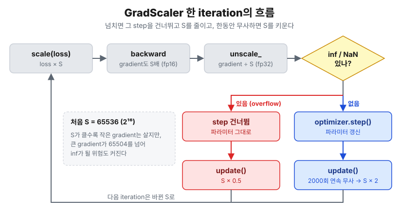

## 0. 들어가며

코드잇 미션7에서는 COCO로 사전학습된 SSD300을 강아지·고양이 얼굴 탐지에 전이학습했습니다. 처음 받은 baseline 노트북을 고쳐 나가다가 이런 코드를 발견했습니다.

```python
# Optimizer와 Loss 정의
optimizer = torch.optim.SGD(model.parameters(), lr=0.001, momentum=0.9, weight_decay=0.0005)
lr_scheduler = torch.optim.lr_scheduler.StepLR(optimizer, step_size=3, gamma=0.1)

for epoch in range(num_epochs):
    model.train()
    for images, targets in tqdm(train_loader, desc="Training"):
        ...
        loss_dict = model(images, targets)
        losses = sum(loss for loss in loss_dict.values())

        optimizer.zero_grad()
        losses.backward()
        optimizer.step()
    # ← lr_scheduler.step()은 어디에도 없다

    # Validation Phase
    ...
```

> 📌 **NOTE**
>
> 이 글은 미션7 실험 노트북([`experiment.ipynb`](https://github.com/raewoo0908/codeit_face_obj_detection))의 학습 코드와, 설치된 PyTorch 2.13.0 소스를 근거로 썼습니다. 
>
> 분류 헤드를 교체에 대한 자세한 이야기는 [SSD 분류 헤드 교체](/posts/ai/ssd-classification-head-replacement) 글에서 따로 다룹니다.

baseline은 `StepLR` 스케줄러를 만들어 놓고, 학습 루프 어디에서도 `scheduler.step()`을 부르지 않았습니다. 그래서 30 epoch 내내 <u>**learning rate가 처음 값 1e-3에 그대로 고정**</u>되어 있었죠. 에러도, 경고도 나지 않았습니다. 스케줄러는 "만들기만 하면 알아서 돌아가는 것"이 아니었던 겁니다.

그래서 이런 질문이 생겼습니다.

> 🤔 **optimizer와 scheduler는 각각 무슨 일을 하길래, scheduler를 부르지 않아도 학습은 멀쩡히 돌아갔을까요?**

이 질문에 답하면서, 같은 학습 루프 안에 들어 있는 <u>**AMP(Automatic Mixed Precision)**</u>까지 살펴보겠습니다. 

> 📌 **총정리**
>
> 1. optimizer는 gradient로 **파라미터를 갱신**하고, scheduler는 `optimizer.param_groups[i]["lr"]` **숫자 하나만 바꾼다.** 그래서 scheduler를 안 불러도 학습은 돈다(LR만 고정된다).
> 2. optimizer에는 `requires_grad=True`인 파라미터만 넘긴다. PyTorch SGD는 grad가 `None`인 파라미터를 건너뛰지만, grad가 0 텐서로 남아 있으면 얼린 파라미터도 weight decay·momentum으로 움직인다.
> 3. Warmup → Cosine은 `LambdaLR` 하나로 구현하고, **iteration마다** step한다. epoch마다 step하면 1 epoch짜리 warmup이 "계단 모양"이 되어 버린다.
> 4. fp16은 범위가 좁아서($2^{-24}$ ~ 65504) 작은 gradient가 0이 된다. **GradScaler**는 loss를 키워 backward한 뒤, 되돌리고(unscale), inf/NaN이 있으면 그 step을 건너뛰고 scale을 줄인다.
> 5. AMP 주의점: 
>       - CUDA에서만 켜고 `enabled=`로 코드를 하나로 유지. 
>       - 평가 출력은 `.float()`로 되돌린다.
>       - clipping 전엔 `unscale_`.
>       - 체크포인트에 **scaler 상태**도 저장.
> 6. GradScaler가 step을 건너뛰어도 scheduler는 한 칸 전진한다. 첫 iteration에서 건너뛰면 경고가 뜨고, 중간에서 건너뛰면 경고 없이 지나간다. 

## 1. Optimizer와 스케줄러는 무엇을 나눠 맡을까?

### 1.1. optimizer는 파라미터를, scheduler는 숫자 하나를 바꾼다

학습 루프의 한 iteration은 대략 이렇게 생겼습니다.

```python
loss = model(images, targets)   # 1. forward + loss
optimizer.zero_grad()           # 2. 이전 gradient 지우기
loss.backward()                 # 3. gradient 계산 (p.grad 채우기)
optimizer.step()                # 4. 파라미터 갱신
scheduler.step()                # 5. 다음 iteration에 쓸 LR 정하기
```

이 중 실제로 모델을 바꾸는 건 4번 `optimizer.step()`뿐입니다. SGD라면 각 파라미터 $\theta$에 대해 다음을 계산합니다.

- $g$: 이번 iteration의 gradient (`p.grad`)
- $\lambda$: weight decay, $\mu$: momentum, $\eta$: learning rate
- $v$: momentum buffer (optimizer가 파라미터마다 따로 들고 있는 상태)

$$
\begin{aligned}
g &\leftarrow g + \lambda\theta \\
v &\leftarrow \mu v + g \\
\theta &\leftarrow \theta - \eta v
\end{aligned}
$$

그렇다면 scheduler는 무엇을 할까요? <u>**scheduler는 이 식의 $\eta$ 하나만 바꿉니다.**</u> PyTorch 소스(`torch/optim/lr_scheduler.py`)의 `LRScheduler._update_lr`을 보면 정말 이것밖에 하지 않습니다.

```python
def _update_lr(self, epoch=None):
    with _enable_get_lr_call(self):
        if epoch is None:
            self.last_epoch += 1          # 내부 카운터를 한 칸 올리고
            values = self.get_lr()        # 그 카운터에 맞는 LR을 계산해서
    ...
    for param_group, lr in zip(self.optimizer.param_groups, values, strict=True):
        _update_param_group_val(param_group, "lr", lr)   # optimizer의 "lr" 값을 덮어쓴다
```

직접 확인해 보겠습니다.

```python
import torch
from torch import nn

model = nn.Linear(2, 1)
optimizer = torch.optim.SGD(model.parameters(), lr=2e-3, momentum=0.9, weight_decay=5e-4)
scheduler = torch.optim.lr_scheduler.LambdaLR(optimizer, lambda step: 0.5 ** step)

print("만든 직후     lr =", optimizer.param_groups[0]["lr"])
model(torch.ones(1, 2)).sum().backward()
optimizer.step()
scheduler.step()
print("step 1회 후   lr =", optimizer.param_groups[0]["lr"])
print("scheduler가 건드리지 않는 값:",
      {k: v for k, v in optimizer.param_groups[0].items() if k in ("momentum", "weight_decay")})
print("optimizer.state 키:", list(next(iter(optimizer.state.values())).keys()))
```

```text
만든 직후     lr = 0.002
step 1회 후   lr = 0.001
scheduler가 건드리지 않는 값: {'momentum': 0.9, 'weight_decay': 0.0005}
optimizer.state 키: ['momentum_buffer']
```

`lr`만 0.002 → 0.001로 바뀌었고, momentum·weight decay·momentum buffer는 scheduler와 무관하게 optimizer가 관리합니다.

이제 처음 질문에 답할 수 있습니다. <u>**scheduler를 부르지 않으면 `param_groups[0]["lr"]`이 처음 값 그대로 남을 뿐, optimizer는 그 LR로 계속 파라미터를 갱신합니다.**</u> 학습이 "멀쩡히 돈" 이유이자, 아무 경고도 나지 않은 이유죠.

> 💡 **scheduler는 optimizer의 비서다**
>
> 비유하자면 optimizer는 운전자이고, scheduler는 옆자리에서 "이제 속도 줄여"라고 말해 주는 내비게이션입니다. 내비게이션을 켜지 않아도(= `step()`을 안 불러도) 차는 달립니다. 다만 출발할 때 밟은 속도로 끝까지 달릴 뿐이죠.

### 1.2. 왜 `requires_grad=True`인 파라미터만 넘길까?

이번 실험은 backbone을 얼리고 head만 학습하는 <u>**Feature Extraction(FE)**</u> 방식이었습니다. 전체 23,879,570개 파라미터 중 학습 대상은 935,634개(약 3.9%)뿐이죠. 저는 optimizer를 이렇게 만들었습니다.

```python
def build_optimizer(model: nn.Module, train: TrainConfig) -> torch.optim.Optimizer:
    """학습 대상 파라미터만 SGD에 넘긴다."""
    trainable = [p for p in model.parameters() if p.requires_grad]
    return torch.optim.SGD(trainable, lr=train.learning_rate, momentum=train.momentum,
                           weight_decay=train.weight_decay)
```

노트북에는 "얼린 파라미터에 weight decay가 걸리거나 optimizer state가 쓸데없이 생기지 않게 한다"고 적어 두었습니다. 그런데 정말 그럴까요? 일부러 얼린 파라미터까지 전부 넘겨서 확인해 봤습니다.

```python
import torch
from torch import nn

torch.manual_seed(0)
backbone, head = nn.Linear(4, 4), nn.Linear(4, 2)
backbone.requires_grad_(False)          # backbone을 얼린다
model = nn.Sequential(backbone, head)

# 일부러 얼린 파라미터까지 전부 optimizer에 넘겨 본다
optimizer = torch.optim.SGD(model.parameters(), lr=0.1, momentum=0.9, weight_decay=5e-4)
before = backbone.weight.clone()

model(torch.randn(8, 4)).sum().backward()
print("backbone.weight.grad:", backbone.weight.grad)
optimizer.step()
print("① grad=None   → backbone 바뀜?", not torch.equal(before, backbone.weight),
      "| momentum state 생김?", backbone.weight in optimizer.state)

backbone.weight.grad = torch.zeros_like(backbone.weight)   # grad가 None이 아니라 0이라면?
optimizer.step()
print("② grad=0 텐서 → backbone 바뀜?", not torch.equal(before, backbone.weight),
      "| 변화량:", (before - backbone.weight).abs().max().item())
```

```text
backbone.weight.grad: None
① grad=None   → backbone 바뀜? False | momentum state 생김? False
② grad=0 텐서 → backbone 바뀜? True | 변화량: 2.3871660232543945e-05
```

결과가 반반이네요.

- **①** 얼린 파라미터는 backward를 거쳐도 `grad`가 `None`이고, PyTorch의 SGD는 <u>**grad가 `None`인 파라미터를 아예 건너뜁니다.**</u> weight decay도, momentum buffer도 생기지 않죠. 즉, 이 경우엔 다 넘겨도 결과가 같습니다.
- **②** 하지만 grad가 `None`이 아니라 <u>**0으로 채워진 텐서**</u>라면 이야기가 다릅니다. gradient가 0이어도 weight decay 항 $\lambda\theta$가 더해져서 <u>**얼렸다고 믿은 backbone이 조금씩 줄어듭니다.**</u>

grad가 0 텐서로 남는 건 `zero_grad(set_to_none=False)`를 쓰거나, 학습하던 파라미터를 도중에 얼리는 경우입니다. 지금 제 실험 노트북은 `zero_grad(set_to_none=True)`를 쓰니 ②에 걸리지는 않습니다. 

```python
# train_one_epoch() 내부 발췌
optimizer.zero_grad(set_to_none=True) # set_to_none=True: 모델의 누적된 기울기를 0으로 채우는 대신 None 값으로 설정합니다.
scaler.scale(loss).backward()
scaler.step(optimizer)
scaler.update()
scheduler.step()
```

하지만 애초에 Optimizer에게 <u>**학습 대상 파라미터만 넘기면 그런 조건을 따질 필요 자체가 사라집니다.**</u> "이 optimizer가 무엇을 학습하는지"가 코드에 그대로 드러난다는 장점도 있고요.

## 2. Warmup → Cosine 스케줄을 `LambdaLR`로 만들어 보자

### 2.1. 왜 warmup과 cosine을 쓸까?

baseline처럼 LR을 고정하면 두 가지 아쉬운 점이 있습니다.

1. **학습 초반**: 새로 만든 분류 head는 무작위로 초기화되어 있어서 처음 몇 iteration의 gradient가 크고 불안정할 수 있습니다. 여기에 처음부터 큰 LR을 쓰면 파라미터가 엉뚱한 곳으로 튈 수 있습니다. 그래서 작은 LR에서 시작해 목표 LR까지 서서히 올리는 <u>**warmup**</u>을 둡니다. [Goyal et al.(2017)](https://arxiv.org/abs/1706.02677)은 큰 배치 학습에서 이 방법을 쓰며 이렇게 설명합니다.

   > *develop a new warmup scheme that overcomes optimization challenges early in training.*

2. **학습 후반**: 최적점 근처에서도 큰 LR을 유지하면 그 주변을 계속 맴돕니다. 그래서 LR을 점점 줄여야 하는데, 이때 계단식으로 뚝뚝 떨어뜨리는 `StepLR` 대신 코사인 곡선을 따라 부드럽게 0까지 내리는 <u>**cosine decay**</u>를 썼습니다. [SGDR 논문](https://arxiv.org/abs/1608.03983)(Loshchilov & Hutter, 2016)에서 제안한 식은 다음과 같습니다.

$$
\eta_t = \eta_{min} + \frac{1}{2}(\eta_{max} - \eta_{min})\left(1 + \cos\left(\frac{T_{cur}}{T_{i}}\pi\right)\right)
$$

- $T_{cur}$: 감소 구간에서 지금까지 지난 step 수, $T_i$: 감소 구간 전체 step 수
- $T_{cur} = 0$이면 $\cos 0 = 1$이라 $\eta_{max}$, $T_{cur} = T_i$이면 $\cos\pi = -1$이라 $\eta_{min}$


즉, 처음엔 천천히, 중간엔 빠르게, 끝에선 다시 천천히 내려가는 S자 곡선이 나옵니다.

### 2.2. 구현: 배율 함수 + `LambdaLR`

`LambdaLR`은 <u>**"step 번호를 받아 처음 LR에 곱할 배율을 돌려주는 함수"**</u>만 넘기면 되는 스케줄러입니다. 소스를 보면 `get_lr()`이 정말 `base_lr * lmbda(self.last_epoch)`만 계산하죠.

```python
def warmup_cosine_factor(step: int, warmup_steps: int, total_steps: int, warmup_start_factor: float) -> float:
    """step(0부터)에서의 LR 배율: 선형 warmup 뒤 cosine decay."""
    if step < warmup_steps:
        return warmup_start_factor + (1.0 - warmup_start_factor) * step / warmup_steps
    progress = (step - warmup_steps) / max(1, total_steps - warmup_steps)
    return 0.5 * (1.0 + math.cos(math.pi * min(1.0, progress)))


def build_warmup_cosine_scheduler(optimizer, steps_per_epoch: int, train: TrainConfig):
    """iteration 단위로 step하는 warmup + cosine 스케줄러."""
    warmup_steps = train.warmup_epochs * steps_per_epoch
    total_steps = train.max_epochs * steps_per_epoch
    return torch.optim.lr_scheduler.LambdaLR(
        optimizer, lambda step: warmup_cosine_factor(step, warmup_steps, total_steps, train.warmup_start_factor))
```

설정값(`TrainConfig`)은 다음과 같습니다.

| 항목 | 값 |
| --- | --- |
| `learning_rate` | 2e-3 |
| `warmup_epochs` | 1 |
| `warmup_start_factor` | 0.1 (warmup 시작 LR = 2e-4) |
| `max_epochs` | 30 |
| train 이미지 / batch size | 2,571장 / 16 |

### 2.3. 손으로 계산해 보자

먼저 step 수부터 구합니다.

- 1 epoch의 iteration 수: $\lceil 2571 / 16 \rceil = \lceil 160.69 \rceil = 161$ 
- `warmup_steps` $= 1 \times 161 = 161$
- `total_steps` $= 30 \times 161 = 4830$ (`max_epochs` = 30)

이제 몇 개 step에서 배율을 계산해 보겠습니다.

1. **step 0 (학습 시작)**: warmup 구간이므로

   $$0.1 + 0.9 \times \frac{0}{161} = 0.1 \quad\rightarrow\quad \text{LR} = 2\text{e-}4$$

2. **step 80 (warmup 중간)**:

   $$0.1 + 0.9 \times \frac{80}{161} = 0.1 + 0.4472 = 0.5472 \quad\rightarrow\quad \text{LR} \approx 1.094\text{e-}3$$

3. **step 161 (warmup 끝, cosine 시작)**: `step < warmup_steps`가 거짓이 되어 cosine 식으로 넘어갑니다.

   $$\text{progress} = \frac{161 - 161}{4830 - 161} = 0 \quad\rightarrow\quad 0.5 \times (1 + \cos 0) = 1.0 \quad\rightarrow\quad \text{LR} = 2\text{e-}3$$

4. **step 2495 (cosine 중간)**:

   $$\text{progress} = \frac{2495 - 161}{4669} = 0.4999 \quad\rightarrow\quad 0.5 \times (1 + \cos(0.4999\pi)) \approx 0.5002 \quad\rightarrow\quad \text{LR} \approx 1.0\text{e-}3$$

5. **step 4829 (마지막 iteration)**: progress $\approx 1$이라 배율은 $0.0$, LR도 사실상 0입니다.

warmup 끝에서 정확히 1.0으로 이어지고, cosine 중간에서 정확히 절반이 되네요. 이 계산이 실제 학습 기록과 맞는지 검산해보겠습니다. 학습 시에 epoch마다 lr을 기록하도록 했습니다. epoch $e$의 시작 step은 $(e-1) \times 161$입니다.

| epoch | 시작 step | 손계산 LR | 노트북 기록 `lr_at_start` |
| --- | --- | --- | --- |
| 1 | 0 | 0.000200 | 0.0002 |
| 2 | 161 | 0.002000 | 0.0020 |
| 16 | 2415 | 0.001054 | 0.0011 |
| 30 | 4669 | 0.000006 | 0.0000 |

30 epoch 전부를 비교해 봐도 소수 넷째 자리까지 모두 일치했습니다.

### 2.4. 왜 epoch가 아니라 iteration마다 step할까?

PyTorch 공식 문서의 예제는 epoch 루프 바깥에서 `scheduler.step()`을 부릅니다. 그런데 이번 제 실험 노트북에서는 `train_one_epoch` **안에서, iteration마다** 불렀습니다. 왜 그랬을까요?

같은 배율 함수를 두 방식으로 step했을 때의 LR을 그려 봤습니다.


오른쪽 확대 그래프를 봐 주세요.

- **파란 선(iteration마다)**: 첫 epoch 161 iteration 동안 2e-4에서 2e-3까지 비스듬히 올라갑니다.
- **주황 선(epoch마다)**: 첫 epoch 내내 2e-4에 머물다가, epoch 1이 끝나는 순간 <u>**2e-3으로 10배 뛰어오릅니다.**</u>

warmup은 "LR을 서서히 올리자"는 아이디어인데, warmup이 1 epoch이고 step이 epoch마다라면 <u>**warmup이 계단 한 칸이 되어 버립니다.**</u> warmup을 안 한 것과 다를 바가 없죠. 왼쪽 그래프에서도 주황 선의 cosine은 30칸짜리 계단이 됩니다. 그래서 warmup이 짧을수록 iteration 단위 step이 필요합니다. 점선은 baseline의 고정 LR입니다.

> 📌 **NOTE: 학습 전에 LR 그래프부터 그려보는 습관을 들이자**
>
> 제 이번 실험 노트북에는 학습 전에 스케줄을 그려 보는 함수가 있습니다. scheduler가 의도대로 잘 동작하는지 **학습 시작 전에 눈으로 확인**하는 습관이 조용한 버그를 막아 줄 수 있습니다.
>
> 

<details>
<summary>그래프 코드</summary>

```python
import math

import matplotlib.pyplot as plt
import numpy as np


def factor(step, warmup_steps, total_steps, start=0.1):
    if step < warmup_steps:
        return start + (1.0 - start) * step / warmup_steps
    progress = (step - warmup_steps) / max(1, total_steps - warmup_steps)
    return 0.5 * (1.0 + math.cos(math.pi * min(1.0, progress)))


SPE, EPOCHS, LR = 161, 30, 2e-3      # 2,571장 / batch 16 = 161 iteration
steps = np.arange(SPE * EPOCHS)
per_iter = [LR * factor(s, SPE, SPE * EPOCHS) for s in steps]
per_epoch = [LR * factor(s // SPE, 1, EPOCHS) for s in steps]   # epoch 단위로 같은 함수를 쓴 경우

fig, axes = plt.subplots(1, 2, figsize=(11, 3.4), gridspec_kw={"width_ratios": [3, 2]})
for ax, xmax, title in [(axes[0], EPOCHS, "30 epoch 전체"), (axes[1], 2, "처음 2 epoch 확대 (warmup 구간)")]:
    ax.plot(steps / SPE, [1e-3] * len(steps), color="gray", ls=":", label="baseline: scheduler.step()을 안 부름 (1e-3 고정)")
    ax.plot(steps / SPE, per_epoch, color="tab:orange", label="epoch마다 step")
    ax.plot(steps / SPE, per_iter, color="tab:blue", label="iteration마다 step (노트북)")
    ax.set_xlim(0, xmax)
    ax.set_xlabel("epoch")
    ax.set_ylabel("learning rate")
    ax.set_title(title)
    ax.grid(alpha=0.3)
axes[0].legend(fontsize=8, loc="upper right")
plt.tight_layout()
plt.show()
```

</details>

## 3. AMP는 무엇이고, 무엇을 지켜 줄까?

지금까지는 매 iteration마다 "LR을 어떻게 조절할까"를 중점으로 다뤘습니다. 이번엔 같은 학습 루프에 들어 있는 다른 장치인 AMP를 보겠습니다.

> 🤔 **AMP(Automatic Mixed Precision)란?**
>
> 연산마다 float32(fp32, 높은 정밀도)와 float16(fp16, 낮은 정밀도) 중 알맞은 쪽을 **자동으로 골라** 섞어 쓰는 학습 방식입니다. PyTorch에서는 두 도구로 구성됩니다.
>
> - `torch.autocast`: 연산마다 fp16/fp32를 골라 준다.
> - `torch.amp.GradScaler`: fp16에서 작은 gradient가 0이 되지 않게 지켜 준다.

> 📌 **한 줄 요약**
>
> 속도·메모리를 위해 fp16을 쓰면 작은 gradient가 0이 되어 학습 신호가 사라진다. 그래서 backward 동안만 loss를 키워 gradient를 fp16 범위 안으로 올리고, fp32로 옮긴 뒤 되돌려서 원래 값으로 갱신한다.

### 3.1. 왜 굳이 fp16으로 학습할까?

fp16이 위험한데도 쓰는 건 얻는 게 크기 때문입니다.

- **속도**: 최신 GPU에는 fp16 행렬곱 전용 연산 장치(Tensor Core)가 있습니다. 같은 conv·linear 연산이 fp32보다 몇 배 빨라집니다.
- **메모리**: 값 하나가 2바이트로 fp32의 절반입니다. activation을 절반 크기로 저장하니 배치를 키우거나 더 큰 모델을 올릴 수 있습니다.

fp32가 유효숫자 일곱 자리 남짓을 적을 수 있는 큰 공책이라면, fp16은 세 자리 남짓만 적히는 작은 메모지입니다. 메모지는 가볍고 빨리 쓸 수 있지만, <u>**아주 작은 숫자를 적으려 하면 칸이 모자라 0이 되어버립니다.**</u>

그래서 AMP는 <u>**"빠르지만 표현 범위가 좁은 fp16"을 최대한 쓰고, 위험한 곳만 fp32로 지키는 전략**</u>입니다.

### 3.2. fp16으로 바꾸면 학습에서 무엇이 망가질까?

먼저 fp16이 표현할 수 있는 정밀도가 얼마나 좁은지 보겠습니다.

```python
import torch

print("fp16 최댓값       :", torch.finfo(torch.float16).max)
print("70000     → fp16  :", torch.tensor(70000.).half().item())

smallest = torch.tensor(2**-24).half()
print("2^-24     → fp16  :", smallest.item())
print("2^-24 ÷ 2 → fp16  :", (smallest / 2).item())
print("1e-8      → fp16  :", torch.tensor(1e-8).half().item())
```

```text
fp16 최댓값       : 65504.0
70000     → fp16  : inf
2^-24     → fp16  : 5.960464477539063e-08
2^-24 ÷ 2 → fp16  : 0.0
1e-8      → fp16  : 0.0
```

- **큰 쪽**: 최댓값은 <u>**65504**</u>입니다. 그보다 큰 70000은 `inf`가 됩니다(<u>**overflow**</u>).
- **작은 쪽**: $2^{-24} \approx 5.96\text{e-}8$은 살아남지만, 그 절반은 0이 됩니다. 즉 fp16이 표현하는 가장 작은 양수는 <u>**$2^{-24}$**</u>이고, 그보다 작으면 0이 됩니다(<u>**underflow**</u>). `1e-8`이 `0.0`이 된 것도 그래서입니다.

> 📌 **NOTE**: `torch.finfo`에는 $2^{-24}$를 알려 주는 항목이 없어서 값을 직접 넣어 확인했습니다. `finfo`의 `tiny`는 $2^{-14}$인데, 그 차이는 이 절 끝의 '더 알아보기'에서 다룹니다.

학습에서 이 범위에 걸리는 건 <u>**backward의 gradient**</u>입니다. forward의 activation은 대체로 0.01~100 같은 무난한 크기지만, gradient는 아주 작은 값이 흔합니다.

1. **loss를 배치 평균으로 낸다**: 샘플 하나가 주는 몫이 1/배치크기로 작아집니다.
2. **chain rule은 곱셈의 연쇄다**: 1보다 작은 미분값이 층마다 곱해지면, 깊은 층으로 갈수록 작아집니다.
3. **학습이 진행될수록 loss가 작아진다**: gradient도 따라 작아집니다.

이렇게 작아진 gradient가 $2^{-24}$ 아래로 떨어지면 0이 됩니다. 학습 관점에서는 <u>**"이 파라미터를 이 방향으로 조금 움직여라"라는 신호가 조용히 사라진다**</u>는 뜻입니다. 즉 기울기가 사라지면 학습이 망가질 수 있는 거죠.

이 문제를 보여준 대표 사례가 공교롭게도 이번에 쓴 SSD입니다. [Mixed Precision Training 논문](https://arxiv.org/abs/1710.03740)(Micikevicius et al., 2017)은 Multibox SSD의 activation gradient 분포를 모아 보고 이렇게 씁니다.

> *Note that much of the FP16 representable range was left unused, while many values were below the minimum representable range and became zeros.*


실제로 SSD는 fp16 범위에서 그대로 학습하면 발산했습니다.


### 3.3. 해결: 단위를 바꿔 적었다가 되돌린다 (loss scaling)

fp16에서는 너무 작은 gradient를 표현하기 힘들었습니다. 그래서 <u>**gradient를 적는 단위만 잠시 바꿔서(scaling) fp16이 표현할 수 있는 범위 내에서 기울기를 계산하고, 가중치를 갱신하기 직전에 되돌리는 방식을 사용합니다.**</u>


위 그림은 3.2절의 범위를 $\log_2$ 눈금으로 펼친 것입니다. 파란 구간이 fp16이 제대로 표현하는 범위, 왼쪽 빨간 구간이 0이 되어 버리는 영역입니다. $2^{-30}$짜리 gradient는 빨간 구간에 있어 그대로면 0이 되지만, $2^{16} = 65536$을 곱하면 $2^{-14}$로 옮겨져 파란 구간 안에 들어오게 되는 겁니다. AMP는 바로 이런 원리를 사용합니다. 

- **직관적으로:**

  소수점 아래 세 자리까지만 적히는 장부(= fp16)가 있다고 해 봅시다.

  | | 장부에 적는 값 | 결과 |
  | --- | --- | --- |
  | m 단위로 적기 (scale 전) | 0.0004 m | `0.000` → 사라짐 |
  | mm 단위로 적기 (scale 후) | 0.4 mm | `0.4` → 살아남음 |

  같은 fp16 장부에 같은 길이를 적었는데, 단위를 바꿨더니 살아남았습니다. 그리고 소수점 아래 수십 자리까지 적히는 큰 장부(= fp32)로 옮긴 다음 1000으로 나누면 원래 길이 0.0004 m가 됩니다. 길이를 조작한 게 아니라 단위를 바꿔서 두 장부 모두에서 값이 살아남을 수 있게 만든 거죠. 

- **엄밀하게:** 단위를 바꾸는 연산은 학습에 전혀 지장이 없습니다.

  1. **gradient는 loss에 정비례한다.** 미분은 상수배를 그대로 통과시킵니다.

     $$
     \frac{\partial (S \cdot L)}{\partial \theta} = S \cdot \frac{\partial L}{\partial \theta}
     $$

     backward는 chain rule, 즉 곱셈의 연쇄라서 맨 처음 loss에 곱한 $S$가 <u>**모든 층의 모든 gradient에 똑같이**</u> 붙어 내려갑니다. 

  2. **2의 거듭제곱을 곱하면 오차가 0이다.** fp16 숫자는 `1.xxx × 2^지수` 꼴이라, $2^{16}$을 곱하면 지수에 16을 더할 뿐 유효숫자 비트는 하나도 바뀌지 않습니다.

     $$
     1.5 \times 2^{-30} \;\xrightarrow{\times 2^{16}}\; 1.5 \times 2^{-14} \;\xrightarrow{\div 2^{16}}\; 1.5 \times 2^{-30}
     $$

     반올림이 없으니 곱했다가 나누면 정확히 원래 값입니다. scale로 65536(= $2^{16}$)처럼 딱 떨어지는 2의 거듭제곱을 곱하는 이유죠.

  3. **위험한 구간에서만 키우고, 안전한 곳에서 되돌린다.** "다시 나누면 결국 또 0이 되는 거 아닌가?" 싶을 수 있습니다. 키운 채로 지나가는 곳은 backward 중 fp16으로 계산되는 <u>**중간 gradient**</u>, 즉 underflow가 실제로 일어나는 곳입니다. 되돌리는 곳은 파라미터의 `.grad`인데, AMP에서 파라미터 원본은 fp32로 저장되기 때문에 `.grad`도 <u>**fp32**</u>입니다. fp32는 $10^{-38}$까지 표현하니 원래 스케일로 되돌려도 멀쩡합니다.

논문은 SSD의 경우 8배(지수 +3)만 키워도 fp32 정확도를 되찾았다고 보고합니다.

### 3.4. 한 iteration 안에서는 어떻게 돌아갈까?

학습 루프에서는 이렇게 썼습니다.

```python
with torch.autocast(device_type="cuda", dtype=torch.float16):
    loss = sum(model(images, targets).values())   # forward → loss 계산
scaler.scale(loss).backward()   # fp16에서 소실될 수 있는 loss를 스케일링( x S)한 채로 backward → gradient도 스케일링됨
scaler.step(optimizer)          # 언스케일링( ÷ S)해서 파라미터 갱신
scaler.update()                 # 다음 iteration의 S 조정
```

이 몇 줄 안에서 일어나는 일을 순서대로 펼치면 다음과 같습니다.

```
① forward (autocast)     conv·matmul은 fp16, softmax·loss 같은 예민한 연산은 fp32
② loss × S               scaler.scale(loss)      ← 단위를 바꾼다 (처음 S = 65536)
③ backward               중간 gradient들이 전부 S배인 채로 fp16에서 계산된다
                         → 원래 2^-30이라 0이 됐을 값이 2^-14로 살아남는다
④ param.grad (fp32)      파라미터 원본이 fp32라 gradient도 fp32 장부에 모인다
⑤ ÷ S                    scaler.step() 안에서 unscale → 원래 크기의 gradient
⑥ inf/NaN 검사           하나라도 있으면 이번 step은 건너뛴다
⑦ optimizer.step()       fp32 파라미터를 진짜 gradient로 갱신
⑧ scaler.update()        건너뛰었으면 S × 0.5, 2000번 연속 무사하면 S × 2
```

핵심은 ③입니다. <u>**gradient가 가장 작아지고 범위가 가장 좁은 구간을 큰 단위로 통과**</u>시키고, ⑤에서 넓은 fp32로 옮긴 뒤 되돌립니다.

> 🤔 **①의 autocast는 어떤 연산은 fp16, 어떤 연산은 fp32로 수행할까?**
>
> 연산 종류별로 정해져 있습니다. PyTorch 문서의 CUDA 기준 목록을 요약하면 다음과 같습니다.
>
> | fp16으로 (무겁고, 정밀도에 덜 예민) | fp32로 (작은 값을 많이 더하거나 지수·로그를 씀) |
> | --- | --- |
> | `matmul`, `linear`, `conv2d`, `bmm` … | `softmax`, `cross_entropy`, `smooth_l1_loss`, `sum`, `exp`, `log` … |
>
> SSD loss가 쓰는 두 함수(분류 `cross_entropy`, 박스 회귀 `smooth_l1_loss`)가 모두 fp32 쪽에 있습니다. <u>**무거운 연산은 빠르게, 예민한 연산은 정확하게**</u> 하는 셈이죠. 목록은 기기(CUDA/CPU)마다 조금 다르니 실제 환경의 목록은 [PyTorch AMP 문서](https://docs.pytorch.org/docs/stable/amp.html)에서 확인합니다. autocast는 forward와 loss만 감싸면 되고, backward는 forward와 같은 dtype으로 알아서 돕니다.

> 🤔 **⑥에서 step을 건너뛰고, ⑧에서 S를 줄였다 키웠다 하는 건 왜일까?**
>
> 1. **$S$는 크다고 무조건 좋은 게 아니다.** $S$를 곱하면 작은 gradient만 커지는 게 아니라 <u>**큰 gradient도 똑같이 커집니다.**</u> 작은 쪽을 $2^{-24}$ 위로 올리려고 $S$를 키우다 보면, 큰 쪽이 반대편 끝인 65504를 넘어 `inf`가 될 수 있습니다(overflow). 그래서 $S$는 "작은 gradient를 살릴 만큼 크고, 큰 gradient가 넘치지 않을 만큼 작은" 값이어야 합니다.
> 2. **그런데 그 적당한 $S$를 미리 알 수 없다.** 모델마다 다르고, 학습이 진행되며 gradient 크기가 변하면 같이 바뀝니다. 그래서 GradScaler는 $S$를 정해 두지 않고 <u>**일단 해 보고, 결과를 보고 고칩니다.**</u>
> 3. **넘쳤으면(⑥) 이번 step은 버린다.** gradient에 `inf`나 `NaN`이 하나라도 섞인 채로 갱신하면, 그 파라미터가 `inf`/`NaN`이 되어 다시는 돌아오지 않습니다. 모델이 통째로 망가지죠. 그래서 넘치는 gradient가 있는 iteration의 갱신은 아예 하지 않습니다. 한 번 건너뛰어도 다음 배치에서 다시 배우면 되니, 모델 자체를 망가뜨리는 것보단 훨씬 낫죠.
> 4. **넘쳤으면(⑧) $S$를 반으로 줄인다.** $S$가 너무 컸다는 뜻이니까요. 다음 iteration은 줄어든 $S$로 다시 시도합니다.
> 5. **한동안 안 넘쳤으면(⑧) $S$를 두 배로 키운다.** 2000번 연속 문제가 없었다면 $S$가 필요 이상으로 작을 수 있습니다. $S$가 작으면 작은 gradient가 다시 0으로 떨어질 위험이 커지니, 조금 더 키워서 시도해 봅니다.
>



> 🤔 **처음 scale이 65536이면 너무 크지 않나요?**
>
> 맞습니다. 그리고 PyTorch도 그걸 알고 있습니다. `GradScaler` docstring에 이렇게 적혀 있습니다.
>
> > *The scale factor often causes infs/NaNs to appear in gradients for the first few iterations as its value calibrates. `scaler.step` will skip the underlying `optimizer.step()` for these iterations.*
>
> 일부러 크게 시작해서, overflow가 나면 반씩 줄여 가며 맞는 값을 찾는 전략입니다. 크게 시작해서 몇 번 건너뛰는 비용이, 작게 시작해서 underflow로 gradient를 잃는 것보다 싸다는 판단이죠.

### 3.5. 어떤 경우에 유효할까?

**유효한 경우** — 아래 세 경우에 모두 해당되어야 합니다.

1. **fp16으로 학습할 때**: 이 문제는 fp16의 좁은 범위 때문에 생깁니다.
2. **CUDA GPU에서**: fp16의 속도 이득도, GradScaler도 CUDA를 전제로 합니다(4.1절).
3. **gradient가 실제로 $2^{-24}$ 아래로 떨어지는 모델일 때**: 깊은 네트워크나 SSD처럼 loss가 여러 항으로 쪼개지는 detection 모델이 대표적입니다. 원래 gradient가 충분히 크다면 큰 차이가 없지만, 미리 알기 어려우니 켜 두는 게 표준입니다.

**필요 없는 경우**

- **fp32로 학습할 때**: 범위가 $10^{-38}$까지라 underflow가 사실상 없습니다.
- **bf16으로 학습할 때**: bf16은 정밀도를 줄이는 대신 지수 비트를 fp32와 같은 8비트로 둡니다. 범위가 fp32와 같아서 작은 gradient도 0이 되지 않으니, bf16 AMP에는 GradScaler를 쓰지 않습니다.

> 🤔 **loss scaling으로 해결되지 않는 것은?**
>
> 1. **forward의 overflow**: activation이 65504를 넘는 문제는 loss를 키워 봐야 소용없습니다. 넘치기 쉬운 연산(`exp`, `sum`, `softmax` 등)을 autocast가 fp32로 돌려서 줄입니다.
> 2. **갱신의 정밀도**: fp16에서는 `1 + 1e-4`가 그냥 `1`이 됩니다. 큰 가중치에 작은 갱신이 묻히는 이 문제는 ⑦의 <u>**fp32 원본 가중치**</u>가 막습니다. scaling의 몫이 아닙니다.
> 3. **gradient의 폭이 fp16보다 넓을 때**: fp16이 담는 폭은 약 $2^{-24}$ ~ $2^{16}$입니다. 가장 큰 gradient와 가장 작은 gradient의 차이가 이보다 크면, 어떤 $S$를 골라도 한쪽 끝이 잘립니다. 키우면 큰 쪽이 `inf`, 줄이면 작은 쪽이 0이 되죠. GradScaler가 `inf`가 날 때마다 $S$를 줄이는 건 이 경계에서 타협하는 과정입니다.

<details>
<summary>더 알아보기: fp16 숫자의 구조 — 정규수와 비정규수</summary>

`torch.finfo`로 fp16과 fp32의 범위를 확인하면 이렇게 나옵니다.

```python
f16, f32 = torch.finfo(torch.float16), torch.finfo(torch.float32)
print("fp16 max", f16.max, "| 가장 작은 정규수", f16.tiny, "| eps", f16.eps)
print("fp32 max", f32.max, "| 가장 작은 정규수", f32.tiny, "| eps", f32.eps)
```

```text
fp16 max 65504.0 | 가장 작은 정규수 6.103515625e-05 | eps 0.0009765625
fp32 max 3.4028234663852886e+38 | 가장 작은 정규수 1.1754943508222875e-38 | eps 1.1920928955078125e-07
```

본문에서는 fp16의 하한을 $2^{-24} \approx 6\text{e-}8$이라 했는데, 출력의 `tiny`는 $6.1\text{e-}5$($2^{-14}$)입니다. 둘 다 맞습니다. 0 근처의 수를 적는 방식이 두 가지라서 그렇습니다.

| 구간 | 범위 | 상태 |
| --- | --- | --- |
| 0 | $2^{-24}$ 미만 | 사라짐 |
| 비정규수 | $2^{-24}$ ~ $2^{-14}$ | 살아는 있지만 정밀도가 깎임 |
| 정규수 | $2^{-14}$ ~ 65504 | 온전함 (상대오차 약 0.05% 이하) |

- **정규수**는 `1.xxxxxxxxxx × 2^지수` 꼴이라 크기와 상관없이 유효숫자가 11비트로 같습니다. `tiny`는 가장 작은 정규수입니다.
- 지수는 $-14$보다 작아질 수 없어서, 그 아래는 앞자리를 `0`으로 둔 `0.xxxxxxxxxx × 2^-14` 꼴로 적습니다. 이게 **비정규수**입니다. 앞자리 0이 늘어난 만큼 유효숫자가 빠집니다. 예를 들어 `1e-6`은 `1.013e-6`(오차 1.3%)으로, `1e-7`은 `1.19e-7`(오차 19%)로 저장됩니다.

그래서 loss scaling은 0이 될 값을 살릴 뿐 아니라, 비정규수 구간에서 뭉개지던 값을 정규수 구간으로 올려 정밀도도 되찾게 해 줍니다. 위 그림의 화살표가 $2^{-30}$을 정확히 정규수의 시작점 $2^{-14}$로 옮기는 것도 그 때문입니다.

`eps`는 1과 구분되는 가장 작은 차이입니다. fp16에서는 약 0.001이라 `1 + 1e-4`가 `1`이 됩니다(3.5절의 "갱신의 정밀도").

</details>

## 4. AMP를 쓸 때 주의할 점

### 4.1. CUDA에서만 켜고, `enabled=` 플래그로 통일

제 실험 노트북에서는 `use_amp`라는 불리언 플래그를 만들어놨습니다. `True`를 디폴트로 설정해 두고, CUDA가 아니면 꺼지도록 만들어놨습니다. 

```python
use_amp = train.use_amp and device.type == "cuda"
scaler = torch.amp.GradScaler("cuda", enabled=use_amp)
...
with torch.autocast(device_type=device.type, dtype=torch.float16, enabled=use_amp):
    loss_dict = model(images, targets)
```

실험 환경이 Colab T4 GPU였고, fp16으로 얻는 속도 이득은 GPU의 fp16 연산 장치에서 나오기 때문입니다. 저는 맥(MPS)과 CPU에서는 AMP를 검증하지 않았기 때문에 끄는 쪽을 골랐습니다.

여기서 중요한 건 <u>**`enabled=False`면 autocast와 GradScaler가 아무것도 하지 않는다**</u>는 점입니다. 소스를 보면 `enabled=False`인 GradScaler의 `step()`은 그냥 `optimizer.step()`을 부르고, `scale`·`update`는 아무 일도 하지 않습니다. 그래서 `if use_amp:` 분기 필요 없이 <u>**같은 코드로 Colab GPU와 로컬 맥 두 환경에서 모두 돌아갑니다.**</u>

### 4.2. 평가에서도 autocast를 쓰면, 출력은 `.float()`로 되돌린다

평가(`predict`)에서도 autocast로 추론 속도를 얻을 수 있습니다. 대신 출력을 꺼낼 때 `.float()`를 붙여야 합니다.

```python
with torch.autocast(device_type=device.type, dtype=torch.float16, enabled=use_amp):
    outputs = model(images)
predictions += [{"boxes": o["boxes"].float().cpu(), "scores": o["scores"].float().cpu(),
                 "labels": o["labels"].cpu()} for o in outputs]
```

autocast 안에서 나온 SSD 출력이 정말 fp16인지 CPU에서 확인해 봤습니다.

```python
import torch
from torchvision.models.detection import ssd300_vgg16

model = ssd300_vgg16(weights=None, weights_backbone=None, num_classes=3).eval()
with torch.no_grad(), torch.autocast(device_type="cpu", dtype=torch.float16):
    outputs = model([torch.rand(3, 400, 300)])
print({key: value.dtype for key, value in outputs[0].items()})
```

```text
{'boxes': torch.float16, 'scores': torch.float16, 'labels': torch.int64}
```

박스와 점수가 fp16으로 나왔습니다(CUDA에서는 `softmax`가 fp32 목록이라 점수의 dtype이 다를 수 있습니다). 이대로 지표 계산에 넘기면 두 가지가 걸립니다.

- **박스 좌표의 해상도**: fp16은 256~512 구간에서 표현할 수 있는 간격이 $256 \times 2^{-10} = 0.25$입니다. 캐시 이미지의 긴 변이 448px이니, 좌표가 0.25px 단위로 반올림되는 셈이죠.
- **점수의 해상도**: 0.5~1.0 사이에 fp16 값은 1024개뿐입니다. AP는 점수로 예측을 정렬해서 계산하니, 값이 뭉치면 정렬 순서가 거칠어집니다.

그래서 <u>**fp32인 GT와 같은 dtype으로 맞춘 뒤 평가 지표를 계산해야 합니다.**</u>

### 4.3. gradient clipping을 쓴다면 `unscale_`을 먼저

이번 노트북은 gradient clipping을 쓰지 않았지만, 쓴다면 순서가 중요합니다. `scale(loss).backward()` 직후의 gradient는 $S$배 커진 상태라서, 그대로 `clip_grad_norm_(max_norm=1.0)`을 하면 <u>**65536배 큰 값을 기준으로 자르게 됩니다.**</u> PyTorch AMP 예제 문서도 이렇게 경고합니다.

> *If you attempted to clip without unscaling, the gradients' norm/maximum magnitude would also be scaled*

그래서 먼저 `unscale_`로 되돌린 뒤 잘라야 합니다.

```python
scaler.scale(loss).backward()
scaler.unscale_(optimizer)                                    # gradient ÷ S (inf 검사도 여기서)
torch.nn.utils.clip_grad_norm_(model.parameters(), max_norm)  # 이제 원래 크기 기준으로 자른다
scaler.step(optimizer)                                        # 이미 unscale했으니 다시 나누지 않는다
scaler.update()
```

`unscale_`을 직접 불렀다면 `step()` 내부에서 언스케일링을 다시 하지는 않습니다. 소스 구현상 `step()`은 아직 unscale되지 않은 상태(`OptState.READY`)일 때만 `unscale_`을 부르고, 한 iteration에 `unscale_`을 두 번 부르면 `RuntimeError`가 납니다.

### 4.4. 체크포인트에 scaler 상태도 저장한다

저는 Colab 무료 계정을 쓰고 있기 때문에 세션이 언제 끊길지 모르는 상황입니다. 따라서 세션 변경 시 학습 재개용 체크포인트를 저장했는데요, 여기에 model·optimizer·scheduler와 함께 <u>**scaler의 `state_dict`**</u>도 넣었습니다.

```python
checkpoints.save_resume({
    "model": model.state_dict(), "optimizer": optimizer.state_dict(),
    "scheduler": scheduler.state_dict(), "scaler": scaler.state_dict(),
    ...
})
# 재개할 때
scaler.load_state_dict(state["scaler"])
```

scaler 상태라고 해 봐야 `scale`, `growth_factor`, `backoff_factor`, `growth_interval`, `_growth_tracker` 다섯 개뿐입니다. 이걸 빼먹으면 어떻게 될까요? 같은 체크포인트에서 scaler 상태를 넣고/빼고 재개해 봤습니다.

```python
import copy

import torch
from torch import nn

torch.manual_seed(0)
model = nn.Linear(8, 3)
x = torch.randn(4, 8) * 3
optimizer = torch.optim.SGD(model.parameters(), lr=2e-3, momentum=0.9)


def train(scaler, n_iters, tag):
    skipped = 0
    for _ in range(n_iters):
        before = model.weight.detach().clone()
        with torch.autocast(device_type="cpu", dtype=torch.float16):
            loss = model(x).float().pow(2).mean()
        optimizer.zero_grad(set_to_none=True)
        scaler.scale(loss).backward()
        scaler.step(optimizer)
        scaler.update()
        skipped += torch.equal(before, model.weight)
    print(f"{tag}: {n_iters} iteration 중 {skipped}번 건너뜀, 끝난 뒤 scale = {scaler.get_scale():.0f}")


scaler = torch.amp.GradScaler("cpu")
train(scaler, 10, "처음 학습            ")
checkpoint = copy.deepcopy({"model": model.state_dict(), "optimizer": optimizer.state_dict(),
                            "scaler": scaler.state_dict()})   # torch.save로 파일에 쓴 것과 같은 효과

for tag, load_scaler in [("scaler 상태 없이 재개", False), ("scaler 상태까지 재개", True)]:
    model.load_state_dict(checkpoint["model"])           # 같은 체크포인트에서 출발
    optimizer.load_state_dict(checkpoint["optimizer"])
    resumed = torch.amp.GradScaler("cpu")
    if load_scaler:
        resumed.load_state_dict(checkpoint["scaler"])
    print(f"  {tag} 직전 scale = {resumed.get_scale():.0f}")
    train(resumed, 10, tag)
```

```text
처음 학습            : 10 iteration 중 3번 건너뜀, 끝난 뒤 scale = 8192
  scaler 상태 없이 재개 직전 scale = 65536
scaler 상태 없이 재개: 10 iteration 중 1번 건너뜀, 끝난 뒤 scale = 32768
  scaler 상태까지 재개 직전 scale = 8192
scaler 상태까지 재개: 10 iteration 중 0번 건너뜀, 끝난 뒤 scale = 8192
```

scaler 상태를 저장하지 않은 상태에서 학습을 재개하면 scale이 <u>**처음 값 65536으로 돌아가서 다시 더듬어 찾기 시작합니다.**</u> 그동안 또 iteration을 건너뛰죠. 상태를 저장한 상태에서 학습을 재개하면 이전에 찾아 둔 8192에서 바로 이어 갑니다. 

## 5. GradScaler가 iteration을 건너뛰어도 scheduler는 lr을 갱신한다

앞에서 Scheduler는 lr을 매 iteration마다 갱신하는 역할을 하고, Scaler는 iteration 안에서 gradient가 inf/NaN이 나면 파라미터 갱신을 건너뛴다고 했습니다. 

그리고 이건 학습 코드에서 다음과 같이 구현됩니다. 

```python
scaler.scale(loss).backward()
scaler.step(optimizer)      # inf/NaN이면 optimizer.step()을 건너뜀
scaler.update()
scheduler.step()            # 그런데 이건 무조건 불린다
```

뭔가 이상하지 않나요? `scaler.step()`은 optimizer를 건너뛸 수 있는데, `scheduler.step()`은 <u>**매 iteration 무조건**</u> 불립니다. 그리고 실제로 학습 첫 epoch에서 이런 경고가 찍혔습니다.

```text
UserWarning: Detected call of `lr_scheduler.step()` before `optimizer.step()`. In PyTorch 1.1.0 and later, you should call them in the opposite order: `optimizer.step()` before `lr_scheduler.step()`.  Failure to do this will result in PyTorch skipping the first value of the learning rate schedule. See more details at https://pytorch.org/docs/stable/optim.html#how-to-adjust-learning-rate
  scheduler.step()
```

코드상으로는 분명히 `optimizer.step()` → `scheduler.step()` 순서인데, 왜 "순서가 반대"라고 할까요?

### 5.1. 경고는 어떻게 "순서"를 알아챌까?

`LRScheduler.__init__`을 보면, 스케줄러는 만들어질 때 <u>**optimizer의 `step` 메서드를 감싸서**</u> 불릴 때마다 표시를 남기게 합니다.

```python
@wraps(func)
def wrapper(*args, **kwargs):
    opt = opt_ref()
    opt._opt_called = True     # optimizer.step()이 한 번이라도 불렸다는 표시
    return func.__get__(opt, opt.__class__)(*args, **kwargs)
```

그리고 `step()`에서 이 표시를 확인합니다.

```python
if self._step_count == 1:
    ...
    # Just check if there were two first lr_scheduler.step() calls before optimizer.step()
    elif not getattr(self.optimizer, "_opt_called", False):
        warnings.warn("Detected call of `lr_scheduler.step()` before `optimizer.step()`. ...")
```

즉, 이 경고는 코드의 순서를 읽는 게 아니라 <u>**"첫 `scheduler.step()` 시점까지 `optimizer.step()`이 실제로 한 번이라도 실행됐는가"**</u>를 봅니다. `_step_count`는 생성자에서 한 번 step하며 1이 되므로, 이 검사는 학습 루프의 첫 `scheduler.step()`에서만 일어납니다.

즉, 첫 iteration에서 scale 65536 때문에 gradient가 overflow → GradScaler가 `optimizer.step()`을 건너뜀 → `_opt_called`가 아직 없음 → 첫 `scheduler.step()`에서 경고. <u>**코드 순서는 맞았지만, 첫 optimizer step이 실행되지 않았던 겁니다.**</u>

### 5.2. 직접 재현해 보자

```python
import math
import warnings

import torch
from torch import nn

warnings.simplefilter("always")
torch.manual_seed(0)


def warmup_cosine_factor(step, warmup_steps, total_steps, warmup_start_factor):
    if step < warmup_steps:
        return warmup_start_factor + (1.0 - warmup_start_factor) * step / warmup_steps
    progress = (step - warmup_steps) / max(1, total_steps - warmup_steps)
    return 0.5 * (1.0 + math.cos(math.pi * min(1.0, progress)))


model = nn.Linear(8, 3)
x = torch.randn(4, 8) * 3       # 출력이 커서 gradient도 큰 입력
optimizer = torch.optim.SGD(model.parameters(), lr=2e-3, momentum=0.9)
scheduler = torch.optim.lr_scheduler.LambdaLR(
    optimizer, lambda s: warmup_cosine_factor(s, warmup_steps=4, total_steps=10, warmup_start_factor=0.1))
scaler = torch.amp.GradScaler("cpu")   # init_scale = 2**16 = 65536

for it in range(6):
    before = model.weight.detach().clone()
    lr_used = optimizer.param_groups[0]["lr"]
    scale_used = scaler.get_scale()
    with torch.autocast(device_type="cpu", dtype=torch.float16):
        loss = model(x).float().pow(2).mean()
    optimizer.zero_grad(set_to_none=True)
    scaler.scale(loss).backward()
    with warnings.catch_warnings(record=True) as caught:
        scaler.step(optimizer)
        scaler.update()
        scheduler.step()
    stepped = not torch.equal(before, model.weight)
    print(f"iter {it}: scale {scale_used:>7.0f} | lr {lr_used:.6f} | optimizer.step {'실행' if stepped else '건너뜀'}"
          + (" | ⚠ " + str(caught[0].message)[:56] + "..." if caught else ""))
```

```text
iter 0: scale   65536 | lr 0.000200 | optimizer.step 건너뜀 | ⚠ Detected call of `lr_scheduler.step()` before `optimizer...
iter 1: scale   32768 | lr 0.000650 | optimizer.step 건너뜀
iter 2: scale   16384 | lr 0.001100 | optimizer.step 건너뜀
iter 3: scale    8192 | lr 0.001550 | optimizer.step 실행
iter 4: scale    8192 | lr 0.002000 | optimizer.step 실행
iter 5: scale    8192 | lr 0.001866 | optimizer.step 실행
```

한 줄씩 읽어 보면 3장의 내용이 그대로 보입니다.

- **iter 0~2**: scale 65536 → 32768 → 16384로 반씩 줄며 <u>**세 번 연속 건너뛰었습니다.**</u> 경고는 첫 번째(iter 0)에서만 떴습니다.
- **iter 3**: scale 8192에서 처음으로 overflow 없이 갱신이 일어났습니다.
- **lr 열**: 그동안에도 LR은 0.0002 → 0.00065 → 0.0011 → 0.00155로 <u>**한 칸씩 착실히 올라갔습니다.**</u>

결과적으로 warmup 4칸 중 3칸(0.0002, 0.00065, 0.0011)은 <u>**한 번도 파라미터 갱신에 쓰이지 못하고 지나갔습니다.**</u> 경고문이 말한 "skipping the first value of the learning rate schedule"이 바로 이겁니다. 그리고 iter 1, 2처럼 <u>**첫 번째 이후의 건너뜀은 경고조차 없습니다.**</u>

### 5.3. 그래서 실제 학습에는 얼마나 영향이 있었을까?

정직하게 말하면, <u>**이번 설정에서는 영향이 미미했을 것으로 판단합니다.**</u>

1. **처음 건너뛴 횟수**: 실험 노트북에는 몇 번 건너뛰었는지 기록이 없습니다. 경고가 떴으니 최소 1번이라는 것만 확실합니다. 처음 몇 번이 건너뛰어지면 warmup 161칸 중 그만큼이 파라미터 갱신 없이 지나갑니다. 예를 들어 1번이면 첫 실제 갱신의 배율이 0.1 대신 $0.1 + 0.9 \times 1/161 \approx 0.1056$이 될 뿐입니다.
2. **중간에 건너뛰는 횟수**: scale이 자리를 잡은 뒤에는 `growth_interval=2000`번 연속 성공할 때마다 두 배로 키워 보다가, overflow가 나면 다시 줄입니다. 전체가 4,830 iteration이니 키워 보는 시도 자체가 두어 번뿐이라, 그 때문에 건너뛰는 것도 몇 번 수준일 것으로 추정됩니다.
3. **cosine의 끝**: 건너뛴 만큼 스케줄이 앞당겨져서, 마지막 몇 iteration이 LR 0 근처를 조금 덜 돌 뿐입니다.

그래도 신경 쓰인다면 <u>**optimizer가 실제로 갱신했을 때만 scheduler를 전진시키도록 코드를 짜면 됩니다.**</u> `update()` 전후의 scale을 비교하면 건너뛰었는지 알 수 있습니다(건너뛰면 scale이 반으로 줄어드니까요).

```python
scale_before = scaler.get_scale()
scaler.step(optimizer)
scaler.update()
if scaler.get_scale() >= scale_before:   # 줄지 않았다 = 이번 step은 실행됐다
    scheduler.step()
```

> 🤔 **그럼 노트북도 이렇게 고쳐야 했을까요?**
>
> 꼭 그렇지는 않습니다. 이 방식에도 대가가 있습니다.
>
> 1. **`get_scale()`은 GPU→CPU 동기화를 일으킵니다.** 매 iteration 부르면 그만큼 GPU가 기다립니다.
> 2. **scheduler의 step 수가 실제 iteration 수와 어긋납니다.** 건너뛴 만큼 cosine이 0에 닿기 전에 학습이 끝납니다. "30 epoch 끝에 LR 0"이라는 설계가 조금 틀어지는 거죠.
>
> 영향이 몇 칸 수준이라면 경고를 이해하고 넘어가는 것도 합리적인 선택입니다. 제 코드는 그쪽을 택했습니다. 중요한 건 <u>**이 경고가 "코드 순서가 틀렸다"는 뜻이 아니라는 걸 아는 것**</u>입니다. 모르면 멀쩡한 순서를 뒤집는 "수정"을 하게 되니까요.

## 6. 그래서 코드는 어떻게 씀?

지금까지 살펴본 것을 노트북의 최종 학습 루프에 모아 보면 다음과 같습니다.

```python
def train_one_epoch(model, loader, optimizer, scheduler, scaler, device, use_amp):
    """1 epoch 학습하고 평균 loss를 돌려준다. scheduler는 iteration마다 step한다."""
    model.train()
    totals = {"loss": 0.0, "loss_classification": 0.0, "loss_bbox_regression": 0.0}
    for images, targets in tqdm(loader, desc="train", leave=False):
        images, targets = move_batch_to_device(images, targets, device)
        # 1. forward + loss만 autocast로 감싼다 (conv는 fp16, loss는 fp32)
        with torch.autocast(device_type=device.type, dtype=torch.float16, enabled=use_amp):
            loss_dict = model(images, targets)
            loss = loss_dict["classification"] + loss_dict["bbox_regression"]
        optimizer.zero_grad(set_to_none=True)   # 2. grad를 None으로 (0 텐서로 남기지 않는다)
        scaler.scale(loss).backward()           # 3. loss × S 로 backward (autocast 바깥)
        scaler.step(optimizer)                  # 4. ÷ S, inf/NaN이면 optimizer.step() 건너뜀
        scaler.update()                         # 5. scale 조정 (건너뛰면 ×0.5, 2000회 연속 성공 시 ×2)
        scheduler.step()                        # 6. 다음 iteration의 LR (iteration 단위)

        totals["loss"] += loss.item()
        totals["loss_classification"] += loss_dict["classification"].item()
        totals["loss_bbox_regression"] += loss_dict["bbox_regression"].item()
    return {key: value / len(loader) for key, value in totals.items()}
```

그리고 이 함수를 호출하는 쪽(`fit`)에서 준비하는 것들입니다.

```python
use_amp = train.use_amp and device.type == "cuda"                          # CUDA에서만 AMP
optimizer = build_optimizer(model, train)                                  # requires_grad=True만
scheduler = build_warmup_cosine_scheduler(optimizer, len(train_loader), train)  # iteration 단위
scaler = torch.amp.GradScaler("cuda", enabled=use_amp)                     # 꺼지면 no-op
```

한 iteration의 호출 순서를 정리하면 다음과 같습니다.

| 순서 | 호출 | 하는 일 | 주의할 점 |
| --- | --- | --- | --- |
| 1 | `with autocast(...)` | forward와 loss를 연산별 dtype으로 계산 | backward는 바깥에서 |
| 2 | `optimizer.zero_grad(set_to_none=True)` | 이전 gradient 제거 | 0 텐서로 남기면 얼린 파라미터가 weight decay로 움직일 수 있음 |
| 3 | `scaler.scale(loss).backward()` | gradient를 S배로 계산 | |
| (3.5) | `scaler.unscale_(optimizer)` + clipping | gradient를 원래 크기로 되돌려 자르기 | clipping을 쓸 때만. 한 iteration에 한 번 |
| 4 | `scaler.step(optimizer)` | ÷S, inf/NaN 검사, 멀쩡하면 갱신 | 건너뛸 수 있다 |
| 5 | `scaler.update()` | scale 조정 | step 다음, iteration 끝에 |
| 6 | `scheduler.step()` | 다음 LR 설정 | 4가 건너뛰어도 전진한다 |

체크포인트에는 model·optimizer·scheduler·**scaler** 네 개의 `state_dict`를 함께 저장하고, evaluation 함수에서 출력은 `.float()`로 fp32로 되돌린 뒤 평가 지표를 계산해야 합니다.

이제 baseline의 "만들기만 한 scheduler"가 왜 아무 일도 하지 않았는지, 그리고 제대로 부르기 시작하자 왜 엉뚱한 경고가 떴는지 모두 설명할 수 있게 되었습니다!

## 📚 참고자료

- :github: [실험 코드 레포지토리](https://github.com/raewoo0908/codeit_face_obj_detection)
- [Mixed Precision Training](https://arxiv.org/abs/1710.03740) — Micikevicius et al., 2017 (ICLR 2018). loss scaling, Multibox SSD 사례
- [SGDR: Stochastic Gradient Descent with Warm Restarts](https://arxiv.org/abs/1608.03983) — Loshchilov & Hutter, 2016. cosine 스케줄
- [Accurate, Large Minibatch SGD: Training ImageNet in 1 Hour](https://arxiv.org/abs/1706.02677) — Goyal et al., 2017. warmup
- [torch.optim — How to adjust learning rate](https://docs.pytorch.org/docs/stable/optim.html)
- [LambdaLR — PyTorch documentation](https://docs.pytorch.org/docs/stable/generated/torch.optim.lr_scheduler.LambdaLR.html)
- [Automatic Mixed Precision package - torch.amp](https://docs.pytorch.org/docs/stable/amp.html)
- [Automatic Mixed Precision examples](https://docs.pytorch.org/docs/stable/notes/amp_examples.html)
- [PyTorch issue #20124](https://github.com/pytorch/pytorch/issues/20124) — `scheduler.step()` 호출 순서 경고가 도입된 배경
