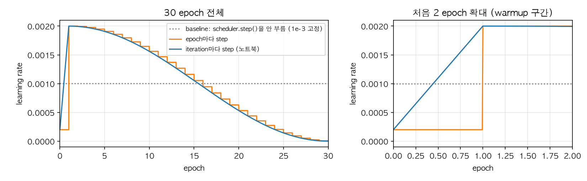
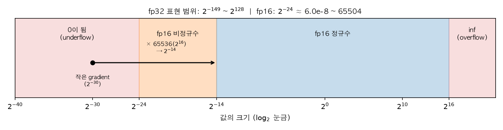

## 0. 들어가며

코드잇 미션7에서는 COCO로 사전학습된 SSD300을 강아지·고양이 얼굴 탐지에 전이학습했습니다. 처음 받은 baseline 노트북을 고쳐 나가다가 이런 코드를 발견했습니다.

> 📌 **NOTE**
>
> 이 글은 미션7 실험 노트북([`experiment.ipynb`](https://github.com/raewoo0908/codeit_face_obj_detection))의 학습 코드와, 설치된 PyTorch 2.13.0 소스를 근거로 썼습니다. 분류 헤드를 교체한 이야기는 [SSD 분류 헤드 교체](/posts/ai/ssd-classification-head-replacement) 글에서 따로 다룹니다.

baseline은 `StepLR` 스케줄러를 만들어 놓고, 학습 루프 어디에서도 `scheduler.step()`을 부르지 않았습니다. 그래서 30 epoch 내내 <u>**learning rate가 처음 값 1e-3에 그대로 고정**</u>되어 있었죠. 에러도, 경고도 나지 않았습니다. 스케줄러는 "만들기만 하면 알아서 돌아가는 것"이 아니었던 겁니다.

그렇다면 질문이 생깁니다.

> 🤔 **optimizer와 scheduler는 각각 무슨 일을 하길래, scheduler를 부르지 않아도 학습은 멀쩡히 돌아갔을까요?**

이 질문에 답하면서, 같은 학습 루프 안에 들어 있는 <u>**AMP(Automatic Mixed Precision)**</u>까지 살펴보겠습니다. 마지막에는 이 둘이 부딪히는 지점, <u>**"GradScaler가 optimizer.step()을 건너뛰어도 scheduler.step()은 불린다"**</u>는 문제까지 다룹니다. 실제로 제 노트북 출력에도 이 경고가 찍혀 있었거든요.

> 📌 **총정리**
>
> 1. optimizer는 gradient로 **파라미터를 갱신**하고, scheduler는 `optimizer.param_groups[i]["lr"]` **숫자 하나만 바꾼다.** 그래서 scheduler를 안 불러도 학습은 돈다(LR만 고정된다).
> 2. optimizer에는 `requires_grad=True`인 파라미터만 넘긴다. PyTorch SGD는 grad가 `None`인 파라미터를 건너뛰지만, grad가 0 텐서로 남아 있으면 얼린 파라미터도 weight decay·momentum으로 움직인다.
> 3. Warmup → Cosine은 `LambdaLR` 하나로 구현하고, **iteration마다** step한다. epoch마다 step하면 1 epoch짜리 warmup이 "계단 한 칸"이 되어 버린다.
> 4. fp16은 범위가 좁아서($2^{-24}$ ~ 65504) 작은 gradient가 0이 된다. **GradScaler**는 loss를 키워 backward한 뒤, 되돌리고(unscale), inf/NaN이 있으면 그 step을 건너뛰고 scale을 줄인다.
> 5. AMP 주의점: CUDA에서만 켜고 `enabled=`로 코드를 하나로 유지 / 평가 출력은 `.float()`로 되돌림 / clipping 전엔 `unscale_` / 체크포인트에 **scaler 상태**도 저장.
> 6. GradScaler가 step을 건너뛰어도 scheduler는 한 칸 전진한다. 첫 iteration에서 건너뛰면 경고가 뜨고, 중간에서 건너뛰면 경고 없이 지나간다. 이번 설정에서는 영향이 미미하다.

## 1. Optimizer와 스케줄러는 무엇을 나눠 맡을까?

### 1.1. optimizer는 파라미터를, scheduler는 숫자 하나를 바꾼다

학습 루프의 한 iteration은 대략 이렇게 생겼습니다.

```python
loss = model(images, targets)   # 1. forward + loss
optimizer.zero_grad()           # 2. 이전 gradient 지우기
loss.backward()                 # 3. gradient 계산 (p.grad 채우기)
optimizer.step()                # 4. 파라미터 갱신
scheduler.step()                # 5. 다음 iteration에 쓸 LR 정하기
```

이 중 실제로 모델을 바꾸는 건 4번 `optimizer.step()`뿐입니다. SGD라면 각 파라미터 $\theta$에 대해 다음을 계산합니다.

- $g$: 이번 iteration의 gradient (`p.grad`)
- $\lambda$: weight decay, $\mu$: momentum, $\eta$: learning rate
- $v$: momentum buffer (optimizer가 파라미터마다 따로 들고 있는 상태)

$$
\begin{aligned}
g &\leftarrow g + \lambda\theta \\
v &\leftarrow \mu v + g \\
\theta &\leftarrow \theta - \eta v
\end{aligned}
$$

그렇다면 scheduler는 무엇을 할까요? <u>**scheduler는 이 식의 $\eta$ 하나만 바꿉니다.**</u> PyTorch 소스(`torch/optim/lr_scheduler.py`)의 `LRScheduler._update_lr`을 보면 정말 그것뿐입니다.

```python
def _update_lr(self, epoch=None):
    with _enable_get_lr_call(self):
        if epoch is None:
            self.last_epoch += 1          # 내부 카운터를 한 칸 올리고
            values = self.get_lr()        # 그 카운터에 맞는 LR을 계산해서
    ...
    for param_group, lr in zip(self.optimizer.param_groups, values, strict=True):
        _update_param_group_val(param_group, "lr", lr)   # optimizer의 "lr" 값을 덮어쓴다
```

직접 확인해 보겠습니다.

```python
import torch
from torch import nn

model = nn.Linear(2, 1)
optimizer = torch.optim.SGD(model.parameters(), lr=2e-3, momentum=0.9, weight_decay=5e-4)
scheduler = torch.optim.lr_scheduler.LambdaLR(optimizer, lambda step: 0.5 ** step)

print("만든 직후     lr =", optimizer.param_groups[0]["lr"])
model(torch.ones(1, 2)).sum().backward()
optimizer.step()
scheduler.step()
print("step 1회 후   lr =", optimizer.param_groups[0]["lr"])
print("scheduler가 건드리지 않는 값:",
      {k: v for k, v in optimizer.param_groups[0].items() if k in ("momentum", "weight_decay")})
print("optimizer.state 키:", list(next(iter(optimizer.state.values())).keys()))
```

```text
만든 직후     lr = 0.002
step 1회 후   lr = 0.001
scheduler가 건드리지 않는 값: {'momentum': 0.9, 'weight_decay': 0.0005}
optimizer.state 키: ['momentum_buffer']
```

`lr`만 0.002 → 0.001로 바뀌었고, momentum·weight decay·momentum buffer는 scheduler와 무관하게 optimizer가 관리합니다.

이제 도입의 질문에 답할 수 있습니다. <u>**scheduler를 부르지 않으면 `param_groups[0]["lr"]`이 처음 값 그대로 남을 뿐, optimizer는 그 LR로 계속 파라미터를 갱신합니다.**</u> 학습이 "멀쩡히 돈" 이유이자, 아무 경고도 나지 않은 이유죠.

> 💡 **scheduler는 optimizer의 비서다**
>
> 비유하자면 optimizer는 운전자이고, scheduler는 옆자리에서 "이제 속도 줄여"라고 말해 주는 내비게이션입니다. 내비게이션을 켜지 않아도(= `step()`을 안 불러도) 차는 달립니다. 다만 출발할 때 밟은 속도로 끝까지 달릴 뿐이죠.

### 1.2. 왜 `requires_grad=True`인 파라미터만 넘길까?

이번 실험은 backbone을 얼리고 head만 학습하는 <u>**Feature Extraction(FE)**</u> 방식이었습니다. 전체 23,879,570개 파라미터 중 학습 대상은 935,634개(약 3.9%)뿐이죠. 노트북은 optimizer를 이렇게 만듭니다.

```python
def build_optimizer(model: nn.Module, train: TrainConfig) -> torch.optim.Optimizer:
    """학습 대상 파라미터만 SGD에 넘긴다."""
    trainable = [p for p in model.parameters() if p.requires_grad]
    return torch.optim.SGD(trainable, lr=train.learning_rate, momentum=train.momentum,
                           weight_decay=train.weight_decay)
```

노트북에는 "얼린 파라미터에 weight decay가 걸리거나 optimizer state가 쓸데없이 생기지 않게 한다"고 적어 두었습니다. 그런데 정말 그럴까요? 일부러 얼린 파라미터까지 전부 넘겨서 확인해 봤습니다.

```python
import torch
from torch import nn

torch.manual_seed(0)
backbone, head = nn.Linear(4, 4), nn.Linear(4, 2)
backbone.requires_grad_(False)          # backbone을 얼린다
model = nn.Sequential(backbone, head)

# 일부러 얼린 파라미터까지 전부 optimizer에 넘겨 본다
optimizer = torch.optim.SGD(model.parameters(), lr=0.1, momentum=0.9, weight_decay=5e-4)
before = backbone.weight.clone()

model(torch.randn(8, 4)).sum().backward()
print("backbone.weight.grad:", backbone.weight.grad)
optimizer.step()
print("① grad=None   → backbone 바뀜?", not torch.equal(before, backbone.weight),
      "| momentum state 생김?", backbone.weight in optimizer.state)

backbone.weight.grad = torch.zeros_like(backbone.weight)   # grad가 None이 아니라 0이라면?
optimizer.step()
print("② grad=0 텐서 → backbone 바뀜?", not torch.equal(before, backbone.weight),
      "| 변화량:", (before - backbone.weight).abs().max().item())
```

```text
backbone.weight.grad: None
① grad=None   → backbone 바뀜? False | momentum state 생김? False
② grad=0 텐서 → backbone 바뀜? True | 변화량: 2.3871660232543945e-05
```

결과가 반반이네요.

- **①** 얼린 파라미터는 backward를 거쳐도 `grad`가 `None`이고, PyTorch의 SGD는 <u>**grad가 `None`인 파라미터를 아예 건너뜁니다.**</u> weight decay도, momentum buffer도 생기지 않죠. 즉, 이 경우엔 다 넘겨도 결과가 같습니다.
- **②** 하지만 grad가 `None`이 아니라 <u>**0으로 채워진 텐서**</u>라면 이야기가 다릅니다. gradient가 0이어도 weight decay 항 $\lambda\theta$가 더해져서 <u>**얼렸다고 믿은 backbone이 조금씩 줄어듭니다.**</u>

grad가 0 텐서로 남는 건 `zero_grad(set_to_none=False)`를 쓰거나, 학습하던 파라미터를 도중에 얼리는 경우입니다. 지금 노트북은 `zero_grad(set_to_none=True)`를 쓰니 ②에 걸리지 않지만, <u>**학습 대상만 넘기면 그런 조건을 따질 필요 자체가 사라집니다.**</u> "이 optimizer가 무엇을 학습하는지"가 코드에 그대로 드러난다는 장점도 있고요.

> 🤔 **그럼 Phase 2에서 backbone을 풀면 optimizer는 어떻게 하나요?**
>
> 학습 대상만 넘긴 optimizer는 나중에 풀린 파라미터를 모릅니다. 그래서 같은 optimizer로 계속 학습하려면 `optimizer.add_param_group()`으로 따로 추가해야 합니다. 이 노트북은 Phase 2(Full fine-tuning)를 **모델과 optimizer를 처음부터 새로 만들어** 돌리기 때문에 이 문제가 없었습니다.

## 2. Warmup → Cosine 스케줄을 `LambdaLR`로 만들어 보자

### 2.1. 왜 warmup과 cosine을 쓸까?

baseline처럼 LR을 고정하면 두 가지가 아쉽습니다.

1. **학습 초반**: 새로 만든 분류 head는 무작위로 초기화되어 있어서 처음 몇 iteration의 gradient가 크고 불안정할 수 있습니다. 여기에 처음부터 큰 LR을 쓰면 파라미터가 엉뚱한 곳으로 튈 수 있습니다. 그래서 작은 LR에서 시작해 목표 LR까지 서서히 올리는 <u>**warmup**</u>을 둡니다. Goyal et al.(2017)은 큰 배치 학습에서 이 방법을 쓰며 이렇게 설명합니다.

   > *develop a new warmup scheme that overcomes optimization challenges early in training.*

2. **학습 후반**: 최적점 근처에서도 큰 LR을 유지하면 그 주변을 계속 맴돕니다. 그래서 LR을 점점 줄여야 하는데, 이때 계단식으로 뚝뚝 떨어뜨리는 `StepLR` 대신 코사인 곡선을 따라 부드럽게 0까지 내리는 <u>**cosine decay**</u>를 썼습니다. 코사인 감소는 SGDR 논문(Loshchilov & Hutter, 2016)에서 널리 퍼졌습니다.

$$
\eta_t = \eta_{min} + \frac{1}{2}(\eta_{max} - \eta_{min})\left(1 + \cos\left(\frac{T_{cur}}{T_{i}}\pi\right)\right)
$$

- $T_{cur}$: 감소 구간에서 지금까지 지난 step 수, $T_i$: 감소 구간 전체 step 수
- $T_{cur} = 0$이면 $\cos 0 = 1$이라 $\eta_{max}$, $T_{cur} = T_i$이면 $\cos\pi = -1$이라 $\eta_{min}$

즉, 처음엔 천천히, 중간엔 빠르게, 끝에선 다시 천천히 내려가는 S자 곡선입니다. 이번 노트북은 $\eta_{min} = 0$으로 두었습니다.

### 2.2. 노트북의 구현: 배율 함수 하나 + `LambdaLR`

`LambdaLR`은 <u>**"step 번호를 받아 처음 LR에 곱할 배율을 돌려주는 함수"**</u>만 넘기면 되는 스케줄러입니다. 소스를 보면 `get_lr()`이 정말 `base_lr * lmbda(self.last_epoch)`만 계산하죠.

```python
def warmup_cosine_factor(step: int, warmup_steps: int, total_steps: int, warmup_start_factor: float) -> float:
    """step(0부터)에서의 LR 배율: 선형 warmup 뒤 cosine decay."""
    if step < warmup_steps:
        return warmup_start_factor + (1.0 - warmup_start_factor) * step / warmup_steps
    progress = (step - warmup_steps) / max(1, total_steps - warmup_steps)
    return 0.5 * (1.0 + math.cos(math.pi * min(1.0, progress)))


def build_warmup_cosine_scheduler(optimizer, steps_per_epoch: int, train: TrainConfig):
    """iteration 단위로 step하는 warmup + cosine 스케줄러."""
    warmup_steps = train.warmup_epochs * steps_per_epoch
    total_steps = train.max_epochs * steps_per_epoch
    return torch.optim.lr_scheduler.LambdaLR(
        optimizer, lambda step: warmup_cosine_factor(step, warmup_steps, total_steps, train.warmup_start_factor))
```

설정값(`TrainConfig`)은 다음과 같습니다.

| 항목 | 값 |
| --- | --- |
| `learning_rate` | 2e-3 |
| `warmup_epochs` | 1 |
| `warmup_start_factor` | 0.1 (warmup 시작 LR = 2e-4) |
| `max_epochs` | 30 |
| train 이미지 / batch size | 2,571장 / 16 |

### 2.3. 손으로 계산해 보자

먼저 step 수부터 구합니다.

- 1 epoch의 iteration 수: $\lceil 2571 / 16 \rceil = \lceil 160.69 \rceil = 161$ (노트북 진행 바의 `0/161`과 같습니다)
- `warmup_steps` $= 1 \times 161 = 161$
- `total_steps` $= 30 \times 161 = 4830$

이제 몇 개 step에서 배율을 계산해 보겠습니다.

1. **step 0 (학습 시작)**: warmup 구간이므로

   $$0.1 + 0.9 \times \frac{0}{161} = 0.1 \quad\rightarrow\quad \text{LR} = 2\text{e-}4$$

2. **step 80 (warmup 중간)**:

   $$0.1 + 0.9 \times \frac{80}{161} = 0.1 + 0.4472 = 0.5472 \quad\rightarrow\quad \text{LR} \approx 1.094\text{e-}3$$

3. **step 161 (warmup 끝, cosine 시작)**: `step < warmup_steps`가 거짓이 되어 cosine 식으로 넘어갑니다.

   $$\text{progress} = \frac{161 - 161}{4830 - 161} = 0 \quad\rightarrow\quad 0.5 \times (1 + \cos 0) = 1.0 \quad\rightarrow\quad \text{LR} = 2\text{e-}3$$

4. **step 2495 (cosine 중간)**:

   $$\text{progress} = \frac{2495 - 161}{4669} = 0.4999 \quad\rightarrow\quad 0.5 \times (1 + \cos(0.4999\pi)) \approx 0.5002 \quad\rightarrow\quad \text{LR} \approx 1.0\text{e-}3$$

5. **step 4829 (마지막 iteration)**: progress $\approx 1$이라 배율은 $0.0$, LR도 사실상 0입니다.

warmup 끝에서 정확히 1.0으로 이어지고, cosine 중간에서 정확히 절반이 되네요. 이 계산이 실제 학습과 맞는지는 노트북이 epoch마다 기록한 `lr_at_start`로 검산할 수 있습니다. epoch $e$의 시작 step은 $(e-1) \times 161$입니다.

| epoch | 시작 step | 손계산 LR | 노트북 기록 `lr_at_start` |
| --- | --- | --- | --- |
| 1 | 0 | 0.000200 | 0.0002 |
| 2 | 161 | 0.002000 | 0.0020 |
| 16 | 2415 | 0.001054 | 0.0011 |
| 30 | 4669 | 0.000006 | 0.0000 |

30 epoch 전부를 비교해 봐도 소수 넷째 자리까지 모두 일치했습니다.

### 2.4. 왜 epoch가 아니라 iteration마다 step할까?

PyTorch 공식 문서의 예제는 epoch 루프 바깥에서 `scheduler.step()`을 부릅니다. 그런데 이 노트북은 `train_one_epoch` **안에서, iteration마다** 부릅니다. 왜 그랬을까요?

<u><strong><em>백문이 불여일견!</em></strong></u> 같은 배율 함수를 두 방식으로 step했을 때의 LR을 그려 봤습니다.



오른쪽 확대 그래프를 봐 주세요.

- **파란 선(iteration마다)**: 첫 epoch 161 iteration 동안 2e-4에서 2e-3까지 비스듬히 올라갑니다.
- **주황 선(epoch마다)**: 첫 epoch 내내 2e-4에 머물다가, epoch 1이 끝나는 순간 <u>**2e-3으로 10배 뛰어오릅니다.**</u>

warmup은 "LR을 서서히 올리자"는 아이디어인데, warmup이 1 epoch이고 step이 epoch마다라면 <u>**warmup이 계단 한 칸이 되어 버립니다.**</u> warmup을 안 한 것과 다를 바가 없죠. 왼쪽 그래프에서도 주황 선의 cosine은 30칸짜리 계단이 됩니다. 그래서 warmup이 짧을수록 iteration 단위 step이 필요합니다. 점선은 baseline의 고정 LR입니다.

> 📌 **NOTE: 학습 전에 LR 그래프부터 그린다**
>
> 노트북에는 학습 전에 스케줄을 그려 보는 `plot_lr_schedule`이 있습니다. baseline의 버그는 학습이 끝나도 아무 신호를 주지 않았습니다. 스케줄을 **학습 시작 전에 눈으로 확인**하는 습관이 그런 조용한 버그를 막아 줍니다.

<details>
<summary>그래프 코드</summary>

```python
import math

import matplotlib.pyplot as plt
import numpy as np


def factor(step, warmup_steps, total_steps, start=0.1):
    if step < warmup_steps:
        return start + (1.0 - start) * step / warmup_steps
    progress = (step - warmup_steps) / max(1, total_steps - warmup_steps)
    return 0.5 * (1.0 + math.cos(math.pi * min(1.0, progress)))


SPE, EPOCHS, LR = 161, 30, 2e-3      # 2,571장 / batch 16 = 161 iteration
steps = np.arange(SPE * EPOCHS)
per_iter = [LR * factor(s, SPE, SPE * EPOCHS) for s in steps]
per_epoch = [LR * factor(s // SPE, 1, EPOCHS) for s in steps]   # epoch 단위로 같은 함수를 쓴 경우

fig, axes = plt.subplots(1, 2, figsize=(11, 3.4), gridspec_kw={"width_ratios": [3, 2]})
for ax, xmax, title in [(axes[0], EPOCHS, "30 epoch 전체"), (axes[1], 2, "처음 2 epoch 확대 (warmup 구간)")]:
    ax.plot(steps / SPE, [1e-3] * len(steps), color="gray", ls=":", label="baseline: scheduler.step()을 안 부름 (1e-3 고정)")
    ax.plot(steps / SPE, per_epoch, color="tab:orange", label="epoch마다 step")
    ax.plot(steps / SPE, per_iter, color="tab:blue", label="iteration마다 step (노트북)")
    ax.set_xlim(0, xmax)
    ax.set_xlabel("epoch")
    ax.set_ylabel("learning rate")
    ax.set_title(title)
    ax.grid(alpha=0.3)
axes[0].legend(fontsize=8, loc="upper right")
plt.tight_layout()
plt.show()
```

</details>

## 3. AMP는 무엇이고, 무엇을 지켜 줄까?

여기까지가 "LR을 얼마로 할까"의 이야기였습니다. 이번엔 같은 학습 루프에 들어 있는 다른 장치, AMP를 보겠습니다.

> 🤔 **AMP(Automatic Mixed Precision)란?**
>
> 연산마다 float32(fp32)와 float16(fp16) 중 알맞은 쪽을 **자동으로 골라** 섞어 쓰는 학습 방식입니다. PyTorch에서는 `torch.autocast`와 `torch.amp.GradScaler` 두 도구로 구성됩니다.

### 3.1. fp16은 무엇이 빠르고, 무엇이 위험할까?

- **직관적으로:**

  fp32가 유효숫자 일곱 자리 남짓을 적을 수 있는 큰 공책이라면, fp16은 세 자리 남짓만 적히는 작은 메모지입니다. 메모지는 가볍고(메모리 절반) 빨리 쓸 수 있지만(GPU의 fp16 연산 장치), <u>**아주 작은 숫자를 적으려 하면 칸이 모자라 0이라고 적게 됩니다.**</u>

- **엄밀하게:**

  fp16은 부호 1비트, 지수 5비트, 가수 10비트입니다. 표현 범위를 직접 확인해 보겠습니다.

  ```python
  import torch

  f16, f32 = torch.finfo(torch.float16), torch.finfo(torch.float32)
  print("fp16 max", f16.max, "| 가장 작은 정규수", f16.tiny, "| eps", f16.eps)
  print("fp32 max", f32.max, "| 가장 작은 정규수", f32.tiny, "| eps", f32.eps)
  print("1e-8       → fp16:", torch.tensor(1e-8).half().item())
  print("1e-8×65536 → fp16:", torch.tensor(1e-8 * 65536).half().item())
  print("70000      → fp16:", torch.tensor(70000.).half().item())
  print("1 + 1e-4  (fp16):", (torch.tensor(1.0).half() + torch.tensor(1e-4).half()).item())
  ```

  ```text
  fp16 max 65504.0 | 가장 작은 정규수 6.103515625e-05 | eps 0.0009765625
  fp32 max 3.4028234663852886e+38 | 가장 작은 정규수 1.1754943508222875e-38 | eps 1.1920928955078125e-07
  1e-8       → fp16: 0.0
  1e-8×65536 → fp16: 0.0006551742553710938
  70000      → fp16: inf
  1 + 1e-4  (fp16): 1.0
  ```

  - **범위**: fp16의 최댓값은 65504입니다. 그보다 크면 `inf`가 됩니다(<u>**overflow**</u>).
  - **작은 쪽**: 정규수는 $2^{-14} \approx 6.1\text{e-}5$까지, 비정규수(subnormal)까지 쳐도 $2^{-24} \approx 6.0\text{e-}8$까지입니다. 그보다 작으면 0이 됩니다(<u>**underflow**</u>). `1e-8`이 `0.0`이 된 게 그 예죠.
  - **정밀도**: eps가 약 0.001이라 `1 + 1e-4`가 그냥 `1`이 됩니다.



위 그림은 값의 크기를 $\log_2$ 눈금으로 펼친 것입니다. 파란 구간이 fp16이 제대로 표현하는 범위, 왼쪽 빨간 구간이 0이 되어 버리는 영역입니다.

문제는 <u>**gradient가 대체로 아주 작은 값이라는 것**</u>입니다. 그리고 이 문제를 보여준 대표 사례가 공교롭게도 이번에 쓴 SSD입니다. Mixed Precision Training 논문(Micikevicius et al., 2017)은 Multibox SSD를 fp32로 학습하며 activation gradient의 분포를 모아 보고 이렇게 씁니다.

> *Note that much of the FP16 representable range was left unused, while many values were below the minimum representable range and became zeros.*

fp16 범위의 위쪽은 텅 비어 있는데, 아래쪽 값들은 범위 밖으로 떨어져 0이 된다는 겁니다. 실제로 이 SSD는 fp16에서 그대로 학습하면 발산했습니다.

| 모델 | fp32 baseline | Mixed Precision, loss scaling 없음 | Mixed Precision, loss scaling 적용 |
| --- | --- | --- | --- |
| Faster R-CNN | 69.1% | 68.6% | 69.7% |
| Multibox SSD | 76.9% | **diverges** | 77.1% |

*(Pascal VOC 2007 test mAP, 논문 Table 2)*

<!-- TODO: 그림 — 논문 Figure 3(Multibox SSD activation gradient 히스토그램) 캡처 -->

해결책은 단순합니다. 위 그림의 화살표처럼 <u>**gradient 전체를 큰 수로 곱해서 fp16 범위 안으로 밀어 올리면 됩니다.**</u> $2^{-30}$짜리 gradient도 $2^{16} = 65536$을 곱하면 $2^{-14}$가 되어 살아남죠. 논문은 SSD의 경우 8배(지수 +3)만 키워도 fp32 정확도를 되찾았다고 보고합니다. 이게 바로 다음에 볼 GradScaler의 원리입니다.

### 3.2. autocast: 연산마다 dtype을 고른다

그렇다고 모든 연산을 fp16으로 하면 위험합니다. 합(sum)이나 loss처럼 작은 값을 많이 더하거나 지수·로그를 쓰는 연산은 정밀도 손실에 약하거든요. 그래서 `torch.autocast`는 <u>**연산 종류별로 dtype을 골라 줍니다.**</u> PyTorch 문서의 CUDA 기준 목록을 요약하면 다음과 같습니다.

| fp16으로 바꾸는 연산 | fp32로 바꾸는 연산 |
| --- | --- |
| `matmul`, `linear`, `conv1d/2d/3d`, `bmm`, `addmm` … | `softmax`, `log_softmax`, `cross_entropy`, `smooth_l1_loss`, `sum`, `exp`, `log` … |

이 목록에 SSD loss가 쓰는 두 함수가 모두 들어 있는 게 보이시나요? torchvision SSD의 `compute_loss`는 박스 회귀에 `smooth_l1_loss`, 분류에 `cross_entropy`를 씁니다. CPU autocast로 직접 확인해 봤습니다(CUDA가 없는 맥에서 돌렸습니다).

```python
import torch
import torch.nn.functional as F

x = torch.randn(4, 8)                      # float32 입력
w = torch.randn(8, 3)
target = torch.tensor([0, 1, 2, 0])

with torch.autocast(device_type="cpu", dtype=torch.float16):
    logits = x @ w                                                     # matmul
    feature = F.conv2d(torch.randn(1, 3, 8, 8), torch.randn(4, 3, 3, 3))  # conv
    cls_loss = F.cross_entropy(logits, target)                         # SSD 분류 loss
    reg_loss = F.smooth_l1_loss(logits, torch.zeros_like(logits))      # SSD 박스 회귀 loss

print("입력 x        :", x.dtype)
print("matmul        :", logits.dtype)
print("conv2d        :", feature.dtype)
print("cross_entropy :", cls_loss.dtype)
print("smooth_l1_loss:", reg_loss.dtype)
```

```text
입력 x        : torch.float32
matmul        : torch.float16
conv2d        : torch.float16
cross_entropy : torch.float32
smooth_l1_loss: torch.float32
```

입력은 fp32인데, 계산량이 많은 matmul·conv는 fp16으로, loss는 fp32로 계산됐습니다. <u>**무거운 연산은 빠르게, 예민한 연산은 정확하게**</u> 하는 셈이죠.

> 📌 **NOTE: 기기마다 목록이 조금 다르다**
>
> autocast의 연산 목록은 기기(CUDA/CPU)마다 따로 정의되어 있습니다. 예를 들어 같은 맥 CPU에서 `softmax`는 fp16으로 남았습니다(CUDA 목록에서는 fp32). 그래서 실제 학습 환경의 목록은 [PyTorch AMP 문서](https://docs.pytorch.org/docs/stable/amp.html)에서 확인해야 합니다.

문서는 autocast를 어디에 씌울지도 정해 둡니다.

> *autocast should wrap only the forward pass(es) of your network, including the loss computation(s).*
>
> *Backward ops run in the same type that autocast used for corresponding forward ops.*

forward와 loss만 감싸고, backward는 바깥에서 부르면 됩니다. backward는 알아서 forward와 같은 dtype으로 돌아가니까요. 노트북도 그렇게 썼습니다.

### 3.3. GradScaler: 키우고, 되돌리고, 망가졌으면 건너뛴다

3.1절의 "gradient를 큰 수로 곱하자"를 구현한 게 `GradScaler`입니다. backward 전에 **loss**에 scale $S$를 곱하면, chain rule에 의해 모든 gradient가 똑같이 $S$배가 됩니다.

$$
\frac{\partial (S \cdot L)}{\partial \theta} = S \cdot \frac{\partial L}{\partial \theta}
$$

학습 루프에서는 세 줄로 씁니다.

```python
scaler.scale(loss).backward()   # 1. loss × S 로 backward → gradient도 S배
scaler.step(optimizer)          # 2. gradient ÷ S, inf/NaN 검사, 멀쩡하면 optimizer.step()
scaler.update()                 # 3. 다음 iteration의 S 조정
```

각 줄이 정확히 무엇을 하는지 `torch/amp/grad_scaler.py` 소스로 따라가 보겠습니다.

1. **`scale(loss)`**: loss에 현재 scale을 곱합니다. 처음 scale은 `init_scale=2.0**16`, 즉 65536입니다.

2. **`step(optimizer)`**: 먼저 `unscale_`을 불러 gradient를 $S$로 나누면서, 그 과정에서 inf나 NaN이 있었는지 `found_inf`에 기록합니다. 그다음이 핵심입니다.

   ```python
   def _maybe_opt_step(self, optimizer, optimizer_state, *args, **kwargs):
       retval = None
       if not sum(v.item() for v in optimizer_state["found_inf_per_device"].values()):
           retval = optimizer.step(*args, **kwargs)
       return retval
   ```

   <u>**inf/NaN이 하나도 없을 때만 `optimizer.step()`을 부릅니다.**</u> 하나라도 있으면 이번 iteration의 파라미터 갱신을 통째로 건너뜁니다. 망가진 gradient로 파라미터를 망치지 않기 위해서죠.

3. **`update()`**: 이번에 건너뛰었다면 scale에 `backoff_factor=0.5`를 곱해 반으로 줄입니다. 반대로 `growth_interval=2000`번 연속으로 건너뛴 적이 없으면 `growth_factor=2.0`을 곱해 두 배로 키웁니다.

즉, GradScaler는 <u>**"overflow가 안 나는 한도에서 가장 큰 scale"을 매 iteration 더듬어 찾아가는 장치**</u>입니다. 클수록 underflow는 줄지만 overflow 위험이 커지니까요.

<!-- TODO: 그림 — GradScaler 흐름도 (scale → backward → unscale·inf 검사 → step 또는 skip → update: ×0.5 / 2000회마다 ×2) -->

> 🤔 **처음 scale이 65536이면 너무 크지 않나요?**
>
> 맞습니다. 그리고 PyTorch도 그걸 알고 있습니다. `GradScaler` docstring에 이렇게 적혀 있습니다.
>
> > *The scale factor often causes infs/NaNs to appear in gradients for the first few iterations as its value calibrates. `scaler.step` will skip the underlying `optimizer.step()` for these iterations.*
>
> 일부러 크게 시작해서, overflow가 나면 반씩 줄여 가며 맞는 값을 찾는 전략입니다. 크게 시작해서 몇 번 건너뛰는 비용이, 작게 시작해서 underflow로 gradient를 잃는 것보다 싸다는 판단이죠. <u>**이 "처음 몇 iteration은 건너뛴다"가 5절의 주인공입니다.**</u>

## 4. AMP를 쓸 때 주의할 점

### 4.1. CUDA에서만 켜고, `enabled=`로 코드는 하나로

노트북은 `use_amp=True`로 설정해 두고, 실제로는 CUDA일 때만 켭니다.

```python
use_amp = train.use_amp and device.type == "cuda"
scaler = torch.amp.GradScaler("cuda", enabled=use_amp)
...
with torch.autocast(device_type=device.type, dtype=torch.float16, enabled=use_amp):
    loss_dict = model(images, targets)
```

실험 환경이 Colab T4 GPU였고, fp16으로 얻는 속도 이득은 GPU의 fp16 연산 장치에서 나오기 때문입니다. 저는 맥(MPS)과 CPU에서는 AMP를 검증하지 않았기 때문에 끄는 쪽을 골랐습니다.

여기서 중요한 건 <u>**`enabled=False`면 autocast와 GradScaler가 아무것도 하지 않는다**</u>는 점입니다. 소스를 보면 `enabled=False`인 GradScaler의 `step()`은 그냥 `optimizer.step()`을 부르고, `scale`·`update`는 아무 일도 하지 않습니다. 그래서 `if use_amp:` 분기 없이 <u>**같은 코드가 Colab GPU와 로컬 맥에서 모두 돕니다.**</u>

### 4.2. 평가에서도 autocast를 쓰면, 출력은 `.float()`로 되돌린다

평가(`predict`)에서도 autocast로 추론 속도를 얻습니다. 대신 출력을 꺼낼 때 `.float()`를 붙입니다.

```python
with torch.autocast(device_type=device.type, dtype=torch.float16, enabled=use_amp):
    outputs = model(images)
predictions += [{"boxes": o["boxes"].float().cpu(), "scores": o["scores"].float().cpu(),
                 "labels": o["labels"].cpu()} for o in outputs]
```

autocast 안에서 나온 SSD 출력이 정말 fp16인지 CPU에서 확인해 봤습니다.

```python
import torch
from torchvision.models.detection import ssd300_vgg16

model = ssd300_vgg16(weights=None, weights_backbone=None, num_classes=3).eval()
with torch.no_grad(), torch.autocast(device_type="cpu", dtype=torch.float16):
    outputs = model([torch.rand(3, 400, 300)])
print({key: value.dtype for key, value in outputs[0].items()})
```

```text
{'boxes': torch.float16, 'scores': torch.float16, 'labels': torch.int64}
```

박스와 점수가 fp16으로 나왔습니다(CUDA에서는 `softmax`가 fp32 목록이라 점수의 dtype이 다를 수 있습니다). 이대로 지표 계산에 넘기면 두 가지가 걸립니다.

- **박스 좌표의 해상도**: fp16은 256~512 구간에서 표현할 수 있는 간격이 $256 \times 2^{-10} = 0.25$입니다. 캐시 이미지의 긴 변이 448px이니, 좌표가 0.25px 단위로 반올림되는 셈이죠.
- **점수의 해상도**: 0.5~1.0 사이에 fp16 값은 1024개뿐입니다. AP는 점수로 예측을 정렬해서 계산하니, 값이 뭉치면 정렬 순서가 거칠어집니다.

그래서 <u>**fp32인 GT와 같은 dtype으로 맞춘 뒤 지표를 계산합니다.**</u> 이 정도 반올림이 이번 mAP를 실제로 얼마나 바꿨을지는 따로 재 보지 않았습니다. 다만 지표 계산까지 fp16으로 할 이유는 없으니 안전한 쪽을 택한 겁니다.

### 4.3. gradient clipping을 쓴다면 `unscale_`을 먼저

이번 노트북은 gradient clipping을 쓰지 않았지만, 쓴다면 순서가 중요합니다. `scale(loss).backward()` 직후의 gradient는 $S$배 커진 상태라서, 그대로 `clip_grad_norm_(max_norm=1.0)`을 하면 <u>**65536배 큰 값을 기준으로 자르게 됩니다.**</u> PyTorch AMP 예제 문서도 이렇게 경고합니다.

> *If you attempted to clip without unscaling, the gradients' norm/maximum magnitude would also be scaled*

그래서 먼저 `unscale_`로 되돌린 뒤 자릅니다.

```python
scaler.scale(loss).backward()
scaler.unscale_(optimizer)                                    # gradient ÷ S (inf 검사도 여기서)
torch.nn.utils.clip_grad_norm_(model.parameters(), max_norm)  # 이제 원래 크기 기준으로 자른다
scaler.step(optimizer)                                        # 이미 unscale했으니 다시 나누지 않는다
scaler.update()
```

`unscale_`을 직접 불렀다면 `step()`은 다시 나누지 않습니다. 소스상 `step()`은 아직 unscale되지 않은 상태(`OptState.READY`)일 때만 `unscale_`을 부르고, 한 iteration에 `unscale_`을 두 번 부르면 `RuntimeError`가 납니다.

### 4.4. 체크포인트에 scaler 상태도 저장한다

Colab은 언제 끊길지 모르기 때문에, 노트북은 3 epoch마다 재개용 체크포인트를 남깁니다. 여기에 model·optimizer·scheduler와 함께 <u>**scaler의 `state_dict`**</u>도 넣었습니다.

```python
checkpoints.save_resume({
    "model": model.state_dict(), "optimizer": optimizer.state_dict(),
    "scheduler": scheduler.state_dict(), "scaler": scaler.state_dict(),
    ...
})
# 재개할 때
scaler.load_state_dict(state["scaler"])
```

scaler 상태라고 해 봐야 `scale`, `growth_factor`, `backoff_factor`, `growth_interval`, `_growth_tracker` 다섯 개뿐입니다. 이걸 빼먹으면 어떻게 될까요? 같은 체크포인트에서 scaler 상태를 넣고/빼고 재개해 봤습니다.

```python
import copy

import torch
from torch import nn

torch.manual_seed(0)
model = nn.Linear(8, 3)
x = torch.randn(4, 8) * 3
optimizer = torch.optim.SGD(model.parameters(), lr=2e-3, momentum=0.9)


def train(scaler, n_iters, tag):
    skipped = 0
    for _ in range(n_iters):
        before = model.weight.detach().clone()
        with torch.autocast(device_type="cpu", dtype=torch.float16):
            loss = model(x).float().pow(2).mean()
        optimizer.zero_grad(set_to_none=True)
        scaler.scale(loss).backward()
        scaler.step(optimizer)
        scaler.update()
        skipped += torch.equal(before, model.weight)
    print(f"{tag}: {n_iters} iteration 중 {skipped}번 건너뜀, 끝난 뒤 scale = {scaler.get_scale():.0f}")


scaler = torch.amp.GradScaler("cpu")
train(scaler, 10, "처음 학습            ")
checkpoint = copy.deepcopy({"model": model.state_dict(), "optimizer": optimizer.state_dict(),
                            "scaler": scaler.state_dict()})   # torch.save로 파일에 쓴 것과 같은 효과

for tag, load_scaler in [("scaler 상태 없이 재개", False), ("scaler 상태까지 재개", True)]:
    model.load_state_dict(checkpoint["model"])           # 같은 체크포인트에서 출발
    optimizer.load_state_dict(checkpoint["optimizer"])
    resumed = torch.amp.GradScaler("cpu")
    if load_scaler:
        resumed.load_state_dict(checkpoint["scaler"])
    print(f"  {tag} 직전 scale = {resumed.get_scale():.0f}")
    train(resumed, 10, tag)
```

```text
처음 학습            : 10 iteration 중 3번 건너뜀, 끝난 뒤 scale = 8192
  scaler 상태 없이 재개 직전 scale = 65536
scaler 상태 없이 재개: 10 iteration 중 1번 건너뜀, 끝난 뒤 scale = 32768
  scaler 상태까지 재개 직전 scale = 8192
scaler 상태까지 재개: 10 iteration 중 0번 건너뜀, 끝난 뒤 scale = 8192
```

scaler 상태 없이 재개하면 scale이 <u>**처음 값 65536으로 돌아가서 다시 더듬어 찾기 시작합니다.**</u> 그동안 또 iteration을 건너뛰죠. 상태를 함께 복원하면 이전에 찾아 둔 8192에서 바로 이어 갑니다. 장난감 모델이라 1번 차이지만, 매번 재개할 때마다 반복되는 손해입니다.

> 💡 **CPU에서 재개해도 깨지지 않는다**
>
> `enabled=False`인 scaler의 `state_dict()`는 빈 dict `{}`를 돌려주고, `load_state_dict()`는 아무것도 하지 않습니다. 그래서 GPU에서 저장한 체크포인트를 AMP가 꺼진 맥에서 불러와도 같은 코드가 에러 없이 돕니다.

## 5. 두 주제가 부딪히는 지점: GradScaler가 건너뛰어도 scheduler는 전진한다

이제 1~2절의 scheduler와 3~4절의 GradScaler를 한 루프에 놓아 보겠습니다. 노트북의 학습 루프는 이렇습니다.

```python
scaler.scale(loss).backward()
scaler.step(optimizer)      # inf/NaN이면 optimizer.step()을 건너뜀
scaler.update()
scheduler.step()            # 그런데 이건 무조건 불린다
```

뭔가 이상하지 않나요? `scaler.step()`은 optimizer를 건너뛸 수 있는데, `scheduler.step()`은 <u>**매 iteration 무조건**</u> 불립니다. 그리고 실제로 FE 학습 첫 epoch에서 이런 경고가 찍혔습니다(FT 학습에서도 똑같이 떴습니다).

```text
UserWarning: Detected call of `lr_scheduler.step()` before `optimizer.step()`. In PyTorch 1.1.0 and later, you should call them in the opposite order: `optimizer.step()` before `lr_scheduler.step()`.  Failure to do this will result in PyTorch skipping the first value of the learning rate schedule. See more details at https://pytorch.org/docs/stable/optim.html#how-to-adjust-learning-rate
  scheduler.step()
```

코드상으로는 분명히 `optimizer.step()` → `scheduler.step()` 순서인데, 왜 "순서가 반대"라고 할까요?

### 5.1. 경고는 어떻게 "순서"를 알아챌까?

`LRScheduler.__init__`을 보면, 스케줄러는 만들어질 때 <u>**optimizer의 `step` 메서드를 감싸서**</u> 불릴 때마다 표시를 남기게 합니다.

```python
@wraps(func)
def wrapper(*args, **kwargs):
    opt = opt_ref()
    opt._opt_called = True     # optimizer.step()이 한 번이라도 불렸다는 표시
    return func.__get__(opt, opt.__class__)(*args, **kwargs)
```

그리고 `step()`에서 이 표시를 확인합니다.

```python
if self._step_count == 1:
    ...
    # Just check if there were two first lr_scheduler.step() calls before optimizer.step()
    elif not getattr(self.optimizer, "_opt_called", False):
        warnings.warn("Detected call of `lr_scheduler.step()` before `optimizer.step()`. ...")
```

즉, 이 경고는 코드의 순서를 읽는 게 아니라 <u>**"첫 `scheduler.step()` 시점까지 `optimizer.step()`이 실제로 한 번이라도 실행됐는가"**</u>를 봅니다. `_step_count`는 생성자에서 한 번 step하며 1이 되므로, 이 검사는 학습 루프의 첫 `scheduler.step()`에서만 일어납니다.

이제 퍼즐이 맞춰집니다. 첫 iteration에서 scale 65536 때문에 gradient가 overflow → GradScaler가 `optimizer.step()`을 건너뜀 → `_opt_called`가 아직 없음 → 첫 `scheduler.step()`에서 경고. <u>**코드 순서는 맞았지만, 첫 optimizer step이 실행되지 않았던 겁니다.**</u>

### 5.2. 직접 재현해 보자

CUDA가 없어도 CPU autocast + `GradScaler("cpu")`로 같은 상황을 만들 수 있습니다. 노트북과 같은 배율 함수를 쓰되, warmup 4 step, 전체 10 step으로 줄였습니다.

```python
import math
import warnings

import torch
from torch import nn

warnings.simplefilter("always")
torch.manual_seed(0)


def warmup_cosine_factor(step, warmup_steps, total_steps, warmup_start_factor):
    if step < warmup_steps:
        return warmup_start_factor + (1.0 - warmup_start_factor) * step / warmup_steps
    progress = (step - warmup_steps) / max(1, total_steps - warmup_steps)
    return 0.5 * (1.0 + math.cos(math.pi * min(1.0, progress)))


model = nn.Linear(8, 3)
x = torch.randn(4, 8) * 3       # 출력이 커서 gradient도 큰 입력
optimizer = torch.optim.SGD(model.parameters(), lr=2e-3, momentum=0.9)
scheduler = torch.optim.lr_scheduler.LambdaLR(
    optimizer, lambda s: warmup_cosine_factor(s, warmup_steps=4, total_steps=10, warmup_start_factor=0.1))
scaler = torch.amp.GradScaler("cpu")   # init_scale = 2**16 = 65536

for it in range(6):
    before = model.weight.detach().clone()
    lr_used = optimizer.param_groups[0]["lr"]
    scale_used = scaler.get_scale()
    with torch.autocast(device_type="cpu", dtype=torch.float16):
        loss = model(x).float().pow(2).mean()
    optimizer.zero_grad(set_to_none=True)
    scaler.scale(loss).backward()
    with warnings.catch_warnings(record=True) as caught:
        scaler.step(optimizer)
        scaler.update()
        scheduler.step()
    stepped = not torch.equal(before, model.weight)
    print(f"iter {it}: scale {scale_used:>7.0f} | lr {lr_used:.6f} | optimizer.step {'실행' if stepped else '건너뜀'}"
          + (" | ⚠ " + str(caught[0].message)[:56] + "..." if caught else ""))
```

```text
iter 0: scale   65536 | lr 0.000200 | optimizer.step 건너뜀 | ⚠ Detected call of `lr_scheduler.step()` before `optimizer...
iter 1: scale   32768 | lr 0.000650 | optimizer.step 건너뜀
iter 2: scale   16384 | lr 0.001100 | optimizer.step 건너뜀
iter 3: scale    8192 | lr 0.001550 | optimizer.step 실행
iter 4: scale    8192 | lr 0.002000 | optimizer.step 실행
iter 5: scale    8192 | lr 0.001866 | optimizer.step 실행
```

한 줄씩 읽어 보면 3장의 내용이 그대로 보입니다.

- **iter 0~2**: scale 65536 → 32768 → 16384로 반씩 줄며 <u>**세 번 연속 건너뛰었습니다.**</u> 경고는 첫 번째(iter 0)에서만 떴습니다.
- **iter 3**: scale 8192에서 처음으로 overflow 없이 갱신이 일어났습니다.
- **lr 열**: 그동안에도 LR은 0.0002 → 0.00065 → 0.0011 → 0.00155로 <u>**한 칸씩 착실히 올라갔습니다.**</u>

결과적으로 warmup 4칸 중 3칸(0.0002, 0.00065, 0.0011)은 <u>**한 번도 파라미터 갱신에 쓰이지 못하고 지나갔습니다.**</u> 경고문이 말한 "skipping the first value of the learning rate schedule"이 바로 이겁니다. 그리고 iter 1, 2처럼 <u>**첫 번째 이후의 건너뜀은 경고조차 없습니다.**</u>

### 5.3. 그래서 실제 학습에는 얼마나 영향이 있었을까?

정직하게 말하면, <u>**이번 설정에서는 영향이 미미했을 것으로 판단합니다.**</u>

1. **처음 건너뛴 횟수**: 노트북에는 몇 번 건너뛰었는지 기록이 없습니다. 경고가 떴으니 최소 1번이라는 것만 확실합니다. 처음 몇 번이 건너뛰어지면 warmup 161칸 중 그만큼이 갱신 없이 지나갑니다. 예를 들어 1번이면 첫 실제 갱신의 배율이 0.1 대신 $0.1 + 0.9 \times 1/161 \approx 0.1056$이 될 뿐입니다. 장난감 예제처럼 3번이어도 161칸 중 3칸이죠. warmup이 4칸뿐인 장난감 예제와는 비율이 전혀 다릅니다.
2. **중간에 건너뛰는 횟수**: scale이 자리를 잡은 뒤에는 `growth_interval=2000`번 연속 성공할 때마다 두 배로 키워 보다가, overflow가 나면 다시 줄입니다. 전체가 4,830 iteration이니 키워 보는 시도 자체가 두어 번뿐이라, 그 때문에 건너뛰는 것도 몇 번 수준일 것으로 추정됩니다.
3. **cosine의 끝**: 건너뛴 만큼 스케줄이 앞당겨져서, 마지막 몇 iteration이 LR 0 근처를 조금 덜 돌 뿐입니다.

그래도 신경 쓰인다면 <u>**optimizer가 실제로 갱신했을 때만 scheduler를 전진시키면 됩니다.**</u> `update()` 전후의 scale을 비교하면 건너뛰었는지 알 수 있습니다(건너뛰면 scale이 반으로 줄어드니까요).

```python
scale_before = scaler.get_scale()
scaler.step(optimizer)
scaler.update()
if scaler.get_scale() >= scale_before:   # 줄지 않았다 = 이번 step은 실행됐다
    scheduler.step()
```

> 🤔 **그럼 노트북도 이렇게 고쳐야 했을까요?**
>
> 꼭 그렇지는 않습니다. 이 방식에도 대가가 있습니다.
>
> 1. **`get_scale()`은 GPU→CPU 동기화를 일으킵니다.** 매 iteration 부르면 그만큼 GPU가 기다립니다.
> 2. **scheduler의 step 수가 실제 iteration 수와 어긋납니다.** 건너뛴 만큼 cosine이 0에 닿기 전에 학습이 끝납니다. "30 epoch 끝에 LR 0"이라는 설계가 조금 틀어지는 거죠.
>
> 영향이 몇 칸 수준이라면 경고를 이해하고 넘어가는 것도 합리적인 선택입니다. 이 노트북은 그쪽을 택했습니다. 중요한 건 <u>**이 경고가 "코드 순서가 틀렸다"는 뜻이 아니라는 걸 아는 것**</u>입니다. 모르면 멀쩡한 순서를 뒤집는 "수정"을 하게 되니까요.

## 6. 그래서 코드는 어떻게 씀?

지금까지 살펴본 것을 노트북의 최종 학습 루프에 모아 보면 다음과 같습니다.

```python
def train_one_epoch(model, loader, optimizer, scheduler, scaler, device, use_amp):
    """1 epoch 학습하고 평균 loss를 돌려준다. scheduler는 iteration마다 step한다."""
    model.train()
    totals = {"loss": 0.0, "loss_classification": 0.0, "loss_bbox_regression": 0.0}
    for images, targets in tqdm(loader, desc="train", leave=False):
        images, targets = move_batch_to_device(images, targets, device)
        # 1. forward + loss만 autocast로 감싼다 (conv는 fp16, loss는 fp32)
        with torch.autocast(device_type=device.type, dtype=torch.float16, enabled=use_amp):
            loss_dict = model(images, targets)
            loss = loss_dict["classification"] + loss_dict["bbox_regression"]
        optimizer.zero_grad(set_to_none=True)   # 2. grad를 None으로 (0 텐서로 남기지 않는다)
        scaler.scale(loss).backward()           # 3. loss × S 로 backward (autocast 바깥)
        scaler.step(optimizer)                  # 4. ÷ S, inf/NaN이면 optimizer.step() 건너뜀
        scaler.update()                         # 5. scale 조정 (건너뛰면 ×0.5, 2000회 연속 성공 시 ×2)
        scheduler.step()                        # 6. 다음 iteration의 LR (iteration 단위)

        totals["loss"] += loss.item()
        totals["loss_classification"] += loss_dict["classification"].item()
        totals["loss_bbox_regression"] += loss_dict["bbox_regression"].item()
    return {key: value / len(loader) for key, value in totals.items()}
```

그리고 이 함수를 감싸는 쪽(`fit`)에서 준비하는 것들입니다.

```python
use_amp = train.use_amp and device.type == "cuda"                          # CUDA에서만 AMP
optimizer = build_optimizer(model, train)                                  # requires_grad=True만
scheduler = build_warmup_cosine_scheduler(optimizer, len(train_loader), train)  # iteration 단위
scaler = torch.amp.GradScaler("cuda", enabled=use_amp)                     # 꺼지면 no-op
```

한 iteration의 호출 순서를 정리하면 다음과 같습니다.

| 순서 | 호출 | 하는 일 | 주의할 점 |
| --- | --- | --- | --- |
| 1 | `with autocast(...)` | forward와 loss를 연산별 dtype으로 계산 | backward는 바깥에서 |
| 2 | `optimizer.zero_grad(set_to_none=True)` | 이전 gradient 제거 | 0 텐서로 남기면 얼린 파라미터가 weight decay로 움직일 수 있음 |
| 3 | `scaler.scale(loss).backward()` | gradient를 S배로 계산 | |
| (3.5) | `scaler.unscale_(optimizer)` + clipping | gradient를 원래 크기로 되돌려 자르기 | clipping을 쓸 때만. 한 iteration에 한 번 |
| 4 | `scaler.step(optimizer)` | ÷S, inf/NaN 검사, 멀쩡하면 갱신 | 건너뛸 수 있다 |
| 5 | `scaler.update()` | scale 조정 | step 다음, iteration 끝에 |
| 6 | `scheduler.step()` | 다음 LR 설정 | 4가 건너뛰어도 전진한다 |

체크포인트에는 model·optimizer·scheduler·**scaler** 네 개의 `state_dict`를 함께 저장하고, 평가 출력은 `.float()`로 되돌린 뒤 지표를 계산합니다.

이제 baseline의 "만들기만 한 scheduler"가 왜 아무 일도 하지 않았는지, 그리고 제대로 부르기 시작하자 왜 엉뚱한 경고가 떴는지 모두 설명할 수 있게 되었습니다!

## 📚 참고자료

- :github: [실험 코드 레포지토리](https://github.com/raewoo0908/codeit_face_obj_detection)
- [Mixed Precision Training](https://arxiv.org/abs/1710.03740) — Micikevicius et al., 2017 (ICLR 2018). loss scaling, Multibox SSD 사례
- [SGDR: Stochastic Gradient Descent with Warm Restarts](https://arxiv.org/abs/1608.03983) — Loshchilov & Hutter, 2016. cosine 스케줄
- [Accurate, Large Minibatch SGD: Training ImageNet in 1 Hour](https://arxiv.org/abs/1706.02677) — Goyal et al., 2017. warmup
- [torch.optim — How to adjust learning rate](https://docs.pytorch.org/docs/stable/optim.html)
- [LambdaLR — PyTorch documentation](https://docs.pytorch.org/docs/stable/generated/torch.optim.lr_scheduler.LambdaLR.html)
- [Automatic Mixed Precision package - torch.amp](https://docs.pytorch.org/docs/stable/amp.html)
- [Automatic Mixed Precision examples](https://docs.pytorch.org/docs/stable/notes/amp_examples.html)
- [PyTorch issue #20124](https://github.com/pytorch/pytorch/issues/20124) — `scheduler.step()` 호출 순서 경고가 도입된 배경
