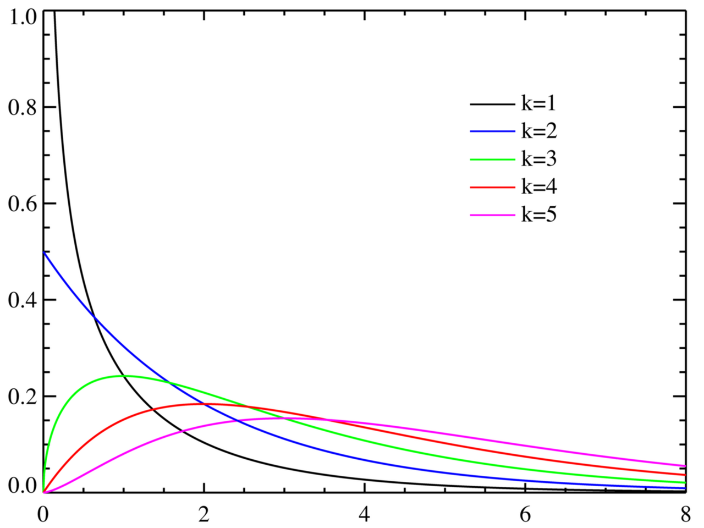
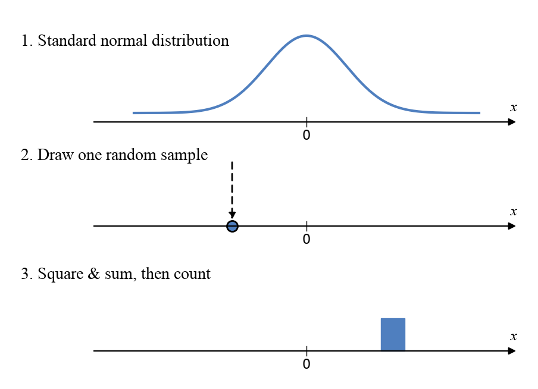
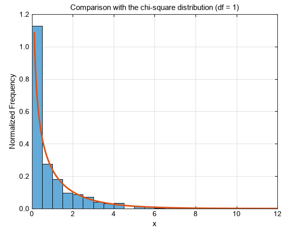
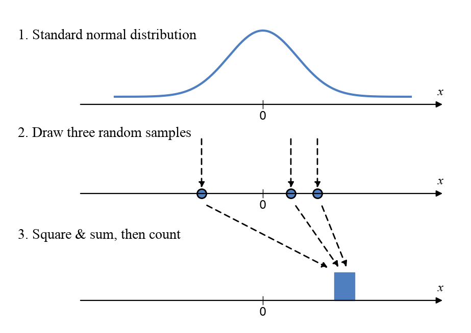
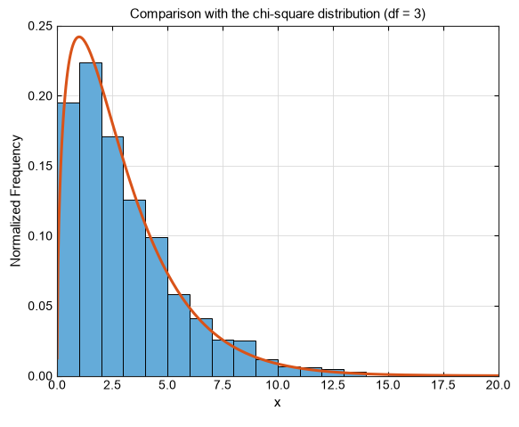
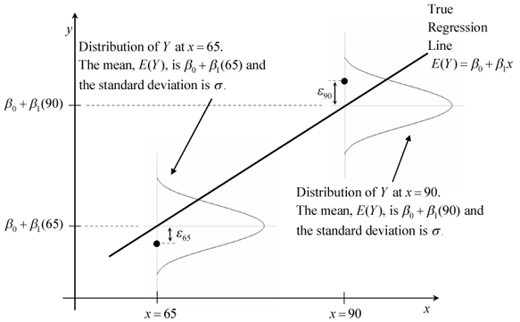
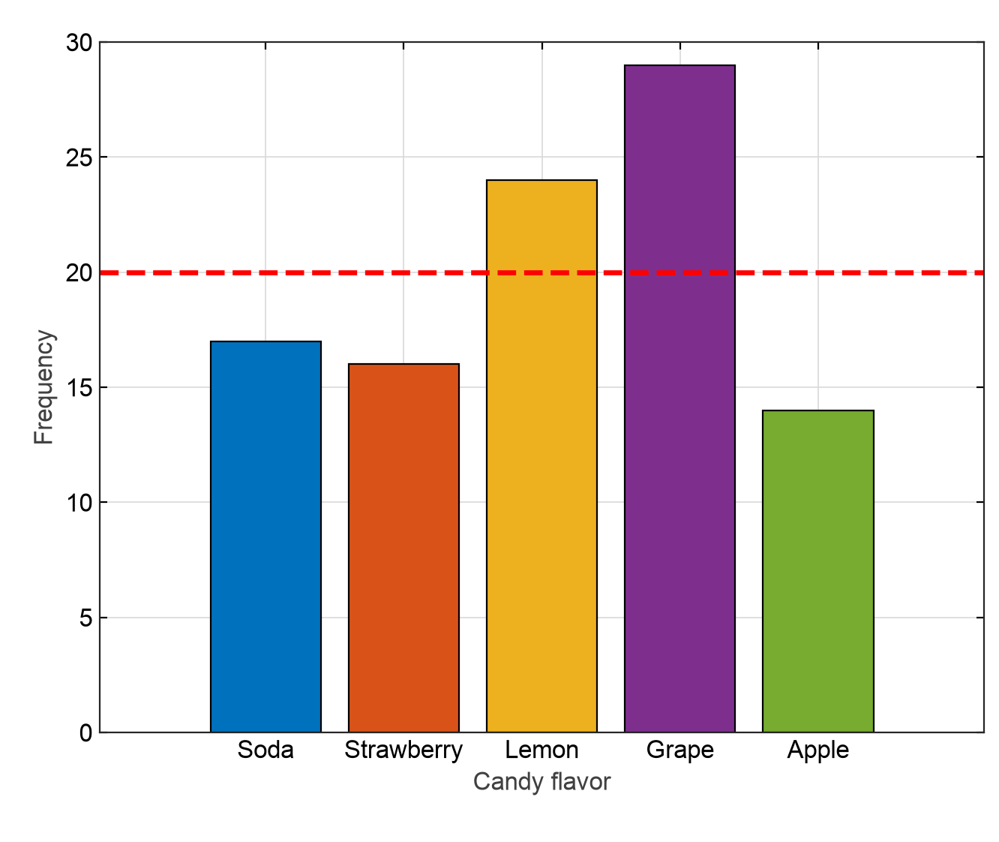
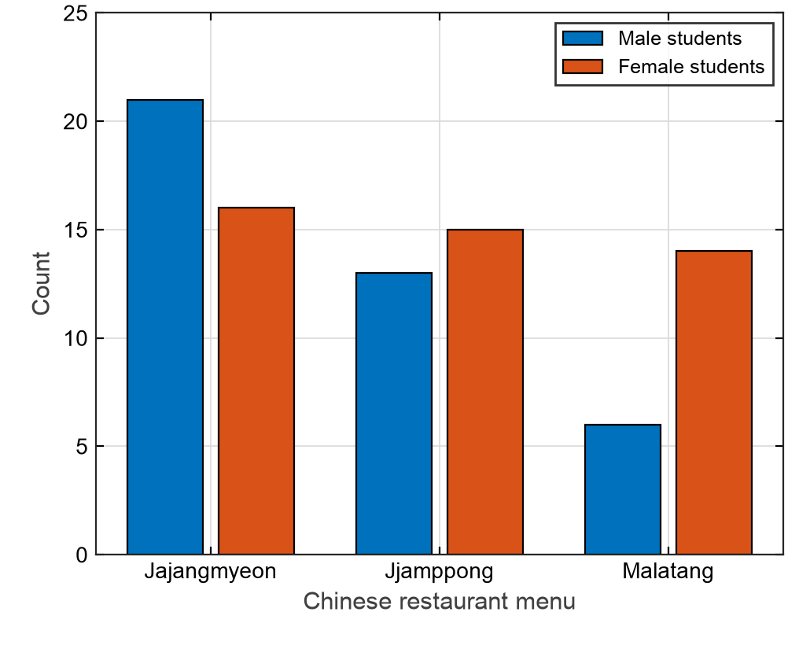
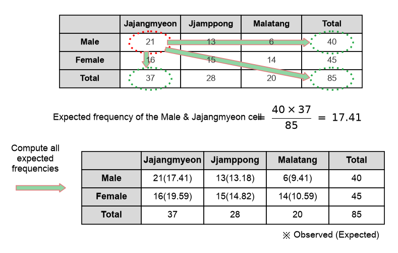

## 1. Chi-Square Distribution

The chi-square distribution ($\chi^{2}$ distribution) is <u>**the continuous probability distribution formed by the sum of independent standard normal random variables, each squared**</u>. To spell it out a bit more,

when $Z_1, Z_2, \dots, Z_k$ independently follow the standard normal distribution $N(0, 1)$, the random variable obtained by squaring and summing them, $X = Z_1^2 + Z_2^2 + \dots + Z_k^2$, can be said to follow a chi-square distribution with $k$ degrees of freedom, $\chi _{k}^{2}$.

$$
Q=\sum _{i=1}^{k}Z_{i}^{2}\sim \chi ^{2}(k)
$$

Plotting it gives the following. The smaller the degrees of freedom $k$, the more it hugs the left wall; the larger $k$ gets, the wider it spreads out.

How does this shape come about? Let's find out with a simulation.

1. $k = 1$

   

   As in the picture above, suppose we randomly draw just one random variable from the standard normal distribution, square it, and stack it onto a histogram. Do this three times and three counts are stacked onto the histogram; repeat it countless times and the histogram will grow as in the video below. That's because, in the standard normal distribution, random variables close to 0 are more likely to be drawn.

   <video src="/videos/chi-square-distribution-and-test/chi-square-sim-k1.en.mp4" width="480" aria-label="Simulation of the chi-square distribution with 1 degree of freedom: the histogram grows as the iteration count rises to 1000" autoplay loop muted playsinline controls></video>

   Comparing this result with the actual chi-square distribution with 1 degree of freedom, we can see that they match quite closely, as shown below.

   

2. $k = 3$

   Let's do the same for 3 degrees of freedom. Everything is the same, except that we draw three points at once from the standard normal distribution.

   

   Then we get a histogram like the one in the video below.

   <video src="/videos/chi-square-distribution-and-test/chi-square-sim-k3.en.mp4" width="480" aria-label="Simulation of the chi-square distribution with 3 degrees of freedom: the histogram grows as the iteration count rises to 1000" autoplay loop muted playsinline controls></video>

   Comparing the final histogram with the actual chi-square distribution with 3 degrees of freedom, we can see they match, as shown below.

   

### 1.1. When Is the Chi-Square Distribution Used?

Why do we use the statistic obtained by squaring and summing random samples from the standard normal distribution — that is, the chi-square statistic? To give the conclusion first, the chi-square distribution is <u>**a distribution that lets us tell whether an error or deviation is a normal error that arose by chance, or one that arose structurally**</u>.

For example, suppose we are building a model using regression analysis. Regression analysis ultimately rests on the premise that the data we obtained are values randomly sampled from a normal distribution centered on the model's output.

Moreover, by the central limit theorem, when the number of samples is very large and the error is defined using a sum, the distribution of the error follows a normal distribution.

> 📌 **NOTE**
>
> Consider the <u>**MSE (Mean Squared Error)**</u>.
>
> $$
> \text{MSE}=\frac{1}{n}\sum _{i=1}^{n}(y_{i}-\hat{y}_{i})^{2}
> $$

We call the difference between predicted and observed values the error or residual, and since this error follows a normal distribution, if we test the error using the chi-square statistic — a statistic built on random sampling from the (standard) normal distribution — we can <u>**determine whether the error is a normal one that arose by chance, or one with a hidden meaning**</u>.

## 2. Chi-Square Test

The chi-square distribution is often used for the <u>**goodness-of-fit test**</u> and <u>**cross tabulation analysis**</u>. In both cases, the chi-square statistic is computed with the following formula.

$$
\chi ^{2}=\sum \frac{(O_{i}-E_{i})^{2}}{E_{i}}
$$

Here $O_i$ = the observed value for the i-th data point, and $E_i$ = the expected value for the i-th data point.

For reference, this formula is called <u>**Pearson's chi-square statistic**</u>.

This formula looks quite different from the one we saw above. But it isn't really different. In fact, it's the same formula. $(O_{i}-E_{i})^2$ is the squared deviation, and dividing by $E$ can be seen as normalizing it. So the expression inside $\sum$ is a normalized squared deviation, and since it follows a normal distribution, we can see that their total follows a chi-square distribution.

> 📌 **NOTE**
>
> The chi-square distribution is a histogram of sums of values randomly sampled from the standard normal distribution.

### 2.1. Goodness-of-Fit Test

The goodness-of-fit test is used <u>**to compare the 'expected frequency distribution' with the 'actually observed frequency distribution' when there is one independent variable**</u>. Here, the independent variable is a categorical variable.

For example, suppose we picked a total of 100 candies from a bag mixed with 5 flavors and checked which flavors we ended up with.

|  | Soda | Strawberry | Lemon | Grape | Apple |
| --- | --- | --- | --- | --- | --- |
| Observed | 17 | 16 | 24 | 29 | 14 |
| Expected | 20 | 20 | 20 | 20 | 20 |

The 5 flavors were supposedly mixed evenly, so we predicted (expected) to draw 20 of each when picking 100, but looking at what we actually drew, quite a lot of grape candies came out. Then we could <u>**guess that the candies in this bag weren't evenly mixed**</u>. So let's test this hypothesis.

Let's claim that <u>**"there is no difference in the number of each kind of candy in this bag."**</u> If this claim is rejected, then there will be a difference in the number of candies in this bag.

In our experiment, the chi-square statistic is as follows.

$$
χ^2 = \frac{(17−20)^2}{20}+\frac{(16−20)^2}{20}+\frac{(24−20)^2}{20}+\frac{(29−20)^2}{20}+\frac{(14−20)^2}{20}=7.9
$$

Since there are 5 categories in total, there are 4 degrees of freedom. With 4 degrees of freedom, the chi-square value corresponding to a p-value of 0.05 is

$$
χ^2(4)_{0.95}=9.4877
$$

This threshold is the value used to judge that <u>**"only a score higher than this means it didn't happen by chance."**</u> Put a little differently, it means <u>**"if the score is higher than this, the error goes beyond the range of chance and is inevitable. Therefore, the distribution of candies is not even."**</u>

Since the computed chi-square statistic (7.9) is smaller than the critical value (9.4877), this phenomenon of drawing many grape candies can be seen as <u>**"something that happened by chance,"**</u> and our initial claim, <u>**"there is no difference in the number of each kind of candy in this bag,"**</u> could not be rejected. In other words, we can conclude that <u>**"there is not enough evidence to say the number of each kind of candy in this bag differs."**</u>

### 2.2. Cross Tabulation Analysis

Whereas the goodness-of-fit test looked at the case with only one independent variable, cross tabulation analysis is applied when there are two or more independent variables. Its purpose is to check whether the differences between the categories of several categorical variables deviate significantly from the expected values. For example, suppose we looked at the distribution of menu items that female and male students ordered at a Chinese restaurant, as follows.

|  | Jajangmyeon | Jjamppong | Malatang | Total |
| --- | --- | --- | --- | --- |
| Male | 21 | 13 | 6 | 40 |
| Female | 16 | 15 | 14 | 45 |
| Total | 37 | 28 | 20 | 85 |

Looking at this data, we want to check <u>**whether there is a difference in choice between genders for each menu item**</u>. How can we analyze this? Since women simply appear to order malatang more often than men, can we conclude that women prefer malatang over men? This is where cross tabulation analysis comes in.

Just as we did in the goodness-of-fit test, let's set up the null hypothesis <u>**"there is no difference in menu choice by gender."**</u> If this null hypothesis is rejected, then there is a difference in menu choice by gender.

In this case there are two categorical variables (gender, menu), with 2 levels for gender and 3 for menu. Here, the expected values and degrees of freedom can be calculated as follows.

$$
\text{Expected value} = \frac{\text{row total} \times \text{column total}}{\text{grand total}}
$$

$$
\text{Degrees of freedom} = (\text{number of columns}-1) \times (\text{number of rows}-1)
$$

Computing the statistic with Pearson's chi-square formula,

$$
χ^2=\frac{(21−17.41)^2}{17.41}+\frac{(16−19.59)^2}{19.59}+\frac{(13−13.18)^2}{13.18}+\frac{(15−14.82)^2}{14.82}+\frac{(6−9.41)^2}{9.41}+\frac{(14−10.59)^2}{10.59}=3.7366
$$

Here the degrees of freedom are $(2-1) \times (3-1)=2$, and at these degrees of freedom the chi-square value corresponding to a p-value of 0.05 is

$$
χ^2(2)_{0.95}=5.9915
$$

Our statistic $3.7366$ is smaller than the threshold $5.9915$, so the null hypothesis could not be rejected. Therefore we can conclude that <u>**there is not enough evidence to say menu choice differs by gender**</u>, and the <u>**difference in menu choice between female and male students is due to chance**</u>.

---

## 📚 References

- [Chi-square distribution and test](https://www.youtube.com/watch?v=_GrdeYtYLO4)
- [Chi-square distribution and test - Angelo's Math Notes](https://angeloyeo.github.io/2021/12/13/chi_square.html)
