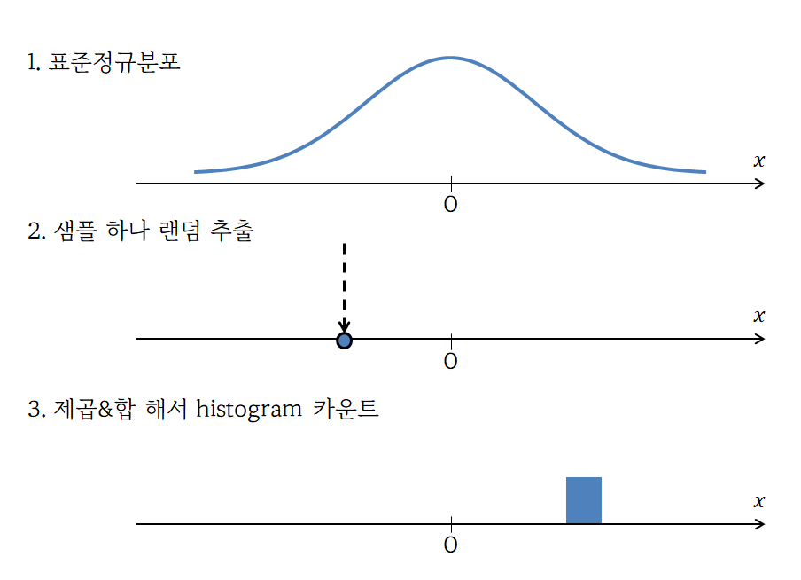
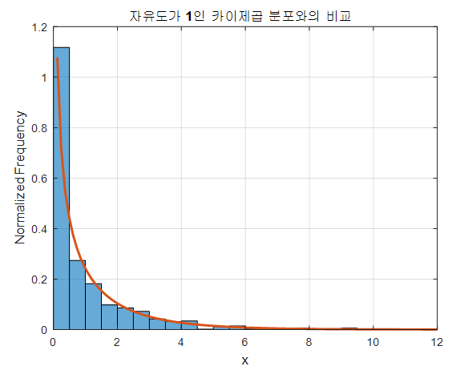
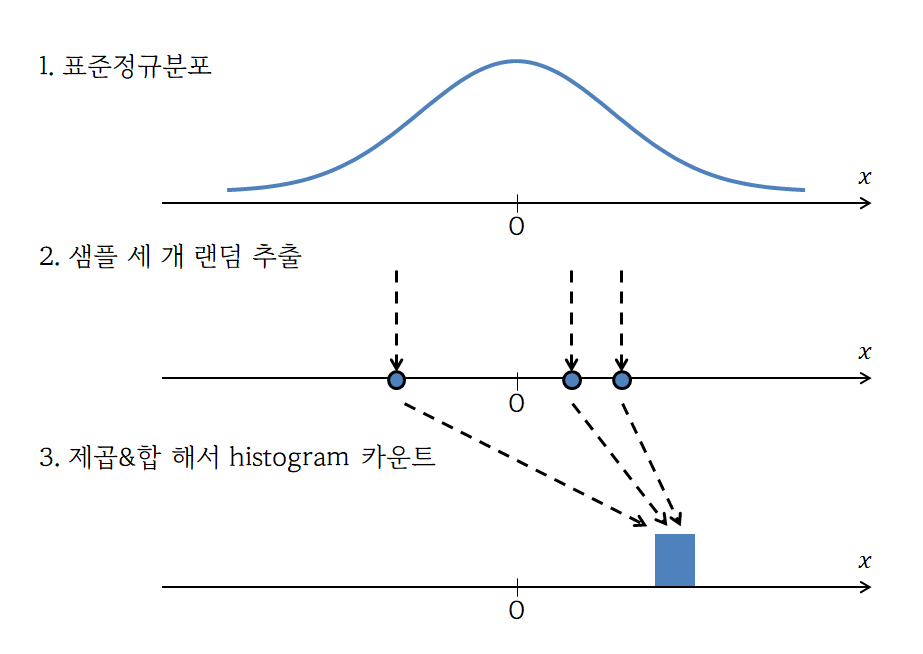
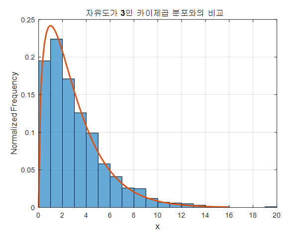
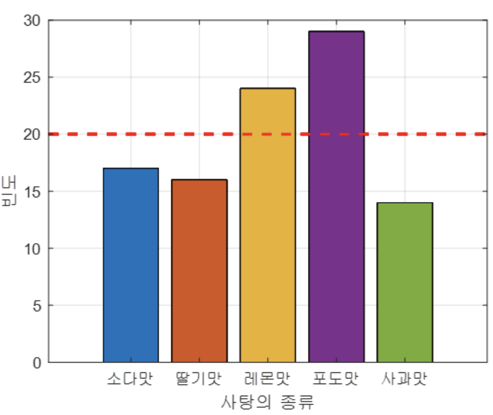
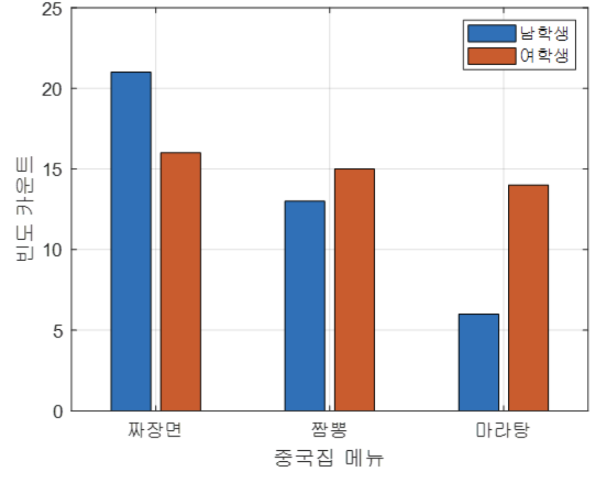
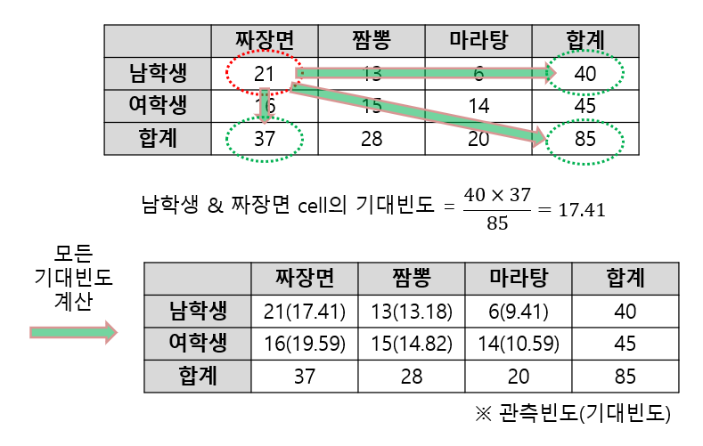

## 1. 카이제곱분포

카이제곱분포($\chi^{2}$ 분포)는 <u>**독립적인 표준정규분포 확률변수들을 각각 제곱하여 합한 값이 이루는 연속적인 확률 분포**</u>입니다. 이를 더 풀어서 설명하면,

$Z_1, Z_2, \dots, Z_k$가 서로 독립인 표준정규분포$N(0, 1)$를 따를 때, 이 값들을 제곱해서 더한 확률변수 $X = Z_1^2 + Z_2^2 + \dots + Z_k^2$는 자유도가 $k$인 카이제곱 분포$\chi _{k}^{2}$를 따른다고 할 수 있습니다.

$$
Q=\sum _{i=1}^{k}Z_{i}^{2}\sim \chi ^{2}(k)
$$

이를 그래프로 확인해보면, 다음과 같습니다. 자유도 $k$가 작을수록 왼쪽 벽으로 붙고, 커질수록 넓게 퍼지는 모양입니다.

어떻게 이런 모양이 생기는 걸까요? 시뮬레이션으로 한번 알아보겠습니다.

1. $k = 1$

   

   위 사진과 같이 표준정규분포에서 하나의 확률변수만을 랜덤하게 뽑아서 제곱해서 히스토그램에 하나 얹어놓는다고 해보겠습니다. 이걸 세 번 하면 히스토그램에 세 개의 도수가 얹어질 것이고, 이걸 수없이 반복하면 다음 영상과 같이 히스토그램이 자라날 것입니다. 왜냐하면 표준정규분포에서 0에 가까운 확률변수는 추출될 확률이 높기 때문이죠.

   <video src="/videos/chi-square-distribution-and-test/chi-square-sim-k1.ko.mp4" width="480" aria-label="자유도가 1인 카이제곱 분포 시뮬레이션: 반복 횟수가 1000까지 늘며 히스토그램이 자라나는 영상" autoplay loop muted playsinline controls></video>

   이 결과는 실제 자유도가 1인 카이제곱 분포와 비교하면 다음과 같이 상당히 일치하는 것을 확인할 수 있습니다.

   

2. $k = 3$

   같은 방식으로 자유도가 3인 경우에 대해서 진행해보겠습니다. 모든 것이 똑같은데, 표준정규분포에서 한 번에 세 개의 점을 뽑는다는 것만 다릅니다.

   

   그러면 다음 영상과 같은 히스토그램을 얻을 수 있습니다.

   <video src="/videos/chi-square-distribution-and-test/chi-square-sim-k3.ko.mp4" width="480" aria-label="자유도가 3인 카이제곱 분포 시뮬레이션: 반복 횟수가 1000까지 늘며 히스토그램이 자라나는 영상" autoplay loop muted playsinline controls></video>

   마지막 히스토그램과 실제 자유도가 3인 카이제곱 분포를 비교하면 다음과 같이 일치하는 걸 볼 수 있죠.

   

### 1.1. 카이제곱분포는 언제 쓸까

표준정규분포로부터 얻는 랜덤 샘플을 제곱해서 다 더한 통계량, 즉 카이제곱 통계량을 왜 사용하는 걸까요? 결론부터 말하면, 카이제곱 분포는 <u>**오차(error) 혹은 편차(deviation)가 우연에 의해 발생한 정상적인 오차인지, 아니면 구조적으로 발생한 오차인지 파악할 수 있는 분포**</u>입니다.

예를 들어, 회귀 분석을 이용한 모델을 제작한다고 해보겠습니다. 회귀분석은 결국 우리가 얻은 데이터들은 모델의 출력값을 중심으로 하는 정규분포에서 랜덤하게 샘플링되어 얻은 값이라고 보는 걸 전제로 깔고 있습니다.

뿐만 아니라, 중심극한정리에 따라, 샘플 수가 무수히 많고, 합(sum)을 이용해서 오차를 정의하는 경우, 오차의 분포는 정규분포를 따르게 됩니다.

> 📌 **NOTE**
>
> <u>**MSE(Mean Squared Error)**</u>를 떠올려보세요.
>
> $$
> \text{MSE}=\frac{1}{n}\sum _{i=1}^{n}(y_{i}-\hat{y}_{i})^{2}
> $$

우리는 예측값과 관측값 사이의 차이를 곧 오차(error) 혹은 잔차(residual)이라고 하는데, 이 오차가 곧 정규분포를 따른다고 하니, (표준)정규분포에서의 랜덤샘플링을 이용한 통계량인 카이제곱 통계량을 활용해 오차를 검증하면, 이 <u>**오차가 우연히 발생한, 정상적인 오차인지, 아니면 숨겨진 의미가 있는 오차인지를 판별**</u>할 수 있다는 것입니다.

## 2. 카이제곱 검정

<u>**적합도 검정(goodness-of-fit-test)**</u>과 <u>**교차분석(cross tabulation analysis)**</u>을 이용할 때 카이제곱 분포를 이용하는 경우가 많습니다. 이 두 경우 모두 카이제곱 통계량을 구하기 위해 다음 식을 이용합니다.

$$
\chi ^{2}=\sum \frac{(O_{i}-E_{i})^{2}}{E_{i}}
$$

여기서 $O_i$ = i번째 데이터에 대한 관찰값, $E_i$ = i번째 데이터에 대한 기댓값입니다.

참고로, 이 식은 <u>**피어슨 카이제곱 통계량**</u>이라고 합니다.

이 공식은 위에서 살펴봤던 공식과는 사뭇 다른 모습입니다. 하지만 별반 다르지 않습니다. 사실 같은 식입니다. $(O_{i}-E_{i})^2$은 편차의 제곱을 말하는 것이고, $E$로 나눈 것은 이를 정규화하는 행위로 볼 수 있습니다. 따라서 $\sum$ 안에 들어있는 수식은 편차 제곱을 정규화한 것이고, 이는 정규분포를 따르므로, 이것들을 모두 합한 값은 카이제곱 분포를 따른다는 것을 알 수 있습니다.

> 📌 **NOTE**
>
> 카이제곱 분포는 표준정규분포에서 랜덤샘플링한 값들의 합에 대한 히스토그램입니다.

### 2.1. 적합도 검정(goodness-of-fit-test)

적합도 검정은 <u>**독립변수가 하나일 때 ‘기대되는 빈도의 분포(frequency distribution)’와 ‘실제 관찰한 빈도의 분포’를 비교**</u>하기 위해 사용합니다. 여기서 독립변수는 범주형 변수(categorical variable)입니다.

예를 들어, 5가지 맛이 섞여있는 사탕 주머니에서 총 100개의 사탕을 집어들어 어떤 맛의 사탕들을 고르게 되었는지 확인해봤다고 해보겠습니다.

|  | 소다맛 | 딸기맛 | 레몬맛 | 포도맛 | 사과맛 |
| --- | --- | --- | --- | --- | --- |
| 관찰값 | 17 | 16 | 24 | 29 | 14 |
| 기댓값 | 20 | 20 | 20 | 20 | 20 |

분명 5개가 고르게 섞여있으니, 100개를 뽑았을 때 20개씩 고르게 뽑힐 거라고 예상(기대) 했는데, 실제 뽑힌 걸 보니, 포도맛 사탕이 상당히 많이 뽑혔네요, 그러면 <u>**이 바구니에 사탕이 고르게 섞여있지 않았을 것이라고 추측**</u>할 수 있겠죠. 그러면 이 가설을 검정해봅시다.

<u>**“이 바구니에 들어있는 사탕 종류들의 개수에는 차이가 없을 것이다”**</u>고 주장해볼게요. 만약 이 주장이 기각된다면, 이 바구니에 들어있는 사탕 개수에는 차이가 있을 겁니다.

우리의 실험에서 카이제곱 통계량은 다음과 같습니다.

$$
χ^2 = \frac{(17−20)^2}{20}+\frac{(16−20)^2}{20}+\frac{(24−20)^2}{20}+\frac{(29−20)^2}{20}+\frac{(14−20)^2}{20}=7.9
$$

총 5개의 카테고리가 있기 때문에 자유도는 4입니다. 자유도가 4일 때 p-value 0.05에 해당하는 카이제곱 값은

$$
χ^2(4)_{0.95}=9.4877
$$

입니다. 이 기준값은 <u>**“이 점수보다 높아야 우연히 일어난 일이 아니다”**</u>라고 판단하는 기준이 되는 값입니다. 조금 다르게 이야기한다면, <u>**“이 점수보다 높다면 발생한 오차는 우연의 범위를 넘어선 필연이다. 그러므로 사탕의 분포가 고르지 않다”**</u>는 걸 의미합니다.

계산된 카이제곱 통계량(7.9)이 기준이 되는 임계값(9.4877)보다 작기 때문에, 포도맛만 많이 뽑힌 이 현상은 <u>**“우연히 일어난 일”**</u>이라고 볼 수 있는 거고, 저희가 처음에 주장한 <u>**“이 바구니에 들어있는 사탕 종류별 개수에는 차이가 없을 것이다”**</u>은 기각되지 못했습니다. 즉, <u>**“이 바구니에 들어있는 사탕 종류별 개수에는 차이가 있다고 볼 증거가 부족하다”**</u>고 결론지을 수 있는 거죠.

### 2.2. 교차 분석(cross tabulation analysis)

적합도 검정에서는 독립변수가 하나뿐인 경우를 봤다면, 교차 분석은 독립변수가 두 개 이상인 경우에 적용하는 분석 방법입니다. 교차 분석의 목적은 여러 범주형 변수의 범주 간 차이가 기댓값에서 유의하게 벗어나는지 확인하는 것입니다. 예를 들어 다음과 같이 여학생, 남학생이 중국집에서 시킨 메뉴의 분포를 확인해봤다고 합시다.

|  | 짜장면 | 짬뽕 | 마라탕 | 합계 |
| --- | --- | --- | --- | --- |
| 남학생 | 21 | 13 | 6 | 40 |
| 여학생 | 16 | 15 | 14 | 45 |
| 합계 | 37 | 28 | 20 | 85 |

이 데이터를 봤을 때, <u>**각 메뉴별로 성별 간 선택의 차이를 보이는지**</u>를 확인하고 싶어졌습니다. 어떻게 분석할 수 있을까요? 단순히 여자가 남자보다 마라탕을 더 많이 시킨다고 보이니, 여자는 남자보다 마라탕을 선호한다고 확정할 수 있을까요? 이때 교차분석을 사용할 수 있습니다.

적합도 검정에서 했던 것과 마찬가지로 <u>**“성별에 따라 메뉴 선택에는 차이가 없을 것이다”**</u> 라는 귀무가설을 세워보겠습니다. 이제 이 귀무가설이 기각된다면, 성별에 따라 메뉴 선택에 차이가 있는 거겠죠.

이 케이스는 범주형 변수는 두 개(성별, 메뉴)이며, 성별 변수는 2개, 메뉴 변수는 3개인 케이스네요. 이 경우에 기댓값과 자유도는 다음과 같이 계산할 수 있습니다.

$$
\text{기댓값} = \frac{\text{해당 행 전체 합} \times \text{해당 열 전체 합}}{\text{전체 데이터 수}}
$$

$$
자유도 = (\text{열 개수}-1) \times (\text{행 개수}-1)
$$

피어슨 카이제곱 통계량 공식에 따라 통계량을 구하면,

$$
χ^2=\frac{(21−17.41)^2}{17.41}+\frac{(16−19.59)^2}{19.59}+\frac{(13−13.18)^2}{13.18}+\frac{(15−14.82)^2}{14.82}+\frac{(6−9.41)^2}{9.41}+\frac{(14−10.59)^2}{10.59}=3.7366
$$

이때, 자유도는 $(2-1) \times (3-1)=2$이고, 이 자유도에서 p-value 0.05에 해당하는 카이제곱 값은

$$
χ^2(2)_{0.95}=5.9915
$$

입니다. 우리가 구한 통계량 $3.7366$은 기준 $5.9915$보다 작으므로, 귀무가설은 기각되지 못했습니다. 따라서 <u>**성별에 따라 메뉴 선택에는 차이가 있다고 볼 증거가 부족하다**</u>고 결론내릴 수 있으며, <u>**여학생과 남학생의 메뉴 선택 차이는 우연**</u>이라고 볼 수 있겠네요.

---

## 📚 참고자료

- [카이제곱 분포와 검정](https://www.youtube.com/watch?v=_GrdeYtYLO4)
- [카이제곱 분포와 검정 - 공돌이의 수학정리노트 (Angelo's Math Notes)](https://angeloyeo.github.io/2021/12/13/chi_square.html)
