## 1. 정규분포

| 용어 | 의미 | 비고 |
| --- | --- | --- |
| 오차(Error) | 관측된 데이터 값과 모델이 예측한 값(또는 집단의 평균)의 차이. | 어떤 학생의 실제 시험 점수가 90점이고, 평균 점수가 80점이라면, 여기서 오차(편차)는 90 - 80 = +10점이 됩니다. |
| 표준화(정규화)하다(Standardization) | 서로 단위나 범위가 다른 데이터들을 **평균이 0, 표준편차가 1인 공통된 척도**로 변환하는 과정. (데이터의 상대적인 위치나 형태는 유지된다). | 키(cm, 평균 170)와 몸무게(kg, 평균 65)처럼 단위가 완전히 다른 두 변수를 직접 비교하기 어렵기 때문에, 두 변수 모두 평균을 빼고 표준편차로 나누어 스케일을 맞춥니다. |
| Z-점수(Z-Score) | **표준편차 몇 개만큼 떨어져 있는지**를 나타내는 표준화된 값. | 평균이 70점이고 표준편차가 10점인 시험에서 90점을 맞았다면, z-score=+2가 됩니다. 이 학생은 평균보다 표준편차 2배만큼 위에 위치합니다. |
| 표준정규분포(Standard Normal Distribution) | 평균=0, 표준편차=1인 정규분포. | 모든 일반적인 정규분포 데이터를 Z-점수로 변환하면 이 **표준정규분포** 위에 놓이게 되며, 이를 통해 서로 다른 시험 점수나 신체 측정값의 상위 백분율(확률)을 손쉽게 비교할 수 있습니다. |
| QQ그림(QQ-plot) | 표본분포가 특정 분포(ex 정규분포)에 얼마나 가까운 지를 보여주는 그림. | • 데이터가 정규분포를 따른다면, QQ 그림 위의 점들이 **45도 대각선 직선 위에 나란히** 위치하게 됩니다. • 만약 양쪽 끝의 점들이 직선에서 크게 휘어지거나 벗어나면, 해당 데이터는 정규분포를 따르지 않는(왜도가 있거나 꼬리가 두꺼운) 형태임을 직관적으로 알 수 있습니다. |

대부분의 데이터가 정규분포를 따르기 때문에, 즉 이게 정상이기 때문에 정상적인(normal) 분포라고 부르는 것은 아닙니다. 실제로 전형적인 데이터 프로젝트에서 사용되는 대부분의 변수들, <u>**실제 대부분의 원시 데이터는 전반적으로 정규분포를 따르지 않습니다**</u>. 단지 <u>**표본분포에서 대부분의 통계량(표본들의 평균, 합계, 오차 등)이 정규분포를 따른다는 점**</u>에서 정규분포의 유용함이 드러날 뿐입니다. 설령 그렇다 하더라도 일반적으로 정규분포 가정은 경험적 확률분포나 부트스트랩 분포를 구할 수 없는 경우 사용되는 최후의 수단입니다.

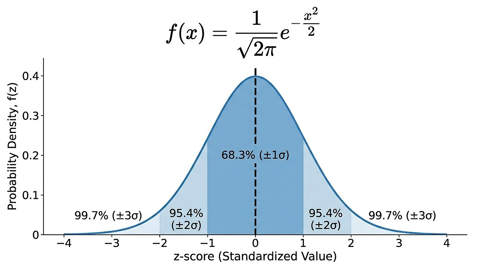

위 그래프는 표본 통계량의 68.3%가 표준편차 내에 있으며, 95.4%는 표준편차의 두배수 내에 속하며 99.7%는 평균의 표준편차 세 배수 내에 있다는 것을 표현하고 있습니다.

> 📌 **NOTE**
>
> 정규분포는 18세기 독일의 수학자 카를 프리드리히 가우스의 이름을 따 <u>**가우스 분포(Gaussian distribution)**</u>라고 부르기도 합니다.

### 1.1. 표준정규분포와 Q-Q Plot

<u>**표준정규분포**</u>는 x축 단위가 평균의 표준편차로 표현되는 정규분포를 말합니다. 데이터를 표준정규분포와 비교하기 위해서는 데이터에서 평균을 뺀 다음 표준편차로 나누면 되는데요,

$$
Z = \frac{X - \mu}{\sigma}
$$

이를 <u>**정규화(Normalization)**</u>, 또는 <u>**표준화(Standardization)**</u>라고 합니다. 이렇게 변환된 점수를 <u>**z점수(z-score)**</u>라고 하며, 표준정규분포를 z-분포(z-distribution)라고 합니다.

이렇게 데이터를 z-score로 변환한다고 해서, 데이터가 정규분포가 되는 것은 아닙니다. 단지 비교를 목적으로 데이터를 표준정규분포와 같은 척도로 만드는 것 뿐입니다.

<u>**Q-Q plot(Quantile-Quantile plot)**</u>은 표본이 특정 분포에 얼마나 가까운지를 시각적으로 판별하는 데에 사용됩니다.

Q-Q plot은 z-score를 오름차순으로 정렬하고 각 값의 z-score를 y축에 표시합니다. x축은 정규분포에서의 해당 분위수(quantile)를 나타냅니다.

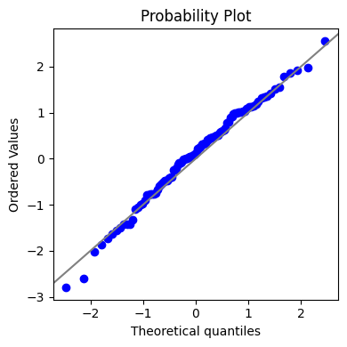

우리가 다음과 같이 15개의 데이터를 갖고있고, 이게 정규분포를 따르는 지 확인해보고싶다고 합시다.

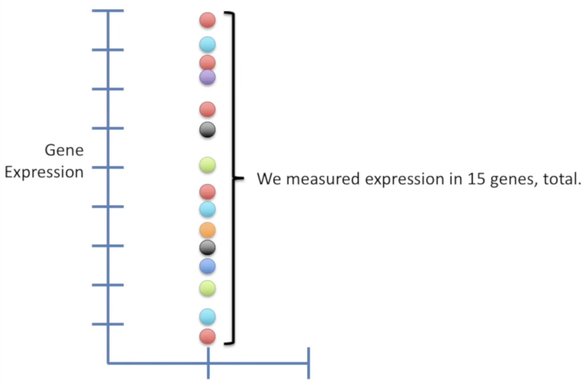

그러면 이 모든 15개의 데이터의 분위수(quantile)을 구하고, 그 quantile이 갖는 z-score을 정규분포에서 찾아봅니다.

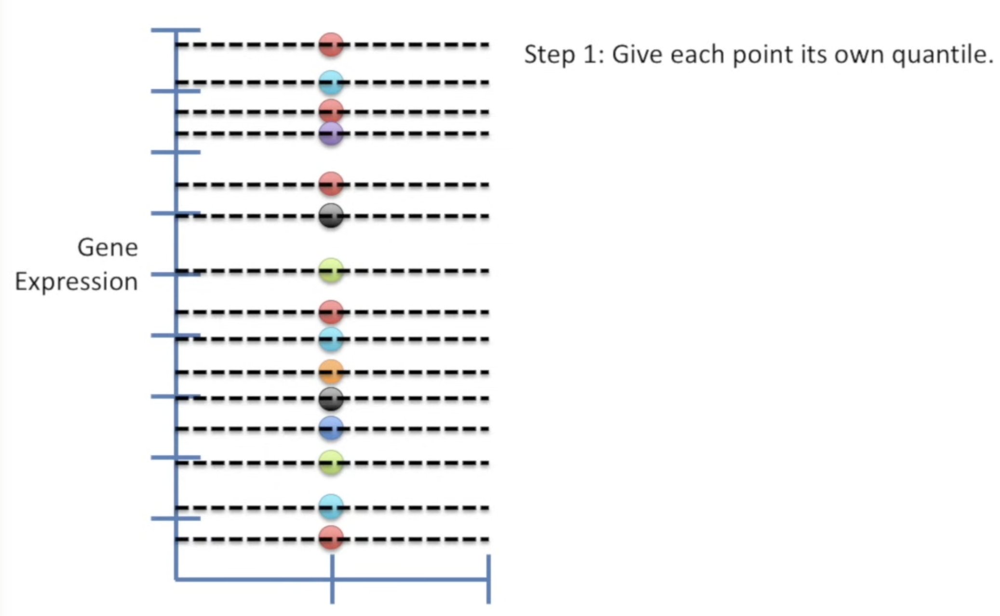 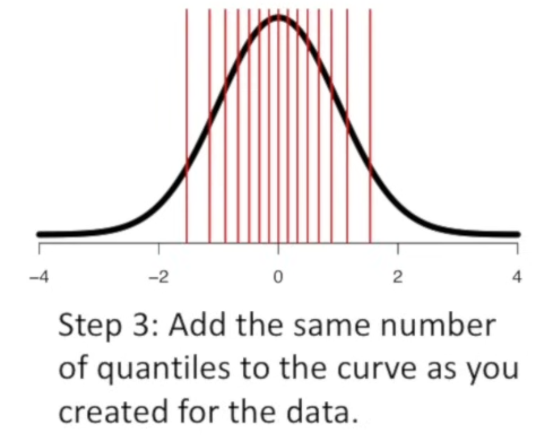

이제 Q-Q Plot을 그리기만 하면 됩니다!

1. 가장 작은 데이터의 값이 $0.6$, $\text{z-score} = -1.5$라면, 다음과 같이 한 점을 찍을 수 있습니다.

   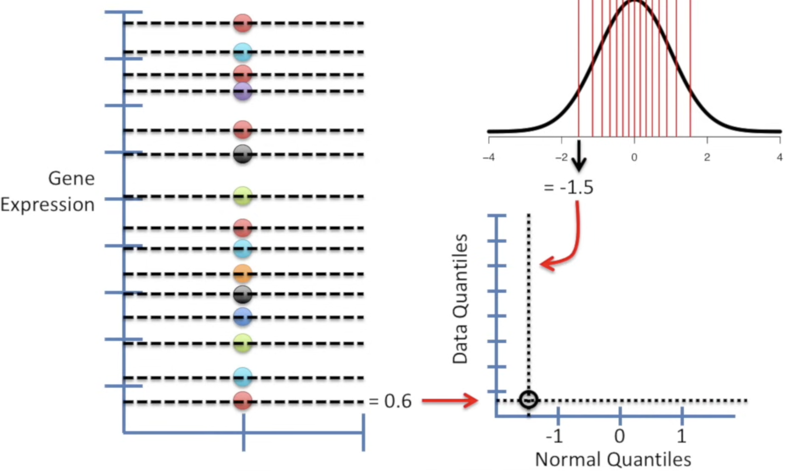

2. 그 다음 데이터의 값이 $1.1$, $\text{z-score} = -1.2$라면, 다음과 같이 한 점을 찍을 수 있습니다.

   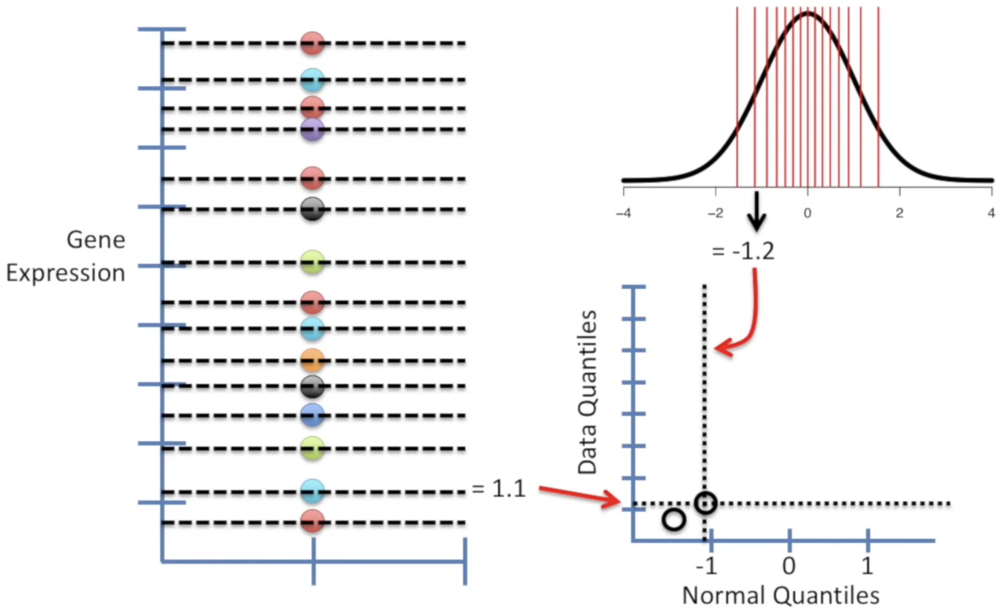

3. 그 다음 데이터의 값이 $1.9$, $\text{z-score} = -0.89$라면, 다음과 같이 한 점을 찍을 수 있습니다.

   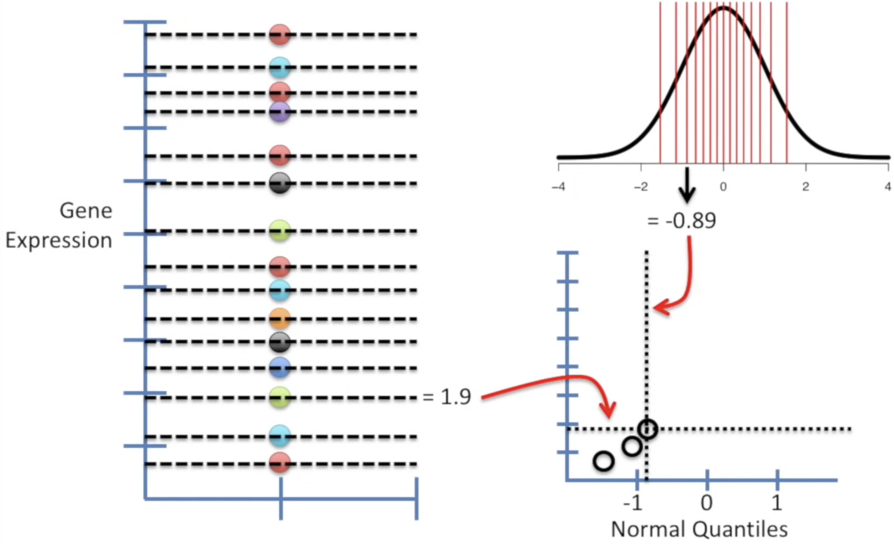

4. 이 과정을 모든 데이터 포인트마다 반복하면 아래와 같은 그래프를 얻을 수 있습니다.

   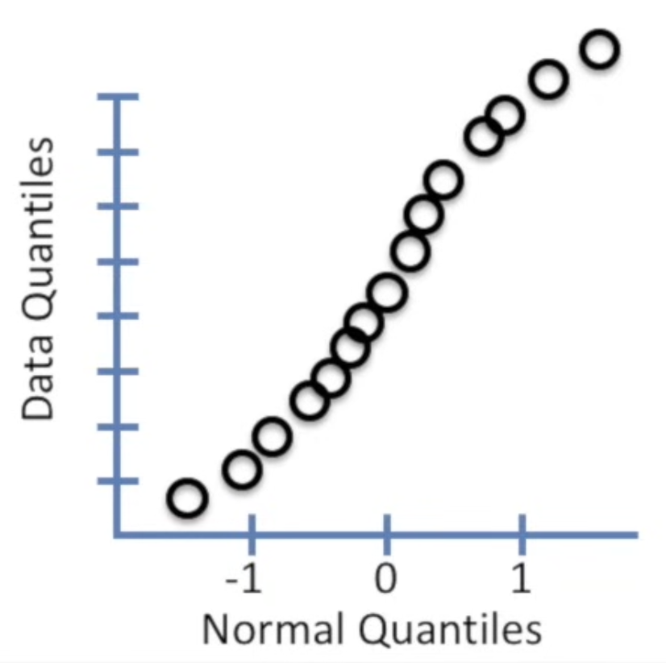

5. 이 사진의 경우, 점들이 정규분포를 보이지 않고 있네요. 만약 데이터가 <u>**정규분포**</u>를 따른다면 <u>**선 위**</u>에 위치해있어야 합니다.

   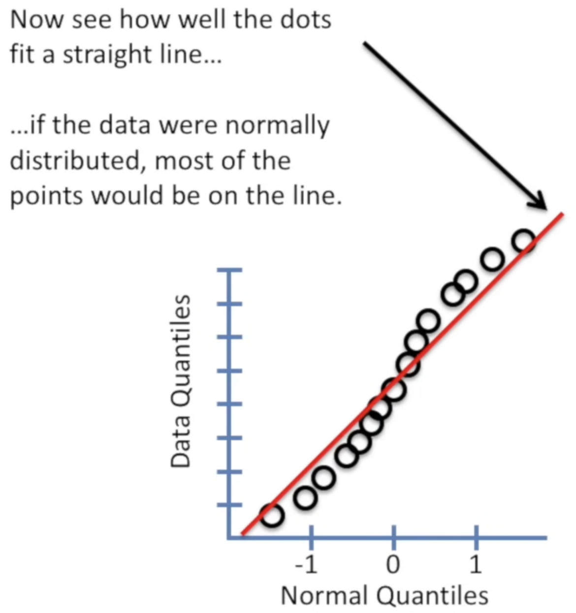

데이터가 표준화되었기 때문에, 단위는 평균으로부터 떨어진 데이터의 표준편차에 해당합니다. 점들이 대략 대각선 위에 놓이면 표본분포가 정규분포에 가까운 것으로 간주할 수 있습니다.

## 2. 긴 꼬리 분포

| 용어 | 의미 | 비고 |
| --- | --- | --- |
| 꼬리(tail) | 적은 수의 극단값이 존재하는, 도수분포의 길고 좁은 부분. | • **꼬리가 어느 쪽으로 길게 뻗어 있는가**에 따라 왜도의 부호가 결정된다. |
| 왜도(skewness) | • 데이터 분포가 좌우로 **얼마나 비대칭적인지**를 나타내는 통계 지표.  분포의 한쪽 꼬리가 반대쪽 꼬리보다 긴 정도. | • **대칭 분포 (왜도 = 0)의미**: 좌우 모양이 완벽하게 대칭인 형태입니다 (예: 정규분포). &nbsp;&nbsp;&nbsp;&nbsp;◦ **특징**: 평균 = 중앙값 = 최빈값. • **양의 왜도 / 우측 꼬리 분포 (왜도 > 0)의미**: 오른쪽 꼬리가 길게 늘어난 형태입니다. &nbsp;&nbsp;&nbsp;&nbsp;◦ **특징**: 소수의 큰 값들이 평균을 오른쪽(높은 값 쪽)으로 끌어올리기 때문에 **평균 > 중앙값** 순서를 가집니다. • **음의 왜도 / 좌측 꼬리 분포 (왜도 &lt; 0)의미**: 왼쪽 꼬리가 길게 늘어난 형태입니다. &nbsp;&nbsp;&nbsp;&nbsp;◦ **특징**: 소수의 극단적으로 작은 값들이 전체 평균을 왼쪽(낮은 값 쪽)으로 끌어내리기 때문에 **평균 &lt; 중앙값** 순서를 가집니다. |

정규분포는 오차나 표본통계량의 분포를 볼 때는 적절하고 유용하지만, <u>**대부분의 원시데이터는 정규분포를 따르지 않습니다**</u>. 때로는 소득 데이터와 같이 분포가 비스듬(asymmetric)하게 기울어져 있거나, 이항 데이터처럼 이산적일 수도 있죠. 대칭 및 비대칭 분포는 모두 <u>**긴 꼬리(long tail)**</u>를 가질 수 있습니다.

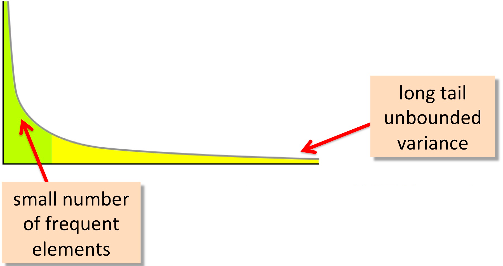

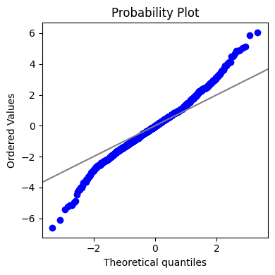

위 그림은 긴 꼬리 분포의 QQ-plot을 그린 것입니다. z-score 점수가 낮은 점들은 대각선보다 훨씬 낮게 분포해있고, 높은 값들은 훨씬 위에 분포해있습니다. 이는 데이터가 정규분포를 따르지 않는다는 것을 의미합니다. 또한 이는 데이터가 정규분포를 따른다고 할 때 예상되는 것보다 훨씬 더 많은 극단값을 관찰할 가능성이 있음을 의미하기도 합니다.

## 3. t-distribution

| 용어 | 의미 | 비고 |
| --- | --- | --- |
| n | 표본크기. | |
| 자유도(degree of freedom) | 다른 표본 크기, 통계량, 그룹의 수에 따라 t분포를 조절하는 변수. | 세 숫자 (A, B, C)의 **합이 항상 10**이어야 한다는 조건이 있다고 해보겠습니다. 이때 내 마음대로 아무 숫자나 자유롭게 정할 수 있는 값은 몇 개일까요? A에 3을 넣고, B에 5를 넣었다면, C는 자동으로 2가 되어야만 합이 10이 됩니다. 즉, 내가 **독립적으로 값을 정할 수 있는 자유도는 2개**(3 - 1)입니다 |

t-분포(t-distribution)는 <u>**모집단의 표준편차를 모를 때, 작은 표본(n &lt; 30)을 사용해 평균을 추정**</u>할 경우 사용되는 확률분포입니다. <u>**정규분포와 생김새가 비슷하지만 꼬리가 약간 더 두껍고 긴**</u> 게 특징이죠.

만약 우리 대학교 전체 학생들의 평균 키(모평균, $\mu$)를 구하려고 한다고 해봅시다. 전교생의 키를 모두 조사하는 건 현실적으로 불가능하죠. 그래서 표본 30명($n=30$)을 뽑아서 평균 키(표본평균, $\bar{x}$)를 계산합니다. 이 때, 이게 모평균($\mu$)과 얼마나 가까운 지 계산하고 싶습니다.

만약, 모집단의 표준편차($\sigma$)를 안다면, 정규분포를 그려서 표본평균과 모평균의 차이를 알 수 있을 겁니다. 하지만, 모평균($\mu$)을 알지 못하는데, 어떻게 모표준편차($\sigma$)를 알 수 있을까요? 따라서 우리의 <u>**표본 평균($\bar{x}$)과 표준편차($s$)로부터 추정**</u>할 수밖에 없습니다. 하지만 표본표준편차를 사용하는 건 약간 기울어진 자로 재는 것과 비슷한 겁니다. 즉, <u>**측정 그 자체에 불확실성(표본평균($\bar{x}$)의 표집오차 (Sampling Error))**</u>도 있고, 그 <u>**도구 자체에 불확실성(표본표준편차($s$)의 추정 불확실성 및 표집 변동성 (Sampling Variability of $s$))**</u>도 있는 거죠.

이 때문에 검정통계량(Test Statistic)의 분모와 분자가 모두 확률변수가 되어 표준정규분포를 그대로 사용할 수 없게 됩니다. 그래서 <u>**t-통계량(t-statistics)**</u>을 계산해서 사용합니다.

$$
t=\frac{\bar{x}-\mu _{0}}{\frac{s}{\sqrt{n}}} = \frac{\bar{x}-\mu _{0}}{s} \times \sqrt{n}
$$

- $\bar{x}$: 표본 평균
- $\mu_0$: 귀무가설상의 모평균
- $s$: 표본 표준편차
- $n$: 표본 크기
- $\frac{s}{\sqrt{n}}$: 표준오차(Standard Error, SE)
- 자유도(df): $n - 1$

**표본이 작을 때 ($n$이 작을 때):** 우리가 추출한 적은 양의 데이터로 계산한 표본표준편차($s$)는 진짜 전체 집단의 표준편차($\sigma$)보다 클 수도 있고, 훨씬 작을 수도 있습니다. 즉, **분모인 $s$ 자체의 변동성(불확실성)이 너무 커집니다.** 이 불확실성 때문에 극단적인 t-통계량이 나올 확률이 높아져 **꼬리가 두꺼운 모양**이 됩니다.

**반면, 표본이 클 때 ($n$이 커질 때):** 표본이 많아질수록 우리가 구한 $s$는 실제 모표준편차($\sigma$)에 아주 가까워집니다(일치성). 분모의 불확실성이 사라지면서 t-통계량은 결국 z-통계량(표준정규분포)과 똑같은 모양으로 수렴하게 됩니다.

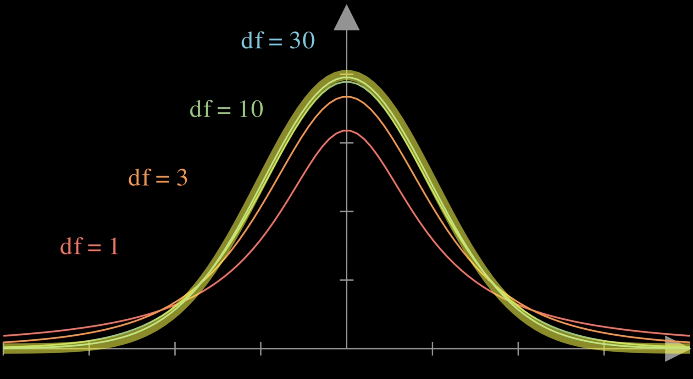

일반적으로, <u>**df ≥ 30이면 t-분포는 정규분포와 매우 가까워**</u>진다고 알려져있습니다.

> 🤔 **왜 Student’s t-distribution이라고 부르나요?**
>
> 1908년 윌리엄 고셋이 *Biometrika*에 ‘학생(Student)’라는 필명으로 논문을 발표하는 바람에 Student’s t-distribution이라고 불리기도 합니다.

> 표본 통계량의 상태를 묘사할 때, t-분포의 정확도는 표본에 대한 통계량의 분포가 정규분포를 따른다는 조건을 필요로 합니다.

## 📚 참고자료

- [practical-statistics-for-data-scientists/python/notebooks/Chapter 1 - Exploratory Data Analysis.ipynb at master · gedeck/practical-statistics-for-data-scientists](https://github.com/gedeck/practical-statistics-for-data-scientists/blob/master/python/notebooks/Chapter%201%20-%20Exploratory%20Data%20Analysis.ipynb)
- [Quantile-Quantile Plots (QQ plots), Clearly Explained!!!](https://www.youtube.com/watch?v=okjYjClSjOg)
- [Student's T Distribution](https://www.youtube.com/watch?v=32CuxWdOlow)
- [Student's t-Distribution - Explained](https://www.youtube.com/watch?v=BZ-Go7VTquk)
