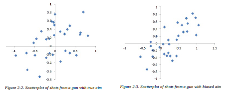
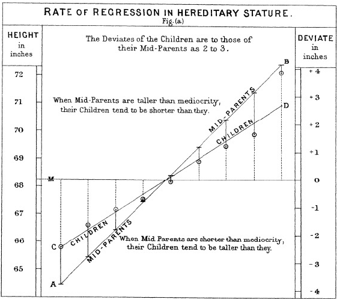
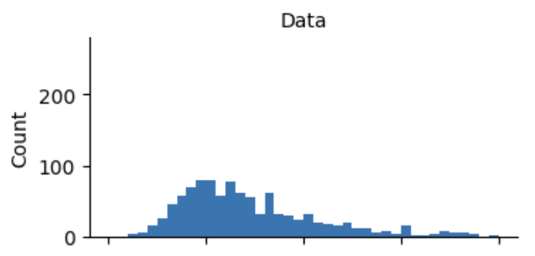
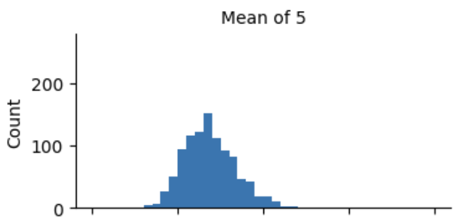
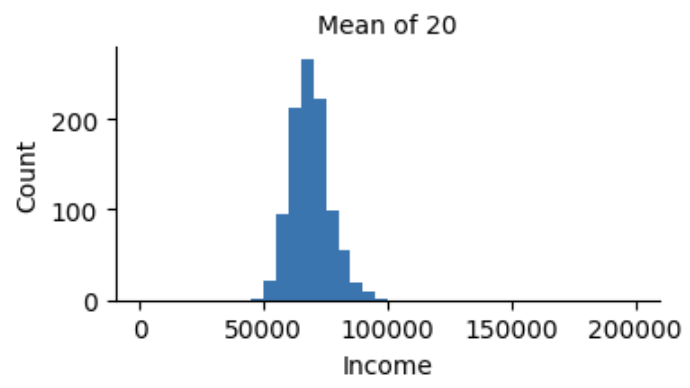

## 1. Random Sampling and Sample Bias

In the age of big data, you might think sampling no longer matters. But today's reality is that data keeps growing in size while its quality and relevance can't be guaranteed beyond a certain level. Even in a big data project, you ultimately build and test predictive models on sample data, so the need for sampling hasn't gone away.

| Concept | Meaning | Notes |
| --- | --- | --- |
| Sample | A subset drawn from a larger data set | |
| Population | The entire set of subjects, or the whole set, that makes up a data set. | Sometimes it's clearly defined as a large but finite set, like a population in biology, but sometimes it refers to a theoretical, hypothetical set. |
| N(n) | The size of the population (sample) | |
| Random sampling | Drawing a sample at random | In each draw, every element has the same probability of being picked. |
| Stratified sampling | Dividing the population into strata, then sampling randomly within each stratum | This is the same `stratified` option used in train/val/test splits to keep the class proportions intact. |
| Stratum | A homogeneous subgroup of the population sharing common characteristics | The plural is strata. It means the same thing as a class. |
| Simple random sample | A sample obtained by random sampling without stratifying the population | |
| Bias | Systematic error | |
| Sample bias | A sample that misrepresents the population | |

A classic example is the 1936 Literary Digest poll, which predicted that Alfred Landon would beat Franklin Roosevelt in the presidential election. The Literary Digest, a major media outlet at the time, surveyed more than 10 million people — its entire subscriber base plus additional lists it compiled. And it predicted a landslide victory for Landon. Meanwhile George Gallup, founder of the Gallup poll, ran a biweekly poll of just 2,000 people and correctly predicted Roosevelt's win.

The Literary Digest focused on increasing the number of samples. But it failed to secure their quality. That's because it surveyed regular subscribers and people who owned luxuries like telephones and cars. The result was <u>**sample bias**</u>. Instead of drawing a sample that could represent the population, it drew one in a <u>**nonrandom**</u> way. Even a random sample can never represent the population exactly. We can say <u>**sample bias**</u> has occurred when the difference between the population and the sample is meaningfully large, and that difference is expected to persist in other samples drawn the same way as the first.

> 📌 **Self-selection sample bias**
>
> People who write reviews on map apps or review sites aren't chosen at random, so their reviews are prone to bias. Rather, because the writers themselves hold the initiative in deciding to write a review, this leads to <u>**self-selection bias**</u>.
>
> People who choose to leave reviews are likely to have had an unsatisfying experience at the venue, to have some connection to it (such as joining a review event), or to be a different type of person from ordinary people who don't leave reviews. So a self-selected sample is hard to use as an indicator for accurately understanding a situation.
>
> That said, it can actually be trustworthy when comparing one venue with another. That's because <u>**a similar self-selection bias**</u> may apply equally to the reviews of each venue.

### 1.1. Bias

<u>**Bias**</u> refers to systematic error arising in the measurement or sampling process. Here, it's important to clearly distinguish <u>**error due to random sampling**</u> from <u>**error due to bias**</u>.

| Category | Definition | Nature |
| --- | --- | --- |
| Error due to random sampling (Sampling Error) | **Naturally occurring chance variation** that arises when drawing a random sample from a population, because only part of it is drawn rather than the whole | • It's nobody's fault; it arises from randomness. • It **shrinks** as the sample size grows (as the number of samples increases). • It can be predicted and controlled with statistical methods (confidence intervals, standard error, etc.). |
| Error due to bias (Bias, Non-sampling Error) | **Error that systematically skews in one direction** because of problems in the sampling method, measurement tools, response process, and so on | • It isn't chance; it has **structural causes** such as design flaws, omission of certain groups, or false responses. • No matter how large the sample, it **doesn't shrink, and the distortion can even get worse**. |

Suppose you're shooting at a target. Unless you're a professional, hitting the dead center repeatedly is nearly impossible. With <u>**unbiased sampling**</u>, the way the bullets scatter is random, and <u>**there's no strong tendency to lean toward any one side**</u>. But if <u>**sampling is biased**</u>, <u>**the errors tend to lean toward one side**</u>. In the picture on the right, you can see the samples concentrated in the first quadrant.

### 1.2. Random Sampling

There are many ways to ensure a sample represents the population, but the most essential one is <u>**random sampling**</u>. It's not as easy as it sounds, though. There's a lot to think about.

1. **You have to choose an accessible population well.**
   - Say you're preparing a pilot customer survey to build a representative customer profile.
   - First you need to define what a <u>**customer**</u> is. Will you count everyone with a purchase amount greater than 0? How far back in time will you include customers? What about customers who got refunds? Internal test buyers?
2. **You have to define the sampling procedure.**
   - Even randomly selecting 100 customers involves many considerations.
   - For example, <u>**visitors at 10 a.m. on weekdays**</u>, <u>**visitors at 5 p.m. on weekdays**</u>, and <u>**visitors at 10 p.m. on weekends**</u> may have different characteristics. You need a way of drawing that isn't biased toward any one group.

That's where <u>**stratified sampling**</u> comes in. When the number of visitors differs greatly by day of week and time of day, a simple random sample may under-select people from the days and times with fewer visitors. In such cases, you can obtain the same sample size for each stratum by sampling with higher weights on those strata.

### 1.3. Size vs. Quality: When Does Size Matter?

When you want to know an overall tendency, like average height or an approval rating, about 2,000 unbiased samples are enough to estimate the population quite accurately. So when on earth does big data matter? The answer: <u>**when the data is both large and sparse**</u>.

Imagine processing queries entered into Google as shown below. Columns represent words, rows represent individual search queries, and each element is 0 or 1 depending on whether the query contains that term. Our goal is to deliver the best-predicted search results for a given query.

| Query \ Word | ricky | ricardo | red | riding | hood | weather | seoul | … (150K) |
| --- | --- | --- | --- | --- | --- | --- | --- | --- |
| Query 1: “seoul weather” | 0 | 0 | 0 | 0 | 0 | 1 | 1 | 0… |
| Query 2: “little red riding hood” | 0 | 0 | 1 | 1 | 1 | 0 | 0 | 0… |
| Query 3: “ricky ricardo and little red riding hood” | 1 | 1 | 1 | 1 | 1 | 0 | 0 | 0… |
| … (1 trillion rows) | | | | | | | | |

There are over 150,000 columns, but a single query contains only a few words at most. So you end up with a matrix that's enormous yet mostly empty. The book describes this as data being 'both large and sparse.'

**Why does sparsity mean you need lots of data?**

What a search engine tries to do is predict "What result does the person who typed this query want?" The best material for learning this is **what past people who typed the same (or nearly the same) query actually clicked on**.

The problem is that the number of word combinations is astronomical. Queries like “seoul weather” come in countless times every day, but an unusual combination like “Ricky Ricardo and Little Red Riding Hood” comes in very rarely. The rows matching that combination are a tiny fraction of the whole.

- **Popular queries**: The same query piles up in large volumes in a short time, so it's learned quickly. That's why popular queries get better results.
- **Rare queries**: There are almost no identical queries, so there's little evidence to learn from, and the search results may be poor.

But the real value of search technology lies in **answering accurately even a rare query that might show up once in a million times**. Each rare query is uncommon on its own, but all those distinct rare queries combined make up a substantial share of all searches.

In Google's early days, there were probably plenty of records of people searching “Ricky Ricardo” and of people searching "Red Riding Hood," each on its own. But there were almost no records of someone searching **both together** and clicking on something. So the engine had no choice but to look at the words separately and show a mix of “Ricky Ricardo” pages and "Red Riding Hood" pages.

But **after trillions of searches piled up,** quite a few people had searched that rare combination, and if what they commonly clicked was a specific episode of the American sitcom *I Love Lucy* (the scene where Ricky tells his son the story of Little Red Riding Hood), Google can now pinpoint and show that episode.

<u>**A few thousand samples are enough, but getting those few thousand samples takes trillions of data points.**</u>

Suppose a certain query combination appears **once in 100 million**. If there are **1 trillion** queries in total, about **10,000** of that combination accumulate. Only now is there enough to learn from. What's actually used for learning is just these 10,000. The remaining 999,999,990,000 have nothing to do with this query. But there's **no way to pick out and collect** these 10,000. You have to accumulate the whole thing for them to mix in.

So when you want an overall tendency, a small sample is enough, but **when you need to answer accurately for each of the many individual cases that rarely appear**, the overall data has to be huge enough for those rare cases to accumulate sufficiently. That's the real sense in which big data is needed.

## 2. Selection Bias

| Concept | Meaning |
| --- | --- |
| Selection bias | Bias caused by the way observed data is selected |
| Data snooping | Extensively combing through data in search of something interesting |
| Vast search effect | Bias or non-reproducibility stemming from repeated data modeling, or modeling that considers too many predictor variables |

**What's the difference between** <u>**a phenomenon confirmed by testing a hypothesis through an experiment**</u> **and** <u>**a phenomenon discovered from the available data**</u>**?**

Someone says they can flip a coin 10 times and get heads all 10 times. You tell them to try it, and they actually flip it 10 times and get all heads. You might well think they have some special ability.

This person claimed "I can do it" **before the result came out**, and tried **just once**. If they succeeded when the probability of succeeding by luck alone is only $\frac{1}{2^{10}} ≈ 0.001$, it's reasonable to conclude "This is hard to see as chance; something's going on." This is <u>**the approach of forming a hypothesis and testing it with an experiment**</u>.

This time, an announcer at a sports stadium asks the 20,000 people in attendance to flip a coin 10 times and let them know if they get heads all 10 times. Now 20,000 people each make one attempt. The probability that one person succeeds is still 1/1024, but 20,000 people are trying.

- **Average number of people who succeed**: $20,000 × 1/1024 ≈$**about 20 people**
- **Probability that no one succeeds**: the probability that one person fails, $1023/1024$, multiplied 20,000 times, $(1023/1024)²⁰⁰⁰⁰ ≈ 0.0000000033 (about 1 in 300 million)$
- **Probability that someone succeeds**: $1 − 0.0000000033 ≈$ **effectively 100%**

In other words, someone in the stadium getting 10 heads in a row is **not surprising but almost certain to happen**. That person isn't special; they're just one of the roughly 20 lucky ones out of 20,000. This is <u>**a phenomenon discovered by laying out the available data and exploring it**</u>.

This thought experiment applies directly to data analysis. With lots of data and many variables, digging through countless combinations is bound to turn up a "hugely significant-looking pattern." Just as someone among 20,000 gets 10 heads in a row.

- **Experiment (hypothesis testing)**: Decide in advance that “A affects B” and check only that → the result is trustworthy
- **Discovery through data exploration**: Scan hundreds or thousands of patterns and pick out whatever stands out → likely to be chance

So a pattern found by combing through data should be treated not as a "discovery" but as <u>**a "candidate worth verifying"**</u>, and confirmed again with new data or a separate experiment. This problem is called <u>**multiple testing**</u>, <u>**data snooping**</u>, or <u>**selection bias**</u>.

> 📌 **Vast search effect**
>
> If you keep building different models and asking different questions of a large data set, sooner or later you're bound to find an interesting pattern. Is that result truly meaningful? Or is it an exception you got by chance?
>
> To guard against this, you can reportedly use two or more hold-out sets, or methods called target shuffling and permutation tests.

### 2.1. Regression to the Mean

<u>**Regression to the mean**</u> is a phenomenon that appears when a given variable is measured successively. It's the tendency for an exceptional observation to be followed by a more middling one.

Regression to the mean is a consequence of a kind of selection bias. You've probably heard that rookie-of-the-year winners in sports usually hit a slump in their second year. Why is that? Nearly every sport has two very important factors.

1. **Skill**
2. **Luck**

When a rookie is chosen based on performance, they had real skill but likely also had luck on their side at the same time. The next season, skill stays the same, but in most cases luck doesn't. So performance may decline.

> 📌 **Francis Galton's regression to the mean**
>
> Galton was very interested in heredity. At one point he investigated how the heights of parents and children were related. Since mothers' and fathers' heights differed somewhat, Galton adjusted for this to create the parents' average height — the mid-parent height — then divided those heights into groups and plotted them.
>
> - If the mid-parent height was below mediocrity (the average), their children tended to be taller than the parents,
> - and if the mid-parent height was above average, their children reportedly tended to be shorter than the parents.
>
> 

> 📌 **NOTE**
>
> Here, 'regression' means <u>**'going back'**</u>, and it's different from linear regression, one of the statistical modeling methods.

## 3. Sampling Distributions in Statistics

| Term | Definition | Example |
| --- | --- | --- |
| Sample statistics | **A metric computed from sample data** drawn from a larger population | Mean, variance, standard deviation, etc. |
| Data distribution | The **frequency distribution of individual values** in a data set | A score distribution table listing the math scores of 30 students in a class, showing the overall shape — how many scored in the 50s, how many in the 80s |
| Sampling distribution | The **probability distribution formed by the sample statistics** obtained from each sample when samples of the same size (n) are **drawn repeatedly, countless times**, from the same population | The distribution showing how often each of the 1,000 'sample means' appears, obtained by repeating the process of drawing 100 high school students from the population of Korean high school students 1,000 times. |
| Central Limit Theorem | The theorem that even if the original population distribution isn't normal, the distribution of sample means **approaches a normal distribution** when the sample size (n) is large enough (usually n > 30) | Even when the original outcomes are skewed or uniformly distributed, as when rolling a die, if you roll 50 dice at a time many times and take the mean each time, the distribution of those means forms a bell-shaped normal distribution. |
| Standard error | The **standard deviation** of a sample statistic (e.g., the sample mean), indicating how much a value estimated from a sample can differ from the true population value (its variability). | • It's different from the standard deviation, which describes the variability of individual data values. • The larger the sample size (n), the smaller the standard error. • When surveying approval ratings in a poll, increasing the sample size from 500 to 2,000 reduces the variability of the sample mean (the standard error), making the survey results more reliable |

In statistics, the term <u>**sampling distribution**</u> refers to <u>**the distribution of a sample statistic over many samples**</u> drawn from one and the same population.

We always estimate or model through samples. In other words, had we drawn a different sample, the modeling results might have differed too. So interest arose in how much results vary from sample to sample, and this is called <u>**sampling variability**</u>. That is, there's a need to understand the sample statistics drawn from multiple samples and the distribution of those sample statistics.

### 3.1. Central Limit Theorem

Even if the population isn't normally distributed, as long as the sample size is large enough and the data doesn't depart too far from normality, <u>**the sample means drawn from multiple samples follow a bell-shaped**</u> normal curve.

Say we have annual income data for tens of thousands of people who applied for loans at a bank. We drew samples from it.

1. **Sample A: just 1,000 people's incomes**

   Randomly pick 1,000 people and write down each person's income as is.

   

   - Most are clustered around 40–80 million won.
   - A few high earners stretch far to the right, at 300 or 500 million won.

   In other words, it's a skewed, **asymmetric distribution**.

2. **Sample B: the mean of 5 people, drawn 1,000 times**

   This time the procedure is different.

   1. Randomly pick **5 people**.
   2. Compute the **mean** of those 5 people's incomes. → **1** number
   3. **Repeat this 1,000 times**. → **1,000** means

   For example, you'd get something like the table below.

   | Round | Incomes of the 5 people drawn (10K won) | Mean |
   | --- | --- | --- |
   | 1 | 4,500 / 6,200 / 3,800 / 5,100 / 7,000 | 5,320 |
   | 2 | 5,500 / 4,000 / 30,000 / 6,000 / 4,800 | 10,060 |
   | 3 | 6,100 / 5,900 / 4,200 / 3,900 / 6,600 | 5,340 |
   | … | … | … |
   | 1,000 | … | … |

   

   This is a distribution not of individual incomes but **of means**.

3. **Sample C: the mean of 20 people, drawn 1,000 times**

   Same as B, but each draw takes the mean of 20 people. Again you get 1,000 means.

   

In all three cases the center is similar, but you can see that the <u>**shape and width**</u> differ.

| | Sample A | Sample B | Sample C |
| --- | --- | --- | --- |
| What the 1,000 values are | Individual incomes | Means of 5 | Means of 20 |
| Shape | Skewed right | Less skewed, closer to a bell | Nearly symmetric bell |
| Spread | Widest | Narrower | Narrowest |
| Center | Near the overall mean | Near the overall mean | Near the overall mean |

**Why does this happen?**

Because **averaging dilutes extreme values**. Even if someone earning 300 million won is among the 5, averaging with the other 4 brings it down to about 100 million.

- In **Sample A**, that 300 million shows up as 300 million. That's why the tail is long.
- In **Sample B**, the 300 million is split among 5 people, so its influence shrinks to 1/5.
- In **Sample C**, it's split among 20 people, so its influence shrinks to 1/20. On top of that, a group of 20 tends to mix high and low earners who offset each other.

So the more people you average over, the more the values **cluster near the overall mean** (narrower width) and **the more evenly likely they are to miss high or low**, forming a symmetric bell shape. No matter how skewed the original data is.

**Why bother looking at this?**

In reality, we usually draw a sample **just once** and get **one** mean. For example, “I surveyed 20 people and the mean income was 65 million won.” But how much can you trust that number?

Samples B and C simulate 1,000 times **"how much the mean would have changed if we had drawn the sample again"**.

- Wide → redrawing could change the mean a lot → my mean is less trustworthy
- Narrow → redrawing gives a similar result → my mean is trustworthy

### 3.2. Standard Error

There's also a rule for how much the width shrinks under the central limit theorem. The spread of the mean is on the order of $\frac{1}{\sqrt{n}}$ of the original data's standard deviation ($s$). For a mean of 5 people it narrows to about 0.45×, and for a mean of 20 people to about 0.22×.

$$
\text{Standard error} = \text{SE} = \frac{s}{\sqrt{n}}
$$

In practice, though, collecting new samples to estimate the standard error is generally not feasible. Fortunately, it turns out you don't need to draw new samples. That's because you can use <u>**bootstrap**</u> resamples. In modern statistics, the bootstrap has reportedly become <u>**the standard way to estimate standard error**</u>.

## 4. The Bootstrap

Earlier we drew a sampling distribution by “drawing the mean of 20 people 1,000 times.” Looking at it told us how much our mean wobbles. But in reality, **you can't draw a sample from the population 1,000 more times.** All you have in hand is a single sample. Then how can you tell "how much my statistic will wobble"? The idea is simple.

<u>**"If my sample resembles the population well, drawing again from the sample can mimic drawing from the population."**</u>

From the distribution obtained this way, you can compute the standard error or a confidence interval. A big advantage is that it works just the same for complex statistics with no formula (median, correlation coefficient, etc.).

| Term | Definition | Notes |
| --- | --- | --- |
| Bootstrap sample | A sample obtained from the original data set by **sampling with replacement** | Used to understand the random variability of the data or the distribution of a statistic. |
| Resampling | A method of repeatedly drawing samples from observed data values in statistics | Because it samples with replacement, a single bootstrap sample may contain the same observation multiple times, and some observations may not be selected at all. |
| **Bootstrapping** | A nonparametric technique that treats a single original sample as if it were the population, repeatedly (B times) draws bootstrap samples of size (n) from it, and estimates the standard error or confidence interval of statistics such as the mean or median | |

> 📌 **Why sampling with replacement?**
>
> If you draw 5 out of 5 without replacement, you get the same set every time, so nothing changes. With replacement, some values are drawn twice and some zero times, which reproduces "the chance differences that arise when you draw a new sample."

> 📌 **A bootstrap scenario**
>
> - **Setup**
>   - Original data (sample size $n = 5$): `[10, 20, 30, 40, 50]`
>     - Sample mean = 30
> - **Generating bootstrap samples**
>   1. From the 5 original data points, draw 5 data points again **with replacement** (e.g., you can draw `10`, put it back, and draw `10` again).
>   2. First bootstrap sample example: `[10, 10, 30, 40, 50]`
>      - Sample mean = 28
>   3. Second bootstrap sample example: `[20, 30, 30, 40, 50]`
>      - Sample mean = 34
>   4. Repeat this hundreds to thousands of times ($B = 1000$ or more).
> - **Using the results**
>   - Look at the distribution of the means from thousands of bootstrap samples, and estimate the accuracy of the data by computing the **standard error** or **confidence interval** of the original statistic (the mean).

### 4.1. Applying the Bootstrap: Bagging Tree Models

What the bootstrap computes doesn't have to be a mean. **Anything that takes a sample and produces a result** will do. Then you can also do this:

- Train **a model** on each bootstrap sample.
- That gives you 1,000 models.
- By looking at how much these models' predictions differ for the same input, you can tell **how much the model wobbles depending on the data**.

Here we can tweak the question slightly.

<u>**"If it can be used to measure the wobble, couldn't it also be used to reduce it?"**</u>

Classification and regression trees are models that keep splitting the data with questions like "Income > 50 million?" or "Debt ratio &lt; 0.3?". They're easy to interpret and flexible, but **they have a fatal weakness:** <u>**even a slight change in the data can drastically change the shape of the tree**</u>.

That's because when the top split changes, everything below it changes in a chain reaction. In statistical terms, it's **a high-variance model**.

This is the same situation as **Sample A** we saw earlier. Look at just one sample at a time and it jumps around a lot. But **by looking at many means many times, you can damp down those jumpy values.**

Bagging is short for **B**ootstrap **Agg**regat**ing**. As the name says, it has two steps.

1. **Bootstrap**: Create many bootstrap samples (e.g., 500) from the training data, and train one tree on each.
2. **Aggregating**: When new data comes in, combine the predictions of the 500 trees.
   - **Regression trees**: the **mean** of the predictions
   - **Classification trees**: **majority vote** (or the mean of class probabilities)

Each individual tree is erratic on its own, but since their wobbles go in different directions, averaging cancels them out. It's the same principle as the mean of 20 people wobbling less than the mean of 5. As a result, **you keep the flexibility of trees while greatly reducing their instability.**

Additionally, about 1/3 of the original data is left undrawn in each bootstrap sample. This data (OOB, out-of-bag) can be used to evaluate the corresponding tree, so you can estimate performance without separate validation data.
