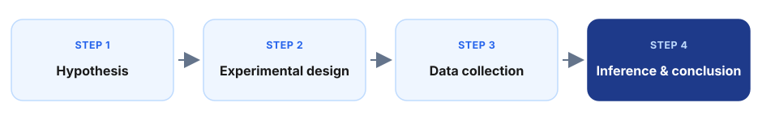
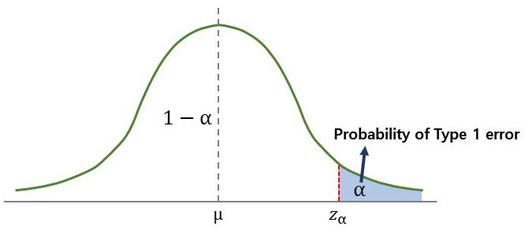
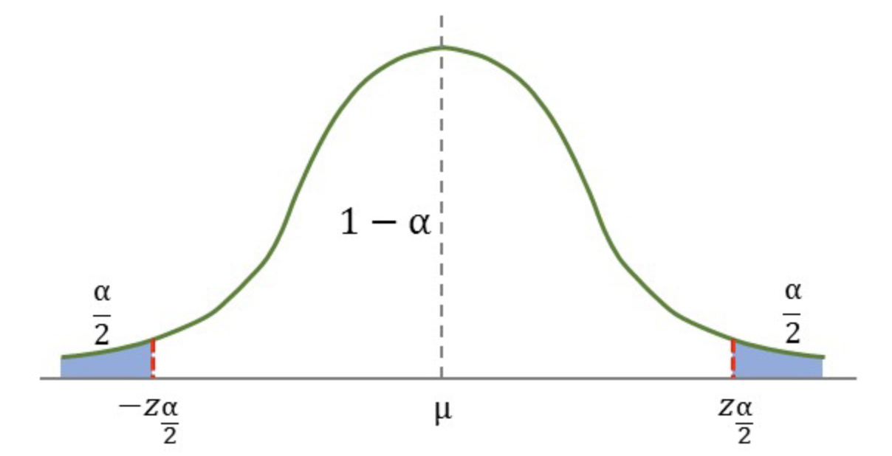

## 0. Introduction

<u>**Experimental design**</u> aims to confirm or reject a hypothesis. Data scientists often find themselves in situations where they must run experiments continuously, such as user interface or product marketing experiments. And these experiments run on a kind of pipeline.

An experiment starts with forming a hypothesis such as ‘Drug A is better than the existing standard drug’ or ‘Price A is more profitable than price B.’ The experiment is designed to test the hypothesis, and designed so that it can lead to the desired final conclusion. Then the data is collected and analyzed, and finally a conclusion is drawn. Alternatively, through a process called <u>**inference**</u>, we sometimes try to apply experimental results obtained from limited data to a larger process or population.

## 1. A/B Testing

An <u>**A/B test**</u> is an experiment that splits subjects into two groups to prove that one of two treatments, products, or procedures is superior to the other. One of the two is set as the standard existing method, or as a method with no treatment applied at all, and this is called the <u>**control group**</u>. A typical <u>**hypothesis**</u> is set up along the lines of "applying the new treatment is better than the control."

| Term | Definition | Example |
| --- | --- | --- |
| Subject | The individual entity to which a treatment is applied (the test participant). | Take an experiment verifying the effect of a new diet pill, 'SlimFit.' **Each of the 100 adult men and women** who agreed to participate is a 'subject.' (In an animal experiment rather than a human one, each individual lab mouse would be a subject.) |
| Treatment | A particular environment or condition given to a subject. | It refers to **the act of having participants take one newly developed 'SlimFit' diet pill a day** for the experiment. |
| Treatment group | The group of subjects exposed to a particular treatment. | Of the 100 participants, it is **the group of 50 who take the 'SlimFit' pill** whose effect we want to verify. |
| Control group | The group of subjects given no treatment. | The remaining group of 50, who, to allow comparison of the drug's effect, **either do not take the 'SlimFit' pill or take a fake pill that looks the same but has no active ingredient (a placebo)**. |
| Randomization | The process of randomly deciding which subjects receive the treatment. | When dividing the 100 participants into the treatment and control groups, it is **the process of randomly assigning 50 to each group using a lottery or a computer random number generator** so that the researcher's subjectivity doesn't intervene. (For example, it prevents only younger people from ending up in the treatment group.) |
| Test statistic | The metric used to measure the effect of the treatment. | When body weight is measured before the experiment and after four weeks, it is <strong>the value computed from the difference between 'the treatment group's average weight loss' and 'the control group's average weight loss' (e.g., the t-value)</strong>. Looking at this value, we judge statistically whether the drug's effect is due to chance or real. |

A/B tests are commonly used in web design and marketing because the results are easy to measure.

> 📌 **Examples of A/B tests**
>
> - Testing two soil treatments to find out which yields better seed germination.
> - Testing two therapies to find which suppresses cancer more effectively.
> - Testing two prices to determine which yields more net profit.
> - Testing two web headlines to determine which produces more clicks.
> - Testing two web ads to judge which earns a higher conversion rate.

You need to pay attention to the <u>**test statistic or metric**</u> used to compare group A and group B. The metric most commonly used in data science is a <u>**binary variable**</u> such as click/no-click, buy/no-buy, fraud/no-fraud. Then the results can be summarized in a 2x2 table like the one below.

| Outcome | Price A | Price B |
| --- | --- | --- |
| Conversion | 200 | 182 |
| No conversion | 23,539 | 22,406 |

Depending on whether the metric is a continuous variable such as purchase amount or profit, or a count variable such as days in the hospital or pages visited, the results may be displayed differently. If you are more interested in revenue per page view than in the conversion rate, the table above would have to be organized like this.

|  | Revenue per page view with price A | Revenue per page view with price B |
| --- | --- | --- |
| Mean | 3.87 | 4.11 |
| Mean absolute deviation | 7.68 | 8.15 |

### 1.1. Why do we need a control group?

Couldn't we just run the experiment on a group given the treatment of interest, without a control group, and simply compare the result with prior experience?

Without a control group, there is no guarantee that the treatment group and prior experience are ‘exactly the same in everything except the treatment.’ So when comparing only against a ‘baseline’ or prior experience, <u>**factors other than the treatment may differ**</u>, which is why a control group is needed.

> 📌 **NOTE**
>
> In data science, A/B tests are used heavily in web settings. Many things can be a <u>**treatment**</u>: the design of a web page, the price of a product, the wording of a headline, and so on. The values to be measured are typically the number of clicks, number of purchases, visit duration, number of pages visited, whether a particular page was visited, and so on.
>
> In a typical A/B experiment, you have to decide on a single metric. Several metrics may be collected, but if the experiment ultimately leads to a decision between treatment A and treatment B, <u>**a single metric or test statistic must be decided in advance**</u>. Choosing the test statistic after running the experiment can lead to <u>**researcher bias**</u>.

### 1.2. Why just A/B? Why not C, D, …?

Of course, the A/B test is not the only type of statistical experiment. You can certainly take repeated measurements on subjects, or run an experiment with a mechanism in place that lets you stop midway and reach a conclusion.

Statistical experimental design in the traditional sense focused on answering a <u>**static question**</u> about the efficacy of a particular treatment.

> Is the difference between price A and price B statistically significant?

But data scientists are not very interested in this kind of question. They are more interested in this one.

> Of the many possible prices, which is the best?

> 📌 **Multi-Armed Bandit (MAB)**
>
> When you don't know which of several options gives the best reward, it is <u>**a decision-making algorithm that repeatedly chooses and learns in order to maximize gains**</u>.
>
> The term combines "bandit," slang for a casino slot machine, with "multi-armed," meaning it has several levers. A casino has several slot machines (each with a different payout probability), and nobody knows which machine pays out big most often. It is a problem that begins with the question <strong>which machine's lever should you pull, and how many times, to win the most money?</strong> within a limited number of chances (money or attempts).
>
> The idea behind the multi-armed bandit is to resolve the <u>**'exploration-exploitation trade-off'**</u>.
>
> - **Exploitation:** Continuing to pick the option that has performed best so far. (e.g., after 10 tries machine B paid out the most, so keep pulling only B)
> - **Exploration (the opposite of exploitation):** Trying other options that you haven't tried yet or have little data on. (e.g., machines C and D have been played less, so try them in case they pay out even more)
>
> **How it differs from a traditional A/B test**
>
> - **Traditional A/B test:** Ad or web page variants A and B are shown in an exact 50/50 split (50:50) for a fixed period (e.g., two weeks) no matter what, and the winner is decided only after it ends. Even if B turns out to be overwhelmingly better midway, traffic keeps being foolishly sent to A until the two weeks are over, incurring losses.
> - **Multi-armed bandit:** As the experiment proceeds, it **gradually funnels more traffic to the better-performing side (e.g., variant B)** and reduces the share of the worse-performing side (variant A). This minimizes the loss incurred during the experiment (<u>**regret**</u>).
>
> *Practical limitation:* Bandits excel at finding "which option yields the optimal gain," but they are not well suited to producing academic or mathematical proof (p-values, etc.) that "variant A was statistically significantly 15% better than variant B."
>
> They are mainly used in **online advertising and marketing** (allocating more budget in real time to the banner with the highest click-through rate among several ad banners), **recommender systems** (showing users the content they're most likely to enjoy in real time on news, shopping, and video platforms, and learning from their responses), and **web/app UI optimization** (quickly converging on the alternative with the highest conversion rate among options such as button colors or copy placement).

## 2. Hypothesis Testing

A <u>**hypothesis test**</u> or <u>**significance test**</u> is a traditional statistical analysis method that appears in most published papers. Its purpose lies in <u>**finding out whether an observed effect is due to chance**</u>.

| Term | Meaning | Example |
| --- | --- | --- |
| Null hypothesis | **The default hypothesis set up from the start in the expectation of rejecting (invalidating) it**, claiming "there is no effect," "there is no difference," or "it is due to chance." | "The new cold medicine **does not differ** in treatment effect from the existing medicine." |
| Alternative hypothesis | The hypothesis that opposes the null hypothesis; it is **the claim the researcher actually wants to prove with data**. | "The new cold medicine is **more effective** than the existing medicine." |
| One-tailed test | A test in which the direction of the alternative hypothesis is fixed to one side (greater, or smaller), so it **computes the probability of something happening by chance in only one direction**. | Alternative hypothesis: "Blood pressure will be **lower** than before after taking the new drug" → Cases where blood pressure rises are not included in the alternative hypothesis we care about; only the 'lowering' direction is tested. |
| Two-tailed test | A test in which the alternative hypothesis has no direction (there is a difference / not equal), so it **computes the probability of something happening by chance considering both directions, greater or smaller**. | Alternative hypothesis: "Blood pressure **differs from before after taking the new drug (whether it rises or falls)**" → Both possibilities, rising and falling, are tested in the regions on both sides. |

Why bother setting up hypotheses at all? Can't we just look at the experimental results and pick the better treatment?

The reason is <u>**the human tendency to underestimate randomness**</u>. Or rather, <u>**the tendency to mistake random events for patterns with some important meaning**</u>. Statistical hypothesis testing serves to protect researchers from being fooled by things that happened randomly, by chance.

> 📌 **Misconceptions about randomness: Minsu and Jieun's coin-flip experiment**
>
> A teacher gave two students an assignment.
>
> - Minsu: actually flips a coin 50 times and writes down the results.
> - Jieun: makes up 50 results without a coin so they "look random."
>
> The teacher can tell who made theirs up the moment they see the result sheets.
>
> **Minsu's record**: Somewhere in the middle there is a stretch like HHHHHH where the same face appears 6 times in a row. If it is truly random, runs this long are common in 50 flips.
>
> **Jieun's record**: HTHHTHTTHTHH… The same face appears at most 3 times in a row. Jieun shows a tendency to break the flow on purpose, thinking “H came up three times, so a T has to come next for it to be random.”
>
> **Lesson 1**: People mistake 'random' for 'evenly mixed.' So <u>**they expect fewer streaks than truly random sequences actually produce**</u>.
>
> **Lesson 2**: Conversely, when they see HHHHHH they suspect "Is the coin rigged?" Concluding “A is definitely better” because headline A got 10% more clicks than B is the same mistake. <u>**It is attaching meaning to a difference that may be due to chance**</u>.

Therefore, in a proper A/B test, data on A and B must be collected so that the observed difference between A and B can be explained by <u>**chance in the selection of subjects, or a true difference between A and B**</u>. Statistical hypothesis testing means performing an analysis, involving an A/B test or, more broadly, multiple randomized experiments, to evaluate whether the difference seen between A and B is due to chance.

### 2.1. Null and alternative hypotheses

Humans tend to interpret something that actually happened by chance as having some meaning if it is uncommon. Therefore, we need evidence that lets us claim the difference between groups obtained in an experiment is extremely different from what could reasonably be obtained at random.

To do this, the standard approach is to set as the baseline assumption that the outcomes of the two groups are the same and that any difference between the groups is the result of chance, and then, if this can be proven wrong, to show that the difference between the two groups is not due to chance.

The hypothesis set up as this baseline is the <u>**null hypothesis**</u>, and the hypothesis that opposes it, that is, the one accepted when the null hypothesis is rejected, is called the <u>**alternative hypothesis**</u>.

- Null hypothesis: There will be no difference between the means of group A and group B. ($\mu(A) = \mu(B)$)
- Alternative hypothesis: A and B are different. ($\mu(A) \neq \mu(B)$)

In other words, <u>**taken together, the null and alternative hypotheses must account for all possibilities**</u>.

### 2.2. One-tailed/two-tailed tests

Suppose we want to use an A/B test to check how a new option (B) compares with the option we have been using (A). The assumption is that we will keep using the default option unless the new option is proven to be definitively better. Since we can simply stick with A unless B is clearly proven to be better, we need a directional (one-sided) alternative hypothesis: ‘B is better than A.’ This is called a <u>**one-tailed test**</u>. It means computing the p-value by considering extreme chance results in only one direction.

If you want a hypothesis test that won't be fooled in either direction, you set up a bidirectional alternative hypothesis such as ‘A and B will differ.’ This is called a <u>**two-tailed test**</u>. It means computing the p-value for extreme chance results appearing on both sides.

## 3. Resampling

<u>**Resampling**</u> means repeatedly drawing samples from the observed data values. There are two main types of resampling: the <u>**bootstrap**</u> and the <u>**permutation test**</u>.

| Term | Meaning | Example |
| --- | --- | --- |
| Resampling | A method of **repeatedly drawing further samples** from already observed sample data to gauge the random variability of the data or estimate the distribution of a statistic. | Given height data for 100 people, it means repeatedly drawing random subsets from that data and checking how the distribution of the mean changes. |
| With replacement | A method in which, after drawing a data point, you **put it back into the original pool** before the next draw. Data already drawn can be drawn again. | If you draw `2` from a box containing `[1, 2, 3]` and put it back before drawing again, `2` can come up again next time. (Used in the bootstrap.) |
| Without replacement | A method in which, after drawing a data point, you **leave it out instead of putting it back** before the next draw. Nothing is drawn twice. | If you draw `2` from `[1, 2, 3]` and set it aside, only `[1, 3]` remains. (Used in the permutation test.) |
| Permutation test | Used when testing a hypothesis about whether there is a difference between two or more groups (e.g., the difference in means between group A and group B). It evaluates the significance of the null hypothesis by repeatedly **combining the two groups' data (shuffling it based on sampling without replacement)**, splitting it randomly into two groups, and computing the difference between them. | • Class A scores: `[80, 85]`, class B scores: `[90, 95]` (difference in class means: 10 points) • Combine both classes' scores: `[80, 85, 90, 95]`. Shuffle them thoroughly, split them without replacement into random classes A' and B' of 2 each, and compute the difference in means. (e.g., `[80, 95]` vs `[85, 90]` → difference of 0 points) • After repeating this shuffle-and-compare step thousands of times, find the p-value by asking "how rare is the real class A/B difference (10 points) among these randomly shuffled results?" |
| Bootstrap | A method that uses **sampling with replacement** from the observed data to create <strong>new samples of the same size (n) as the original sample (bootstrap samples)</strong> many times (B times). It is used without distributional assumptions to obtain standard errors or confidence intervals for statistics such as the mean or median. | Original data: `[10, 20, 30]` (size 3) • Bootstrap sample example 1, drawn with replacement: `[10, 10, 30]` (10 is duplicated) • Bootstrap sample example 2, drawn with replacement: `[20, 30, 30]` (30 is duplicated)  Repeat this process hundreds to thousands of times, look at the distribution of the means, and estimate a confidence interval. |

### 3.1. Permutation test

<u>**A permutation test proceeds by combining the data of two groups, randomly shuffling and reassigning them thousands of times, and computing the probability (p-value) that the actually observed difference is due to chance**</u>.

Let's take as an example an **A/B test scenario** that checks the difference in dwell time between a website's existing design (variant A) and a new design (variant B).

**1. Set up hypotheses and compute the observed statistic**

- **Set up hypotheses**: Set the null hypothesis (H₀) as "there is no difference in mean dwell time between variants A and B." Set the alternative hypothesis (H₁) as "variant B has a longer dwell time (or there is a difference)."
- **Compute the observed difference**: Compute the difference in means between the two groups from the actual experimental results. For example, if the dwell times for variant A (3 people) are `[10s, 12s, 14s]` (mean 12s) and for variant B (3 people) are `[18s, 20s, 22s]` (mean 20s), **the actual observed difference is 8 seconds**.

**2. Pool the data (Pooling)**

- **Remove group labels**: Take off all the labels "variant A" and "variant B" and combine all the data into one basket.
- **Pooled data**: `[10, 12, 14, 18, 20, 22]` (6 numbers in total) is created. If the null hypothesis is true, these data came from the same population in the first place, so there's no harm in shuffling them.

**3. Randomly reassign by sampling without replacement (Shuffle & Split)**

- **Random split**: Shuffle the 6 combined data points well, then use sampling without replacement to split them into two groups of 3 each (virtual A, virtual B), the same size as the original groups.
- **Example result**: `[10, 18, 20]` is drawn for virtual A, and the remaining `[12, 14, 22]` is assigned to virtual B.

**4. Compute and record the virtual groups' statistic**

- **Compute the virtual difference**: Compute the difference in means between the virtual groups just split at random. In the example above, the virtual B mean (16s) minus the virtual A mean (16s), **0 seconds**, is recorded.
- **Repeat**: Repeat steps 3 and 4 **from 1,000 to 10,000 or more times**, collecting thousands of virtual mean differences to form a distribution.

**5. Compute the p-value (significance probability)**

- **Compute the proportion of extreme values**: Among the thousands of virtual differences produced by shuffling, calculate what percentage are **greater than or equal to the actual observed difference (8 seconds) from step 1**.
- **Calculation example**: If, out of 1,000 repetitions, a difference of 8 seconds or more arose by chance only 10 times, the p-value is `10 / 1,000 = 0.01` (1%).

**6. Statistical decision**

- **Compare with the significance level**: Compare the obtained p-value with a threshold set in advance (usually a <u>**significance level**</u> of α = 0.05).
- **Draw a conclusion**: Since the p-value (0.01) is smaller than 0.05, we judge that "a difference of 8 seconds is very unlikely to arise by mere chance" and <u>**reject the null hypothesis**</u>. In other words, we conclude that design B actually has the effect of increasing dwell time.

This random shuffling procedure is called a <u>**random permutation test**</u> or a <u>**randomization test**</u>.

### 3.2. Exhaustive and bootstrap permutation tests

Besides the <u>**random permutation test**</u> and <u>**randomization test**</u> we saw above, there are two more variants of the permutation test.

- <u>**Exhaustive permutation test**</u>
- <u>**Bootstrap permutation test**</u>

#### 3.2.1. Exhaustive permutation test

- **Core principle**: When splitting the pooled data without replacement, it **computes every theoretically possible combination (every case) without missing a single one** to obtain an exact p-value.
- **When to use**: Only when the data is small enough for a computer to compute every combination.

**Example scenario: verifying a new drug's effect on a small scale (6 people in total)**

- **Situation**: Compare the reduction in blood pressure between a new-drug group (group A, 3 people) and a placebo group (group B, 3 people) in 6 patients with a rare disease.
- **Pooled data**: The blood pressure reductions of the 6 people are `[2, 4, 5, 10, 12, 14]`.
- **Procedure**:
  1. Computing **the number of all combinations** (${}_{6}C_{3}$) for splitting 6 people's data into two groups of 3 gives **20 in total**.
  2. Instead of having the computer shuffle randomly, it **lists all 20 combinations from 1 to 20** and computes the difference in means for each.
  3. If exactly 1 of the 20 results is greater than or equal to the actual observed difference, the p-value is fixed at exactly **1 / 20 = 0.05**, with no error.
- **Limitation**: If the total grows to 30 people (15 vs 15), the number of possible combinations becomes about **150 million**, making it impossible to compute every case.

#### 3.2.2. Bootstrap permutation test

- **Core principle**: Unlike the ordinary permutation test (sampling without replacement), it compares differences by **using sampling with replacement (duplicates allowed) to randomly create virtual groups** from the pooled data.
- **When to use**: When there is so much data that the total number of cases can't be computed, or when you want to test the hypothesis while broadly reflecting even the variability of the population itself.

**Example scenario: A/B test of a shopping-site checkout button color (2,000 people in total)**

- **Situation**: Show 2,000 visitors either a blue button (group A, 1,000 people) or a red button (group B, 1,000 people) and compare the difference in purchase conversion rates.
- **Pooled data**: Combine the purchase data of the 2,000 people (purchase = 1, no purchase = 0) into one pool.
- **Procedure**:
  1. The total number of ways to choose 1,000 people out of 2,000 is astronomically large, so an exhaustive permutation test is impossible.
  2. From the pooled data of 2,000 people, draw 1,000 people by **sampling with replacement** to form virtual group A, and again draw 1,000 people with replacement to form virtual group B. (The same person's data can end up in both A and B at once, or several times in the same group.)
  3. Compute the difference in conversion rates between the two virtual groups.
  4. **Repeat this process many, many times** to obtain an approximate p-value.

Both procedures come up often in statistics, but distinguishing between them is somewhat complicated and reportedly not practical from a data science standpoint.

---

## 📚 References

- [\[Probability and Statistics\] 60. Statistical Testing (3) - One-Sided and Two-Sided Tests](https://m.blog.naver.com/mykepzzang/220886418140)
