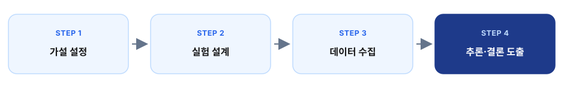
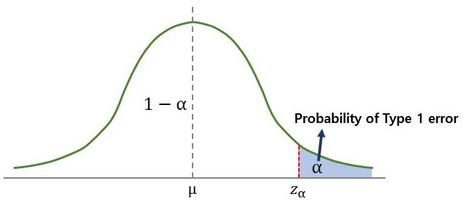
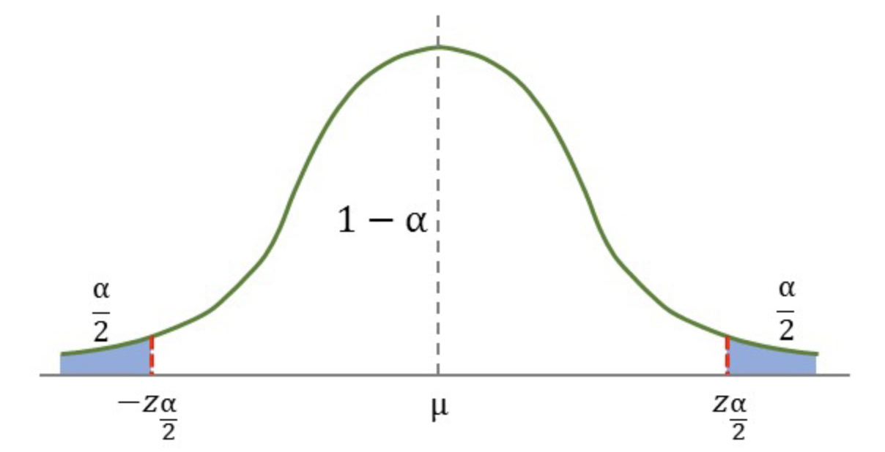

## 0. 들어가며

<u>**실험 설계**</u>는 어떤 가설을 확인하거나 기각하기 위한 목표를 갖고 있습니다. 데이터 과학자들은 종종 사용자 인터페이스나 제품 마케팅 실험과 같이 지속적으로 어떤 실험을 수행해야 하는 상황에 있습니다. 그리고 이런 실험은 일종의 파이프라인 위에서 수행됩니다.

실험은 ‘약품 A가 기존의 표준 약품보다 낫다’, 혹은 ‘가격 A가 가격 B보다 수익성이 높다’라는 식의 가설을 세우는 것에서부터 출발합니다. 실험은 가설을 검정하기 위해 설계되고, 원하는 최종적인 결론을 도출할 수 있도록 설계됩니다. 그리고 데이터를 수집하고 분석한 다음 마침내 결론을 도출합니다. 또는 <u>**추론(inference)**</u>이라는 작업을 통해 제한된 데이터로 주어진 실험 결과를 더 큰 과정 또는 모집단에 적용하는 시도를 하기도 합니다.

## 1. A/B 검정

<u>**A/B 검정**</u>은 두 가지 처리 방법, 제품, 절차 중 어느 쪽이 다른 쪽보다 더 우월하다는 것을 입증하기 위해 실험군을 두 그룹으로 나누어 진행하는 실험입니다. 이 두 가지 방법 중 하나는 기준이 되는 기존 방법이거나, 아예 아무런 처리도 적용하지 않은 방법으로 설정되며, 이를 <u>**대조군**</u>이라고 합니다. 일반적인 <u>**가설**</u>은, 새로운 처리 방법을 적용하는 것이 대조군보다 더 낫다는 식으로 설정됩니다.

| 용어 | 정의 | 예시 |
| --- | --- | --- |
| 대상(subject) | 처리를 적용할 개체 대상(피실험자)입니다. | 새로운 다이어트 약 '슬림핏'의 효과 검증 실험을 예시로, 이 실험에 참여하기로 동의한 **성인 남녀 100명 개개인**이 각각 '대상'이 됩니다. (사람이 아닌 동물 실험이라면 실험용 쥐 한 마리 한 마리가 대상이 됩니다.) |
| 처리(treatment) | 어떤 대상에 주어지는 특별한 환경이나 조건입니다. | 실험을 위해 새롭게 개발된 **'슬림핏' 다이어트 약을 하루에 한 알씩 복용하게 하는 행위** 자체를 의미합니다. |
| 처리군(treatment group) | 특정 처리에 노출된 대상들의 집단입니다. | 전체 참여자 100명 중, 실제로 효과가 있는지 확인하려는 **'슬림핏' 약을 복용하는 50명의 집단**입니다. |
| 대조군(control group) | 어떤 처리도 하지 않은 대상들의 집단입니다. | 나머지 50명의 집단으로, 약의 효과를 비교하기 위해 **'슬림핏' 약을 먹지 않거나, 모양만 같고 성분이 없는 가짜 약(위약/플라시보)을 복용하는 집단**입니다. |
| 임의화(randomization) | 처리를 적용할 대상을 임의로 결정하는 과정입니다. | 100명의 참여자를 처리군과 대조군으로 나눌 때, 연구자의 주관이 개입되지 않도록 **제비뽑기나 컴퓨터 난수 생성기 등을 이용해 무작위로 50명씩 배정하는 과정**입니다. (예: 나이가 어린 사람만 처리군에 몰리는 것을 방지합니다.) |
| 검정통계량(test statistic) | 처리 효과를 측정하기 위한 지표입니다. | 실험 시작 전과 4주 후의 몸무게를 측정했을 때, <strong>'처리군의 평균 체중 감소량'과 '대조군의 평균 체중 감소량'의 차이를 바탕으로 계산된 수치(예: t-값)</strong>입니다. 이 수치를 보고 약의 효과가 우연인지, 진짜 효과가 있는 것인지 통계적으로 판단합니다. |

A/B 검정은 결과를 쉽게 측정할 수 있으므로 웹 디자인이나 마케팅에서 일반적으로 사용됩니다.

> 📌 **A/B 검정의 예시**
>
> - 종자 발아가 어디에서 더 잘되는지 알아보기 위해 두 가지 토양 처리를 검정합니다.
> - 두 가지 치료법을 검정하여 암을 더 효과적으로 억제하는 쪽을 찾습니다.
> - 두 가지 가격을 검정하여 더 많은 순이익을 산출하는 쪽을 결정합니다.
> - 두 개의 인터넷 뉴스 제목을 검정하여 더 많은 클릭을 생성하는 쪽을 결정합니다.
> - 두 개의 인터넷 광고를 검정하여 어느 것이 더 높은 전환율을 얻을지 판단합니다.

그룹 A와 그룹 B를 비교하는 데 사용하는 <u>**검정통계량 또는 측정 지표**</u>에 주의를 기울여야 합니다. 데이터 과학에서 일반적으로 사용되는 지표는 클릭/클릭하지 않음, 구매/구매하지 않음, 사기/사기 아님 등과 같은 <u>**이진변수**</u>입니다. 그러면 다음과 같이 2x2 표로 결과를 요약할 수 있게 됩니다.

| 결과 | 가격 A | 가격 B |
| --- | --- | --- |
| 전환 | 200 | 182 |
| 전환되지 않음 | 23,539 | 22,406 |

측정 지표가 구매액, 수익 등과 같은 연속형 변수인지, 입원 일수, 방문한 페이지 수 등과 같은 횟수를 나타내는 변수인지에 따라, 결과가 다르게 표시될 수 있습니다. 만약 전환율보다 페이지 뷰당 수익에 더 관심이 많다면 위의 표는 다음과 같이 정리해서 봐야 할 것입니다.

|  | 가격 A의 페이지 뷰당 수익 | 가격 B의 페이지 뷰당 수익 |
| --- | --- | --- |
| 평균 | 3.87 | 4.11 |
| 평균절대편차 | 7.68 | 8.15 |

### 1.1. 대조군은 왜 필요할까?

대조군 없이, 관심 있는 처리를 적용한 그룹에만 실험을 하고, 그 결과를 단순히 이전 경험과 비교해보면 안 될까요?

만약 대조군이 없다면 처리군과 그 이전의 경험이 ‘처리를 제외한 다른 모든 것들이 완전히 동일하다’고 보장할 수 없습니다. 따라서 단순히 ‘기준선’ 또는 이전 경험과 비교할 경우, <u>**처리 이외의 다른 요소가 다를 수도 있기 때문에**</u> 대조군이 필요한 것입니다.

> 📌 **NOTE**
>
> 데이터 과학 분야에서 A/B 검정은 웹 환경에서 많이 사용됩니다. 웹 페이지의 디자인, 제품의 가격, 헤드라인의 어감 등 많은 항목이 <u>**처리**</u>가 될 수 있습니다. 이때 측정하고자 하는 값은 일반적으로 클릭 수, 구매 수, 방문 기간, 방문한 페이지 수, 특정 페이지 방문 여부 등입니다.
>
> 일반적인 A/B 검정 실험에서는 하나의 측정 지표를 결정해야 합니다. 여러 지표가 수집될 수는 있지만, 실험이 결국 처리 A와 처리 B 사이의 결정으로 이어질 경우, <u>**단일 지표 또는 검정통계량을 사전에 미리 정해놓아야 합니다**</u>. 실험을 수행한 뒤에 검정통계량을 선택한다면 <u>**연구자 편향**</u>에 빠질 수 있기 때문입니다.

### 1.2. 왜 하필 A/B일까? C, D, … 가 아니라?

물론 A/B 검정이 유일한 통계 실험 유형인 것은 아닙니다. 당연히 피실험자들을 대상으로 반복적인 측정을 할 수도 있고, 중간에 실험을 중단하고 결론을 얻을 수 있는 장치를 마련해두고 실험을 할 수도 있습니다.

전통적인 의미의 통계적 실험설계는 특정 처리 방법의 효과에 대한 <u>**정적인 질문**</u>에 답하는 데에 초점을 두었습니다.

> 가격 A와 가격 B의 차이가 통계적으로 유의한가?

하지만 데이터 과학자들은 이런 질문에는 별 관심이 없습니다. 오히려 이런 질문에 더 관심이 있습니다.

> 가능한 여러 가격 중에서 가장 좋은 가격은 얼마일까?

> 📌 **멀티암드 밴딧(Multi-Armed Bandit, MAB)**
>
> 여러 선택지 중에서 어떤 것이 가장 좋은 보상을 줄지 모르는 상태일 때, <u>**이득을 최대화하기 위해 선택과 학습을 반복하는 의사결정 알고리즘**</u>입니다.
>
> 카지노의 슬롯머신을 속어로 부르는 밴딧(Bandit)과, 손잡이가 여러 개 달려있다는(multi-armed) 의미가 결합된 용어입니다. 카지노에 여러 대의 슬롯머신(각각 당첨 확률이 다름)이 있는데, 어떤 기계가 대박이 잘 터지는지는 아무도 모릅니다. 주어진 제한된 기회(돈이나 시도 횟수) 안에서 <strong>어떤 기계의 손잡이를 몇 번 당겨야 최대의 돈을 벌 수 있을까?</strong>라는 고민에서 출발한 문제입니다.
>
> 멀티암드 밴딧의 개념은 <u>**'탐험과 활용의 딜레마(Exploration-Exploitation Trade-off)'**</u>를 해결하는 것입니다.
>
> - **활용 (Exploitation):** 지금까지의 경험상 가장 성과가 좋았던 선택지를 계속 고르는 것입니다. (예: 10번 해봤더니 B 머신이 제일 잘 터지므로 계속 B만 당기기)
> - **탐험 (Exploitation의 반대 / Exploration):** 아직 안 해봤거나 데이터가 부족한 다른 선택지를 시도해보는 것입니다. (예: C나 D 머신은 덜 돌려봤으니 혹시 더 대박일지 모른다는 생각에 시도해보기)
>
> **전통적인 A/B 테스트와의 차이점**
>
> - **기존 A/B 테스트:** 광고나 웹페이지 시안 A와 B를 딱 반반씩(50:50) 정해진 기간(예: 2주) 동안 무조건 노출한 뒤, 끝난 후에야 승자를 결정합니다. 중간에 B가 압도적으로 좋다는 게 드러나도 2주가 끝날 때까지 멍청하게 A에 계속 트래픽을 흘려보내 손해를 봅니다.
> - **멀티암드 밴딧:** 실험을 진행하면서 **성과가 잘 나오는 쪽(예: B안)에 점점 더 많은 트래픽을 몰아주고**, 성과가 낮은 쪽(A안)의 비중을 줄여나갑니다. 이를 통해 실험 기간 중 발생하는 손실(<u>**Regret**</u>)을 최소화합니다.
>
> *실무적 한계:* 밴딧은 "어떤 것이 최적의 이득인가"를 찾는 데는 탁월하지만, "A안이 B안보다 통계적으로 유의미하게 15% 더 뛰어났다"는 학술적·수학적 증명(p-value 등)을 내기에는 적합하지 않습니다.
>
> 주로 **온라인 광고 및 마케팅**(여러 종류의 광고 배너 중 클릭률이 높은 배너에 실시간으로 예산을 더 집중 배분하기), **추천 시스템**(뉴스, 쇼핑몰, 영상 플랫폼에서 유저가 가장 좋아할 만한 콘텐츠를 실시간으로 노출하고 반응을 학습하기), **웹/앱 UI 최적화**(버튼 색상, 문구 배치 등 여러 대안 중 전환율이 높은 안으로 빠르게 수렴시키기)에 많이 쓰입니다.

## 2. 가설 검정

<u>**가설 검정(Hypothesis test)**</u> 또는 <u>**유의성 검정(Significance test)**</u>은 발표된 대부분의 논문에 등장하는 전통적인 통계분석 방법입니다. 목적은 <u>**관찰된 효과가 우연에 의한 것인지 여부를 알아내는 데**</u>에 있습니다.

| 용어 | 의미 | 예시 |
| --- | --- | --- |
| 귀무가설(null hypothesis) | "효과가 없다", "차이가 없다", "우연에 의한 것이다"라며 **처음부터 기각(무효화)할 것을 예상하고 설정하는 기본 가설**(영가설)입니다. | "새로운 감기약은 기존 약과 비교해 치료 효과에 **차이가 없다**." |
| 대립가설(alternative hypothesis) | 귀무가설과 대립되는 가설로, **연구자가 데이터를 통해 진짜로 입증하고 싶은 주장**입니다. | "새로운 감기약은 기존 약보다 치료 효과가 **더 좋다**." |
| 단측검정(one-tailed test) | 대립가설의 방향성이 한쪽(크다, 또는 작다)으로 정해져 있어서, **한쪽 방향으로만 우연히 일어날 확률을 계산**하는 검정 방식입니다. | 대립가설: "신약 투여 후 혈압이 기존보다 **낮아질 것이다**" → 혈압이 높아지는 경우는 우리가 관심 있는 대립가설에 포함하지 않고, 오직 '낮아지는 쪽' 한 방향만 검정합니다. |
| 양측검정(two-tailed test) | 대립가설에 방향성이 없어서(차이가 있다/같지 않다), **크거나 작은지 양방향 모두를 고려해 우연히 일어날 확률을 계산**하는 검정 방식입니다. | 대립가설: "신약 투여 후 혈압에 기존과 **차이가 있다(높아지든 낮아지든 달라진다)**" → 혈압이 높아지거나 낮아지는 두 방향의 가능성을 모두 양쪽 영역에서 검정합니다. |

왜 굳이 가설을 세워야 할까요? 단순히 실험 결과를 보고 더 나은 치료법을 선택하면 안 되는 걸까요?

그 이유는 <u>**임의성을 과소평가하려는 인간의 경향**</u> 때문입니다. 또는, <u>**무작위 사건을 어떤 중요한 의미가 있는 패턴을 갖는 것으로 오해하는 경향**</u> 때문입니다. 통계적 가설 검정은 연구자가 랜덤하게 우연히 일어난 일에 속지 않도록 보호하기 위한 역할을 하는 것입니다.

> 📌 **임의성에 대한 오해: 민수와 지은의 동전 던지기 실험**
>
> 선생님이 두 학생에게 과제를 냈습니다.
>
> - 민수: 동전을 실제로 50번 던지고 결과를 적습니다.
> - 지은: 동전 없이 "랜덤해 보이게" 50개를 지어냅니다.
>
> 선생님은 결과지를 보자마자 누가 지어냈는지 맞힐 수 있습니다.
>
> **민수의 기록**: 중간에 HHHHHH처럼 같은 면이 6번 이어진 구간이 있습니다. 진짜 무작위라면 50번 던질 때 이 정도로 이어지는 건 흔한 일입니다.
>
> **지은의 기록**: HTHHTHTTHTHH… 같은 면이 길어야 3번 연속으로 나옵니다. 지은은 “H가 세 번 나왔으니 이제 T가 나와야 랜덤하지”라고 생각하고 일부러 흐름을 끊는 경향이 보입니다.
>
> **교훈 1**: 사람들은 '랜덤'을 '골고루 섞인 것'으로 착각합니다. 그래서 <u>**진짜 무작위에서 나오는 연속을 실제보다 적게 예상합니다**</u>.
>
> **교훈 2**: 거꾸로 HHHHHH를 보면 "동전이 조작됐나?" 하고 의심합니다. 헤드라인 A가 B보다 클릭이 10% 많다고 “A가 확실히 낫다”고 단정하는 것도 같은 실수입니다. <u>**우연일 수도 있는 차이에 의미를 붙이는 것**</u>입니다.

따라서 적절한 A/B 검정에서는, A와 B 사이의 관찰된 차이가 <u>**우연한 대상 선정, 또는 A와 B의 진정한 차이**</u>로 설명될 수 있도록 A와 B에 대한 데이터를 수집해야 합니다. 통계 가설검정은 A와 B 사이에서 보이는 차이가 우연에 의한 것인지를 평가하기 위해 A/B 검정이나 더 나아가 여러 무작위 실험을 포함하는 분석을 한다는 것을 의미합니다.

### 2.1. 귀무가설과 대립가설

인간은 실제로 우연히 발생한 일이라도 그것이 흔하지 않다면, 그것에 뭔가 의미가 있을 것이라고 해석하는 경향을 가지고 있습니다. 그러므로 실험에서 얻은 그룹 간의 차이가 무작위로 얻을 수 있는 합리적인 수준과는 극단적으로 다르다고 주장할 수 있는 증거가 필요합니다.

이를 위해서 두 그룹 간의 결과는 서로 동일하며, 그룹 간의 차이는 우연에 의한 결과라는 것을 기본 가정으로 설정하고, 이것이 틀렸음을 입증할 수 있게 된다면 두 그룹 간의 차이는 우연이 아니라는 것을 증명하는 흐름을 기본적으로 사용합니다.

여기서 기본적으로 설정되는 가설이 <u>**귀무가설**</u>이고, 그에 대립되는 가설, 즉 귀무가설이 기각됨에 따라 채택되는 가설을 <u>**대립가설**</u>이라고 합니다.

- 귀무가설: 그룹 A와 그룹 B의 평균에는 차이가 없을 것입니다. ($\mu(A) = \mu(B)$)
- 대립가설: A와 B는 다릅니다. ($\mu(A) \neq \mu(B)$)

즉, <u>**귀무가설과 대립가설을 합해서 봤을 때 모든 가능성을 설명할 수 있어야 합니다**</u>.

### 2.2. 단측/양측검정

A/B 검정으로 기존에 사용하던 옵션(A)과 비교하여 새 옵션(B)이 어떠한지 검증하고자 한다고 해보겠습니다. 새 옵션이 완벽히 더 나은 것으로 입증되지 않는 이상, 기본 옵션을 계속 사용한다는 게 가정입니다. B가 확실하게 좋다고 증명되지 않는다면 A를 계속 고수하면 되기 때문에, ‘B가 A보다 낫다’는 방향성을 고려한(단방향) 대립가설이 필요합니다. 이런 경우를 <u>**단측검정**</u>이라고 합니다. 이는 한 방향에서 우연에 의한 극단적인 결과가 나타날 것을 고려하여 p-value를 계산한다는 의미입니다.

만약 어느 쪽으로도 속지 않도록 가설검정을 원한다면 ‘A와 B는 차이가 있을 것이다’라는 식의 양방향 대립가설을 세우면 됩니다. 이런 경우를 <u>**양측검정**</u>이라고 합니다. 우연에 의한 극단적인 결과가 양쪽에서 나타날 p-value를 계산한다는 의미입니다.

## 3. 재표본추출(Resampling)

<u>**재표본추출**</u>은, 관찰된 데이터의 값에서 표본을 반복적으로 추출하는 것을 의미합니다. 재표본추출에는 <u>**부트스트랩**</u>과 <u>**순열검정**</u>이라는 두 가지 주요 유형이 있습니다.

| 용어 | 의미 | 예시 |
| --- | --- | --- |
| 재표본추출(resampling) | 이미 관측된 표본 데이터에서 **반복적으로 또 다른 표본을 추출**하여 데이터의 무작위 변동성을 파악하거나 통계량의 분포를 추정하는 방법입니다. | 100명의 키 데이터가 있을 때, 이 데이터 안에서 무작위로 일부를 다시 뽑아 평균값의 분포가 어떻게 변하는지 여러 번 확인하는 것입니다. |
| 복원 추출(with replacement) | 하나의 데이터를 뽑은 뒤, **다시 원래 데이터 통에 넣고** 다음번 추출을 진행하는 방식입니다. 이미 뽑았던 데이터가 중복해서 다시 뽑힐 수 있습니다. | 숫자 `[1, 2, 3]`이 들어 있는 상자에서 하나를 뽑아 `2`를 확인한 뒤 다시 상자에 넣고 뽑으면, 다음에도 `2`가 또 나올 수 있습니다. (부트스트랩에서 사용합니다.) |
| 비복원 추출(without replacement) | 하나의 데이터를 뽑은 뒤, **다시 넣지 않고 제외**한 채 다음 추출을 진행하는 방식입니다. 중복해서 뽑히지 않습니다. | 숫자 `[1, 2, 3]` 중 `2`를 뽑아 제외하면 남은 것은 `[1, 3]`뿐입니다. (순열검정에서 사용합니다.) |
| 순열검정(permutation test) | 둘 이상의 그룹 간에 차이가 있는지(예: A 집단과 B 집단의 평균 차이) 가설 검정을 할 때 쓰입니다. 두 그룹의 데이터를 **하나로 합친 뒤(비복원 추출 기반으로 섞어서)** 임의로 두 그룹으로 나누어 집단 간 차이를 계산하는 과정을 반복해 귀무가설의 유의성을 평가합니다. | • A반 성적: `[80, 85]`, B반 성적: `[90, 95]` (두 반 평균 차이: 10점) • 두 반 성적을 전부 합칩니다: `[80, 85, 90, 95]`. 이걸 마구 섞은 뒤 2개씩 비복원으로 임의의 A'반, B'반으로 나누어 평균 차이를 구합니다. (예: `[80, 95]` vs `[85, 90]` → 차이 0점) • 이 섞어서 차이를 구하는 작업을 수천 번 반복한 뒤, "진짜 A반/B반의 차이(10점)가 이 랜덤하게 섞인 결과들 중 얼마나 드문 일인가?"를 보고 p-value를 구합니다. |
| 부트스트랩(bootstrap) | 관측된 데이터에서 **복원 추출**을 통해 원래 표본과 <strong>동일한 크기(n)의 새로운 표본(부트스트랩 표본)</strong>을 여러 번(B번) 만드는 방법입니다. 평균, 중앙값 등 통계량의 표준오차나 신뢰구간을 구할 때 분포 가정 없이 사용합니다. | 원본 데이터: `[10, 20, 30]` (크기 3) • 복원 추출로 만든 부트스트랩 샘플 예시 1: `[10, 10, 30]` (10이 중복됨) • 복원 추출로 만든 부트스트랩 샘플 예시 2: `[20, 30, 30]` (30이 중복됨)  이 과정을 수백~수천 번 반복해 평균값들의 분포를 보고 신뢰구간을 추정합니다. |

### 3.1. 순열 검정

<u>**순열검정(Permutation Test)은 두 그룹의 데이터를 하나로 합친 뒤 무작위로 섞어 재배치하는 과정을 수천 번 반복하여, 실제 관측된 차이가 우연일 확률(p-value)을 계산하는 과정**</u>으로 진행됩니다.

웹사이트의 기존 디자인(A안)과 새로운 디자인(B안)의 체류 시간 차이를 검증하는 **A/B 테스트 상황**을 예로 들어보겠습니다.

**1. 가설 설정 및 관측된 통계량 계산**

- **가설 설정**: 귀무가설(H₀)을 "A안과 B안의 평균 체류 시간에는 차이가 없다"로 설정합니다. 대립가설(H₁)은 "B안의 체류 시간이 더 길다(또는 차이가 있다)"로 둡니다.
- **관측 차이 계산**: 실제 실험 결과에서 두 그룹의 평균 차이를 구합니다. 예를 들어 A안(3명)의 체류 시간이 `[10초, 12초, 14초]`(평균 12초)이고, B안(3명)이 `[18초, 20초, 22초]`(평균 20초)라면 **실제 관측된 차이는 8초**입니다.

**2. 데이터 통합 (Pooling)**

- **그룹 라벨 제거**: A안과 B안이라는 이름표를 모두 떼고 모든 데이터를 하나의 바구니에 합칩니다.
- **통합 데이터**: `[10, 12, 14, 18, 20, 22]` (총 6개의 숫자)가 만들어집니다. 귀무가설이 맞다면 이 데이터들은 애초에 같은 집단에서 나온 것이므로 섞어도 무방합니다.

**3. 비복원 추출로 무작위 재배치 (Shuffle & Split)**

- **무작위 분할**: 합쳐진 6개의 데이터를 잘 섞은 뒤, 비복원 추출을 통해 원래 그룹 크기와 똑같이 3개씩 두 그룹(가상 A안, 가상 B안)으로 나눕니다.
- **예시 결과**: 가상 A안에 `[10, 18, 20]`이 뽑히고, 나머지 `[12, 14, 22]`가 가상 B안으로 배정됩니다.

**4. 가상 그룹의 통계량 계산 및 기록**

- **가상 차이 계산**: 방금 무작위로 나눈 가상 그룹들의 평균 차이를 구합니다. 위 예시에서는 가상 B안 평균(16초)에서 가상 A안 평균(16초)을 뺀 **0초**가 기록됩니다.
- **반복 실행**: 3번과 4번 과정을 **1,000번에서 10,000번 이상** 반복하여 수천 개의 가상 평균 차이값을 모아 분포를 만듭니다.

**5. p-value(유의확률) 계산**

- **극단값 비율 산출**: 수천 번 섞어서 만든 가상의 차이값들 중에서, **1단계에서 구한 실제 관측 차이(8초)보다 크거나 같은 경우**가 전체 중 몇 퍼센트인지 계산합니다.
- **계산 예시**: 만약 1,000번 반복했을 때 우연히 8초 이상의 차이가 난 경우가 10번뿐이었다면, p-value는 `10 / 1,000 = 0.01` (1%)이 됩니다.

**6. 통계적 의사결정**

- **유의수준 비교**: 구해진 p-value를 사전에 정한 기준(보통 <u>**유의수준**</u> α = 0.05)과 비교합니다.
- **결론 도출**: p-value(0.01)가 0.05보다 작으므로 "8초라는 차이는 단순한 우연으로 발생하기 매우 어렵다"고 판단하여 <u>**귀무가설을 기각**</u>합니다. 즉, B안 디자인이 실제로 체류 시간을 늘리는 효과가 있다고 결론 내립니다.

이런 랜덤 셔플링 절차를 <u>**임의 순열 검정(random permutation test)**</u> 또는 <u>**임의화 검정(randomization test)**</u>이라고 부릅니다.

### 3.2. 전체 및 부트스트랩 순열검정

위에서 본 <u>**임의 순열 검정(random permutation test)**</u>과 <u>**임의화 검정(randomization test)**</u> 외에도 순열 검정에는 두 가지 방식이 더 있습니다.

- <u>**전체순열검정(exhaustive permutation test)**</u>
- <u>**부트스트랩 순열검정(bootstrap permutation test)**</u>

#### 3.2.1. 전체 순열 검정

- **핵심 원리**: 통합된 데이터를 비복원 추출로 나눌 때, **이론상 가능한 모든 조합(경우의 수)을 단 하나도 빠짐없이 전부 계산**하여 정확한(Exact) p-value를 구합니다.
- **적용 조건**: 데이터가 적어서 컴퓨터가 모든 조합을 계산할 수 있을 때만 사용합니다.

**예시 시나리오: 소규모 신약 효과 검증 (총 6명)**

- **상황**: 희귀병 환자 6명을 대상으로 신약 투여군(A그룹, 3명)과 위약 투여군(B그룹, 3명)의 혈압 감소 수치를 비교합니다.
- **통합 데이터**: 6명의 혈압 감소 데이터는 `[2, 4, 5, 10, 12, 14]`입니다.
- **진행 과정**:
  1. 6명의 데이터를 3명씩 두 그룹으로 나누는 **모든 조합의 수**(${}_{6}C_{3}$)를 계산하면 **총 20가지**가 나옵니다.
  2. 컴퓨터가 무작위로 섞는 대신, 이 **20가지 조합을 1번부터 20번까지 전부 나열**하여 각각의 평균 차이를 계산합니다.
  3. 20개의 결과 중 실제 관측된 차이보다 크거나 같은 경우가 정확히 1개라면, p-value는 오차 없이 **1 / 20 = 0.05**로 확정됩니다.
- **한계점**: 만약 총 인원이 30명(15명 vs 15명)으로 늘어나면 가능한 조합이 약 **1억 5천만 가지**가 되어 모든 경우를 계산하는 것이 불가능해집니다.

#### 3.2.2. 부트스트랩 순열검정 (Bootstrap Permutation Test)

- **핵심 원리**: 일반적인 순열검정(비복원 추출)과 달리, 통합된 데이터에서 **복원 추출(중복 허용)을 사용하여 무작위로 가상 그룹을 만들어** 차이를 비교합니다.
- **적용 조건**: 데이터가 많아서 전체 경우의 수를 구할 수 없거나, 모집단 자체의 변동성까지 폭넓게 반영하여 가설을 검정하고 싶을 때 사용합니다.

**예시 시나리오: 쇼핑몰 결제 버튼 색상 A/B 테스트 (총 2,000명)**

- **상황**: 방문자 2,000명에게 파란색 버튼(A그룹, 1,000명)과 빨간색 버튼(B그룹, 1,000명)을 보여준 뒤 구매 전환율 차이를 비교합니다.
- **통합 데이터**: 2,000명의 구매 여부 데이터(구매=1, 미구매=0)를 하나의 통에 합칩니다.
- **진행 과정**:
  1. 2,000명에서 1,000명을 뽑는 전체 조합의 수는 천문학적인 숫자이므로 전체순열검정은 불가능합니다.
  2. 통합된 2,000명의 데이터 통에서 **복원 추출** 방식으로 1,000명을 뽑아 가상 A그룹을 만들고, 또 복원 추출로 1,000명을 뽑아 가상 B그룹을 만듭니다. (같은 사람의 데이터가 A와 B에 동시에 들어가거나 한 그룹에 여러 번 들어갈 수 있습니다.)
  3. 두 가상 그룹의 전환율 차이를 계산합니다.
  4. 이 과정을 **무수히 반복**하여 근사적인 p-value를 구합니다.

이 두 과정 모두 통계학에서 자주 접하게 되지만, 이 둘을 구분하는 일은 다소 복잡하고, 데이터 과학의 입장에서는 실용적이지 않다고 합니다.

---

## 📚 참고자료

- [\[확률과 통계\] 60. 통계적 검정(3) - 단측검정과 양측검정, One-Sided Test and Two-Sided Test](https://m.blog.naver.com/mykepzzang/220886418140)
