## 0. Introduction

We probably want to handle natural language with AI in order to do things like <u>**translation, summarization, and conversation**</u>. So how can AI actually handle natural language? This time, we'll walk through <u>**RNN**</u>, <u>**Seq2Seq**</u>, <u>**Attention**</u>, and <u>**Self-Attention**</u>, tracing how LLMs evolved step by step.

> Throughout this post, translation is the running example.

## 1. RNN

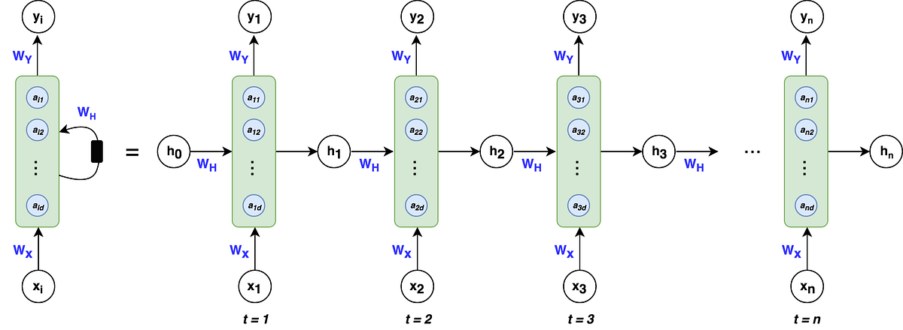

RNNs are well known for handling sequential data well. Time-series data and natural-language sentences are typical examples. Let's say we first split a sentence into words/tokens (<u>**Tokenizing**</u>), convert them into numbers (<u>**Encoding**</u>), and project them into a latent space (<u>**Embedding**</u>) to get a <u>**vector representation**</u>.

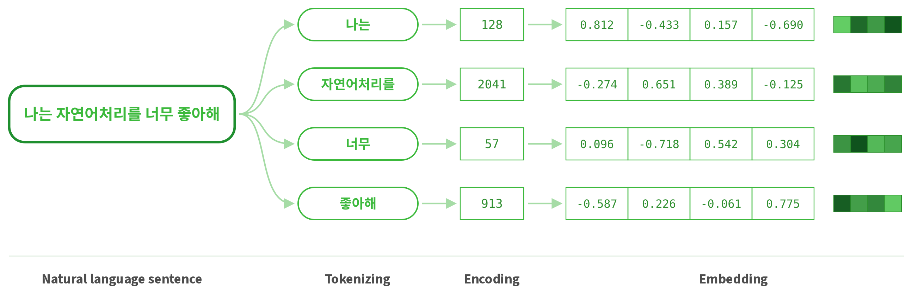

Now let's translate using the vector representations we just built. Suppose we use the familiar <u>**Synchronized RNN (many-to-many)**</u> to translate the Korean sentence ‘***나는 자연어처리를 너무 좋아해***’ into ‘***I like NLP so much***’. A synchronized RNN reads one token at each time step and immediately emits one output on the spot. So the output at time step $t$ has to be decided **by looking only at $x_1 \dots x_t$, what it has read so far**. What happens if we make it translate this way?

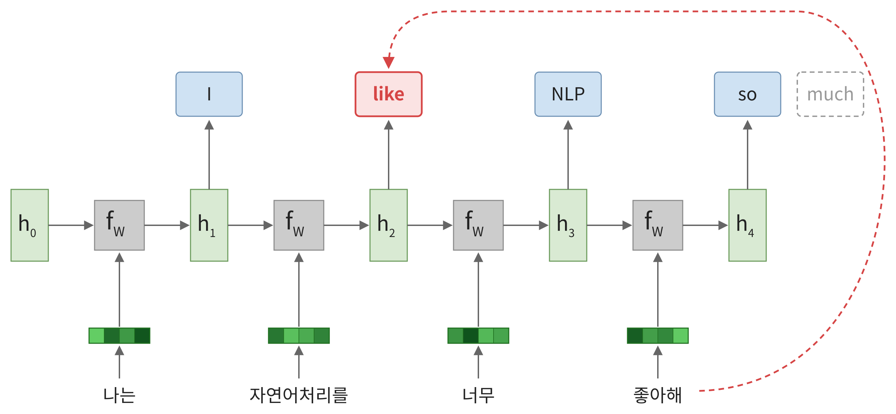

Reading '나는' (I) and emitting ‘I’ at the first step is no problem. But the trouble starts at the second step. The second word of the English sentence is ‘like’, yet the model has only read up to '나는 자연어처리를' (I, NLP). The word for ‘like’, '좋아해', sits at the <u>**very end**</u> of the Korean sentence.

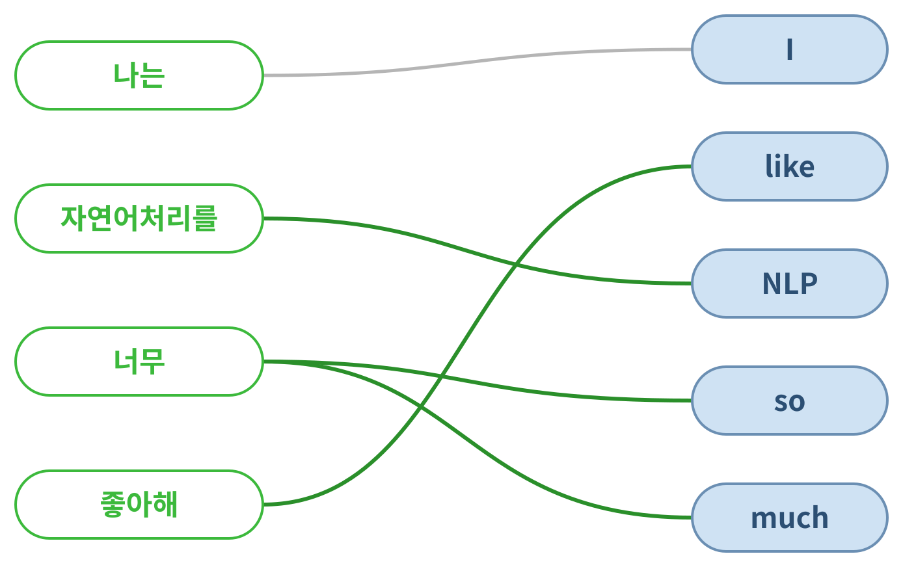

Korean puts the verb at the end of the sentence (SOV), while English puts it right after the subject (SVO). So if you draw alignment lines between words with the same meaning, they don't line up neatly — they **cross** each other. In translation, situations where <u>**you have to see a word you haven't read yet before you can say the current word**</u> come up all the time, and a Synchronized RNN structurally cannot do that.

There's one more problem. The input is 4 tokens, but the output, ‘I like NLP so much’, is 5 tokens. A synchronized RNN ties <u>**one output to each input**</u>, so there is no slot to emit ‘much’ — even though there's no reason at all for a translation to be the same length as the source.

> 🤔 **"Couldn't a Bi-directional RNN look at the later words too?"**
>
> It could. But inputs and outputs are still tied 1:1, so the length problem remains.

So we need a structure that **reads the whole sentence to the end first, and then says as much as it needs to**. Just like a professional interpreter who listens to someone's entire utterance, understands all of it, and only then translates.

## 2. Seq2Seq

**Seq2Seq** is a structure that chains two RNNs together: a many-to-one and a one-to-many. The many-to-one acts as the **encoder**, which reads the source sentence and summarizes it into a single vector, and the one-to-many acts as the **decoder**, which produces the translation based on that summary.

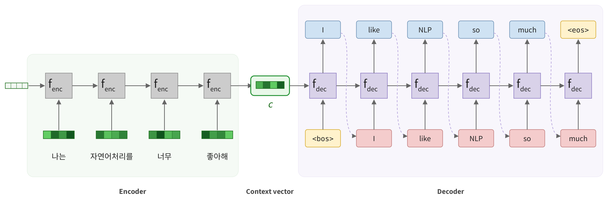

The encoder reads the embedding vectors of the input sentence '*나는 자연어처리를 너무 좋아해*' one after another. At the intermediate steps it outputs nothing and just keeps updating its hidden state. After reading the last token, there will be a final hidden state; we treat the information of the whole sentence as compressed into that hidden state and call it the **context vector $c$**. The $h_4$ at the very end of the earlier RNN figure is the context vector here.

The decoder takes the context vector as its first hidden state and produces the translation one token at a time. It takes `<bos>` and emits ‘I’, takes ‘I’ as the next input and emits ‘like’, … takes ‘much’, emits `<eos>`, and stops. Generating one word at a time like this, **using the output it just produced as the next input**, is called **autoregressive** generation.

> 📌 **teacher forcing**
>
> Training works a little differently. Even when the decoder outputs a wrong word, we feed the correct word as the next input; this training scheme is called **teacher forcing**. As a result, the training data is shifted by one position, as shown below.
>
> 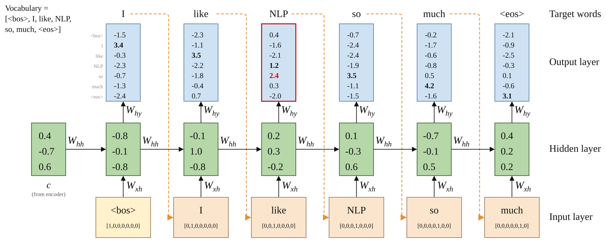
>
> - Decoder input: `<bos>` I like NLP so much
> - Decoder target: I like NLP so much `<eos>`

This Seq2Seq structure solves both problems we saw earlier.

- **Word-order problem:** By the time the decoder says its first word, it has already received the entire source sentence as the context vector.
- **Length problem:** The output length is determined by when the decoder emits `<eos>`. It doesn't matter whether it reads 4 tokens and outputs 5 tokens, or 50.

**But…** Our example is fine because it has only 4 tokens — what about a 50-token sentence, or 100 or 200 tokens? The encoder has to cram that entire long sentence into **one fixed-size vector $c$**, and the decoder has to cling to that single vector every time it says a word. There was also a critical weakness: information from earlier words gets diluted as it passes through the RNN. In practice, Seq2Seq showed its limits as translation quality dropped sharply with longer sentences.

How would a person translate? A person can **look back at the source text at any time**, even in the middle of translating. When writing ‘like’ they can look at '좋아해' again, and when writing ‘NLP’ they can look at '자연어처리를' again. So what if we let the model, too, look back at the source itself — rather than a summary of it (the context vector) — while translating?

## 3. Seq2Seq with Attention

The Seq2Seq in Section 2 packed the whole sentence into **a single context vector**. That's fine for short sentences, but the longer they get, the more the early information fades — a **bottleneck** problem.

The idea of Attention is simple. **Don't pass only the encoder's last hidden state; pass the hidden states of every time step, $h_1 \dots h_4$.** Then, every time the decoder produces a word, it gives more weight to whichever source tokens it currently needs and builds a fresh **context vector $c_t$ just for that time step**.

Let's take the second time step, where the decoder produces ‘like’, and follow how the context vector **$c_t$** is computed and how that time step's output comes out.

> 📌 **NOTE**
>
> The method described in this post is Luong's (Luong, 2015). The Attention idea itself was originally proposed by Bahdanau (Bahdanau, 2015); Luong refined the computation into a simpler form.

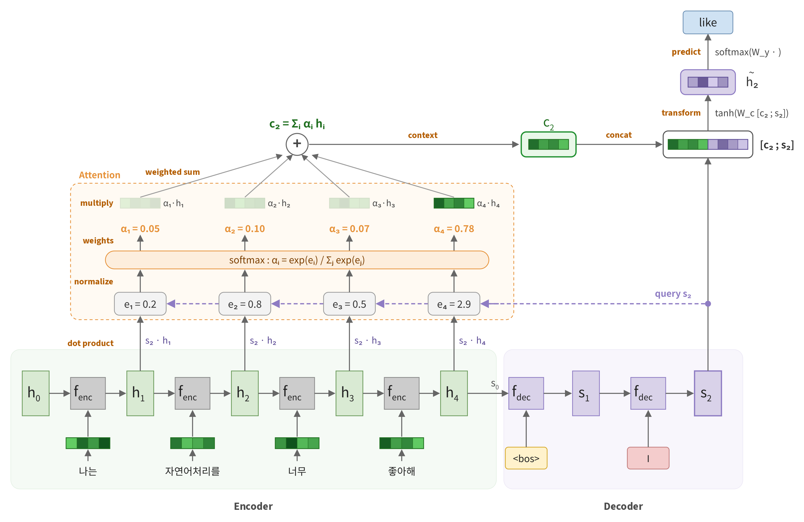

1. **Advance the decoder one step**

    The decoder takes the previous state $s_1$ and the previous word ‘I’ ($y_1$) and produces a new state $s_2$.

    $$
    s_2 = f_{dec}(s_1, y_1)
    $$

    At this point, $s_2$ holds "what word I'm about to say," but source information is only faintly present, carried through $s_1$.

2. **How similar are they (score): the dot product of $s_2$ with each $h_i$**

    Take the <u>**dot product**</u> of **$s_2$** with each of the encoder hidden states $h_1, h_2, h_3, h_4$. Since a dot product grows as two vectors point in the same direction, it becomes a score of "how relevant this source word is to what I'm about to say."

    $$
    e_i = s_2 \cdot h_i \;\rightarrow\; [0.2,\ 0.8,\ 0.5,\ 2.9]
    $$

3. **Get the weights $\alpha$ with softmax**

    Feeding the scores into softmax gives weights that sum to 1.

    $$
    \alpha = \text{softmax}(e) = [0.05,\ 0.10,\ 0.07,\ 0.78]
    $$

    In other words, it tells the model to focus (<u>**attention**</u>) 78% on '*좋아해*' (like).

4. **Build the context vector $c_2$ as a weighted sum**

    $$
    c_2 = \sum_i \alpha_i h_i = 0.05\,h_1 + 0.10\,h_2 + 0.07\,h_3 + 0.78\,h_4
    $$

    $c_2$ effectively becomes a vector made up mostly of '*좋아해*' information.

5. **Combine $c_2$ and $s_2$ to predict the word**

    Concatenate **$c_2$** (information taken from the source) and **$s_2$** (what the decoder wants to say), transform them once with $\tanh$, and then pick the output word for that time step.

    $$
    \tilde{h}_2 = \tanh(W_c[c_2;\, s_2]), \qquad y_2 = \text{softmax}(W_y \tilde{h}_2) \rightarrow \text{'like'}
    $$

> 🤔 **Where do Query, Key, and Value come in?**
>
> When the Attention mechanism described here came out, Key and Value were the same vector. Still, for those who already know the Transformer's Q, K, V, Seq2Seq Attention can be summarized like this:
>
> - **Query** = decoder state $s_t$: "this is the information I need right now"
> - **Key** = encoder hidden state $h_i$: "this is what I'm about" (the thing being compared)
> - **Value** = encoder hidden state $h_i$: the value that actually gets mixed in and taken
>
> Back then, Key and Value were the same vector, and the names Q·K·V weren't used. The Q, K, V idea was formalized in the Transformer.

The key point is that **$\alpha$ is recomputed at every time step**. When it has to output ‘like’ it should focus on '좋아해', and when it has to output ‘NLP’ it should focus on '자연어처리를'. The process by which the RNN weights $W_{hh}, W_{xh}, W_{hy}$ get updated appropriately to achieve this is exactly how learning happens in Seq2Seq with attention.

If the answer is ‘like’ but the model assigns it a low probability, the loss grows. The gradient of this loss flows back down through backpropagation, as in the chain below, updating the weights.

$$
W_y \rightarrow \tilde{h}_2 \rightarrow W_c \rightarrow c_2 \rightarrow \alpha \rightarrow e_i = s_2 \cdot h_i \rightarrow s_2 \text{ and } h_i \rightarrow W_h,\ W_x
$$

If pulling in more of '좋아해''s information helps it get ‘like’ right, the gradient adjusts the RNN weights in the direction that increases $e_4$ — that is, so that $s_2$ and $h_4$ point in more similar directions. Repeat this over countless sentence pairs, and the encoder and decoder learn on their own to build representations where “the dot product with 좋아해 grows when saying like.” As a result, as in the image below, the correspondence between tokens shows up in the Attention map (a matrix that visualizes, with numbers and colors, how much each word focuses on (attends to) the other words when the model understands or translates a sentence; a higher number means the model judged the two words to be more closely related).

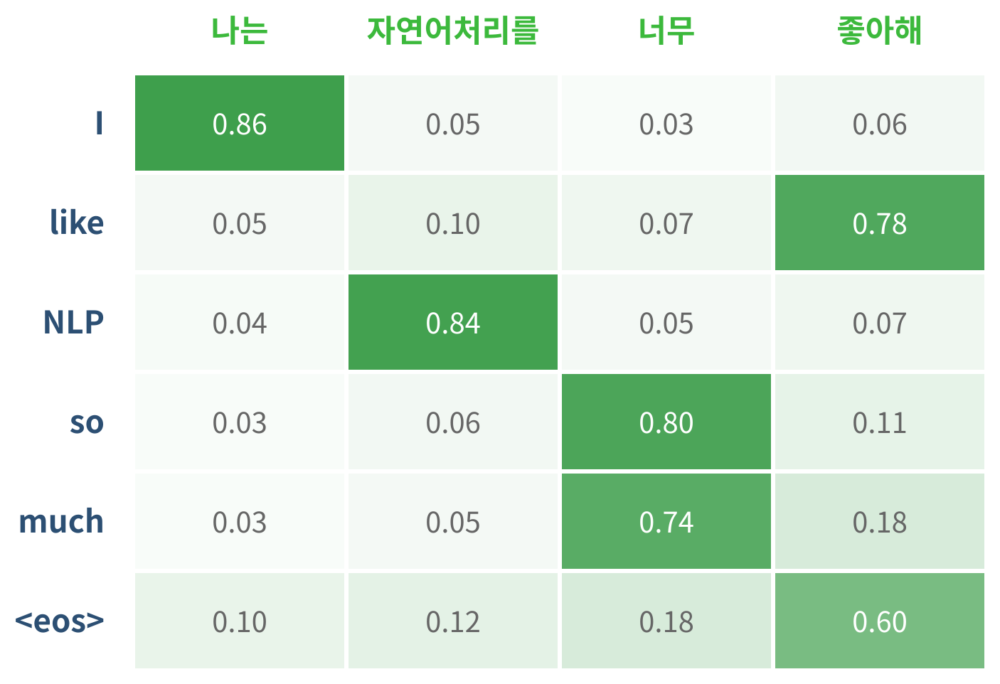

> 📌 **NOTE**
>
> The numbers ($\alpha$) in the table above are example values, assuming a fully trained model.
>
> At inference time, the trained weights are used only to **compute** $\alpha$ on the fly. So it's more accurate to understand it not as “the attention values themselves are stored and learned,” but as “the representations are learned so that attention gets computed well.”

## 4. Seq2Seq with Self-Attention

Using the RNN family (RNN, LSTM, GRU) together with Attention made it possible to pull important information directly from the earlier context, which was a breakthrough improvement. But the RNN's chronic limitation — ‘sequential processing’ — remained. Why is sequential processing a problem? Consider the following example sentences.

1. *‘나는 <u>**자연어처리**</u>를 좋아해, <u>**그건**</u> 정말 재밌거든’* (“I like NLP, because <u>**it**</u>'s really fun”)
2. *‘나는 <u>**돈**</u>을 흥청망청 아주 많이 쓸데없이 시도 때도 없이 맛있는 것을 사 먹는 데 <u>**쓰는**</u> 걸 좋아해’* (“I love <u>**spending**</u> <u>**money**</u> lavishly, a lot, pointlessly, at all hours, on buying tasty food”)

- **Problem 1: The farther away, the more it's forgotten + attention lands on information that keeps fading**
    - In sentence 1, what <u>***‘그건’***</u> (it) refers to is <u>***‘자연어처리’***</u> (NLP), which comes earlier. In sentence 2, the object of <u>***‘쓰는’***</u> (spending) is <u>***‘돈’***</u> (money), which appears way earlier.
    - An RNN must process $h_1 \rightarrow h_2 \rightarrow h_3 \rightarrow \cdots$ sequentially from the front before it can compute the hidden state of <u>***‘그건’***</u> or <u>***‘쓰는’***</u>, and only from that can an attention score be computed.
    - In other words, even though the decoder can now reference the encoder's hidden states of the source directly, there's still a problem if those encoder hidden states carry diluted information. That's because the true meaning of <u>***‘그건’***</u> and of <u>***‘쓰는’***</u> only emerges when you look at them together with <u>***‘자연어처리’***</u> and <u>***‘돈’***</u>, respectively.
- **Problem 2: It can't be parallelized.**
    - An RNN encoder can only compute $h_2$ after computing $h_1$, and $h_3$ after computing $h_2$. With 6 words you wait 6 times in turn, and with 100 words, 100 times. A GPU can do thousands of computations at once, but an RNN can barely use that capability.

So here's a thought: ***What if the Attention the decoder used to look at the encoder were used by the encoder's sentence to look at itself?*** If every word could look at every other word at once, directly, both problems could be solved together. This is <u>**Self-Attention**</u>.

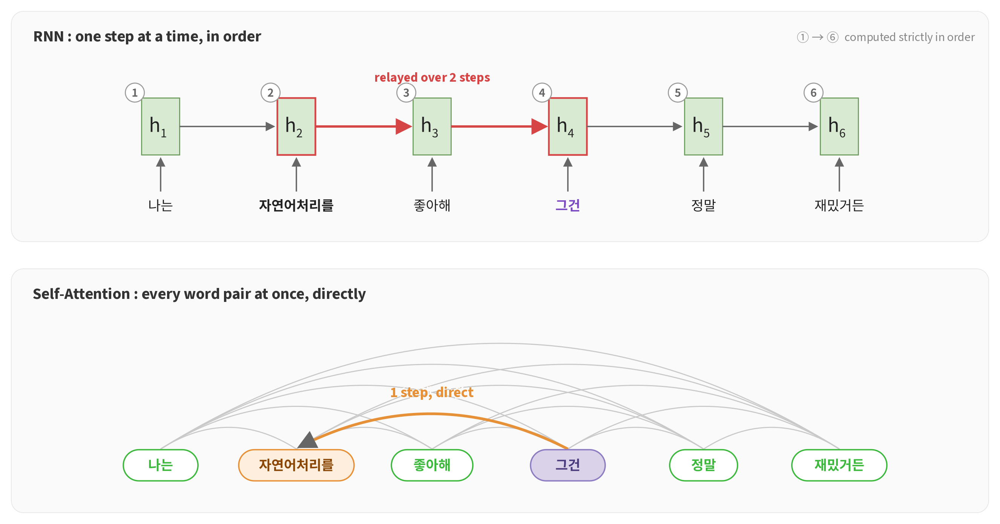

### 4.1. Self-Attention

Through self-attention, when the model processes ‘그것’ (it) and ‘쓰다’ (to spend), it can associate them with ‘자연어처리’ (NLP) and ‘돈’ (money), respectively. Let's now look in detail at how self-attention is computed.

1. **Build Query, Key, and Value vectors from the embedding vector of each encoder input token.**

    First, let's go over what the unfamiliar concepts Query, Key, and Value are.

    - **Query**: The reference point that gets compared with the other words in the sentence. It corresponds to the question the word currently being processed asks: **"This is the information I need."**
        - *"I'm a demonstrative — where's the noun I point to?"*
    - **Key:** The thing that gets compared with the Query and has its similarity measured — **"how relevant am I to this question."** It corresponds to the **"name tag"** or **"keyword"** that every word in the sentence carries.
    - **Value:** The **"core information (semantic content)"** each word actually carries. After the similarity scores (weights) between the Query and the Keys are computed, it is mixed in according to those importance ratios — **the actual value used to update the final word's representation**.

    > 💡 As a search analogy, the Query is the search term, the Key is each document's title and tags, and the Value is the document body. You compare the search term against the titles, score their relevance, rank them by score, and fetch the bodies. In search, ranking and listing them is the end of it, but in self-attention, it's easiest to think of it as scraping each body in proportion to the size of its score and pulling it in.

    We multiply each word's embedding $x_i$ by three weight matrices $W^Q$, $W^K$, $W^V$ to get the query, key, and value vectors $q_i$, $k_i$, $v_i$.

    $$
    q_i = x_i W^Q, \quad k_i = x_i W^K, \quad v_i = x_i W^V
    $$

    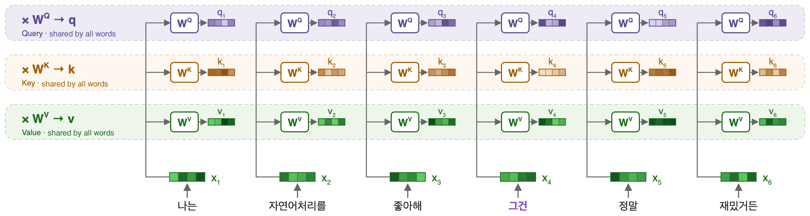

    The important point here is that **every word uses — and trains — the same $W^Q$, $W^K$, $W^V$**. Whether it's '나는' or '그건', it gets multiplied by the same matrices. There isn't a separate matrix per word; a matrix is a single "rule for turning an embedding into a query/key/value," and that rule is applied identically to every word. That's why the same model can be used even when sentence lengths differ.

2. **Scoring**

    Take the dot product of '그건''s query $q_4$ with the keys of all the words in the sentence ($k_1, k_2, \dots, k_6$).

    $$
    q_4 \cdot k_1,\ q_4 \cdot k_2,\ \dots,\ q_4 \cdot k_6 \;=\; [0.4,\ 4.6,\ 1.4,\ 2.0,\ 0.2,\ 1.6]
    $$

    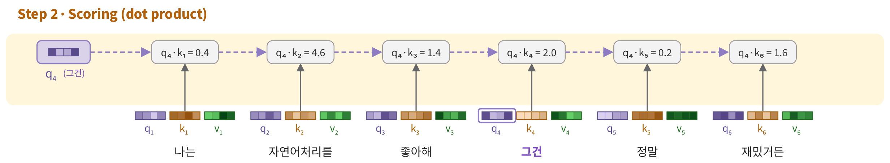

    These scores decide “how much to focus on each word (나는, 자연어처리를, …) when processing '그건'.”

    > 🤔 **Why does a dot product become a 'relevance' score?**
    >
    > The dot product of two vectors $q$ and $k$ is the sum of the products of their corresponding components.
    >
    > $$
    > q \cdot k = q_1k_1 + q_2k_2 + \dots + q_dk_d
    > $$
    >
    > Written geometrically, the same value is:
    >
    > $$
    > q \cdot k = \|q\|\,\|k\|\cos\theta
    > $$
    >
    > Here $\theta$ is the angle between the two vectors. So the dot product measures **how much two vectors point in the same direction**. Let's take the 2-D query $q = [1, 2]$ as an example.
    >
    > ![Three cases for q = [1, 2]: k = [2, 1.5] in a similar direction gives a dot product of 5, the orthogonal k = [2, −1] gives 0, and the opposite k = [−1, −2] gives −5](./image/dot-product-direction.en.png)
    >
    > In short, the more alike the directions, the higher the score; unrelated gives around 0, and opposite gives a negative number. Since we represent tokens as embedding vectors, if two token vectors have the same direction and magnitude in embedding space, we can judge the two tokens to be highly ‘related’.
    >
    > In self-attention, $W^Q$ and $W^K$ get updated during training so that the vectors of tokens that should be contextually similar in meaning point in similar directions — which is why '그건''s query and '자연어처리를''s key can end up pointing in the same direction. Once they point the same way, the dot product grows, and attention ends up leaning toward that word.

3. **Divide by $\sqrt{d_k}$**

    Divide the scores by the square root of the key vector dimension ($d_k$). In the original paper the key dimension is 64, so it divides by 8; in this post's example $d_k = 4$, so we divide by 2.

    $$
    e_j = \frac{q_4 \cdot k_j}{\sqrt{d_k}} \;\rightarrow\; [0.2,\ 2.3,\ 0.7,\ 1.0,\ 0.1,\ 0.8]
    $$

    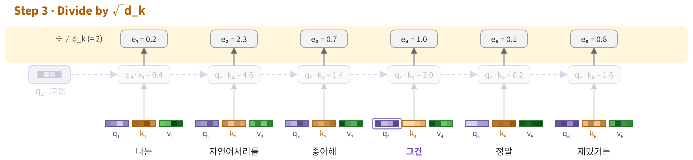

    > 🤔 **Why divide by $\sqrt{d_k}$?**
    >
    > <u>**To keep the gradient from vanishing to 0 and wrecking training.**</u>
    >
    > In this example, if you feed the scores into softmax without dividing by $\sqrt{d_k}$, the weight on '자연어처리를' climbs to 0.84. Because of how softmax works, a large score gives that word nearly 1 and the rest nearly 0.
    >
    > 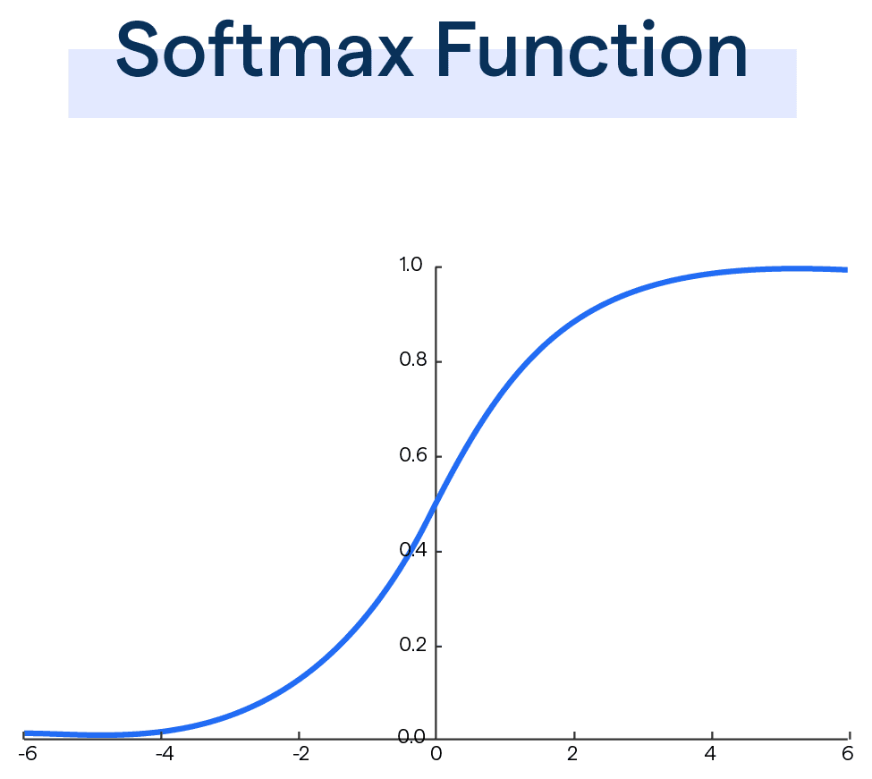
    >
    > In the softmax derivative, when $\alpha$ is close to 1 or 0, the gradient becomes almost 0. The gradient vanishes and learning stalls.
    >
    > $$
    > \frac{\partial \alpha_i}{\partial e_j} = \alpha_i(\delta_{ij} - \alpha_j)
    > $$
    >
    > The dot-product formula from step 2 doesn't just contain $\cos\theta$; it is also multiplied by the vector magnitudes $\|q\|\,\|k\|$. As the dimension $d_k$ grows, there are more terms to add up, so the <u>**magnitude**</u> of the dot product grows too. If each vector's components have mean 0 and variance 1, the variance of $q \cdot k$ is $d_k$ and its standard deviation is $\sqrt{d_k}$. Normalizing by dividing by the standard deviation brings the variance back to 1, so <u>**the magnitude stays constant regardless of dimension**</u>.

4. **softmax**

    Softmax turns the scores into weights that are all positive and sum to 1.

    $$
    \alpha_j = \frac{\exp(e_j)}{\sum_k \exp(e_k)} \;\rightarrow\; [0.06,\ 0.52,\ 0.10,\ 0.14,\ 0.06,\ 0.12]
    $$

    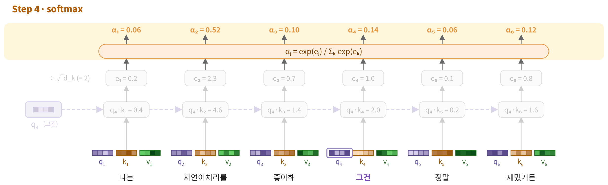

5. **Multiply the values by the weights**

    Multiply each word's value vector by the weight from step 4. The value of a word worth focusing on stays large, while the value of an unrelated word gets multiplied by a small number and nearly disappears.

    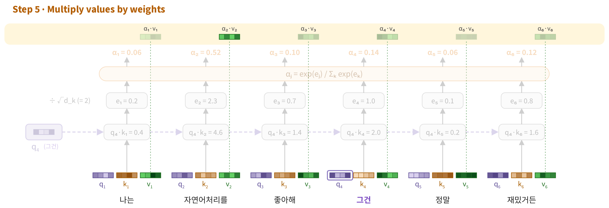

    > 📌 **Scalar multiplication acts as a ‘volume knob’**
    >
    > Multiplying a vector by a number (scalar) **$\alpha$** **keeps its direction and only scales its length by $\alpha$**.
    >
    > $$
    > \|\alpha_j v_j\| = \alpha_j \|v_j\|
    > $$
    >
    > It doesn't change the content (direction) of the information each word carries; it only adjusts how strongly that information is reflected. That's why, in the figure above, '자연어처리를''s $v_2$ stays strong while the rest fade.

6. **Add them all up**

    Adding up all the weighted values gives the vector for '*그건*', now reflecting the surrounding context.

    $$
    z_4 = \sum_j \alpha_j v_j
    $$

    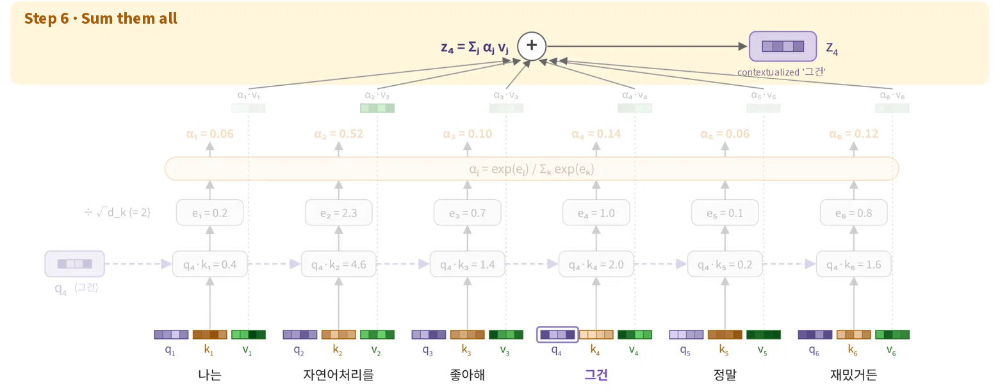

    Since ‘자연어처리를’ had the largest of the weighted values, the vector for ‘그건’ naturally ends up with a lot of ‘자연어처리를’'s vector blended into it.

    > 📌 **A weighted sum is a 'weighted average'**
    >
    > Because the weights are all at least 0 and sum to 1, this weighted sum is a **convex combination** — simply put, a weighted average.
    >
    > $$
    > z_4 = \sum_j \alpha_j v_j, \quad \alpha_j \ge 0,\ \sum_j \alpha_j = 1
    > $$
    >
    > So $z_4$ always lies **inside** the region spanned by $v_1, v_2, \dots, v_6$, and gets pulled toward $v_2$, which has the largest weight. Put in terms of probability, it's "the average you'd get if you repeatedly picked one word with probability $\alpha$ and took its value" — that is, the **expectation** $z_4 = \mathbb{E}_{j \sim \alpha}[v_j]$.
    >
    > 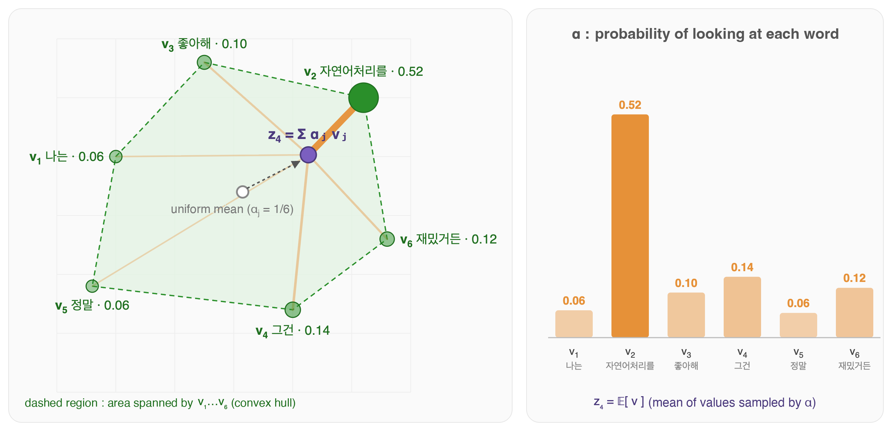

Steps 1\~6 above only cover the process of computing self-attention with ‘그건’ as the query. In practice, all 6 words are bundled into matrices and computed in parallel on the GPU, all at once and fast.

$$
Q = XW^Q, \quad K = XW^K, \quad V = XW^V\\ X = \text{matrix of vector representations}
$$

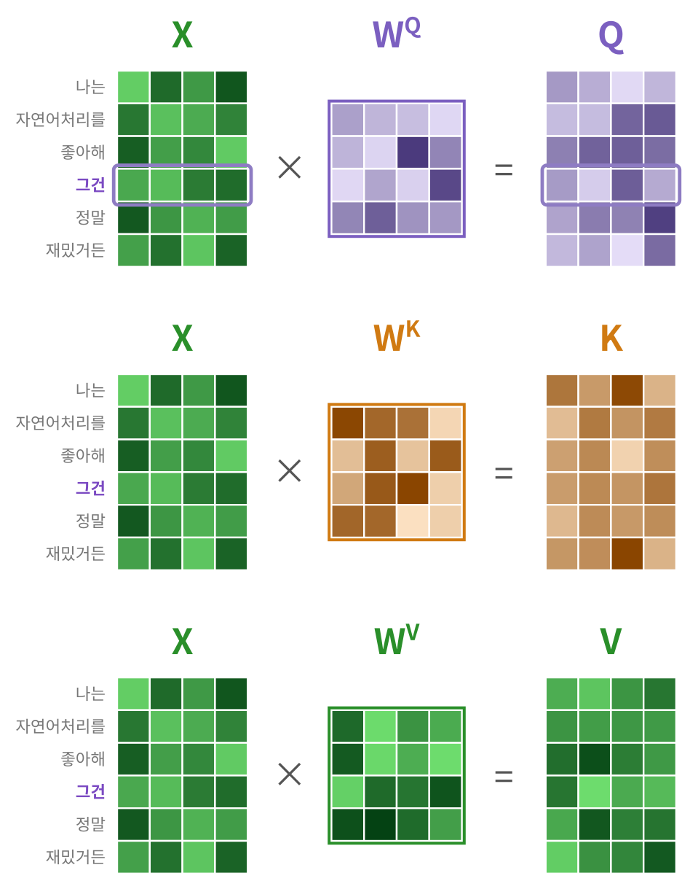

$$
\text{Attention}(Q, K, V) = \text{softmax}\!\left(\frac{QK^\top}{\sqrt{d_k}}\right)V
$$

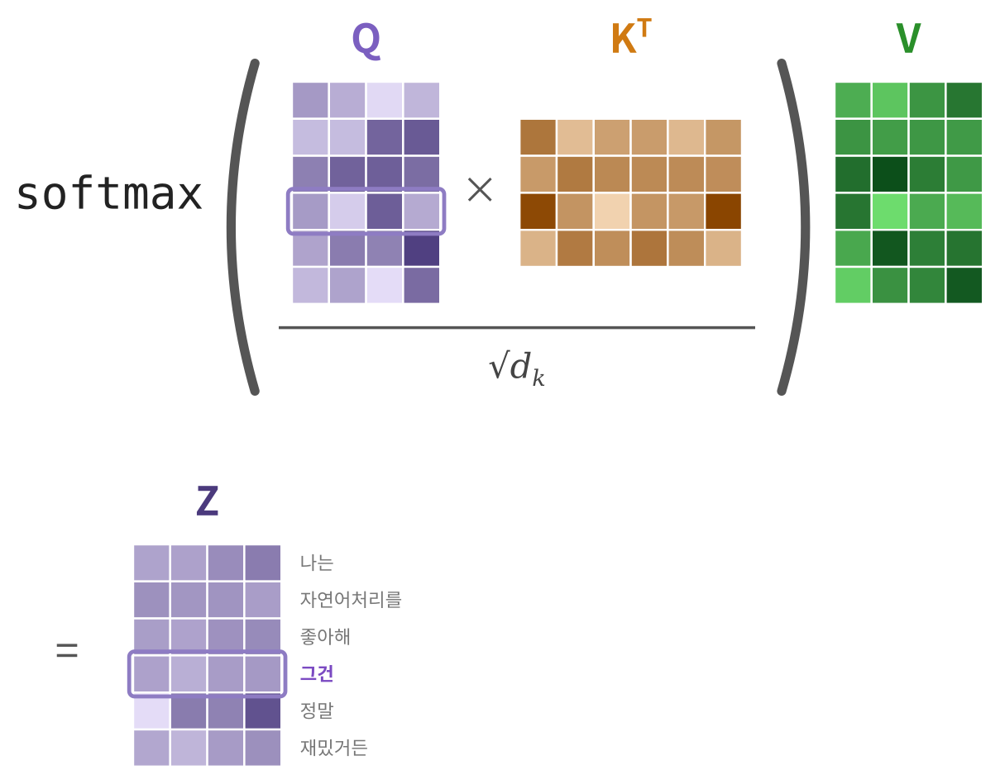

This is how self-attention solves both of the RNN's chronic problems at once: **“the farther away, the more it's forgotten”** and **“it can't be parallelized.”**

- **Problem 1 solved: one dot product, regardless of distance**
    - In an RNN, for '자연어처리를''s information to reach '그건', it had to pass through $h_2 \rightarrow h_3 \rightarrow h_4$, and for far-apart words like '돈' and '쓰는' in sentence 2, the information got diluted passing through every word in between.
    - In self-attention, '그건''s query takes a **direct dot product** with '자연어처리를''s key. Whether it's the very next word or a word 50 positions back, there is exactly one step to go through.
    - So what the encoder produces changes too. The RNN's $h_4$ was a faint mix of the preceding words, but self-attention's $z_4$ is a **contextualized '그건'** that clearly carries $0.52$ of '자연어처리를''s information. The source representation the decoder consults becomes sharper itself.
- **Problem 2 solved: compute everything at once with matrix multiplication**
    - Computing $z_4$ doesn't require $z_3$ to be finished first. Since the computations for the 6 words don't wait on each other, we can bundle $Q, K, V$ into matrices, as above, and process the whole sentence simultaneously with **a few matrix multiplications**.
    - Because it uses matrix multiplication, it can use the GPU efficiently. Whether there are 6 words or 100, there's no need to wait in turn — it can all be computed at once.

- **Encoder:** The RNN that computed $h_i$ in order disappears, and **Self-Attention** takes its place. The whole sentence goes in at once, and $z_1 \dots z_6$ come out simultaneously.
- **Decoder:** The decoder also uses self-attention instead of an RNN. However, predicting while looking at the entire target sentence would be like cheating, so it uses a technique that lets it see **only the words that came before** the current position and hides future words while predicting (**Masked** Self-Attention).

    - **Masked Self-Attention**

        This step also builds $Q$, $K$, $V$ with Self-Attention. Here, $Q$, $K$, $V$ are built from the decoder input alone, and for each time step only the information of tokens up to that point is used in the weighted sum to produce the vectors ($d_1, d_2, d_3, d_4$).

    - **Encoder-Decoder Attention**

        The vectors $d_1, d_2, d_3, d_4$ coming up from the Masked Self-Attention step are multiplied by $W^Q$ to make $Q$, which then goes through: dot product with the encoder's $z_i$ → divide by $\sqrt{d_k}$ → softmax → weighted sum with $V$. It's the same as the Self-Attention process, except that only the query comes from the decoder, while the keys and values come from the encoder.

    In other words, the role that $s_t$ played in RNN with Attention — <u>**“looking at the words generated so far and summarizing what's needed next”**</u> — is taken over by Masked Self-Attention in Seq2Seq with Self-Attention. Its result becomes the query that looks into the encoder side.

    To sum up, the decoder builds queries **twice**: once inside Masked Self-Attention (Q·K·V all from the decoder), and once inside Encoder-Decoder Attention (only Q from the decoder).

- **Encoder–decoder connection:** It's an **Encoder-Decoder Attention** structure, where the decoder builds the query and the encoder's $z_1 \dots z_6$ serve as the keys and values.

> 📌 **Masked Self-Attention**
>
> When training with teacher forcing, the decoder is fed the tokens from `<bos>` up to just before `<eos>` as input. Since self-attention computes the contextualized representation $z_i$ as a weighted sum over all the input tokens, training the decoder as is would mean it <u>**learns by cheating**</u>.
>
> The technique used here is <u>**masking**</u>. In masked self-attention, masking is implemented by assigning an extremely negative value ($-\infty$) to the dot-product results with tokens after the current time step $t$. Softmax has the property that the closer the input gets to $-\infty$, the closer the output gets to 0, so when the weights are computed, all weights from time step $t+1$ onward become 0 — giving the effect of performing self-attention only with the tokens up to time step $t$.

> 📌 **NOTE**
>
> Self-attention simply computes token-to-token relationships via dot products; it doesn't take word order into account. So it <u>**lost the position/order information**</u> that an RNN knew naturally.
>
> That's why we separately add a **positional encoding** that tells each word "which position it's in." We'll look at this in detail when we cover the Transformer.

### 4.2. Multi-Headed Self Attention

Let's bring back the first example sentence.

*‘나는 <u>**자연어처리**</u>를 좋아해, <u>**그건**</u> 정말 <u>**재밌거든**</u>’* (“I like <u>**NLP**</u>, because <u>**it**</u>'s really <u>**fun**</u>”)

Through self-attention, the weights when ‘그건’ is the query came out like this:

$$
\alpha = [0.06,\ \mathbf{0.52},\ 0.10,\ 0.14,\ 0.06,\ 0.12]
$$

It focuses most on '자연어처리를' (0.52), but weight is also scattered onto '재밌거든' (fun, 0.12) and itself (0.14). Yet to properly understand the word '그건', you need to know at least two things.

- **What does it refer to? →** ‘자연어처리를’ (NLP)
- **What state is it in? →** ‘재밌거든’ (fun)

In this example sentence, the word ‘그건’ carries the meaning that ‘자연어처리’ (NLP) is ‘재밌다’ (fun). But with a single pass of self-attention, the model may learn that ‘그건’ refers to ‘자연어처리를’, yet find it hard to also grasp that it points to the meaning ‘재밌다’ (fun). That's because:

1. **The weights form a single distribution that sums to 1.** The $\alpha$ that softmax produces is one probability distribution. Focusing more on '자연어처리를' inevitably shrinks the share left for '재밌거든'. Different relationships end up splitting the same pie.
2. **The result comes out as a single weighted average.** As we saw in step 6, $z_i$ is a convex combination of the values — that is, a <u>**weighted average**</u>. The information about the referent and the information about the predicate get <u>**lumped together into one vector**</u>, so neither relationship stays crisp.

The Transformer paper points this out too: averaging over positions with attention weights reduces the resolution of the representation, and with a single attention head, averaging inhibits capturing information from different perspectives together.

The solution is <u>**Multi-Headed Self Attention**</u>: if one perspective isn't enough, just have several.

Instead of one set of $W^Q, W^K, W^V$, make <u>**several**</u>, and let each set (**head**) compute self-attention independently. Because each head's $W^Q, W^K, W^V$ are initialized differently and trained separately, the heads naturally focus on different relationships. For example, head 1 might look at '그건 → 자연어처리를', while head 2 looks at '그건 → 재밌거든'.

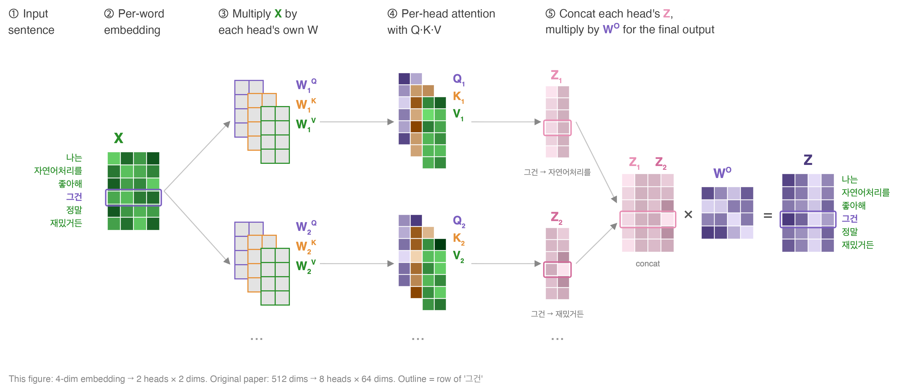

Step 4 in the image above produces as many matrices $Z_1, \dots, Z_h$ as there are attention heads ($h$). As is, they don't match the shape of the original self-attention output (in a Transformer, they don't match the shape the FFN expects), so at the end we concatenate the results from each head and multiply by one more matrix $W^O$ to turn them into a single representation ($Z$).

That's it for this post. I'll be back with the Transformer in the next one.

---

## 📚 References

- [Attention/Transformer, explained with visualizations](http://youtube.com/watch?v=6s69XY025MU)
- [\[Transformer Lecture TTT\] The most intuitive explanation of attention & self-attention!](https://www.youtube.com/watch?v=8E6-emm_QVg)
- [\[Transformer Lecture TTT\] Everything about RNNs](https://www.youtube.com/watch?v=50Miugxkmgo)
- [Visualizing A Neural Machine Translation Model (Mechanics of Seq2seq Models With Attention)](https://jalammar.github.io/visualizing-neural-machine-translation-mechanics-of-seq2seq-models-with-attention/)
- [The Illustrated Transformer](https://jalammar.github.io/illustrated-transformer/)
- [Neural Machine Translation by Jointly Learning to Align and Translate](https://arxiv.org/abs/1409.0473)
- [https://arxiv.org/abs/1508.04025](https://arxiv.org/abs/1508.04025)
- [The Basics of Recurrent Neural Networks (RNNs)](https://pub.towardsai.net/whirlwind-tour-of-rnns-a11effb7808f)
