## 0. 들어가며

우리는 아마 <u>**번역, 요약, 대화**</u> 등등을 수행하기 위해 AI로 자연어를 다루고자 합니다. 과연 AI로 자연어를 어떻게 다룰 수 있을까요? 이번에는 <u>**RNN**</u>, <u>**Seq2Seq**</u>, <u>**Attention**</u>, <u>**Self-Attention**</u>까지 훑어보면서 LLM의 발전 과정을 밟아가보겠습니다.

> 이번 포스트에서 번역을 예시로 설명을 이어갑니다.

## 1. RNN

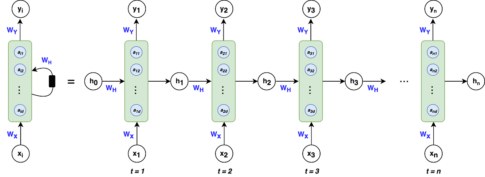

RNN은 연속적인 데이터를 잘 다루는 것으로 익히 알려져 있습니다. 시계열 데이터, 자연어 문장과 같은 게 그 예시죠. 우선 문장을 단어/토큰 단위로 쪼개고(<u>**Tokenizing**</u>), 그것을 숫자로 변환하고(<u>**Encoding**</u>), 잠재공간에 투영(<u>**Embedding**</u>)해서 <u>**vector representation**</u>을 만들었다고 해봅시다.

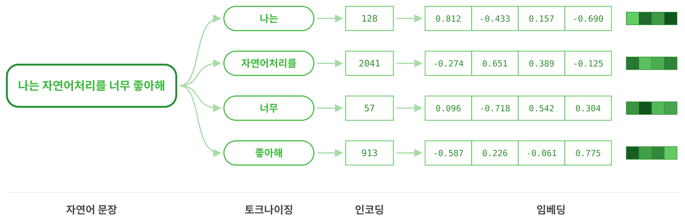

자 그러면 이렇게 만든 vector representation으로 번역을 해봅시다. 우리가 지금까지 익히 알았던 <u>**Synchronized RNN(many-to-many)**</u>로 ‘***나는 자연어처리를 너무 좋아해***’를 ‘***I like NLP so much***’로 번역하는 작업을 수행해본다고 해볼게요. 동기식 RNN은 매 시점마다 토큰 하나를 읽고, 그 자리에서 바로 출력을 하나 내보냅니다. 그러니까 시점 $t$의 출력은 **지금까지 읽은 $x_1 \dots x_t$만 보고** 결정해야 하죠. 이대로 번역을 시켜 보면 어떻게 될까요?

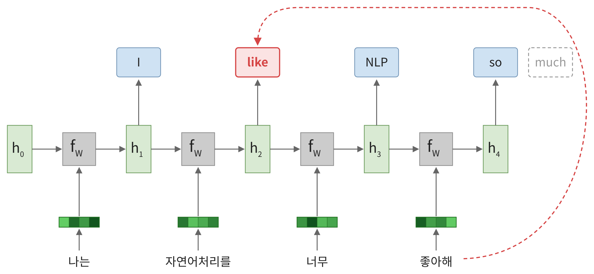

첫 번째 시점에서 '나는'을 읽고 ‘I’를 내보내는 건 문제없습니다. 그런데 두 번째 시점에서 문제가 생깁니다. 영어 문장의 두 번째 단어는 ‘like’인데, 모델은 아직 '나는 자연어처리를'까지밖에 읽지 않았거든요. ‘like’에 해당하는 '좋아해'는 한국어 문장의 <u>**맨 끝**</u>에 있습니다.

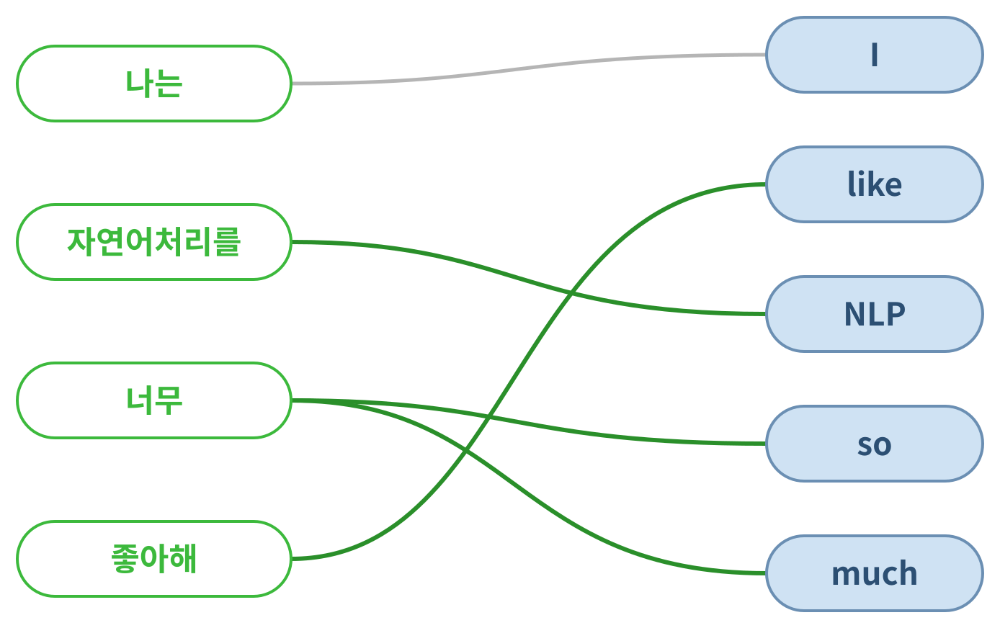

한국어는 동사가 문장 끝에 오고(SOV), 영어는 주어 바로 뒤에 오는(SVO) 문장 구조를 가지고 있습니다. 그래서 각 의미의 단어별로 대응선을 그려보면, 위치가 딱 맞아떨어지는 게 아니라 서로 **교차**하게 됩니다. 번역에서는 <u>**아직 읽지 않은 단어를 봐야 지금 단어를 말할 수 있는**</u> 상황이 흔하게 생기는데, Synchronized RNN은 구조상 이걸 할 수 없습니다.

문제는 하나 더 있습니다. 입력은 4개 토큰인데 출력은 ‘I like NLP so much’로 5개 토큰이에요. 동기식 RNN은 <u>**입력 하나에 출력 하나**</u>가 묶여 있어서 ‘much’를 내보낼 자리가 없습니다. 번역문의 길이가 원문과 같아야 할 이유는 전혀 없는데도요.

> 🤔 **"Bi-directional RNN을 쓰면 뒤쪽 단어도 볼 수 있지 않나요?"**
>
> 맞습니다. 하지만 입력과 출력이 1:1로 묶여 있는 건 그대로라서 길이 문제는 여전히 남아있습니다.

따라서 **문장을 끝까지 다 읽은 다음에, 필요한 만큼 말하는** 구조가 필요합니다. 마치 전문 번역가가 한 사람의 발화를 다 듣고 그걸 모두 이해해서 번역해주는 것처럼요.

## 2. Seq2Seq

**Seq2Seq**는 RNN 두 개, many-to-one과 one-to-many를 이어 붙인 구조입니다. many-to-one은 원문을 읽어서 하나의 벡터로 요약하는 **인코더(Encoder)**, one-to-many는 그 요약문을 토대로 번역문을 만들어 내는 <strong>디코더(Decoder)</strong>의 역할을 합니다.

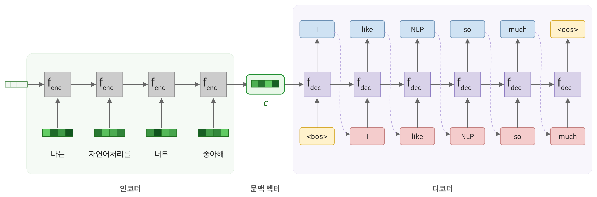

인코더는 입력 문장 '*나는 자연어처리를 너무 좋아해*'의 임베딩 벡터를 차례로 읽습니다. 중간 시점에서는 아무것도 출력하지 않고, 은닉 상태만 계속 갱신합니다. 마지막 토큰까지 읽고 난 뒤에 생성되는 은닉 상태가 있을 텐데요, 그 은닉 상태에 문장 전체의 정보가 압축되어 있다고 보고, 이것을 <strong>문맥 벡터(context vector) $c$</strong>라고 부릅니다. 앞의 RNN 그림 맨 끝에 있던 $h_4$가 여기서 context vector인 거죠.

디코더는 context vector를 첫 은닉 상태로 받아서 번역문을 한 토큰씩 만들어 냅니다. 디코더는 `<bos>`를 받아 ‘I’를 내고, ‘I’를 다음 입력으로 받아 ‘like’를 내고 … ‘much’를 받아 `<eos>`를 내고 멈춥니다. 이렇게 **자기가 방금 낸 출력을 다음 입력으로 쓰며** 한 단어씩 생성하는 방식을 **자기회귀(autoregressive)** 생성이라고 합니다.

> 📌 **teacher forcing**
>
> 학습할 때는 조금 다릅니다. 디코더가 틀린 단어를 내도 다음 입력에는 정답 단어를 넣어 주는 학습 방식을 이용하며, 이를 **teacher forcing**이라고 합니다. 그래서 학습 데이터는 아래처럼 한 칸씩 밀린 형태가 됩니다.
>
> 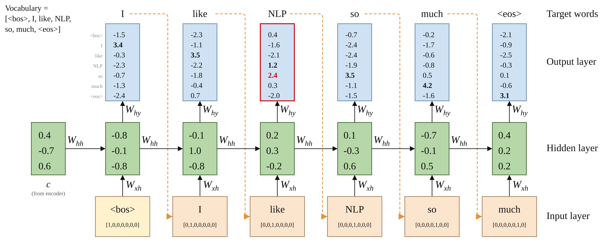
>
> - 디코더 입력: `<bos>` I like NLP so much
> - 디코더 정답: I like NLP so much `<eos>`

이 Seq2Seq 구조로 앞에서 본 두 문제가 모두 해결됩니다.

- **어순 문제:** 디코더가 첫 단어를 말하는 시점에는 이미 원문 전체를 context vector로 받아 둔 상태입니다.
- **길이 문제:** 출력 길이는 디코더가 `<eos>`를 언제 내느냐로 정해집니다. 4개 토큰을 읽고 5개 토큰을 출력해도, 50개 토큰을 출력해도 상관없습니다.

**그런데…** 지금 예시는 4개 토큰이라 괜찮지만, 50개 토큰짜리 문장이라면, 100개짜리, 200개짜리 문장이라면 어떨까요? 인코더는 그 긴 문장 전체를 **고정된 크기의 벡터 $c$ 하나**에 욱여넣어야 하고, 디코더는 단어를 말할 때마다 그 벡터 하나만 붙들고 있어야 합니다. 앞쪽 단어의 정보는 RNN을 지나며 점점 희석된다는 치명적인 단점도 있었습니다. 실제로 Seq2Seq는 문장이 길어질수록 번역 품질이 뚝 떨어졌다는 한계가 드러났습니다.

만약 사람이 번역을 한다면 어떻게 할까요? 사람은 번역하는 도중에도 **원문을 언제든 다시 들여다볼 수 있습니다.** ‘like’를 쓸 때는 '좋아해'를, ‘NLP’를 쓸 때는 '자연어처리를' 다시 볼 수 있는 거죠. 그렇다면 모델에게도 번역하는 도중에 원문의 요약본(context vector)이 아니라, 원문을 다시 볼 수 있도록 하면 어떨까요?

## 3. Seq2Seq with Attention

2절의 Seq2Seq는 문장 전체를 **context vector 하나**에 담았습니다. 짧은 문장이면 괜찮지만, 길어질수록 앞쪽 정보가 희미해지는 <strong>병목(bottleneck)</strong>이 생긴다는 문제점이 있었습니다.

Attention의 아이디어는 단순합니다. **인코더의 마지막 은닉 상태만 넘기지 말고, 모든 시점의 은닉 상태 $h_1 \dots h_4$를 다 넘기자.** 그리고 디코더가 단어를 하나 만들 때마다, 지금 필요한 원문의 어떤 토큰을 더 참고할지 가중치를 더 줘서 <strong>그 시점만을 위한 문맥 벡터 $c_t$</strong>를 새로 만드는 방식입니다.

디코더가 ‘like’를 만드는 두 번째 시점을 예시로 어떻게 문맥 벡터 <strong>$c_t$</strong>가 계산되고 해당 time step의 출력이 나오는지 따라가 보겠습니다.

> 📌 **NOTE**
>
> 이 글에서 설명하는 방식은 루옹(Luong, 2015)의 방식입니다. 원래 Attention 아이디어를 제안한 건 바다나우(Bahdanau, 2015)인데, 루옹이 이 계산을 더 단순하게 다듬은 것입니다.

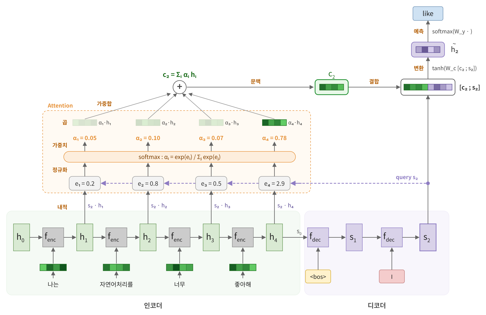

1. **디코더 한 스텝 진행**

    디코더는 직전 상태 $s_1$과 직전 단어 ‘I’($y_1$)를 받아 새 상태 $s_2$를 만듭니다.

    $$
    s_2 = f_{dec}(s_1, y_1)
    $$

    이 시점에서 $s_2$는 "지금 무슨 단어를 말하려는지"를 담고 있지만, 원문 정보는 아직 $s_1$을 통해 희미하게만 들어 있을 뿐입니다.

2. **얼마나 닮았는가(score): $s_2$와 각 $h_i$의 내적**

    <strong>$s_2$</strong>를 인코더의 은닉 상태 $h_1, h_2, h_3, h_4$와 하나씩 <u>**내적**</u>합니다. 내적은 두 벡터가 같은 방향일수록 커지니까, "지금 말하려는 것과 이 원문 단어가 얼마나 관련 있는가"를 나타내는 점수(score)가 됩니다.

    $$
    e_i = s_2 \cdot h_i \;\rightarrow\; [0.2,\ 0.8,\ 0.5,\ 2.9]
    $$

3. **softmax로 가중치 $\alpha$ 구하기**

    score를 softmax에 넣으면 합이 1인 가중치가 됩니다.

    $$
    \alpha = \text{softmax}(e) = [0.05,\ 0.10,\ 0.07,\ 0.78]
    $$

    이는 곧 '*좋아해*'에 78%만큼 더 집중(<u>**attention**</u>)하라고 알려주는 겁니다.

4. **가중합으로 문맥 벡터 $c_2$ 만들기**

    $$
    c_2 = \sum_i \alpha_i h_i = 0.05\,h_1 + 0.10\,h_2 + 0.07\,h_3 + 0.78\,h_4
    $$

    $c_2$는 사실상 '*좋아해*' 정보가 대부분인 벡터가 됩니다.

5. **$c_2$와 $s_2$를 합쳐 단어 예측**

    **$c_2$**(원문에서 가져온 정보)와 **$s_2$**(디코더가 말하려는 것)를 이어 붙이고, 한 번 $\tanh$로 변환한 뒤 해당 time step에서의 출력 단어를 고릅니다.

    $$
    \tilde{h}_2 = \tanh(W_c[c_2;\, s_2]), \qquad y_2 = \text{softmax}(W_y \tilde{h}_2) \rightarrow \text{'like'}
    $$

> 🤔 **Query, Key, Value는 어디서 등장하나요?**
>
> 지금 설명하는 Attention 메커니즘이 나온 당시에는 Key와 Value가 같은 벡터였습니다. 그래도 이미 트랜스포머의 Q, K, V를 아는 사람을 위해서 언급하자면, Seq2Seq Attention은 이렇게 정리됩니다.
>
> - **Query** = 디코더 상태 $s_t$: "지금 이런 정보가 필요해"
> - **Key** = 인코더 은닉 상태 $h_i$: "나는 이런 내용이야" (비교 대상)
> - **Value** = 인코더 은닉 상태 $h_i$: 실제로 섞어서 가져가는 값
>
> 이 시절에는 Key와 Value가 같은 벡터였고, Q·K·V라는 이름도 쓰지 않았습니다. 이 Q, K, V 아이디어는 Transformer에서 정리됐습니다.

중요한 점은 **$\alpha$를 매 시점 새로 계산한다**는 점입니다. ‘like’를 출력해야 할 때는 '좋아해'에 집중해야 하고, ‘NLP’를 출력해야 할 때는 '자연어처리를'에 집중해야 하는 겁니다. 이를 달성하기 위해 RNN의 가중치 $W_{hh}, W_{xh}, W_{hy}$가 적절히 갱신되는 과정이 바로 Seq2Seq with attention에서 학습이 이루어지는 과정인 겁니다.

만약 정답이 ‘like’인데 모델이 여기에 낮은 확률을 주면 손실(loss)이 커집니다. 이 손실의 기울기는 아래 수식과 같이 역전파로 거슬러 내려가면서 가중치를 갱신합니다.

$$
W_y \rightarrow \tilde{h}_2 \rightarrow W_c \rightarrow c_2 \rightarrow \alpha \rightarrow e_i = s_2 \cdot h_i \rightarrow s_2 \text{와 } h_i \rightarrow W_h,\ W_x
$$

'좋아해' 쪽 정보를 더 많이 가져왔을 때 ‘like’를 더 잘 맞힌다면, 기울기는 $e_4$를 키우는 방향, 즉 $s_2$와 $h_4$가 더 비슷한 방향을 향하도록 RNN 가중치를 조정합니다. 이걸 수많은 문장 쌍에서 반복하면 “like를 말할 때는 좋아해와 내적이 커지는” 표현을 인코더와 디코더가 스스로 만들게 되는 겁니다. 그 결과, 아래 이미지와 같이 Attention map(모델이 문장을 이해하거나 번역할 때, 각 단어가 다른 단어들에 얼마나 집중(주의)하고 있는지를 수치와 색상으로 시각화한 행렬, 숫자가 높을수록 두 단어 사이의 연관성이 깊다고 모델이 판단했음을 의미)에 각 토큰별로 대응 관계가 나타나게 되는 겁니다.

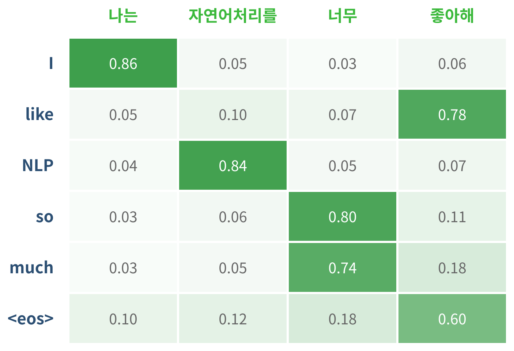

> 📌 **NOTE**
>
> 위 표의 숫자($\alpha$)는 학습이 끝난 모델이라고 가정하고 넣은 예시 값입니다.
>
> 추론할 때는 학습이 끝난 가중치로 $\alpha$를 그때그때 **계산**만 합니다. 그러니 “attention 값 자체가 저장돼서 학습되는 것”이 아니라 “attention을 잘 계산하도록 표현이 학습되는 것”이라고 이해하는 것이 정확합니다.

## 4. Seq2Seq with Self-Attention

RNN 시리즈(RNN, LSTM, GRU)와 Attention을 같이 씀으로써 이전의 문맥에서 중요한 정보를 직접 가져와서 참고할 수 있었고, 이는 획기적인 개선을 보여줬습니다. 하지만, 여전히 ‘순차처리’라는 RNN의 고질적인 한계가 남아있었습니다. 순차처리가 왜 문제가 될까요? 아래와 같은 예문이 있다고 해봅시다.

1. *‘나는 <u>**자연어처리**</u>를 좋아해, <u>**그건**</u> 정말 재밌거든’*
2. *‘나는 <u>**돈**</u>을 흥청망청 아주 많이 쓸데없이 시도 때도 없이 맛있는 것을 사 먹는 데 <u>**쓰는**</u> 걸 좋아해’*

- **문제 1: 멀수록 잊혀진다 + 갈수록 흐려지는 정보에 attention한다**
    - 1번 문장에서 <u>***‘그건’***</u>이 가리키는 건 앞에 있는 <u>***‘자연어처리’***</u>입니다. 2번 문장에서 <u>***‘쓰는’***</u>의 목적어는 한참 앞에 등장하는 <u>***‘돈’***</u>입니다.
    - RNN은 앞에서부터 순차적으로 $h_1 \rightarrow h_2 \rightarrow h_3 \rightarrow \cdots$을 처리해야 <u>***‘그건’***</u>이나, <u>***‘쓰는’***</u>의 hidden state를 계산할 수 있고, 이로부터 attention score가 계산될 수 있습니다.
    - 이는 즉 아무리 decoder 단에서 encoder 원문의 hidden state를 직접 참조할 수 있게 되었다 하더라도, 그 encoder의 hidden state가 희석된 정보라면 이는 문제가 좀 있겠죠. <u>***‘그건’***</u>의 참 의미, 그리고 <u>***‘쓰는’***</u>의 참 의미는 각각 <u>***‘자연어처리’***</u>와 <u>***‘돈’***</u>을 함께 봤을 때 드러나는 것이기 때문입니다.
- **문제 2: 병렬처리를 할 수 없다.**
    - RNN 인코더는 $h_1$을 계산해야 $h_2$를, $h_2$를 계산해야 $h_3$을 계산할 수 있습니다. 단어가 6개면 6번을 차례로 기다려야 하고, 100개면 100번입니다. GPU는 수천 개의 계산을 동시에 할 수 있는데, RNN은 그 능력을 거의 쓰지 못합니다.

그렇다면 이런 생각을 해볼 수 있습니다. ***디코더가 인코더를 볼 때 쓰던 Attention을, 인코더 문장이 자기 자신을 보는 데 쓰면 어떨까?*** 모든 단어가 다른 모든 단어를 한 번에, 직접 볼 수 있다면 두 문제가 함께 풀릴 수 있겠죠. 이것이 <u>**Self-Attention**</u>입니다.

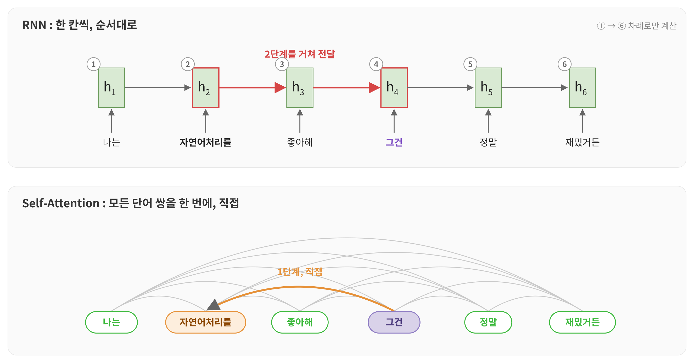

### 4.1. Self-Attention

self-attention을 통해 모델이 ‘그것’과 ‘쓰다’를 처리할 때, 각각 ‘자연어처리’와 ‘돈’을 연관 지을 수 있게 됩니다. 이제 self-attention이 어떻게 계산되는지 자세하게 살펴보겠습니다.

1. **encoder input tokens 각각의 embedding vector를 통해 Query, Key, Value 벡터를 만듭니다.**

    우선 낯선 개념인 Query, Key, Value가 뭔지부터 짚고 넘어가겠습니다.

    - **Query**: 문장 내의 다른 단어들과 비교 대상이 되는 기준점입니다. 현재 처리 중인 특정 단어가 <strong>"나는 이런 정보가 필요해"</strong>라며 던지는 질문에 해당합니다.
        - *"나는 지시어야, 내가 가리키는 명사는 어디 있지?"*
    - **Key:** Query와 비교되어, **"나랑 이 질문이 얼마나 관련이 있는지"** 유사도를 측정당하는 대상입니다. 문장 내 모든 단어들이 각자 가지고 있는 **"내 이름표"** 혹은 <strong>"키워드"</strong>에 해당합니다.
    - **Value:** 각 단어가 실제로 담고 있는 <strong>"알맹이 정보(의미 내용)"</strong>입니다. Query와 Key의 유사도 점수(가중치)를 계산한 뒤, 그 중요도 비율만큼 섞여서 **최종 단어의 표현을 업데이트하는 데 쓰이는 실제 값**에 해당합니다.

    > 💡 검색에 비유하면 Query는 검색어, Key는 각 문서의 제목과 태그, Value는 문서 본문입니다. 검색어와 제목을 비교해서 관련도 점수를 매기고, 그 점수대로 줄 세워서 본문을 가져오는 거죠. 검색에서는 줄 세워서 나열해주면 끝이지만, self-attention에서는 그 점수의 크기에 비례해서 각각의 본문을 긁어서 가져온다고 생각하면 쉽습니다.

    각 단어의 임베딩 $x_i$에 세 개의 가중치 행렬 $W^Q$, $W^K$, $W^V$를 곱해서 query, key, value 벡터 $q_i$, $k_i$, $v_i$를 만듭니다.

    $$
    q_i = x_i W^Q, \quad k_i = x_i W^K, \quad v_i = x_i W^V
    $$

    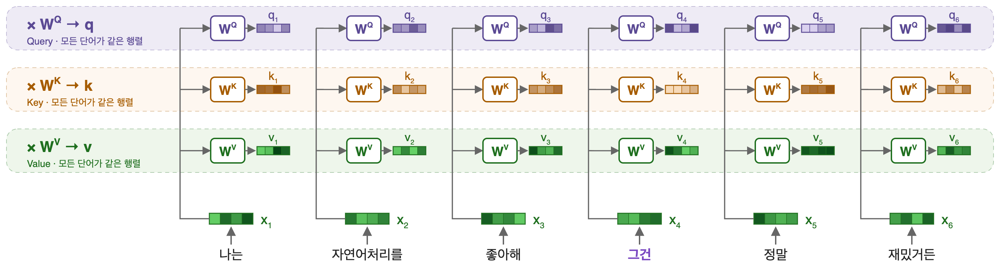

    여기서 중요한 점은 **모든 단어가 같은 $W^Q$, $W^K$, $W^V$를 쓰며 학습시킨다**는 점입니다. '나는'이든 '그건'이든 같은 행렬을 곱합니다. 단어마다 행렬이 따로 있는 게 아니라, 행렬은 "임베딩을 query/key/value로 바꾸는 규칙" 하나이고, 그 규칙을 모든 단어에 똑같이 적용하는 겁니다. 그래서 문장 길이가 달라져도 같은 모델을 쓸 수 있습니다.

2. **점수 매기기**

    '그건'의 query $q_4$를 문장의 모든 단어의 key($k_1, k_2, \dots, k_6$)와 내적합니다.

    $$
    q_4 \cdot k_1,\ q_4 \cdot k_2,\ \dots,\ q_4 \cdot k_6 \;=\; [0.4,\ 4.6,\ 1.4,\ 2.0,\ 0.2,\ 1.6]
    $$

    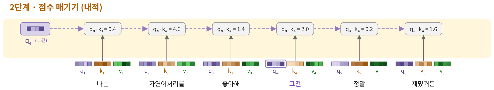

    이 점수는 “'그건'을 처리할 때 각 단어(나는, 자연어처리를 …)에 얼마나 집중할지”를 정합니다.

    > 🤔 **내적은 왜 '관련도' 점수가 되나요?**
    >
    > 두 벡터 $q$와 $k$의 내적은 같은 자리의 성분끼리 곱해서 모두 더한 값입니다.
    >
    > $$
    > q \cdot k = q_1k_1 + q_2k_2 + \dots + q_dk_d
    > $$
    >
    > 같은 값을 기하학적으로 쓰면 다음과 같습니다.
    >
    > $$
    > q \cdot k = \|q\|\,\|k\|\cos\theta
    > $$
    >
    > 여기서 $\theta$는 두 벡터 사이의 각도입니다. 그래서 내적은 **두 벡터가 얼마나 같은 방향을 가리키는가**를 재는 값이 됩니다. 2차원 query $q = [1, 2]$로 예를 들어 볼게요.
    >
    > ![q = [1, 2]에 대해 비슷한 방향의 k = [2, 1.5]는 내적 5, 직각인 k = [2, −1]은 0, 정반대인 k = [−1, −2]는 −5가 되는 세 경우](./image/dot-product-direction.ko.png)
    >
    > 즉, 방향이 닮을수록 점수가 크고, 상관없으면 0 근처, 반대면 음수가 됩니다. 우리는 토큰을 Embedding vector로 나타내므로, Embedding space 상에서 두 토큰 벡터의 방향과 크기가 같다면 두 토큰은 ‘관련성’이 크다고 판단할 수 있는 거죠.
    >
    > self-attention에서는 $W^Q, W^K$가 학습을 거치면서 문맥적으로 비슷한 의미여야 하는 토큰들의 벡터가 비슷한 방향을 향하도록 갱신되기 때문에 '그건'의 query와 '자연어처리를'의 key는 같은 방향을 가리킬 수 있게 되는 겁니다. 둘이 같은 방향이 되면 내적이 커지고, 결국 attention이 그쪽으로 쏠리게 됩니다.

3. **$\sqrt{d_k}$로 나누기**

    점수를 key 벡터 차원($d_k$)의 제곱근으로 나눕니다. 원래 논문은 key 차원이 64라서 8로 나누고, 이 포스트의 예시는 $d_k = 4$라서 2로 나눕니다.

    $$
    e_j = \frac{q_4 \cdot k_j}{\sqrt{d_k}} \;\rightarrow\; [0.2,\ 2.3,\ 0.7,\ 1.0,\ 0.1,\ 0.8]
    $$

    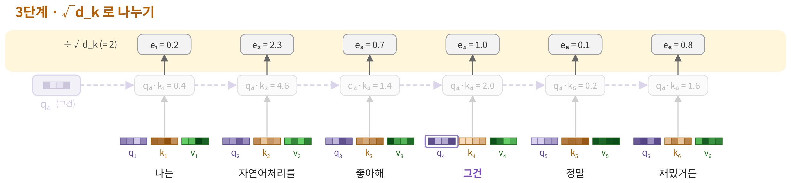

    > 🤔 **왜 $\sqrt{d_k}$로 나누나요?**
    >
    > <u>**기울기가 0이 되어 학습이 망가지는 걸 방지하기 위해서입니다.**</u>
    >
    > 이 예시에서 $\sqrt{d_k}$로 나누지 않은 점수를 그대로 softmax에 넣으면 '자연어처리를'의 가중치가 0.84까지 오릅니다. softmax의 특성상, 점수가 크면 그 단어에 거의 1, 나머지에 거의 0을 주게 됩니다.
    >
    > 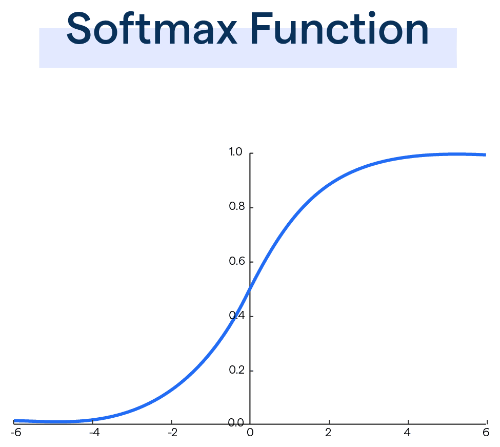
    >
    > softmax 도함수에서 $\alpha$가 1이나 0에 가까우면 기울기 값이 거의 0이 됩니다. 기울기가 사라져 학습이 멈추는 거죠.
    >
    > $$
    > \frac{\partial \alpha_i}{\partial e_j} = \alpha_i(\delta_{ij} - \alpha_j)
    > $$
    >
    > 2단계 점수 계산의 내적 식에 $\cos\theta$만 있는 게 아니라 벡터의 크기 $\|q\|\,\|k\|$도 곱해졌습니다. 차원 $d_k$가 커지면 더하는 항이 많아져서 내적 값의 <u>**크기**</u>도 함께 커집니다. 각 벡터의 성분들이 평균 0, 분산 1이라고 하면 $q \cdot k$의 분산은 $d_k$, 표준편차는 $\sqrt{d_k}$가 됩니다. 표준편차로 나눠서 정규화를 해주면 분산이 다시 1이 되어 <u>**차원과 상관없이 크기가 일정**</u>해지는 효과가 있습니다.

4. **softmax**

    softmax로 점수를 모두 양수이고 합이 1인 가중치로 바꿉니다.

    $$
    \alpha_j = \frac{\exp(e_j)}{\sum_k \exp(e_k)} \;\rightarrow\; [0.06,\ 0.52,\ 0.10,\ 0.14,\ 0.06,\ 0.12]
    $$

    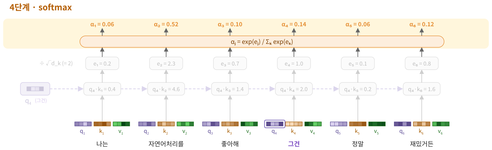

5. **가중치와 value 곱하기**

    각 단어의 value 벡터에 4단계에서 얻은 가중치를 곱합니다. 집중해야 할 단어의 value는 크게 남고, 관련 없는 단어의 value는 작은 수가 곱해져 거의 사라지는 효과가 있습니다.

    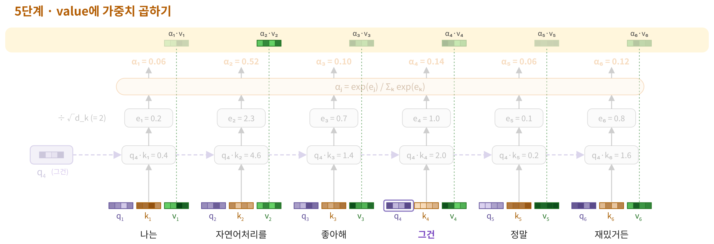

    > 📌 **스칼라 곱은 ‘볼륨 조절’의 역할을 합니다**
    >
    > 벡터에 숫자(스칼라) <strong>$\alpha$</strong>를 곱하면 **방향은 그대로, 길이만 $\alpha$배**가 됩니다.
    >
    > $$
    > \|\alpha_j v_j\| = \alpha_j \|v_j\|
    > $$
    >
    > 각 단어가 가진 정보의 내용(방향)은 바꾸지 않고, 그 정보를 얼마나 크게 반영할지만 조절하는 겁니다. 이 덕분에 위 그림에서 '자연어처리를'의 $v_2$가 진하게 남고, 나머지는 옅어지게 됩니다.

6. **모두 더하기**

    가중치를 곱한 value를 모두 더하면, 그게 바로 주변 문맥 정보가 반영된 '*그건*'의 벡터가 됩니다.

    $$
    z_4 = \sum_j \alpha_j v_j
    $$

    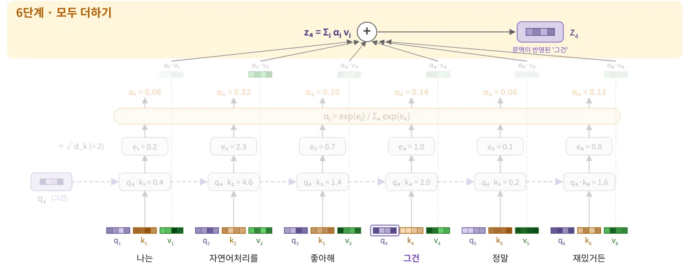

    가중치가 곱해진 value들 중 ‘자연어처리를’의 값이 가장 컸기 때문에, ‘그건’의 벡터에는 ‘자연어처리를’의 벡터가 자연스럽게 많이 녹아있는 상태가 되는 거죠.

    > 📌 **가중합은 '가중 평균'**
    >
    > 가중치가 모두 0 이상이고 합이 1이라서, 이 가중합은 **볼록 결합(convex combination)**, 쉽게 말해 가중 평균이 됩니다.
    >
    > $$
    > z_4 = \sum_j \alpha_j v_j, \quad \alpha_j \ge 0,\ \sum_j \alpha_j = 1
    > $$
    >
    > 그래서 $z_4$는 항상 $v_1, v_2, \dots, v_6$가 만드는 영역 **안쪽**에 놓이고, 가중치가 큰 $v_2$ 쪽으로 끌려갑니다. 확률에 대입해보면, "$\alpha$의 확률로 단어 하나를 골라 그 value를 가져오는 일을 반복했을 때의 평균", 즉 **기댓값** $z_4 = \mathbb{E}_{j \sim \alpha}[v_j]$이 됩니다.
    >
    > 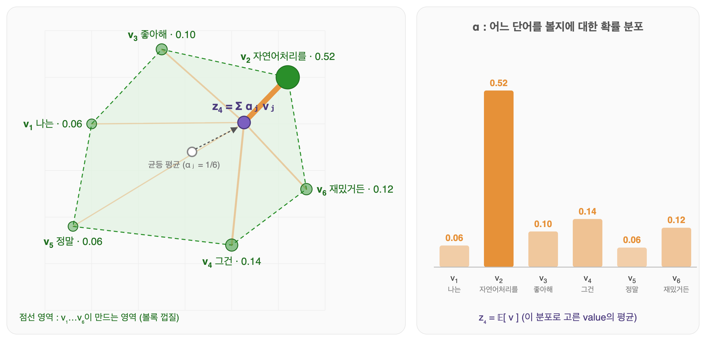

지금까지 본 1단계\~6단계는 ‘그건’이 query가 되어 self-attention을 계산하는 과정만 들어있습니다. 실제로는 6개 단어 모두 행렬로 묶어서 GPU에서 병렬로 한 번에, 빠르게 계산할 수 있습니다.

$$
Q = XW^Q, \quad K = XW^K, \quad V = XW^V\\ X = \text{matrix of vector representations}
$$

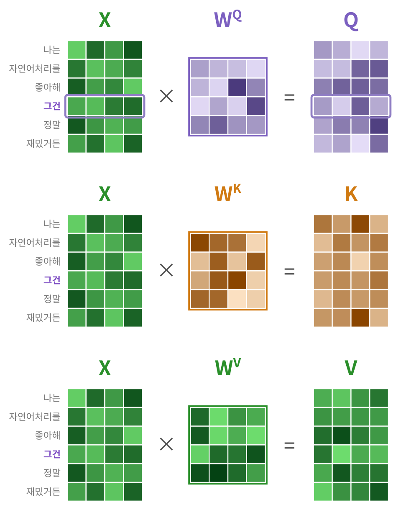

$$
\text{Attention}(Q, K, V) = \text{softmax}\!\left(\frac{QK^\top}{\sqrt{d_k}}\right)V
$$

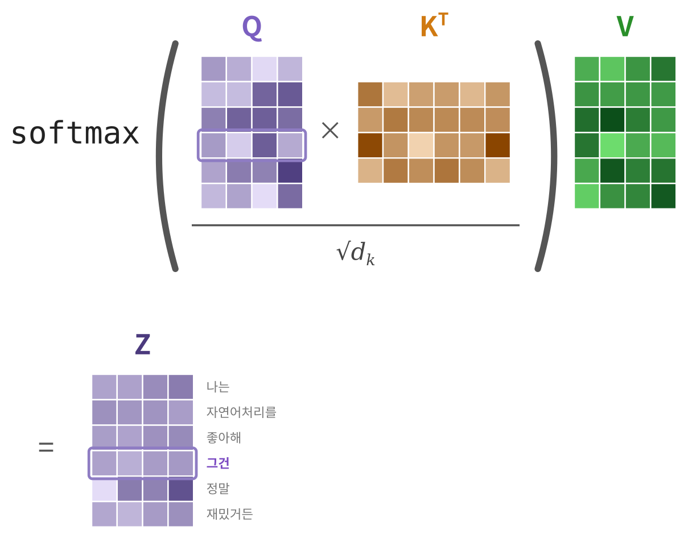

이렇게 self-attention을 통해 RNN의 고질적인 한계였던 두 문제, <strong>“멀수록 잊혀진다”</strong>와 <strong>“병렬 처리를 할 수 없다”</strong>가 함께 해결됩니다.

- **문제 1 해결: 거리와 상관없이, 한 번 내적한다**
    - RNN에서 '자연어처리를'의 정보가 '그건'에 닿으려면 $h_2 \rightarrow h_3 \rightarrow h_4$를 거쳐야 했고, 2번 문장의 '돈'과 '쓰는'처럼 멀리 떨어진 단어는 그 사이 모든 단어를 지나며 정보가 희석됐습니다.
    - Self-attention에서는 '그건'의 query가 '자연어처리를'의 key와 **직접 내적**합니다. 바로 옆 단어든 50번째 앞 단어든 거쳐야 하는 단계는 똑같이 단 하나뿐입니다.
    - 그래서 인코더가 내놓는 결과도 달라집니다. RNN의 $h_4$는 앞 단어들이 희미하게 섞인 상태였지만, self-attention의 $z_4$는 '자연어처리를'의 정보를 $0.52$만큼 분명하게 담은 <strong>문맥이 반영된 '그건'</strong>입니다. 디코더가 참고하는 원문 표현 자체가 더 선명해지는 거죠.
- **문제 2 해결: 행렬 곱으로 한꺼번에 계산한다**
    - $z_4$를 계산할 때 $z_3$이 먼저 끝나 있을 필요가 없습니다. 6개 단어의 계산이 서로를 기다리지 않으니, 위에서 본 것처럼 $Q, K, V$를 행렬로 묶어 **행렬 곱 몇 번**으로 문장 전체를 동시에 처리할 수 있습니다.
    - 행렬 곱을 쓰기 때문에 GPU를 효율적으로 활용할 수 있게 됩니다. 단어가 6개든 100개든 차례로 기다릴 필요 없이 한 번에 계산할 수 있게 됐습니다.

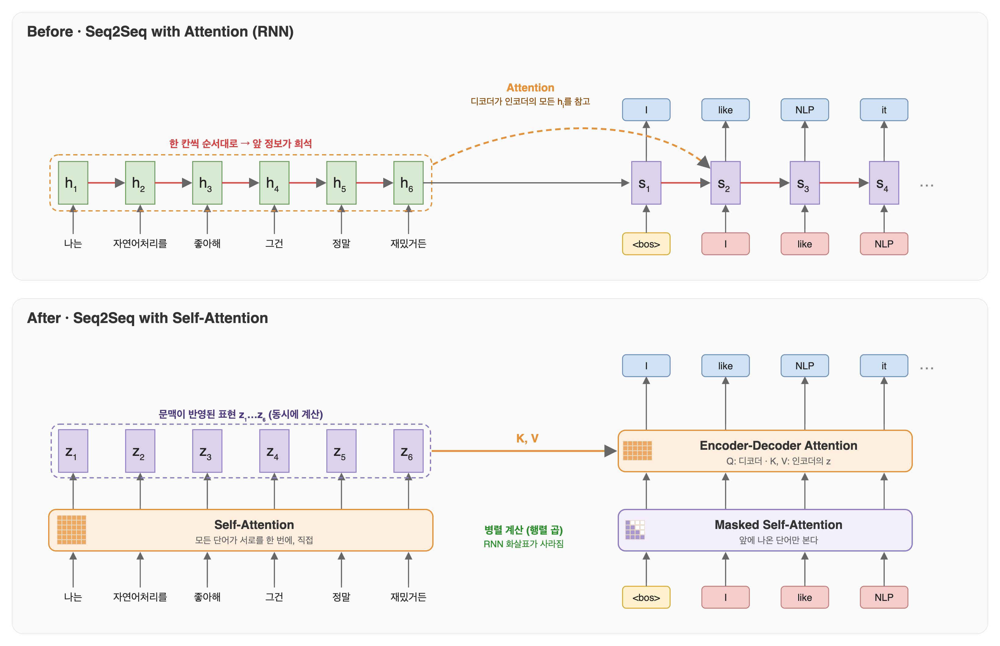

- **인코더:** 순서대로 $h_i$를 계산하던 RNN이 사라지고, **Self-Attention**이 그 자리를 대신합니다. 문장 전체를 한 번에 넣어 $z_1 \dots z_6$을 동시에 얻습니다.
- **디코더:** 디코더도 RNN 대신 self-attention을 씁니다. 다만 정답 문장 전체를 보고 예측하는 것은 치팅을 하는 것과 마찬가지이기 때문에, 현 시점 기준으로 **앞에 나온 단어만** 보도록 하고, 미래의 단어는 가려서 예측하는 기법을 사용합니다(**Masked** Self-Attention).

    - **Masked Self-Attention**

        이 단계에서도 Self-Attention으로 $Q$, $K$, $V$를 만듭니다. 이때는 디코더 입력만으로 $Q$, $K$, $V$를 만들어서 각각 time step 이전의 토큰 정보만 사용해서 가중합을 해 벡터($d_1, d_2, d_3, d_4$)를 만듭니다.

    - **Encoder-Decoder Attention**

        Masked Self-Attention 단계에서 올라온 벡터 $d_1, d_2, d_3, d_4$에 $W^Q$를 곱해 $Q$를 만들고, 인코더의 $z_i$들과 내적 → $\sqrt{d_k}$로 나누기 → softmax → $V$로 가중합의 과정을 거칩니다. Self-Attention 과정과 똑같되, query만 디코더에서, key와 value는 인코더에서 온다는 점만 다릅니다.

    즉 RNN with Attention의 $s_t$가 하던 역할, 곧 <u>**“지금까지 생성한 단어를 보고 다음에 무엇이 필요한지 요약”**</u>을 Seq2Seq with Self-Attention에서는 Masked Self-Attention이 맡는 겁니다. 그 결과가 query가 돼서 인코더 쪽을 들여다보는 구조입니다.

    정리하면 디코더는 query를 **두 번** 만듭니다. Masked Self-Attention 안에서 한 번(Q·K·V 모두 디코더에서), Encoder-Decoder Attention 안에서 한 번(Q만 디코더에서).

- **인코더–디코더 연결:** 디코더가 query를 만들고, 인코더의 $z_1 \dots z_6$이 key와 value가 되는 **Encoder-Decoder Attention** 구조입니다.

> 📌 **Masked Self-Attention**
>
> teacher forcing 기법으로 훈련시킬 때, 디코더에는 `<bos>`부터 `<eos>` 직전까지의 토큰들을 입력으로 넣어줍니다. self-attention은 입력으로 들어온 모든 토큰들의 가중합을 통해 문맥이 반영된 표현 $z_i$를 계산하기 때문에, 이대로 디코더를 학습시키면 <u>**치팅을 통해 학습**</u>하게 된다는 문제가 생깁니다.
>
> 이때 사용하는 방법이 바로 <u>**마스킹(Masking)**</u>입니다. masked self-attention에서의 마스킹은 현재 시점 $t$ 이후의 토큰들과의 내적 결과에 극단적인 음수($-\infty$)를 주는 방식으로 구현됩니다. Softmax에는 입력 값이 $-\infty$에 가까울수록 출력 값이 0에 가까워진다는 특징이 있기 때문에, 가중치를 구할 때, $t+1$ 시점부터의 가중치는 모두 0이 되어, 마치 $t$ 시점까지의 토큰들과만 self-attention을 수행하는 효과를 얻을 수 있습니다.

> 📌 **NOTE**
>
> self-attention은 단순히 내적으로 토큰과 토큰의 관계를 계산하지, 단어의 순서를 고려하지는 않습니다. 그래서 RNN에서는 자연스럽게 알 수 있었던 <u>**위치/순서 정보를 잃게 됐습니다**</u>.
>
> 그래서 각 단어에 "몇 번째 자리인지"를 알려 주는 **positional encoding**을 따로 더해 줍니다. 이 부분은 Transformer를 다룰 때 자세히 살펴보겠습니다.

### 4.2. Multi-Headed Self Attention

다시 처음의 예문을 상기시켜보겠습니다.

*‘나는 <u>**자연어처리**</u>를 좋아해, <u>**그건**</u> 정말 <u>**재밌거든**</u>’*

self-attention을 통해 ‘그건’이 query일 때의 가중치는 다음과 같이 구해졌었죠.

$$
\alpha = [0.06,\ \mathbf{0.52},\ 0.10,\ 0.14,\ 0.06,\ 0.12]
$$

'자연어처리를'(0.52)에 가장 많이 집중하지만, '재밌거든'(0.12)과 자기 자신(0.14)에도 가중치가 흩어져 있습니다. 그런데 '그건'이라는 단어를 제대로 이해하려면 적어도 두 가지를 알아야 합니다.

- **지시 대상이 무엇인가? →** ‘자연어처리를’
- **상태가 어떻다는 건가? →** ‘재밌거든’

이 예문에서 ‘그건’이라는 단어에는 ‘자연어처리’는 ‘재밌다’는 의미가 함께 들어있습니다. 하지만 self-attention을 한 번만 수행하면 ‘그건’이 ‘자연어처리를’을 가리킨다는 사실은 알 수 있지만, ‘재밌다’는 의미를 가리킨다는 것까지 알기에는 어려울 수 있습니다. 왜냐하면

1. **가중치는 합이 1인 하나의 분포이기 때문입니다.** softmax가 만드는 $\alpha$는 확률 분포 하나입니다. '자연어처리를'에 더 집중하면 '재밌거든'에 줄 몫이 줄어들 수밖에 없습니다. 서로 다른 관계들이 같은 파이를 나눠 먹는 셈입니다.
2. **결과는 가중 평균 하나로 나옵니다.** 6단계에서 본 것처럼 $z_i$는 value들의 볼록 결합, 즉 <u>**가중 평균**</u>입니다. 지시 대상의 정보와 서술어의 정보가 <u>**한 벡터 안에 뭉뚱그려 섞여**</u> 버려서, 각각의 관계가 또렷하게 남지 않습니다.

Transformer 논문도 이 점을 짚습니다. attention 가중치로 여러 위치를 평균 내면 표현의 해상도가 떨어지고, attention head가 하나뿐이면 평균이 서로 다른 관점의 정보를 함께 담는 것을 방해한다는 겁니다.

그 해결책이 바로 <u>**Multi-Headed Self Attention**</u>으로, 관점이 하나라 부족하다면, 여러 개를 두면 된다는 아이디어입니다.

$W^Q, W^K, W^V$ 세트를 하나가 아니라 <u>**여러 벌**</u> 만들고, 각 세트(**head**)가 독립적으로 self-attention을 계산하게 합니다. 각 head의 $W^Q, W^K, W^V$는 서로 다르게 초기화되고 따로 학습되기 때문에, 자연스럽게 서로 다른 관계에 집중하게 됩니다. 예를 들어 head 1은 '그건 → 자연어처리를'을, head 2는 '그건 → 재밌거든'을 보는 식이에요.

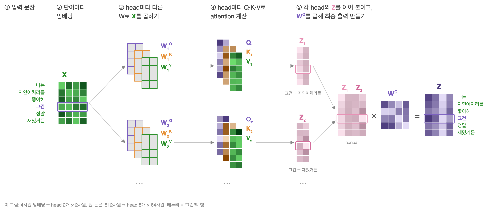

위 이미지의 4단계의 결과로 attention head 개수($h$)만큼의 $Z_1, \dots, Z_h$ 행렬이 나옵니다. 이대로는 원래 self-attention의 출력 결과와 모양이 맞지 않기 때문에(transformer에서는 FFN의 기대 shape과 맞지 않기 때문에) 마지막에 각 head가 만든 결과를 이어 붙이고(concat) 행렬 $W^O$를 한 번 더 곱해 하나의 표현($Z$)으로 가공합니다.

이번 포스트는 여기까지 작성하겠습니다. Transformer는 다음 포스트로 찾아뵙겠습니다.

---

## 📚 참고자료

- [Attention/Transformer 시각화로 설명](http://youtube.com/watch?v=6s69XY025MU)
- [\[트랜스포머 강의 TTT\] 어텐션 & 셀프-어텐션 가장 직관적인 설명!](https://www.youtube.com/watch?v=8E6-emm_QVg)
- [\[트랜스포머 강의 TTT\] RNN의 모든 것](https://www.youtube.com/watch?v=50Miugxkmgo)
- [Visualizing A Neural Machine Translation Model (Mechanics of Seq2seq Models With Attention)](https://jalammar.github.io/visualizing-neural-machine-translation-mechanics-of-seq2seq-models-with-attention/)
- [The Illustrated Transformer](https://jalammar.github.io/illustrated-transformer/)
- [Neural Machine Translation by Jointly Learning to Align and Translate](https://arxiv.org/abs/1409.0473)
- [https://arxiv.org/abs/1508.04025](https://arxiv.org/abs/1508.04025)
- [The Basics of Recurrent Neural Networks (RNNs)](https://pub.towardsai.net/whirlwind-tour-of-rnns-a11effb7808f)
