## 0. Introduction

How does a computer — or, more precisely, an AI model — recognize natural language? Characters like a, b, c, ㄱ, ㄴ, ㄷ can be converted into <u>**numbers (bytes)**</u> that a computer understands, through familiar rules such as <u>**Unicode**</u> and <u>**UTF-8 encoding**</u>. But these numeric representations (bytes) don't contain the <u>**meaning**</u> of characters and words. For a model to produce sentences naturally, it has to know what characters and words mean — so how is that possible?

In this post, we'll look at how natural language gets processed until it carries semantic information that a model can understand.

## 1. Natural Language Processing Overview


The process by which a model comes to understand natural language can be broadly split into two stages: <u>**Tokenization**</u> and <u>**Vectorization**</u>. As in the figure above, all the text in a <u>**corpus**</u> — a collection of human-written text — is split into meaningful <u>**tokens**</u>, and each of those tokens is then given a <u>**meaning expressed in numbers (a vector)**</u>.

## 2. Tokenization

First, we split a sentence into <u>**tokens**</u>, the smallest units a model can handle. For example, the sentence *"자연어 처리 모델은"* ("the natural language processing model") can be split into tokens such as `자연어`, `처리`, `모델`, and `##은`.

Once the whole corpus has been split into tokens, we can build a <u>**vocab (vocabulary)**</u> that assigns a unique number (id) to every token that appeared. From then on, the model sees a sentence not as characters but as a <u>**sequence of ids**</u>.

So how exactly should we split tokens? Can we just split on spaces?

There are two broad ways to split tokens: the <u>**rule-based approach**</u> and the <u>**data-driven approach**</u>.

### 2.1. Rule-Based Approach

As the name says, the rule-based approach splits sentences according to <u>**rules a person has set in advance**</u>. Because a person directly sets criteria like "cut where there's a space" or "split off punctuation marks," it behaves simply and its results are easy to predict. Representative methods are <u>**whitespace-based**</u> tokenization and tokenization with a <u>**morphological analyzer**</u>.

#### 2.1.1. Whitespace-Based Tokenization

The simplest rule is to split on whitespace.

```py
sentence = "자연어 처리 모델은 어렵습니다"
tokens = sentence.split()

>>> ['자연어', '처리', '모델은', '어렵습니다']
```

With `word_tokenize()` from `nltk`, a package commonly used for English, you can also handle apostrophes and hyphens.

```py
import nltk
for res in ['punkt', 'punkt_tab', 'stopwords', 'wordnet']:
    nltk.download(res, quiet=True)
from nltk.tokenize import word_tokenize

en = "The mask doesn't fit well, but the delivery was super-fast."
print('split()      :', en.split())
print('word_tokenize:', word_tokenize(en))

>>> split()      : ['The', 'mask', "doesn't", 'fit', 'well,', 'but', 'the', 'delivery', 'was', 'super-fast.']
>>> word_tokenize: ['The', 'mask', 'does', "n't", 'fit', 'well', ',', 'but', 'the', 'delivery', 'was', 'super-fast', '.']
```

In a language like <u>**English**</u>, where words are separated by spaces and word forms don't change much, this method alone gives fairly plausible results.

But applying whitespace tokenization as-is to <u>**Korean**</u> causes problems. Korean is an <u>**agglutinative language**</u>, in which particles and endings attach to the end of a word to set its grammatical role. If you split only by spacing units (eojeol), the tokens below all become different tokens.

| **Eojeol** | **Actual meaning** |
| --- | --- |
| `모델은` | 모델 + 은 |
| `모델이` | 모델 + 이 |
| `모델을` | 모델 + 을 |
| `모델에게` | 모델 + 에게 |

To a person they're all the same `모델` (model), but because the particles differ, each one is registered in the vocab with a <u>**different id**</u>. As a result, the vocab grows unnecessarily, and the information of words with the same meaning gets scattered across several tokens.

#### 2.1.2. Morpheme-Based Tokenization

To solve this problem, morphological analyzers are widely used for Korean. A <u>**morpheme**</u> is the smallest unit of language that carries meaning. A morphological analyzer splits each eojeol into morphemes based on grammar rules and a pre-built dictionary, and even tells you each morpheme's part of speech. Splitting the earlier sentence into morphemes with `Kiwi` gives the following.

```py
from kiwipiepy import Kiwi

kiwi = Kiwi()
tokens = kiwi.tokenize('자연어 처리 모델은, 모델이, 모델마저 어렵습니다.')
print(set([(t.form, t.tag) for t in tokens]))

>>> {('어렵', 'VA-I'), ('은', 'JX'), ('마저', 'JX'), (',', 'SP'), ('.', 'SF'), ('습니다', 'EF'), ('모델', 'NNG'), ('자연어', 'NNP'), ('이', 'JKS'), ('처리', 'NNG')}
```

As in the example above, `모델은`, `모델이`, and `모델마저` all split into the same `모델` token plus different particle tokens, so the noun morpheme `모델` is registered in the vocab only once, while `은`, `이`, and `마저` are each registered separately in the vocab as different particle tokens. Widely used Korean morphological analyzers include `Okt`, `Komoran`, `Kkma`, and `Mecab` from `KoNLPy`, as well as `Kiwi`. Each analyzer has its own rules and dictionary, so the same sentence can be tokenized slightly differently depending on the analyzer.

### 2.2. Data-Driven Approach

The rule-based approach is intuitive and easy to interpret, but it has clear limitations.

- It is weak against <u>**tokens missing from the vocab (OOV, Out-Of-Vocabulary)**</u>. New coinages and typos like `갓생`, `킹받네`, and `맛잇다` aren't in the morphological analyzer's dictionary, so they may be split in odd ways or treated as tokens missing from the vocab.
- <u>**The vocab keeps growing**</u>. Every time a new word appears in the corpus, a new token has to be added to the vocab.
- You have to build <u>**separate rules for each language**</u>. Rules tuned for English don't fit Korean, and a Korean morphological analyzer can't be used for Japanese.

Because of these limitations, <u>**methods that learn the splitting criteria themselves from data**</u> emerged, instead of having a person set the rules.

The core idea of the data-driven approach is simple: <u>**bundle frequently occurring character combinations into a single token, and split rarely occurring words into smaller pieces**</u>. Tokens split into units smaller than a word are called <u>**subwords**</u>, so this approach is also called <u>**subword tokenization**</u>.

With this approach, a person doesn't need to decide "where to cut"; they only set one thing, <u>**the vocab size (vocab_size)**</u>. The algorithm decides where to cut on its own by looking at the corpus statistics. As a result, even when a new word that wasn't in the vocab comes in, it can be represented by splitting it into small pieces the model already knows, and the vocab stays at the preset size instead of growing without bound.

Representative algorithms are **BPE**, **WordPiece**, and **Unigram**.

#### 2.2.1. BPE (Byte Pair Encoding)

BPE is the most intuitive subword algorithm. It works as follows.

- **Algorithm**
  ```c
  // Training
  1. vocab: every character that appears in the corpus
  2. merges: list of merge rules
  3. while len(vocab) < target vocab size:
      4. count occurrences of each adjacent token pair (a, b) across the corpus
      5. (a, b) ← the most frequent pair
      6. merge a b into a single ab in every word
      7. add ab to vocab, record (a, b) in merges

  // Tokenization
  1. split the new word into characters
  2. apply the merge rules in the order recorded in merges
  ```
- **Example**
  - corpus

    | **Word** | **편해요** | **편하고** | **아파요** | **아프다** | **해요** |
    | --- | --- | --- | --- | --- | --- |
    | Count | 5 | 3 | 4 | 2 | 2 |

  1. State before BPE training

     | **State** | Before training |
     | --- | --- |
     | vocab | `편, 해, 요, 하, 고, 아, 파, 프, 다` |
     | merges | `()` |
     | Word segmentation | 편 / 해 / 요, 편 / 하 / 고, 아 / 파 / 요, 아 / 프 / 다, 해 / 요 |

  2. Counting occurrences of each pair

     - Step 1:

       | **Pair** | **Words it appears in** | **Count** |
       | --- | --- | --- |
       | **해 + 요** | **편해요(5) + 해요(2)** | **7** |
       | 편 + 해 | 편해요(5) | 5 |
       | 아 + 파 | 아파요(4) | 4 |
       | 파 + 요 | 아파요(4) | 4 |
       | 편 + 하 | 편하고(3) | 3 |
       | ... | ... | ... |

       Merge the most frequent pair, `해 + 요` (7 times), and add `해요` to vocab. Now `편해요` becomes `편 / 해요`, and `해요` becomes a single chunk, `해요`.

       | **State** | **After step 1** |
       | --- | --- |
       | vocab | `편, 해, 요, 하, 고, 아, 파, 프, 다, 해요` |
       | merges | `(해, 요)` |
       | Word segmentation | 편 / 해요, 편 / 하 / 고, 아 / 파 / 요, 아 / 프 / 다, 해요 |

     - Step 2:

       | **Pair** | **Words it appears in** | **Count** |
       | --- | --- | --- |
       | **편 + 해요** | **편해요(5)** | **5** |
       | 아 + 파 | 아파요(4) | 4 |
       | 파 + 요 | 아파요(4) | 4 |
       | 편 + 하 | 편하고(3) | 3 |
       | 하 + 고 | 편하고(3) | 3 |
       | 아 + 프 | 아프다(2) | 2 |
       | 프 + 다 | 아프다(2) | 2 |

       Since `해요` has already become a single token, this time the pair is `편 + 해요` rather than `해 + 요`. Merge the most frequent pair, `편 + 해요` (5 times).

       | **State** | **After step 2** |
       | --- | --- |
       | vocab | `편, 해, 요, 하, 고, 아, 파, 프, 다, 해요, 편해요` |
       | merges | `(해, 요), (편, 해요)` |
       | Word segmentation | 편해요, 편 / 하 / 고, 아 / 파 / 요, 아 / 프 / 다, 해요 |

     - Step 3:

       | **Pair** | **Words it appears in** | **Count** |
       | --- | --- | --- |
       | **아 + 파** | **아파요(4)** | **4** |
       | 파 + 요 | 아파요(4) | 4 |
       | 편 + 하 | 편하고(3) | 3 |
       | 하 + 고 | 편하고(3) | 3 |
       | 아 + 프 | 아프다(2) | 2 |
       | 프 + 다 | 아프다(2) | 2 |

       `아 + 파` and `파 + 요` are tied at 4 times. When frequencies tie, each implementation picks one according to its own rule; here we'll merge `아 + 파`, which appeared first.

       | **State** | **After step 3** |
       | --- | --- |
       | vocab | `편, 해, 요, 하, 고, 아, 파, 프, 다, 해요, 편해요, 아파` |
       | merges | `(해, 요), (편, 해요), (아, 파)` |
       | Word segmentation | 편해요, 편 / 하 / 고, 아파 / 요, 아 / 프 / 다, 해요 |

     - Step 4:

       | **Pair** | **Words it appears in** | **Count** |
       | --- | --- | --- |
       | **아파 + 요** | **아파요(4)** | **4** |
       | 편 + 하 | 편하고(3) | 3 |
       | 하 + 고 | 편하고(3) | 3 |
       | 아 + 프 | 아프다(2) | 2 |
       | 프 + 다 | 아프다(2) | 2 |

       Merge `아파 + 요` (4 times).

       | **State** | **After step 4** |
       | --- | --- |
       | vocab | `편, 해, 요, 하, 고, 아, 파, 프, 다, 해요, 편해요, 아파, 아파요` |
       | merges | `(해, 요), (편, 해요), (아, 파), (아파, 요)` |
       | Word segmentation | 편해요, 편 / 하 / 고, 아파요, 아 / 프 / 다, 해요 |

After step 4, vocab holds 13 tokens: the initial 9 characters plus `해요`, `편해요`, `아파`, and `아파요`. Merging repeats like this until the vocab reaches the target size (vocab_size). The frequently used `해요` and `편해요` quickly become single chunks, while the rare `아프다` stays finely split as `아 / 프 / 다` to the end.

It's important that merges is an ordered list, not a set, because merges are applied in this list's order when a new word is tokenized. For example, the unseen word `아파해요` is split into the characters `아 / 파 / 해 / 요`, and the rules are applied in the order (해, 요) → (편, 해요) → (아, 파) → (아파, 요). (해, 요) turns it into `아 / 파 / 해요`, (아, 파) into `아파 / 해요`, and the remaining rules pass by with no matching pair, so the word ends up split as `아파 / 해요`.

#### 2.2.2. Unigram

Unigram builds the vocab in the opposite direction from BPE. It's a <u>**top-down**</u> approach: it starts with a very large vocab of candidate tokens and removes first the tokens whose removal costs the least.

To measure that "cost," Unigram assumes each token appears independently and assigns <u>**an occurrence probability $P(token)$ to each token**</u>. Then, among the many ways to split a word, it can pick the one with the largest product of probabilities, and it can compute how well the whole corpus is explained as a <u>**loss**</u>. A smaller loss means the vocab explains the corpus better.

$$
\mathcal{L} = -\sum_{X \in D} \log \left( \sum_{\mathbf{x} \in S(X)} \prod_{i=1}^{|\mathbf{x}|} p(x_i) \right)
\quad \text{where} \sum_{x \in V} p(x) = 1
$$

- Algorithm
  ```c
  // Training
  1. vocab: a large candidate vocab of substrings that appear often in the corpus
  2. while len(vocab) > target vocab size:
      3. estimate each token's probability P(token)
      4. split each word the way that maximizes the product of probabilities, and compute the total loss
      5. for token in vocab:
          6. compute how much the loss increases when the token is removed
      7. remove a fixed fraction of the tokens with the smallest loss increase from vocab
         (but always keep single-character tokens so that any word can still be split)

  // Tokenization
  1. split the new word the way that maximizes the product of probabilities
  ```
- Example
  - corpus

    | **Word** | **편해요** | **편하고** | **아파요** | **아프다** | **해요** |
    | --- | --- | --- | --- | --- | --- |
    | Count | 5 | 3 | 4 | 2 | 2 |

  1. Build a <u>**candidate vocab**</u> from all substrings of the five words — `편`, `해`, `편해`, `해요`, `편해요`, `아파`, `프다`, ... — 21 substrings in total. Each token's probability is estimated as follows.

     $$
     p(token) = \frac{\text{number of times the token appears in the corpus}}{\text{total number of token occurrences}}
     $$

     | token | **요** | **편** | **해요** | **해** | **아** | **편해** | **편해요** | **아파요** | **...** | **아프다** |
     | --- | --- | --- | --- | --- | --- | --- | --- | --- | --- | --- |
     | Probability | 0.122 | 0.089 | 0.078 | 0.078 | 0.067 | 0.056 | 0.056 | 0.044 | ... | 0.022 |

  2. **Round 1**
     1. **Find the best segmentation and compute the total loss**

        For example, the probability of each way of splitting `편해요` is as follows.

        | **Segmentation** | **Product of probabilities** |
        | --- | --- |
        | 편해요 | 0.056 |
        | 편 / 해요 | 0.089 × 0.078 ≈ 0.0069 |
        | 편해 / 요 | 0.056 × 0.122 ≈ 0.0068 |
        | 편 / 해 / 요 | 0.089 × 0.078 × 0.122 ≈ 0.0008 |

        The more $p(token)$ values you multiply, the smaller the probability gets, so in this small corpus, leaving all five words unsplit is optimal. In the same way, we find the best segmentation for `편하고`, `아파요`, `아프다`, and `해요` and compute the total loss. Let's say <u>**the total loss is about 49.83**</u>.

     2. **Removing tokens**

        Now we compute how the loss changes when each token is removed. The seven tokens `편해`, `아파`, `파요`, `편하`, `하고`, `프다`, and `아프` aren't used in any word's best segmentation. Removing them redistributes their probability to the remaining tokens, so <u>**the loss actually goes down**</u>.

        So removing these seven first leaves 14 tokens in vocab (9 single characters + `해요`, `편해요`, `편하고`, `아파요`, `아프다`), and <u>**the loss drops to 45.11**</u>.

  3. **Round 2**
     1. **Re-estimate the probabilities**

        Since 7 tokens disappeared in round 1, we recompute the probabilities using 67 — the total count of the remaining 14 tokens — as the denominator. Every remaining token's probability becomes a little larger than in round 1.

        | token | **Count** | **Round 1 probability (denominator = 90)** | **Round 2 probability (denominator = 67)** |
        | --- | --- | --- | --- |
        | 요 | 11 | 0.122 | 0.164 |
        | 편 | 8 | 0.089 | 0.119 |
        | 해 | 7 | 0.078 | 0.104 |
        | 해요 | 7 | 0.078 | 0.104 |
        | 아 | 6 | 0.067 | 0.090 |
        | 편해요 | 5 | 0.056 | 0.075 |
        | 파 | 4 | 0.044 | 0.060 |
        | 아파요 | 4 | 0.044 | 0.060 |
        | 고 / 하 / 편하고 | 3 | 0.033 | 0.045 |
        | 다 / 프 / 아프다 | 2 | 0.022 | 0.030 |

     2. **Find the best segmentation and compute the total loss**

        We compare each word's segmentations again with the new probabilities. Since `편해` was removed from vocab, the segmentation `편해 / 요` is no longer even a candidate.

        | **Segmentation** | **Product of probabilities** |
        | --- | --- |
        | 편해요 | 0.075 |
        | 편 / 해요 | 0.119 × 0.104 ≈ 0.0125 |
        | 편 / 해 / 요 | 0.119 × 0.104 × 0.164 ≈ 0.0020 |

        Once again, leaving all five words unsplit is optimal. The loss is the sum of each word's log probability multiplied by its count, so it comes out as follows.

        | **Word** | **Best segmentation** | **log P** | **Count × (−log P)** |
        | --- | --- | --- | --- |
        | 편해요 | 편해요 | −2.595 | 5 × 2.595 = 12.98 |
        | 편하고 | 편하고 | −3.106 | 3 × 3.106 = 9.32 |
        | 아파요 | 아파요 | −2.818 | 4 × 2.818 = 11.27 |
        | 아프다 | 아프다 | −3.512 | 2 × 3.512 = 7.02 |
        | 해요 | 해요 | −2.259 | 2 × 2.259 = 4.52 |
        |  |  | Total (loss) | **45.11** |

     3. **Removing tokens**

        This time, all of the remaining tokens are used in some word's best segmentation. So removing any token increases the loss, and we need to find <u>**the token whose removal increases it the least**</u>. We remove tokens one at a time and compute how much the loss increases.

        | **Token to remove** | **Loss increase** | **Segmentation that changes after removal** |
        | --- | --- | --- |
        | 해요 | +1.63 | 해요 → 해 / 요 |
        | 편해요 | +7.32 | 편해요 → 편 / 해요 |
        | 아프다 | +11.24 | 아프다 → 아 / 프 / 다 |
        | 편하고 | +14.69 | 편하고 → 편 / 하 / 고 |
        | 아파요 | +15.40 | 아파요 → 아 / 파 / 요 |

        Removing `해요` costs the least, so we remove `해요`. `해요` is now split into `해 / 요`, <u>**vocab has 13**</u> tokens, and the loss becomes 45.11 + 1.63 = <u>**46.74**</u>.

  From round 3 on, the same process — re-estimating the probabilities, segmenting, and removing the tokens that cost the least — <u>**repeats until vocab reaches the target size (vocab_size)**</u>.

#### 2.2.3. Using It Easily with SentencePiece

SentencePiece is not an algorithm! It's a <u>**library**</u> released by Google that makes the BPE and Unigram we saw above easy to use. You only need to change the argument, `model_type=bpe` or `model_type=unigram`.

SentencePiece's biggest feature is that it doesn't split on whitespace first. It treats the whole sentence as one chunk and <u>**handles whitespace as if it were a character, replacing it with the symbol `▁`**</u>. That's why it can be applied as-is, without language-specific preprocessing, to Korean, Japanese, and Chinese, where spacing doesn't divide units of meaning.

```py
def train_spm(prefix, corpus, vocab_size, model_type):
    spm.SentencePieceTrainer.train(
        input=corpus, model_prefix=prefix, vocab_size=vocab_size, model_type=model_type,
        pad_id=0, unk_id=1, bos_id=2, eos_id=3, character_coverage=0.9995,
        minloglevel=2)   # reduce training logs
    return spm.SentencePieceProcessor(model_file=prefix + '.model')

sp_bpe = train_spm('spm/bpe2000', 'spm/corpus_raw.txt', 2000, 'bpe')
sp_uni = train_spm('spm/uni2000', 'spm/corpus_raw.txt', 2000, 'unigram')

line = '귀가 하나도 안 아프고 숨쉬기 편해요!'
print('BPE    :', sp_bpe.encode(line, out_type=str))
print('Unigram:', sp_uni.encode(line, out_type=str))
print("======= BPE =======")
print('번호   :', [sp_bpe.bos_id()] + sp_bpe.encode(line) + [sp_bpe.eos_id()])
print('복원   :', sp_bpe.decode(sp_bpe.encode(line)))
print("======= Unigram =======")
print('번호   :', [sp_uni.bos_id()] + sp_uni.encode(line) + [sp_uni.eos_id()])
print('복원   :', sp_uni.decode(sp_uni.encode(line)))

>>> BPE    : ['▁귀가', '▁하나', '도', '▁안', '▁아프', '고', '▁숨쉬기', '▁편해요', '!']
>>> Unigram: ['▁귀가', '▁하나', '도', '▁안', '▁아', '프', '고', '▁숨쉬기', '▁편해요', '!']
>>> ======= BPE =======
>>> 번호   : [2, 430, 296, 792, 42, 640, 786, 368, 683, 825, 3]
>>> 복원   : 귀가 하나도 안 아프고 숨쉬기 편해요!
>>> ======= Unigram =======
>>> 번호   : [2, 354, 283, 7, 35, 145, 948, 10, 277, 611, 23, 3]
>>> 복원   : 귀가 하나도 안 아프고 숨쉬기 편해요!
```

The code above trains SentencePiece on product review data with both algorithms, BPE and Unigram, and compares the resulting vocabs.

The `▁` at the front of a token marks that there was a space at that position in the original sentence. So concatenating the tokens restores the original text exactly, spaces included. The big difference is that whitespace tokenization and morphological analysis can't be reversed like this.

### 2.3. How Should We Choose vocab_size?

`vocab_size` determines how many merges to perform — that is, how large the tokens are allowed to grow.

- **If vocab_size is small:**

  - **Lighter and faster computation:** The embedding layer and the output layer shrink, reducing the model's total number of parameters. It takes less memory, and the output computation is fast.
  - **Longer sequences:** Words get split into characters or small subword units. Even the same sentence has more tokens, so the Transformer's attention computation may actually increase.
  - **Harder to grasp meaning:** Since one word is split into several pieces, the model needs more layers and more training time to learn the original word's meaning by combining the pieces.
  - **Fewer out-of-vocabulary tokens (OOV):** Since words get split down to very small units (bytes, jamo, etc.), the chance of a token the model doesn't know at all (`UNK`) goes down.
- **If vocab_size is large**:

  - **Long words preserved:** Frequently used words and compounds stay as single tokens instead of being split finely. Context is easier to grasp, and sequences (sentences) get shorter.
  - **More memory usage:** The input embedding matrix and the output weight matrix become huge. As a result, GPU memory (VRAM) consumption rises sharply.
  - **Slower computation:** When the model predicts the next token, it has more candidates to compute, so inference and training slow down.
  - **Sparsity problem:** Rare tokens that barely appear in the dataset lack training data, so their embedding quality can drop.

For agglutinative languages like Korean, a `vocab_size` that's too small can break morphemes apart badly and hurt both performance and speed, so it's important to secure an adequate size (usually 32,000\~128,000).

### 2.4. Rule-Based or Data-Driven: Which Should You Use?

| Situation | Suitable method |
| --- | --- |
| Keyword extraction, word clouds, statistical analysis | Morphological analysis (human-readable tokens) |
| Training deep learning models, data with many new words and typos | Subwords (almost no OOV, fixed vocab size) |
| Using a pretrained model | Use the tokenizer that model was trained with, as-is |

If you use a pretrained model, you must <u>**use the tokenizer that model was trained with, as-is**</u>. A pretrained model's embedding matrix was trained to match the ids produced by its own tokenizer. If you feed in ids made by a different tokenizer, it's as if token 17 originally meant "배송" (delivery) but we fed it in meaning "가격" (price) — the model's predictions can no longer be decoded back into the intended text, and training becomes impossible too.

## 3. Vectorization

After tokenization, a sentence becomes a sequence of ids. For example, suppose we built the following vocab from a corpus of product reviews.

```py
vocab ={'배송': 0, '빠르다': 1, '느리다': 2, '가격': 3,
         '저렴하다': 4, '마스크': 5, '편하다': 6, '신속하다': 7}
```

Then "배송이 빠르다" (delivery is fast) becomes `[0, 1]`, and "배송이 느리다" (delivery is slow) becomes `[0, 2]`. Just as we wanted, natural language has been cut into units to become tokens, and we've expressed them as numbers — so can't we just feed these ids straight into the model?

No. An id is merely a name tag attached to a token, but the model may take it as a number with magnitude. That unintentionally creates relationships that never existed.

A model computes by multiplying its inputs by weights. `신속하다` (swift, id 7) enters as a value 7 times larger than `빠르다` (fast, id 1), so simply because it was registered later in the vocab, <u>**a token with a larger id has a bigger influence on the output**</u>.

Also, if we try to gauge the difference in meaning between tokens by <u>**the distance between the numbers**</u>, we'll get unintended results. The opposites `빠르다` (fast) and `느리다` (slow) are close, at distance 1, while the similar `빠르다` and `신속하다` are far apart, at distance 6. In other words, <u>**ids alone can't capture these semantic relationships**</u>. If the model learned anything from these ids, it would be learning the order of registration in vocab, not the meaning of tokens.

That's where the idea of the <u>**one-hot vector**</u> came from. Instead of using the id as a single number, it creates a vector with as many slots as vocab_size and fills a 1 only at the position matching each token's id, with 0 everywhere else.

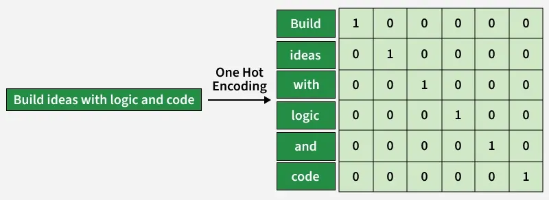

Now it looks like the earlier problems have been solved.

- Every vector has length vocab_size, so no token goes in as a larger value.
- Any two tokens are the same distance apart. Regardless of their vocab registration order, all tokens are equally spaced, so no fake relationships arise.

But this fairness comes at a price.

- <u>**No token meaning is captured**</u>. The similarity between `빠르다` and `신속하다` and the similarity between `빠르다` and `느리다` are both 0. To get rid of the fake relationships, we gave up the real ones too.
- <u>**The vectors are too big**</u>. If vocab_size is 32,000, representing one token takes 32,000 slots, and it becomes a <u>**sparse vector**</u> with 31,999 of them set to 0.
- <u>**A sentence or document can't be represented as a single vector**</u>. A 4-token review is represented as four 32,000-slot vectors, and a 100-token review as 100 vectors. It's practically the same as moving integer ids into sparse vectors of 0s and 1s. One of the ultimate goals of processing natural language could be something like review sentiment analysis: looking at reviews, <u>**judging whether each one is positive or negative**</u>, and understanding how our product is being evaluated overall. But one-hot vectors alone can't tell one review's sentiment from another's.

### 3.1. Statistics-Based Approach

#### 3.1.1. BoW (Bag of Words)

Let's first solve the third problem: a sentence or document can't be represented as a single vector. The simplest way to represent one review as one vector is <u>**to add up the one-hot vectors of the tokens in the review**</u>.

![Adding the one-hot vectors of the four tokens 배송, 빠르다, 가격, 저렴하다 to get the BoW vector [1, 1, 0, 1, 1, 0, 0, 0]](./image/bow-one-hot-sum.png)

As in the image above, each slot of the sum holds <u>**how many times that token appeared in the document**</u>. It's called <u>**Bag of Words (BoW)**</u> because it's like throwing away the token order, dumping the tokens (words) into a bag, and counting them by type.

Now, with BoW, we can build a vocab_size-length vector per sentence (document) from the frequencies of the tokens that appear in it!

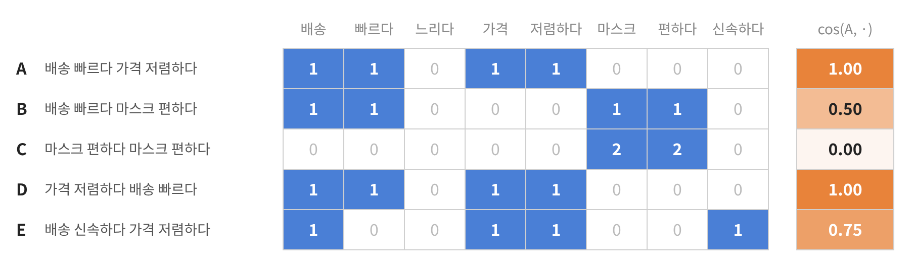

What BoW gains is clear.

- Regardless of review length, <u>**every review becomes a vector of the same length, vocab_size**</u>. Now it can go straight into a classification model.
- Reviews can be compared. A (“배송 빠르다 가격 저렴하다”) and B (“배송 빠르다 마스크 편하다”), which share two tokens, score 0.5, while A (“배송 빠르다 가격 저렴하다”) and C (“마스크 편하다 마스크 편하다”), which share none, score 0. Individual tokens had no relationship to one another, but <u>**similarity between documents emerged from which tokens appeared together**</u>.
- When the same token appears several times, as in C, its slot value grows, which also reveals <u>**how emphasized the token is in the document**</u>.

But D (”가격 저렴하다 배송 빠르다”) and E (”배송 신속하다 가격 저렴하다”) in the figure also show BoW's limits. D differs from A only in order, yet its vector is exactly the same. So <u>**it can't distinguish reviews that use the same tokens but have opposite meanings because of token order, like "the price is not cheap and the delivery is fast" vs. "the price is cheap and the delivery is not fast"**</u>. Also, E means the same as A, yet its similarity stops at 0.75. That's because BoW still uses one-hot at the token level, so it still doesn't know that `빠르다` and `신속하다` are similar.

#### 3.1.2. TF-IDF

BoW has one more problem. In product reviews, tokens like `배송` (delivery) and `가격` (price) appear in almost every review. Since they're in every review, they don't help much in telling reviews apart, yet BoW counts them exactly like other tokens, and they contribute equally to similarity. Conversely, tokens like `느리다` (slow) and `신속하다` (swift) that appear in only a few reviews characterize those reviews well, yet they're also counted as just 1.

<u>**TF-IDF (Term Frequency - Inverse Document Frequency)**</u> solves this problem by giving each token a different weight.

- **TF (Term Frequency)**: The more often a token appears within a document, the more important it is in that document. It's <u>**the number of times a token appears in a document**</u>, so the BoW vector is the TF itself.
- **IDF (Inverse Document Frequency)**: But if a token appears across many documents, its importance is discounted. If we call <u>**the number of documents a token appears in DF (Document Frequency)**</u>, then IDF (Inverse Document Frequency) is the log of the total number of documents N divided by DF.

$$
TF-IDF(t,d)=TF(t,d) \times \log{\frac{N}{DF(t)}}
$$

A token that appears in every document — that is, a token common to every review — has $\frac{N}{DF} = 1$, so its IDF is $\log{1} = 0$, and <u>**the rarer a token, the larger its IDF**</u>.

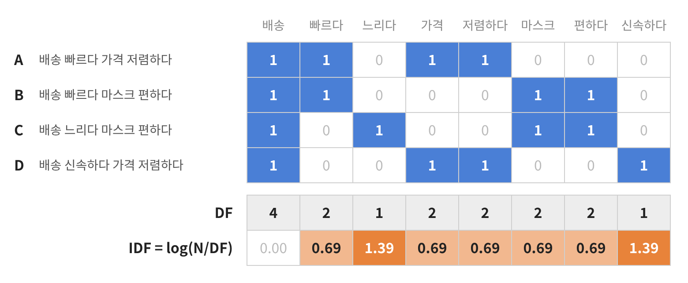

- `배송` appears in all 4 reviews, so $DF = 4$ and $IDF = \log{(\frac{4}{4})} = 0$.
- `느리다` and `신속하다` each appear in only one review, so $IDF = \log(\frac{4}{1}) ≈ 1.39$, the largest.

Multiplying each review's $TF$ by the $IDF$ obtained this way gives the <u>**TF-IDF vector**</u>.

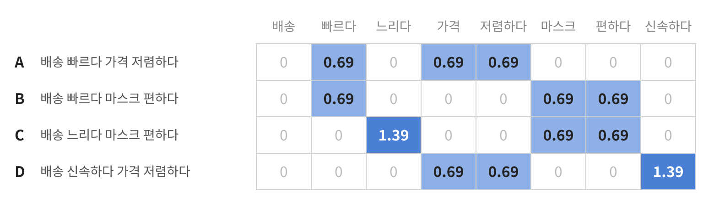

As `배송`'s TF-IDF becomes 0 in every document, the similarity that had been inflated by a token appearing everywhere settles down. A and B shared two tokens, `배송` and `빠르다`, for a similarity of 0.50 under BoW, but under TF-IDF only the meaningful common point, `빠르다`, remains, and you can see the similarity drop to 0.33.

In practice, rather than computing it by hand, people usually use `scikit-learn`'s `TfidfVectorizer`.

```py
from sklearn.feature_extraction.text import TfidfVectorizer
from sklearn.metrics.pairwise import cosine_similarity

reviews = ['배송 빠르다 가격 저렴하다',
           '배송 빠르다 마스크 편하다',
           '배송 느리다 마스크 편하다',
           '배송 신속하다 가격 저렴하다']

vec = TfidfVectorizer(token_pattern=r'\S+')   # assume already-tokenized sentences; split on whitespace only
X = vec.fit_transform(reviews)

print(vec.get_feature_names_out())
print('IDF:', vec.idf_.round(2))
print(cosine_similarity(X).round(2))

>>> ['가격' '느리다' '마스크' '배송' '빠르다' '신속하다' '저렴하다' '편하다']
>>> IDF: [1.51 1.92 1.51 1.   1.51 1.92 1.51 1.51]
>>> [[1.   0.42 0.12 0.65]
>>>  [0.42 1.   0.65 0.12]
>>>  [0.12 0.65 1.   0.11]
>>>  [0.65 0.12 0.11 1.  ]]
```

The numbers differ slightly from the earlier calculation because `TfidfVectorizer` computes IDF as follows by default.

$$
IDF = log(\frac{(1 + N)}{(1 + DF)}) + 1
$$

This prevents the denominator from becoming 0 (smoothing) and makes `배송`, which appears in every document, get the smallest value (1.0) instead of a weight of exactly 0. The calculation differs a little, but the result is the same: the more common a token, the smaller its weight.

#### Limits of the Statistics-Based Approach

TF-IDF solved the problem of common tokens, but if we look at the similarities again, something is off.

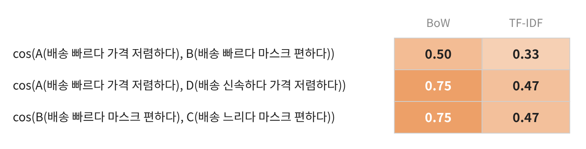

A and D differ only in `빠르다` vs. `신속하다` — reviews with practically the same meaning. Reviews like these should have a similarity close to 1. Yet their TF-IDF vector similarity is 0.47. B and C differ only in `빠르다` vs. `느리다` — reviews with opposite meanings. Yet this pair's TF-IDF vector similarity is also 0.47, exactly the same.

The reason is <u>**exactly the one-hot limitation**</u> we saw at the start of section 3. BoW and TF-IDF merely represent a document as a sum of token slots; each token's slot is still independent of the others, just like one-hot. So <u>**from the model's point of view, the relationship between `빠르다` and `신속하다` is just "different tokens," exactly like the relationship between `빠르다` and `느리다`**</u>. They're also still sparse vectors, as long as vocab_size and mostly 0.

In the end, what we need is <u>**to put meaning into each individual token**</u>, not into documents. If there were some vector that placed `빠르다` and `신속하다` close together and `빠르다` and `느리다` apart, it seems we could solve this problem.

### 3.2. Inference-Based Approach

How can we put meaning into each individual token so that tokens with similar meanings get similar vectors, and tokens with opposite meanings get opposite vectors?

First, we need to be able to embed at the token level. What does it mean to embed a token? Before getting to that, let's look at the example of representing a person's personality with MBTI.

Let's say my MBTI test result came out as **I 40%, S 30%, T 60%, P 20%**.

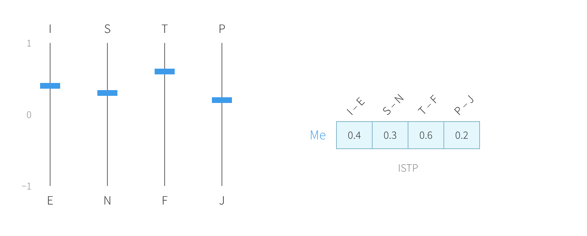

To make it easy to see, let's drop the last axis, P, and draw it in 3 dimensions.

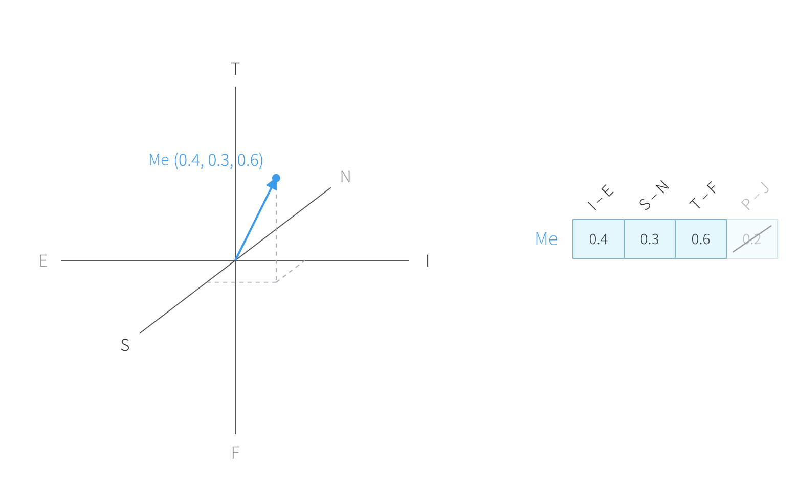

How about that? This is exactly what embedding a person's personality as a vector looks like. MBTI defines personality in 4 dimensions, but the features that determine a person's personality are surely far more numerous, right? Then, in the same way we just did, we can represent a person as a vector of 100 or even 200 dimensions.

Now let's see why representing people as vectors matters. Suppose I got hit by a bus and was rushed to the ER. Someone would then have to take over my work, and ideally it would be the person whose personality and traits are most similar to mine, right? Because we've just represented people as vectors above, we can compare two different people's personalities by the similarity between their vectors. Cosine similarity lets us score the similarity between vectors.

$$
\text{Cosine Similarity}(A, B) = \frac{A \cdot B}{\|A\| \|B\|} = \frac{\sum_{i=1}^{n} A_i B_i}{\sqrt{\sum_{i=1}^{n} A_i^2} \sqrt{\sum_{i=1}^{n} B_i^2}}
$$

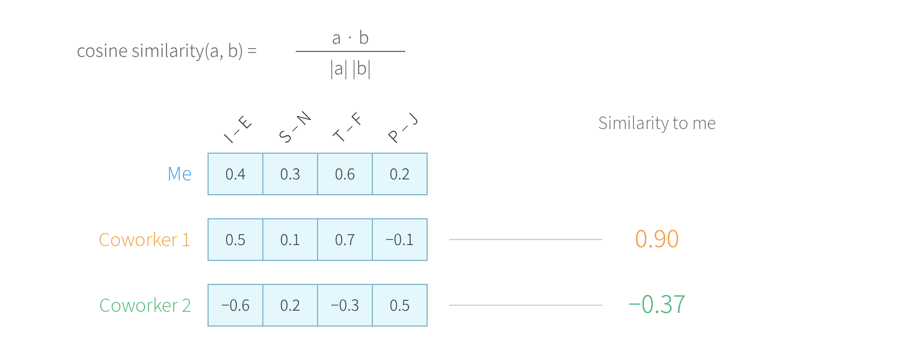

In short, representing people as vectors gives us the following two things.

1. We can quantify a person's traits as numbers, which <u>**makes computation easy**</u>.
2. We can easily compute <u>**the similarity between two different vectors**</u>.

So, just like people, we can define features for <u>**tokens**</u> too and <u>**project them into a space (feature space)**</u> to vectorize tokens, right?

#### 3.2.1. Word2Vec

The theory that answered <u>**how a token's features can be defined**</u> is the <u>**distributional hypothesis**</u>, the theory that “words used in similar contexts have similar meanings.” This view originated with the linguist J. R. Firth's *"You shall know a word by the company it keeps"* and Zellig Harris's distributional theory (Distributional Semantics).

One of the embedding algorithms based on the distributional hypothesis is <u>**Word2Vec**</u>, which has two training methods.

- **CBOW (Continuous Bag of Words)**: predicts the center word from the context words
- **Skip-gram**: predicts the context words from a single center word

> By convention, papers and lectures on Word2Vec call the token in the middle the center word and the tokens around it context words. The name ‘word’ might make you think of ‘natural-language words’ rather than tokens, but word here means the same thing as token.

In this post, we'll look at **Skip-gram**, which is used more in practice, together with **Negative Sampling**, the key trick that made Word2Vec fast to train even on large corpora.

Let's take the English review sentence `the mask arrived fast and fits well` as an example. By the way, a key concept that Word2Vec uses is <u>**window_size**</u>, which means <u>**raising the similarity with the tokens within window_size around the center word**</u>. In other words, it limits the criterion for “tokens used together” to within window_size.

As in the picture below, if window_size = 2, it means we treat the 2 tokens before and the 2 tokens after the center word fast as context words and build embeddings so that these tokens get similar vectors.

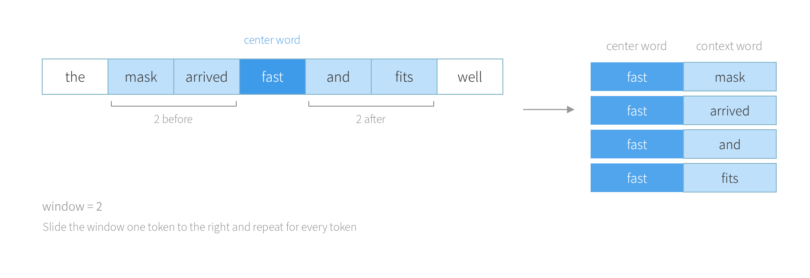

This gives four training pairs from a single center word: `(fast, mask)`, `(fast, arrived)`, `(fast, and)`, and `(fast, fits)`. We slide the window one token to the right and repeat this over the whole corpus to create a huge number of training pairs. Here, the model's goal is to raise the probability that `mask`, `arrived`, `and`, and `fits` appear as context words given the center word `fast`, which can be written as follows.

$$
P(o | c)
\\ \text{where, o: context word, c: center word}
$$

#### Basic Model Architecture: Using Softmax

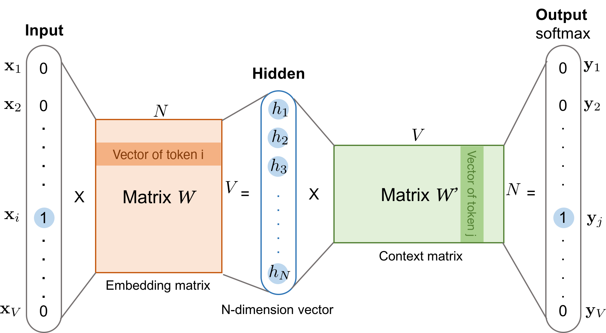

Every token has one vector in each of the two embedding matrices: one for when the token is a center word and one for when it is a context word.

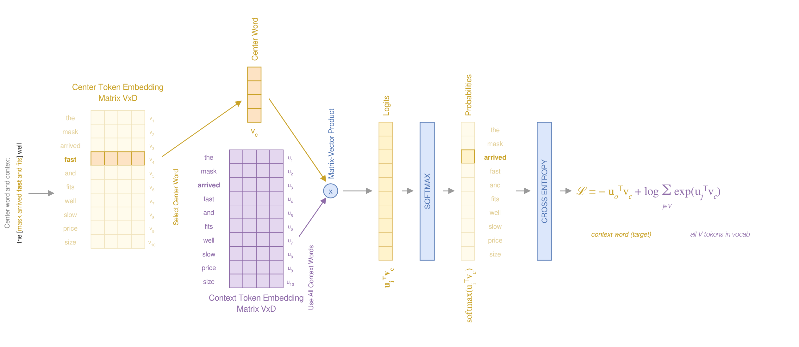

1. Take the row `v` corresponding to the center word `fast` from embedding matrix W.
2. Dot it with **every row** of embedding matrix W’ to produce V scores, computing its similarity with each token in vocab.
3. Turn the V scores into probabilities with softmax.
4. Take −log of the probability of the correct answer, `arrived`, to get the loss (cross entropy).

   $$
   J(W) = -\frac{1}{T}\sum_{t=1}^{T}\sum_{-m \le j \le m,\ j \ne 0} \log P(w_{t+j} \mid w_t)
   $$

5. Repeat steps 1\~4 for every training pair so that this loss goes down, and run multiple epochs.
6. Embedding matrices W and W’ are then adjusted little by little in the direction that raises the vector similarity of nearby tokens, and in the end, the vectors of tokens that frequently appear together end up clustered.
7. Use embedding matrix W as the final embedding matrix.

But this approach has a fatal flaw: computing the loss costs far too much.

$J(W)$ is mathematically clean. All the probabilities lie between 0 and 1 and sum to 1. The problem is the **denominator**. To get the probability of a single correct token, you have to <u>**compute scores for every token in vocab**</u>, <u>**divide by their sum**</u>, and send <u>**gradients to all of them**</u> as well.

- If vocab has 100,000 tokens, you have to do **100,000 dot products for every single training pair**.
- Skip-gram computes softmax as many times as there are context words for each center word (up to 10 when window = 5), so the cost grows in proportion to both the vocab size and the window size.
- All we actually care about is strengthening the `(fast, arrived)` connection, yet <u>**most of the computation is wasted re-fitting the probabilities of the remaining 99,000-odd tokens every time**</u>.

Embeddings get better with more data, but when training on a large corpus, vocab_size inevitably grows. This made the softmax layer so inefficient that training took far too long. The method that came out of this is <u>**Negative Sampling**</u>.

#### Negative Sampling: Making Computation Efficient

The core of Negative Sampling isn't a breakthrough idea for computing softmax quickly; it's an approach that changes how the problem is posed in the first place.

- Before: "Which of the 100,000 vocab tokens is `fast`'s neighbor?" → **multi-class classification** (one out of V)
- Negative Sampling: "Are `fast` and `arrived` real neighbors?" → **binary classification** (yes / no)

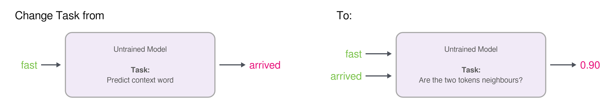

Once the problem is reframed this way, the dataset has to change first. That is, we take the training pairs and attach labels meaning that those pairs are neighbors.

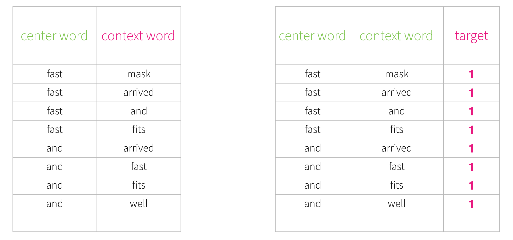

But the pairs drawn from the corpus are all real neighbors, so every label is 1. Then even a model that answers "yes" to every pair gets a perfect score and learns nothing. So for each real pair (**positive**), we create K fake pairs (**negative**) and label them 0. A fake pair keeps the center word as-is and replaces only the token in the context word slot with one drawn at random from vocab.

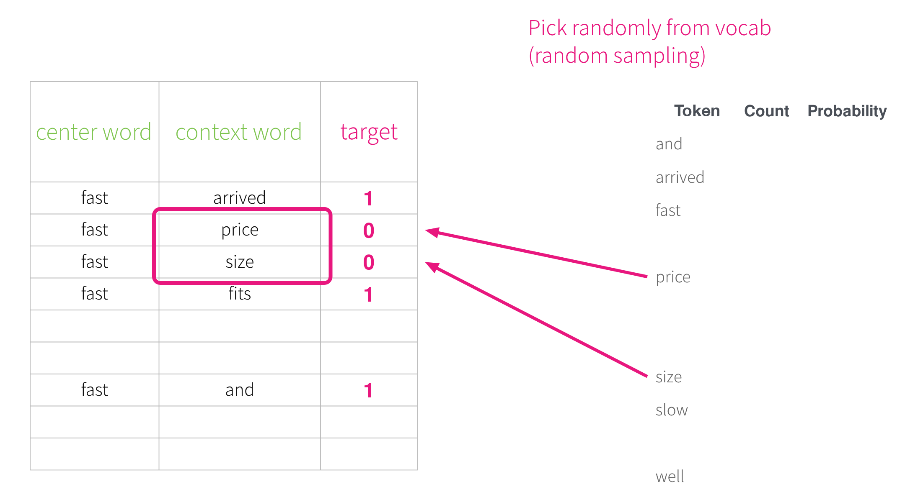

Now the problem the model solves has become <u>**a classification problem: "Did this pair come from real text, or is it random noise?"**</u> This training scheme, which uses Negative Sampling with Skip-gram, is called <u>**SGNS (Skip-Gram with Negative Sampling)**</u>.

#### SGNS (Skip-Gram with Negative Sampling)

The SGNS architecture is almost the same as the earlier one with softmax, but two things have changed.

1. It **takes only the needed rows** from the context matrix,
2. and **sigmoid** takes the place of softmax at the end.

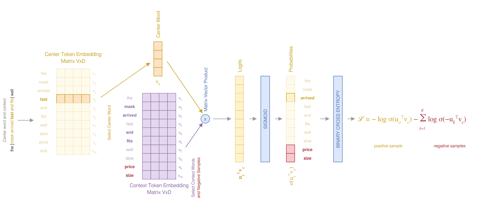

1. **Take the center word vector**: Get `fast`'s row `v` from embedding matrix W.
2. **Take the context word + negative vectors**: From embedding matrix W’, take only the rows for the real context word `arrived` and for the randomly drawn `price` and `size`. The remaining rows aren't used at all in this step.
3. **Dot product**: Dot v with each of the K+1 rows taken to get <u>**K+1 scores**</u>.
4. **sigmoid**: Turn each score into a value between 0\~1, computing each pair's "probability of being real neighbors." Unlike softmax, the probability isn't split among other tokens; each pair is judged independently.
5. **binary cross entropy**: Compare against the target (1 for positive, 0 for negative) to compute the loss.

   $$
   \mathcal{L}(c, o) = -\log \sigma(u_o^\top v_c) \; - \; \sum_{k=1}^{K} \log \sigma(-u_{w_k}^\top v_c)\\ w_k\text{: token drawn as a negative}
   $$

   - **First term (positive)**: Increases the dot product with the real context word o, pushing $\sigma$ toward 1.
   - **Second term (negative)**: Decreases the dot products with the random tokens, pushing $\sigma$ toward 0. Since $σ(−x) = 1 − σ(x)$, $log σ(−uᵀv)$ is the log of the "probability of being a fake pair."

   In other words, this expression is the **binary cross entropy** with targets 1 (positive) and 0 (negative), summed over K+1 pairs.

Training on one pair needs only one positive and K negatives, for a total of **K+1 dot products**. With K = 10, whether vocab_size is 100,000 or 1,000,000, you only need 11 dot products. In practice, about 5\~20 negatives per positive are enough to get good embeddings. Thanks to this, Word2Vec became trainable even on corpora of billions of tokens.

After training, the W’ matrix is discarded, and **each row of the** W **matrix is used as that token's embedding**.

#### Trying It Out with Gensim

In practice, rather than implementing it yourself, people usually use `gensim`'s `Word2Vec`.

```py
from gensim.models import Word2Vec

reviews = [
    ['the', 'mask', 'arrived', 'fast', 'and', 'fits', 'well'],
    ['delivery', 'was', 'fast', 'and', 'cheap'],
    ['delivery', 'was', 'slow', 'but', 'cheap'],
    ['the', 'mask', 'arrived', 'quick', 'and', 'fits', 'well'],
]

model = Word2Vec(
    sentences=reviews,
    vector_size=100,  # embedding dimension D
    window=5,         # number of context words to look at on each side
    sg=1,             # 1 = Skip-gram, 0 = CBOW
    negative=5,       # number of negative samples K (0 disables negative sampling)
    hs=0,             # 1 uses hierarchical softmax
    ns_exponent=0.75, # exponent of the negative sampling distribution (power of 3/4)
    min_count=1,      # tokens that appear fewer times than this are excluded from vocab
    epochs=50,
    seed=42,
)

print(model.wv['fast'].shape)
print(model.wv.most_similar('fast', topn=3))

>>> (100,)
>>> [('quick', 0.314...), ('arrived', 0.162...), ('cheap', 0.026...)]
```

| Argument | Default | Meaning |
| --- | --- | --- |
| `vector_size` | 100 | Embedding dimension. Larger values allow finer representations but need more data. Usually set to 100\~300. |
| `window` | 5 | When small (2\~15), interchangeable tokens get closer; when large (15\~50), tokens on the same topic get closer |
| `sg` | 0 | 1 for Skip-gram, 0 for CBOW |
| `negative` | 5 | Number of negative samples K |
| `ns_exponent` | 0.75 | Exponent of the negative sampling distribution |
| `min_count` | 5 | Threshold for dropping rare tokens from vocab |

**Window size is the most important hyperparameter, deciding 'what kind of semantic relationship' tokens will learn**.

1. <u>**Small window size: 2\~15**</u>

   It mainly sees the **grammatical structure and direct modifier relationships — particles, articles, verbs, adjectives, and so on —** attached right before and after the center word.

   - **Key characteristic**: **Tokens that remain grammatically natural even when swapped within a sentence** become close to each other.
   - **That is, the vectors of antonyms may become close.**
     - Example 1: *"This movie is **good**."*
     - Example 2: *"This movie is **bad**."*
     - With a small window, `good` and `bad` both have **exactly the same context words**: `is` before and a period (`.`) after. From the model's point of view, the two tokens' contexts are 100% identical, so it places the two tokens very close together (high similarity) in the vector space.
   - **Applications**: Favored for tasks where <u>**a token's functional and syntactic role**</u> matters, such as POS tagging, grammar correction, and building synonym/thesaurus dictionaries.
2. <u>**Large window size: 15\~50 or more**</u>

   Rather than grammatical word order, it sees **the tokens that make up the topic of a whole paragraph or document** together.

   - **Key characteristic**: Even if they differ in part of speech or can't replace each other in a sentence, **tokens that appear together in the same situation or topic** become close.
     - For example, if you look broadly around the token 'hospital,' tokens like 'doctor,' 'treat,' 'sick,' 'pharmacy,' and 'stethoscope' appear often. They can't grammatically replace each other, but **they're grouped into the same domain (topic): 'medicine.'**
   - **Applications**: Favored for tasks that need to grasp <u>**the overall context or domain knowledge of a text**</u>, such as document classification, sentiment analysis, recommender systems, and information retrieval.

#### 3.2.2. FastText

To sum up how FastText works in one sentence: the Embedder does what the Tokenizer would do. In Word2Vec's case, it takes the tokens the Tokenizer has neatly cut as they are and trains the center word and context word vectors to be close. As a result, you get a lookup table (= embedding matrix) that corresponds 1:1 to the vocab the Tokenizer built.

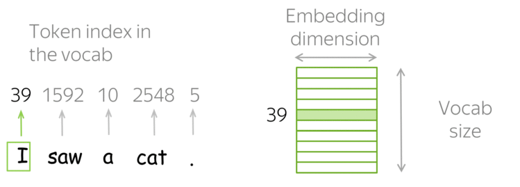

This approach has drawbacks.

1. **OOV (Out of Vocabulary)**

   In Word2Vec, each token is matched to exactly one embedding. So if a token that wasn't in the vocab at training time comes in from the real world, it has no choice but to be treated as `UNK`. For example, even if tensor and flow were in the vocab during training so that there are vectors for them, when the token tensorflow is given at test time or in the real world, there's no embedding matched 1:1 to it, so it gets treated as UNK.

   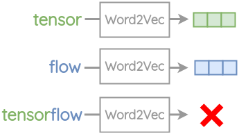

2. **Morphology**

   Since Word2Vec creates tokens and embeddings 1:1, when words that differ only in their suffix each become a separate token, it has no choice but to give each of those tokens a different embedding. That's inefficient.

   

   > 🔗 Of course, this can be handled well enough by the tokenizer. A morpheme-level tokenizer or a data-driven tokenizer can separate verbs and suffixes when tokenizing, so Word2Vec can handle the morphology problem well enough too.

But FastText works differently. Like Word2Vec, it trains the vectors of neighboring tokens to be similar, but inside FastText it <u>**cuts the tokens the Tokenizer produced once more into finer units and assigns a vector to each of them**</u>, and along with that, it combines these piece vectors and also returns, as part of the final result, a lookup table that corresponds 1:1 to the vocab the Tokenizer built!

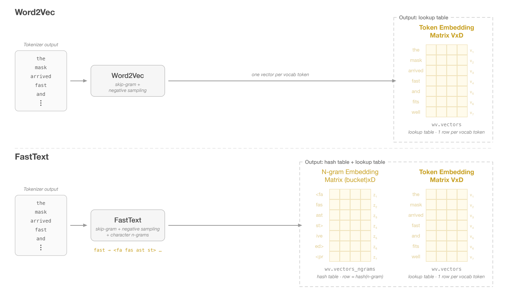

This lets it <u>**use the internal structure of tokens**</u> to make the vector representations obtained from skip-gram richer.

#### 1. Sub-word generation

Given the token `eating`, we attach boundary symbols at both ends to make `<eating>`,


and then extract character n-grams of length 3\~6 (defaults `minn=3`, `maxn=6`).


| **Token** | **Length(n)** | **Character n-grams** |
| --- | --- | --- |
| eating | 3 | &lt;ea, eat, ati, tin, ing, ng> |
| eating | 4 | &lt;eat, eati, atin, ting, ing> |
| eating | 5 | &lt;eati, eatin, ating, ting> |
| eating | 6 | &lt;eatin, eating, ating> |

Even from the example above, the single token `eating` was broken into 18 pieces, so splitting every token in vocab this way would produce a huge number of them, right? So, for lookup efficiency and memory efficiency, these n-grams are stored using a <u>**hash table**</u>.

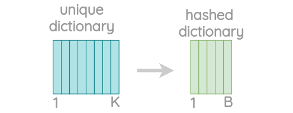

Rather than learning an embedding for every one of these n-grams, embeddings are learned for only B n-grams. Here, B is the size of the hash table (bucket size), and the paper used 2 million.

Each character n-gram is hashed to an integer between 1 and B. So collisions, where different character n-grams end up sharing the same row, can happen, but apparently they're simply ignored. The paper used the FNV-1a function to hash character sequences into integers.


The important point is that all tokens share the n-gram matrix. eat, eating, and eaten are different tokens, but they can now share the same n-gram, `<eat`.

#### 2. Skip-gram with negative sampling

The training method here is almost the same as Word2Vec. The only differences are that, when taking the center word, it pulls character n-grams from the hash bucket and sums them (averages them, in the actual implementation), and that negative samples aren't prepared in advance but drawn at random from the existing vocab.

Let's walk through an example with the sentence we kept using for Word2Vec, “The mask arrived fast and fits well,” with `fast` as the center word and `window_size=2`.

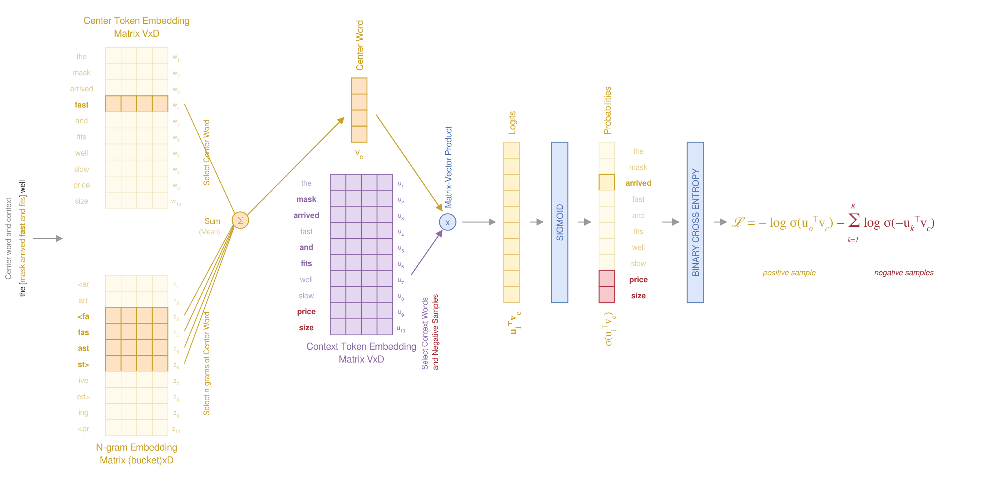

1. **Take and combine the n-gram vectors**: To get the vector for the center word fast, look up `<fa`, `fas`, `ast`, `st>`, `<fas`, `fast`, `ast>`, `<fast`, `fast>`, `<fast>` in the hash bucket, then sum or average all of them together with the `fast` found in the Center Token Embedding Matrix (sum in the paper, average in the actual implementation) to get the vector of the single token `fast`.
2. **Take the context word and negative samples**: The actually neighboring context word isn't built by combining n-grams; it's taken directly from the Context Token Embedding Matrix (VxD). Negative samples are drawn at random from the same Context Token Embedding Matrix (VxD), following a distribution proportional to each token's frequency raised to the 0.75 power (`ns_exponent=0.75`).
3. **Dot product → sigmoid**: Dot v with each of the K+1 rows taken, and use sigmoid to get each pair's "probability of being real neighbors."
4. **binary cross entropy**: Compare against the target (1 for positive, 0 for negative) to compute the loss. The formula is the same as in SGNS.

   $$
   \mathcal{L}(c, o) = -\log \sigma\Big(u_o^\top \sum_{g \in G_c} z_g\Big) \; - \; \sum_{k=1}^{K} \log \sigma\Big(-u_{w_k}^\top \sum_{g \in G_c} z_g\Big)
   $$

5. **Update**: The gradient flows equally to every row that made up v. So training `fast` also affects the vectors of other tokens (`faster`, `last`, etc.) that have n-grams like `<fa` and `ast`.

After training, for each vocab token it computes (Center Token Embedding Matrix\[that token\] + n-gram Embedding Matrix\[that token's n-grams\]) ÷ (number of n-grams + 1) and stores the result ahead of time in a new, third matrix, `wv.vectors(V × D)` (adjust_vectors). At this point, the `Center Token Embedding Matrix` and the `n-gram Embedding Matrix` are kept rather than discarded.

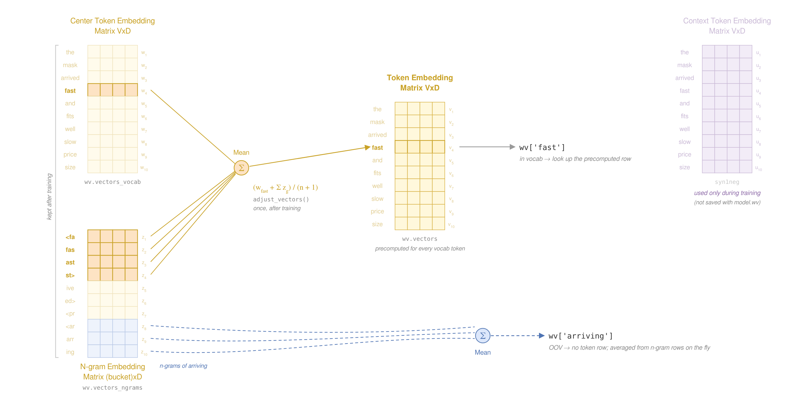

#### FastText's Strength: Robust to OOV

In practice, it goes like this.

1. Tokenize **with the same tokenizer used during training**.
2. Get a vector for each token.

   - **Word2Vec**: If the token is in the vocab, fetch its row; if not, treat it as `UNK` or drop it.
   - **FastText**: If the token is in the vocab, look it up in the `Token Embedding Matrix`; if not, use `mean(n-gram vectors only)`.

Since FastText kept the two matrices it used in training — the Center Token Embedding Matrix and the n-gram Embedding Matrix — instead of discarding them, it can now use them in practice: even when a token it didn't see at training time comes in as input, it can build a vector for that unseen token by combining the n-gram vectors it already knows.

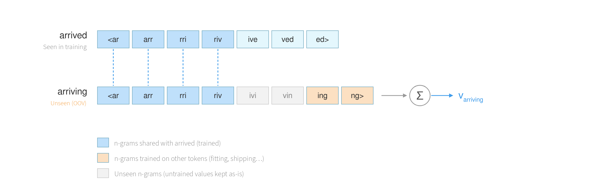

Suppose `arrived` was in the training corpus but `arriving` never appeared even once.

- **Word2Vec**: There's no `arriving` row in the embedding matrix, so it can't build a vector, and the token is treated as `UNK`.
- **FastText**: Splitting `arriving` into n-grams gives `<ar`, `arr`, `rri`, `riv`, `ivi`, `vin`, `ing`, `ng>`. Of these, `<ar`, `arr`, `rri`, and `riv` are n-grams it already learned while training `arrived`. `ing` and `ng>` may have been learned from other tokens like `fitting` and `shipping`.

  But `ivi` and `vin` are n-grams that appear in no token of the training corpus, so the random vector values that gensim initialized are used as-is.

  In this way, it can build a vector for `arriving` by **adding up and averaging only the n-gram vectors**.

By the same principle, **typos** (`arrivd`) and **new words** can also get vectors as long as they contain known n-grams, and those vectors land near tokens with similar spellings.

#### FastText's Limitations

Sharing n-grams isn't always a good thing.

- **Tokens with similar spellings but different meanings can also end up close.** `price` and `prize` share `<pr` and `pri`, so their vectors get somewhat close even when their contexts differ. Conversely, tokens with similar meanings but different spellings, like `good` and `great`, get no help from n-grams.
- **Memory and speed costs are high.** On top of the token rows, it has to keep the n-gram bucket rows (2 million by default), making the model file much larger, and it has to add up dozens of vectors per token, so training is slower too.
- **It's still a static embedding that doesn't look at context.** Just as in Word2Vec, `bank` has a single vector whether it means a financial bank or a riverbank.

#### FastText May or May Not Help, Depending on the Tokenizer

For example, suppose the training corpus contained "떡볶이를 먹었다" (I ate tteokbokki), and "로제떡볶이 먹었음" (ate rosé tteokbokki) comes in at inference time. The segmentations below are illustrative examples to aid understanding.

1. **Word-level, like whitespace / nltk (token ≈ word)**

   The vocab explodes, and low-frequency tokens form a long tail. `로제떡볶이` and `먹었음` are both missing from the vocab. Word2Vec gives UNK, but FastText builds a plausible vector from n-grams like `떡볶이` and `<먹었`. **This is where the benefit is largest**, and it's exactly the setting of the usual Word2Vec vs. FastText comparison.

2. **Morphological analyzer (Kiwi, etc.)**

   Endings and particles are separated. `먹었음` splits into `먹 / 었 / 음`, and all three are in the vocab, so OOV drops a lot at the token level and Word2Vec is enough. The benefit left for FastText is limited to new words, proper nouns, and compound nouns missing from the analyzer's dictionary (e.g., when `로제떡볶이` comes out as one chunk), typos, and analysis errors. **The benefit is moderate**.

   Note that if you train with POS tags attached, like `먹/VV`, every verb ends up sharing n-grams like `/VV>`. This can act as part-of-speech information, or it can turn into noise.

3. **BPE / Unigram (data-driven subwords)**

   The vocab size is fixed, and with byte-level BPE or byte fallback, **OOV doesn't arise in principle**. FastText's signature strength disappears. On top of that, the tokens are short, so n-grams add almost no information. For example, the n-grams of `볶이` are only `<볶이`, `볶이>`, and `<볶이>`, which are practically the same as the token itself.

   Still, two benefits remain.

   - **Sharing information among tokens that differ only in form**: `▁happy`, `happy`, and `▁Happy` are different IDs but share `app` and `ppy`. This only applies when tokens are long, though; `▁먹` and `먹` share no n-grams at all with minn=3.
   - **Tokens that are in the vocab but rare**: These arise when the corpus the tokenizer was trained on differs from the corpus the embeddings will be trained on, and FastText helps a little.

   The cost grows. You have to carry around a 2 million × d bucket matrix, far larger than a 30,000-entry vocab. **The benefit is small, and the cost-effectiveness is questionable**.

   | Tokenizer | Character information left inside tokens | OOV on real-world tokens | FastText benefit |
   | --- | --- | --- | --- |
   | Whitespace / nltk | A lot (includes inflections and particles) | Frequent | Large |
   | Morphemes (Kiwi) | Moderate | Only unknown words and typos | Moderate |
   | BPE / Unigram | Little (short pieces) | None in principle | Small |

#### FastText and Subword Tokenizers Differ Only in Where, and in What Order, They Do the Same Job

BPE and FastText's n-grams are **substitutes that do the same job in different places**.

|  | BPE + Word2Vec | Whitespace + FastText |
| --- | --- | --- |
| Where decomposition happens | Before embedding, in the tokenizer | Inside the embedding |
| Segmentation | A single segmentation, non-overlapping pieces, deterministic | Every possible n-gram, overlapping |
| Context prediction unit / window | Pieces (the window gets shorter in terms of words) | Words |
| Word vectors | None (combining pieces is up to the user) | Provided directly by the model |
| OOV | None | None (approximated with n-grams) |

So FastText can be seen as "a model that puts a trainable, overlapping subword decomposition inside the embedding layer." If the tokenizer has already split things finely, there's little left for FastText to do. To use FastText as originally intended, **feed it tokens close to words and leave subword handling to FastText**.

#### Trying Out FastText

```py
from gensim.models import FastText, Word2Vec

reviews = [
    ['the', 'mask', 'arrived', 'fast', 'and', 'fits', 'well'],
    ['delivery', 'was', 'fast', 'and', 'cheap'],
    ['delivery', 'was', 'slow', 'but', 'cheap'],
    ['the', 'mask', 'arrived', 'quick', 'and', 'fits', 'well'],
]

w2v = Word2Vec(reviews, vector_size=100, window=5, sg=1, negative=5,
               min_count=1, epochs=50, seed=42)
ft = FastText(reviews, vector_size=100, window=5, sg=1, negative=5,
              min_count=1, epochs=50, seed=42,
              min_n=3, max_n=6)   # use 3–6 character n-grams

print('arriving' in ft.wv.key_to_index)   # is it in the training vocab?
print(ft.wv['arriving'].shape)            # we can still build a vector
print(ft.wv.most_similar('arriving', topn=3))

w2v.wv['arriving']                        # what about Word2Vec?

>>> False
>>> (100,)
>>> [('arrived', 0.414...), ('well', 0.128...), ('fits', 0.123...)]
>>> KeyError: "Key 'arriving' not present"
```

`arriving` isn't in the training vocab, yet FastText built a vector for it and found `arrived` as the closest token. Under the same conditions, Word2Vec raises a `KeyError`.

| Argument | Default | Meaning |
| --- | --- | --- |
| `vector_size`, `window`, `sg`, `negative`, `min_count` | 100, 5, 0, 5, 5 | Same as Word2Vec |
| `min_n` | 3 | Length of the shortest n-gram |
| `max_n` | 6 | Length of the longest n-gram. Setting it below `min_n` disables n-grams, making it the same as Word2Vec |
| `bucket` | 2,000,000 | Number of rows to hash n-grams into. Larger values mean fewer collisions but more memory |

**The n-gram length (`min_n`, `max_n`) is the hyperparameter that decides which of a token's n-grams FastText uses as information**.

1. **Small n: 1\~2**
   - n-grams like `ar` and `ed` appear in too many tokens, so even unrelated tokens become similar.
   - On the other hand, even the strangest typo almost always contains a known n-gram, so it's robust to OOV.
2. **Large n: 5\~6 or more**
   - It sees n-grams close to roots or endings, like `arriv` and `rived`, so meaningful units share information.
   - On the other hand, short tokens produce almost no n-grams, and fewer n-grams overlap with unseen tokens.

For English, the default of 3\~6 is said to work fine. If you feed Korean in syllable units, each character carries a lot of information, so a smaller n (e.g., 1\~3) is said to be better; if you break it down into jamo (ㄱㄴㄷ), a larger n is said to be better.

#### 3.2.3. GloVe

The methods we've seen so far fall into two broad groups

- **Statistics-based (BoW, TF-IDF)**: Counts over the whole corpus at once and uses **global statistics**. But it's weak at expressing semantic relationships between tokens through vector arithmetic (king − man + woman ≈ queen).
- **Inference-based (Word2Vec, FastText)**: Strong at that kind of vector arithmetic, but it learns by scanning the training pairs within a window one at a time. If `(fast, and)` appears thousands of times in the corpus, it just repeats the same update thousands of times and never directly looks at the global statistic of "how many times they appeared together overall."

Can't we combine the strengths of both? **GloVe** (Global Vectors), published in 2014 by Pennington, Socher, and Manning at Stanford, is exactly that attempt. The paper points out that methods like skip-gram do better on analogies, but because they train on separate local windows instead of global co-occurrence counts, they fail to make proper use of the corpus statistics.

GloVe's idea can be summarized in two steps.

1. Scan the corpus once and **count, in a matrix, how many times tokens appeared together.** (the strength of the statistics-based approach)
2. Looking at that matrix, train the vectors so that the dot product of two token vectors equals **the log of the number of times they appeared together**. (the strength of the inference-based approach)

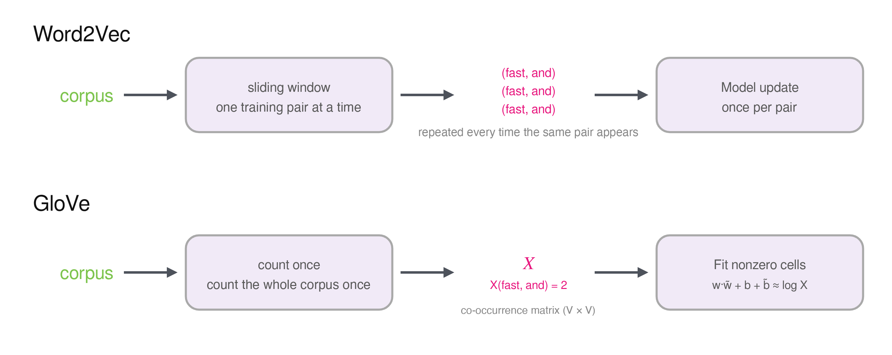

#### Building the Co-occurrence Matrix

The first step is to turn the corpus into statistics. Let's tokenize the 4 reviews we used for Word2Vec on whitespace and count with window = 2.

```py
reviews = [
    ['the', 'mask', 'arrived', 'fast', 'and', 'fits', 'well'],
    ['delivery', 'was', 'fast', 'and', 'cheap'],
    ['delivery', 'was', 'slow', 'but', 'cheap'],
    ['the', 'mask', 'arrived', 'quick', 'and', 'fits', 'well'],
]
```

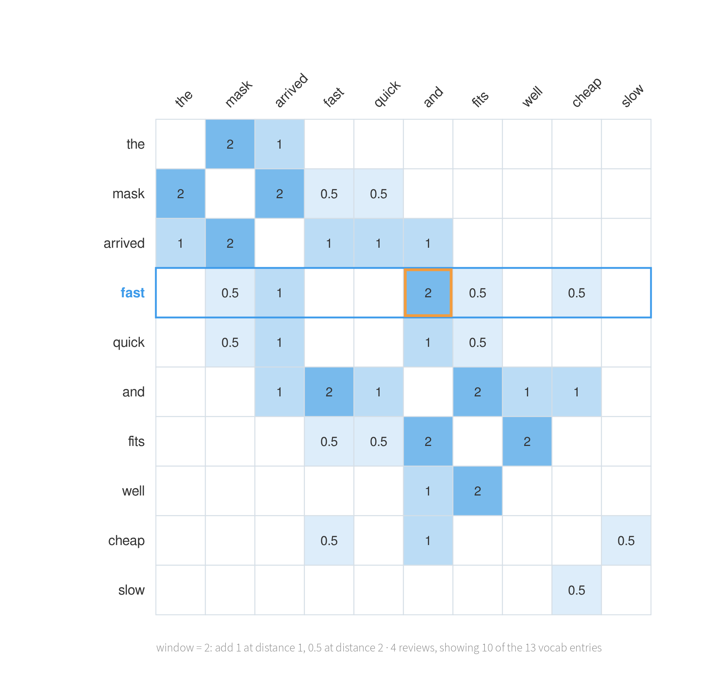

The co-occurrence matrix X is **V × V** in size. $X_{ij}$ means "how many times token j appeared within token i's window."

The original GloVe implementation also reflects distance: it adds 1 for an adjacent token (distance 1) and 1/2 for a token one slot away (distance 2). For example, the `and` right after `fast` appears once each in reviews 1 and 2, so $X_{(fast, and)} = 1 + 1 = 2$, and the `mask` two slots before `fast` appears only in review 1, so $X_{(fast, mask)} = 0.5$.

This matrix has two properties.

- **It's symmetric.** Since the window looks both ways, $X_{ij} = X_{ji}$.
- **It's a sparse matrix.** Even in our example, only 54 of the 13 × 13 = 169 cells are nonzero, and in a real corpus with a vocab of hundreds of thousands, the ratio gets much smaller. GloVe uses **only these nonzero cells** for training.

#### Core Idea: Ratios of Co-occurrence Probabilities

What corpus statistics should the vectors be trained to hold so that <u>**differences between vectors carry meaning**</u>? In other words, the researchers' question was: what feature of the corpus should we focus on to build vectors in which relationships like $king − man + woman ≈ queen$ hold?

So the authors approached it with <u>**the idea of turning co-occurrence counts into probabilities and using ratios of those probabilities to infer the difference between two tokens**</u>.

First, turn the co-occurrence counts into <u>**probabilities**</u>. If $X_i$ is the sum of token $i$'s row, then “the probability that token $k$ appears around token $i$,” $P(k \mid i)$, is as follows.

$$
P(k \mid i) = \frac{X_{ik}}{X_i}, \qquad X_i = \sum_k X_{ik}
$$

The authors had to find which statistic in the corpus corresponds to “the difference between two tokens,” and they worked it out by comparing the relationship between ice and steam. Both are states of water and therefore similar, differing only in <u>**solid vs. gas**</u> — a pair perfectly suited to an analogy problem.

Under the distributional hypothesis, a token's meaning is determined by "which tokens appear around it." So the difference between ice and steam can only be found by comparing their surroundings. Each time they plugged in a context word k, they tried to gather clues by asking, “k, do you appear more often next to ice, or next to steam?”, and to do that, they focused on the fact that <u>**ratios of probabilities reveal meaning better than the probabilities themselves**</u>.

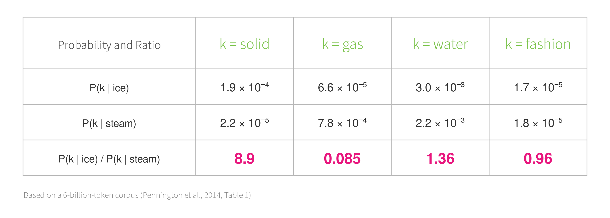

For example, here's what we can tell by looking at the ratio of $P(solid \mid ice)$ to $P(solid \mid steam)$.

- **Ratio close to 0** → `solid` appears with `steam` more often than with `ice`.
- **Ratio close to 1** → `solid` appears about equally with `ice` and with `steam`.

  - In this case, `solid` could be a token closely related to both `ice` and `steam`, or a token related to neither.
- **Ratio greater than 1** → `solid` appears with `ice` more often than with `steam`.

Looking at the table above again, we can interpret it like this.

- `solid` answers that it's on the `ice` side (8.9).
- `gas` answers that it's on the `steam` side (0.085).
- `water` and `fashion` answer that the two are the same (≈ 1).

Gathering these answers reveals the difference: **"ice and steam differ on the solid/gas axis and are the same otherwise"**.

So the training objective is set as follows.

- What we want: make the difference between vectors ($w_{ice} - w_{steam}$) meaningful
- What we use from the corpus: the probability ratio $P(k \mid ice) / P(k \mid steam)$
- The bridge between differences and ratios: $\log$, i.e., $\log(\frac{a}{b}) = \log a - \log b$

The first formula that comes to mind sets the vector difference equal to the log ratio.

$$
w_{ice} - w_{steam} \approx \log \frac{P(k \mid ice)}{P(k \mid steam)}
$$

But this formula can't hold.

1. **The left side is a vector (D-dimensional), and the right side is a single number (a scalar).** A vector and a number can't be set equal.
2. **The right side differs for each k, but the left side has no k.** Plugging in `solid` gives $\log 8.9 \approx 2.2$ and `gas` gives $\log 0.085 \approx -2.5$, but a single fixed $w_{ice} - w_{steam}$ that doesn't depend on k can't equal all of these values at once.

So the left side needs **something that varies with k and turns a vector into a number**. We give each token k its own vector $\tilde{w}_k$ and make a number with the simplest method, the **dot product**.

$$
(w_{ice} - w_{steam})^\top \tilde{w}_k \approx \log \frac{P(k \mid ice)}{P(k \mid steam)}
$$

This reads as "projecting the difference vector between ice and steam onto the direction of question k gives the log ratio." Projecting onto the `solid` direction should give a large positive number, onto `gas` a large negative number, and onto `water` or `fashion` something near 0.

Another reason to use the dot product is that it allows the **distributive law**. Expanding the left and right sides gives the following.

$$
w_{ice}^\top \tilde{w}_k - w_{steam}^\top \tilde{w}_k \approx \log P(k \mid ice) - \log P(k \mid steam)
$$

Both sides now have the form "term about ice − term about steam," so we can match them term by term.

$$
w_{ice}^\top \tilde{w}_k \approx \log P(k \mid ice), \qquad w_{steam}^\top \tilde{w}_k \approx \log P(k \mid steam)
$$

Now the condition about "the difference between two tokens" has turned into a condition between **"a single token and k."** So we can train by looking at just one cell, $(i, k)$, of the co-occurrence matrix. Generalizing ice and steam to token $i$ and expanding the probability into counts gives the following.

$$
w_i^\top \tilde{w}_k \approx \log P(k \mid i) = \log({\frac{X_{i,k}}{X_{i}}}) = \log X_{ik} - \log X_i
$$

Here, $\log X_i$ is the log of "the total number of tokens that appeared around token i," so its value is the same whether k is `solid`, `gas`, or `water`. Since it's a constant added equally for every k, instead of computing it directly we use the trick of absorbing it into **a trainable parameter $b_i$, one per token**.

$$
w_i^\top \tilde{w}_k + b_i \approx \log X_{ik}
$$

Finally, one more term, $\tilde{b}_k$, is attached. Earlier we split one difference equation into two, but in fact, adding the same **value that depends only on k** to both equations leaves the difference equation intact, because it cancels out when subtracted. We set this "share of k that cancels out when subtracted" as a bias, $\tilde{b}_k$.

So GloVe trains so that the following holds in **each nonzero cell** of the co-occurrence matrix.

$$
w_i^\top \tilde{w}_k + b_i + \tilde{b}_k \approx \log X_{ik}
$$

- $w_i$: the vector of center word i, $\tilde{w}_k$: the vector of context word k (the direction of question k)
- $b_i$: a bias that absorbs $\log X_i$, $\tilde{b}_k$: a bias that holds k's share

Let's check that this formula really satisfies the original goal. The equations for cell $(ice, k)$ and cell $(steam, k)$ are as follows.

$$
w_{ice}^\top \tilde{w}_k + b_{ice} + \tilde{b}_k \approx \log X_{ice,k}
$$

$$
w_{steam}^\top \tilde{w}_k + b_{steam} + \tilde{b}_k \approx \log X_{steam,k}
$$

Subtracting the two equations makes $\tilde{b}_k$ disappear.

$$
(w_{ice} - w_{steam})^\top \tilde{w}_k + (b_{ice} - b_{steam}) \approx \log X_{ice,k} - \log X_{steam,k}
$$

Since $b_{ice} - b_{steam}$ plays the role of the denominator term $\log X_{ice} - \log X_{steam}$, we end up back at the formula we wanted at the start.

$$
(w_{ice} - w_{steam})^\top \tilde{w}_k \approx \log \frac{X_{ice,k} / X_{ice}}{X_{steam,k} / X_{steam}} = \log \frac{P(k \mid ice)}{P(k \mid steam)}
$$

In one line, GloVe trains so that **the dot product of two token vectors ≈ the log of the number of times they appeared together**. Each individual cell only fits the log of a count, but subtracting two cells makes the vector difference hold the probability ratio.

#### GloVe Training Architecture: Learning from the Co-occurrence Matrix

Like Word2Vec, GloVe has two matrices: the **Center Token Embedding Matrix $W$** and the **Context Token Embedding Matrix $W'$**. On top of that, each token has one more bias in each, b and b̃. The difference is the training data. Word2Vec built training pairs by sliding a window over the corpus one step at a time, but in GloVe, **each nonzero cell of the co-occurrence matrix X is a training example**.

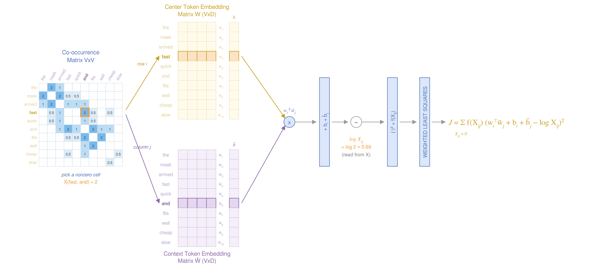

Let's follow a single step with the `(fast, and)` cell (X = 2).

1. **Pick a cell**: Pick one nonzero cell of X. Here, $i$ = `fast`, $j$ = `and`, and $X_{ij}$ = 2.
2. **Take the vectors**: Take `fast`'s row $w_i$ from $W$ and `and`'s row $w̃_j$ from $W'$. Also take the biases $b_i$ and $b̃_j$.
3. **Compute the prediction**: Compute $w_i^\top \tilde w_j + b_i + b̃_j$. The answer this value should hit is $log X_{ij} = log 2 ≈ 0.69$.
4. **Squared error**: Compute $(\text{prediction} − log X_{ij})²$. It's a **regression problem** that predicts a single number, with no sigmoid and no cross entropy.
5. **Multiply by a weight**: Each cell has a different importance, so multiply by $f(X_{ij})$.

   - $f$ is a weighting function that assigns a weight to the loss of each cell.

     $$
     f(x) = \begin{cases} (x / x_{\max})^{\alpha} & x < x_{\max} \\ 1 & \text{otherwise} \end{cases}\qquad (x_{\max} = 100,\ \alpha = 3/4)
     $$

     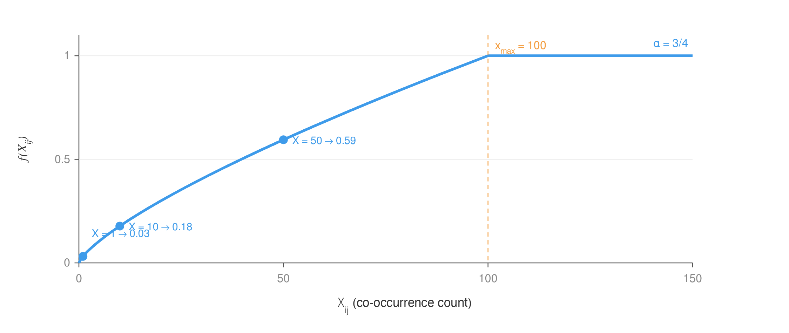

6. **Update**: Update only four things — $w_i$, $w̃_j$, $b_i$, $b̃_j$ — so that this loss goes down. The paper uses AdaGrad for optimization.

After training, we use **the sum of $W$ and $W'$**.

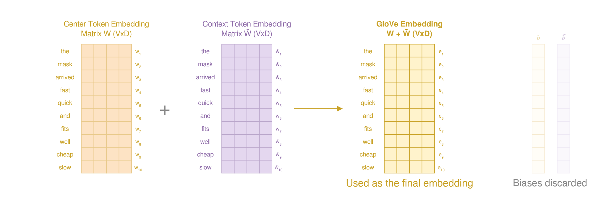

#### GloVe's Strengths and Limitations

**Strengths**

- **Training is efficient.** After one pass to build the co-occurrence matrix, training only iterates over the matrix's nonzero cells. No matter how many times the same pair appears, it's still just one cell, so even as the corpus grows, <u>**the computation per epoch doesn't grow proportionally.**</u>
- **It fits global statistics directly.** It uses "how many times they appeared together in the whole corpus" as the target value, so the relationships between tokens show up well as vector differences. It's strong on evaluations like analogies (king − man + woman).
- **Pretrained vectors are easy to get.** Stanford has <u>**released**</u> vectors trained on Wikipedia + Gigaword (6 billion tokens), Common Crawl (42 billion tokens), and more.

**Limitations**

- **Tokens outside the vocab have no vectors.** Like Word2Vec, it's a lookup table with an independent row for each token. The problem FastText solved remains. In other words, it's weak against OOV.
- **It needs memory to build the co-occurrence matrix.** The matrix is V × V, so even when stored as a sparse matrix, this step becomes a burden as the vocab and corpus grow.
- **It's a static embedding that doesn't look at context.** Just as in Word2Vec and FastText, `apple` has a single vector whether it means the fruit or the company Apple.

## 📚 References

- [One-Hot Encoding in NLP - GeeksforGeeks](https://www.geeksforgeeks.org/nlp/one-hot-encoding-in-nlp/)
- [Word2Vec — Negative Sampling](https://medium.com/@tnodecode/word2vec-negative-sampling-63995b13464f)
- [Word Embeddings](https://lena-voita.github.io/nlp_course/word_embeddings.html)
- [A Visual Guide to FastText Word Embeddings](https://amitness.com/posts/fasttext-embeddings)
- [Enriching Word Vectors with Subword Information](https://arxiv.org/abs/1607.04606)
- [FNV Hash](https://www.isthe.com/chongo/tech/comp/fnv/)
