## 0. 들어가며

컴퓨터, 더 자세히 말하면 인공지능 모델은 어떻게 자연어를 인식할까요? a, b, c, ㄱ, ㄴ, ㄷ같은 문자는 우리가 흔히 아는 <u>**유니코드**</u>와 <u>**UTF-8 인코딩**</u>과 같은 규칙을 통해서 컴퓨터가 이해할 수 있는 <u>**숫자(바이트)**</u>로 변환할 수는 있습니다. 하지만, 이런 숫자 표현(바이트)에는 문자와 단어의 <u>**의미**</u>가 들어 있지는 않습니다. 모델이 자연스럽게 문장을 말하기 위해서는 문자와 단어의 의미를 알 수 있어야 하는데, 그건 어떻게 가능할까요?

이번 포스트에서는 자연어가 어떻게 처리되어 모델이 이해할 수 있는 의미 정보를 담게 되는지 알아보겠습니다.

## 1. 자연어 처리 Overview

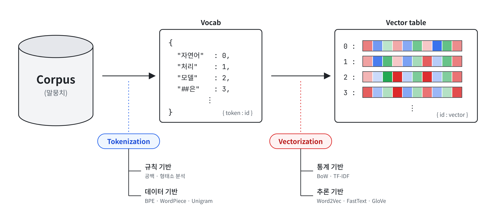

모델이 자연어를 이해하기까지의 과정은 크게 두 단계로 나눌 수 있습니다. 바로 <u>**Tokenization**</u>과 <u>**Vectorization**</u>입니다. 위 그림처럼 사람이 쓴 글의 모음인 <u>**말뭉치(Corpus)**</u>의 모든 텍스트를 의미 있는 <u>**토큰(token)**</u>으로 나누고, 그 토큰 하나하나에 <u>**숫자로 된 의미(vector)**</u>를 붙여주는 흐름으로 이어집니다.

## 2. Tokenization

먼저 문장을 모델이 다룰 수 있는 최소 단위인 <u>**토큰(token)**</u>으로 쪼갭니다. 예를 들어 <em>"자연어 처리 모델은"</em>이라는 문장은 `자연어`, `처리`, `모델`, `##은`과 같은 토큰으로 나눌 수 있습니다.

이렇게 말뭉치 전체를 토큰으로 나누고 나면, 등장한 토큰마다 고유한 번호(id)를 붙인 <u>**vocab(vocabulary)**</u>을 만들 수 있습니다. 이렇게 하고 나면 모델은 문장을 글자가 아니라 <u>**id의 나열**</u>로 볼 수 있게 됩니다.

그러면 도대체 토큰을 어떻게 나눠야 할까요? 띄어쓰기를 기준으로 그냥 나누면 될까요?

토큰을 나누는 방법은 크게 두 가지, <u>**규칙 기반 방식**</u>과 <u>**데이터 기반 방식**</u>이 있습니다.

### 2.1. 규칙 기반 방식

규칙 기반 방식은 이름 그대로 <u>**사람이 미리 정해 둔 규칙**</u>에 따라 문장을 나누는 방법입니다. "띄어쓰기가 있는 곳에서 자른다", "문장 부호는 따로 떼어 낸다"처럼 기준을 사람이 직접 정하기 때문에 동작이 단순하고, 결과도 예측하기 쉽습니다. 대표적인 방법으로 <u>**공백 기반**</u> 토큰화와 <u>**형태소 분석기**</u>를 이용한 토큰화가 있습니다.

#### 2.1.1. 공백 기반 토큰화

가장 단순한 규칙은 공백을 기준으로 나누는 것입니다.

```py
sentence = "자연어 처리 모델은 어렵습니다"
tokens = sentence.split()

>>> ['자연어', '처리', '모델은', '어렵습니다']
```

영어를 처리할 때 일반적으로 많이 쓰는 패키지 `nltk`의 `word_tokenize()`를 사용하면 아포스트로피와 하이픈도 처리할 수 있습니다.

```py
import nltk
for res in ['punkt', 'punkt_tab', 'stopwords', 'wordnet']:
    nltk.download(res, quiet=True)
from nltk.tokenize import word_tokenize

en = "The mask doesn't fit well, but the delivery was super-fast."
print('split()      :', en.split())
print('word_tokenize:', word_tokenize(en))

>>> split()      : ['The', 'mask', "doesn't", 'fit', 'well,', 'but', 'the', 'delivery', 'was', 'super-fast.']
>>> word_tokenize: ['The', 'mask', 'does', "n't", 'fit', 'well', ',', 'but', 'the', 'delivery', 'was', 'super-fast', '.']
```

<u>**영어**</u>처럼 단어와 단어 사이를 띄어 쓰고, 단어의 형태가 크게 바뀌지 않는 언어에서는 이 방법만으로도 꽤 그럴듯한 결과를 얻을 수 있습니다.

하지만 <u>**한국어**</u>에 공백 기반 토큰화를 그대로 적용하면 문제가 생깁니다. 한국어는 단어 뒤에 조사나 어미가 붙어서 문법적인 역할이 정해지는 <u>**교착어**</u>이기 때문입니다. 띄어쓰기 단위(어절)로만 나누면 아래 토큰들이 모두 서로 다른 토큰이 됩니다.

| **어절** | **실제 의미** |
| --- | --- |
| `모델은` | 모델 + 은 |
| `모델이` | 모델 + 이 |
| `모델을` | 모델 + 을 |
| `모델에게` | 모델 + 에게 |

사람이 보기에는 모두 같은 `모델`이지만, 조사가 다르다는 이유로 vocab에는 각각 <u>**다른 id**</u>로 등록됩니다. 그 결과 vocab의 크기는 불필요하게 커지고, 같은 의미를 가진 단어의 정보가 여러 토큰으로 흩어지게 됩니다.

#### 2.1.2. 형태소 기반 토큰화

이 문제를 해결하기 위해 한국어에서는 형태소 분석기를 많이 사용합니다. <u>**형태소(morpheme)**</u>란 의미를 가진 가장 작은 말의 단위를 말합니다. 형태소 분석기는 문법 규칙과 미리 구축된 사전을 바탕으로 어절을 형태소 단위로 쪼개고, 각 형태소의 품사까지 알려 줍니다. `Kiwi`로 앞의 문장을 형태소 단위로 나누면 다음과 같이 나옵니다.

```py
from kiwipiepy import Kiwi

kiwi = Kiwi()
tokens = kiwi.tokenize('자연어 처리 모델은, 모델이, 모델마저 어렵습니다.')
print(set([(t.form, t.tag) for t in tokens]))

>>> {('어렵', 'VA-I'), ('은', 'JX'), ('마저', 'JX'), (',', 'SP'), ('.', 'SF'), ('습니다', 'EF'), ('모델', 'NNG'), ('자연어', 'NNP'), ('이', 'JKS'), ('처리', 'NNG')}
```

위 예시처럼 `모델은`, `모델이`, `모델마저` 모두 같은 `모델` 토큰과 서로 다른 조사 토큰으로 나뉘기 때문에, `모델`이라는 명사 형태소는 vocab에 한 번만 등록되고, `은`, `이`, `마저`는 서로 다른 조사 토큰으로 vocab에 각각 다르게 등록됩니다. 한국어 형태소 분석기로는 `KoNLPy`에 포함된 `Okt`, `Komoran`, `Kkma`, `Mecab` 등과 `Kiwi`가 널리 쓰입니다. 분석기마다 규칙과 사전이 달라서, 같은 문장이라도 분석기에 따라 토큰화 결과가 조금씩 다를 수 있습니다.

### 2.2. 데이터 기반 방식

규칙 기반 방식은 직관적이고 해석하기 쉽지만, 분명한 한계도 있습니다.

- <u>**vocab에 없는 토큰(OOV, Out-Of-Vocabulary)**</u>에 약합니다. `갓생`, `킹받네`, `맛잇다` 같은 신조어나 오타는 형태소 분석기의 사전에 없으니 엉뚱하게 쪼개지거나, vocab에 없는 토큰으로 처리될 수 있습니다.
- <u>**vocab이 계속 커집니다**</u>. 말뭉치에 새로운 단어가 등장할 때마다 vocab에 새 토큰이 추가되어야 하기 때문입니다.
- <u>**언어마다 규칙을 따로**</u> 만들어야 합니다. 영어에 맞춘 규칙은 한국어에 맞지 않고, 한국어 형태소 분석기는 일본어에 쓸 수 없습니다.

이런 한계 때문에, 사람이 규칙을 정하는 대신 <u>**데이터로부터 토큰을 나누는 기준 자체를 학습하는 방법**</u>이 등장했습니다.

데이터 기반 방식의 핵심 아이디어는 간단합니다. <u>**자주 등장하는 글자 조합은 하나의 토큰으로 묶고, 드물게 등장하는 단어는 더 작은 조각으로 쪼개자**</u>는 것입니다. 이렇게 단어보다 작은 단위로 나눈 토큰을 <u>**서브워드(sub-word)**</u>라고 부르기 때문에, 이 방식을 <u>**서브워드 토큰화**</u>라고도 합니다.

이 방식에서 사람은 "어디서 자를지"를 정할 필요 없이, <u>**vocab의 크기(vocab_size)**</u> 하나만 정하면 됩니다. 어디서 자를지는 코퍼스의 통계를 보고 알고리즘이 스스로 정하기 때문입니다. 덕분에 vocab에 없던 신조어가 들어와도 이미 알고 있는 작은 조각들로 쪼개서 표현할 수 있고, vocab의 크기도 미리 정한 만큼만 유지되어 무한정 커지지 않습니다.

대표적인 알고리즘으로 **BPE**, **WordPiece**, **Unigram**이 있습니다.

#### 2.2.1. BPE (Byte Pair Encoding)

BPE는 가장 직관적인 서브워드 알고리즘입니다. 동작 방식은 다음과 같습니다.

- **알고리즘**
  ```c
  // 학습
  1. vocab: corpus에 등장한 모든 글자
  2. merges: 병합 규칙 목록
  3. while len(vocab) < 목표 vocab 크기:
      4. 말뭉치 전체에서 붙어 있는 두 토큰 쌍 (a, b)의 등장 횟수를 셈
      5. (a, b) ← 가장 많이 등장한 쌍
      6. 모든 단어에서 a b 를 ab 하나로 합침
      7. vocab에 ab 추가, merges에 (a, b) 기록

  // 토큰화
  1. 새 단어를 글자 단위로 쪼갬
  2. merges에 기록된 순서대로 병합 규칙을 적용
  ```
- **예시**
  - corpus

    | **단어** | **편해요** | **편하고** | **아파요** | **아프다** | **해요** |
    | --- | --- | --- | --- | --- | --- |
    | 등장 횟수 | 5 | 3 | 4 | 2 | 2 |

  1. BPE 학습 전 상태

     | **상태** | 학습 전 |
     | --- | --- |
     | vocab | `편, 해, 요, 하, 고, 아, 파, 프, 다` |
     | merges | `()` |
     | 단어 분할 | 편 / 해 / 요, 편 / 하 / 고, 아 / 파 / 요, 아 / 프 / 다, 해 / 요 |

  2. 쌍별 등장 횟수 세기

     - 1단계:

       | **쌍** | **등장하는 단어** | **횟수** |
       | --- | --- | --- |
       | **해 + 요** | **편해요(5) + 해요(2)** | **7** |
       | 편 + 해 | 편해요(5) | 5 |
       | 아 + 파 | 아파요(4) | 4 |
       | 파 + 요 | 아파요(4) | 4 |
       | 편 + 하 | 편하고(3) | 3 |
       | ... | ... | ... |

       가장 많은 `해 + 요`(7회)를 합쳐 `해요`를 vocab에 추가합니다. 이제 `편해요`는 `편 / 해요`, `해요`는 `해요` 한 덩어리가 됩니다.

       | **상태** | **1단계 후** |
       | --- | --- |
       | vocab | `편, 해, 요, 하, 고, 아, 파, 프, 다, 해요` |
       | merges | `(해, 요)` |
       | 단어 분할 | 편 / 해요, 편 / 하 / 고, 아 / 파 / 요, 아 / 프 / 다, 해요 |

     - 2단계:

       | **쌍** | **등장하는 단어** | **횟수** |
       | --- | --- | --- |
       | **편 + 해요** | **편해요(5)** | **5** |
       | 아 + 파 | 아파요(4) | 4 |
       | 파 + 요 | 아파요(4) | 4 |
       | 편 + 하 | 편하고(3) | 3 |
       | 하 + 고 | 편하고(3) | 3 |
       | 아 + 프 | 아프다(2) | 2 |
       | 프 + 다 | 아프다(2) | 2 |

       `해요`가 이미 한 토큰이 되었기 때문에, 이번에는 `해 + 요`가 아니라 `편 + 해요`라는 쌍이 생겼습니다. 가장 많은 `편 + 해요`(5회)를 합칩니다.

       | **상태** | **2단계 후** |
       | --- | --- |
       | vocab | `편, 해, 요, 하, 고, 아, 파, 프, 다, 해요, 편해요` |
       | merges | `(해, 요), (편, 해요)` |
       | 단어 분할 | 편해요, 편 / 하 / 고, 아 / 파 / 요, 아 / 프 / 다, 해요 |

     - 3단계:

       | **쌍** | **등장하는 단어** | **횟수** |
       | --- | --- | --- |
       | **아 + 파** | **아파요(4)** | **4** |
       | 파 + 요 | 아파요(4) | 4 |
       | 편 + 하 | 편하고(3) | 3 |
       | 하 + 고 | 편하고(3) | 3 |
       | 아 + 프 | 아프다(2) | 2 |
       | 프 + 다 | 아프다(2) | 2 |

       `아 + 파`와 `파 + 요`가 4회로 같습니다. 이렇게 빈도가 같을 때는 구현마다 정해 둔 규칙에 따라 하나를 고르는데, 여기서는 먼저 등장한 `아 + 파`를 합치겠습니다.

       | **상태** | **3단계 후** |
       | --- | --- |
       | vocab | `편, 해, 요, 하, 고, 아, 파, 프, 다, 해요, 편해요, 아파` |
       | merges | `(해, 요), (편, 해요), (아, 파)` |
       | 단어 분할 | 편해요, 편 / 하 / 고, 아파 / 요, 아 / 프 / 다, 해요 |

     - 4단계:

       | **쌍** | **등장하는 단어** | **횟수** |
       | --- | --- | --- |
       | **아파 + 요** | **아파요(4)** | **4** |
       | 편 + 하 | 편하고(3) | 3 |
       | 하 + 고 | 편하고(3) | 3 |
       | 아 + 프 | 아프다(2) | 2 |
       | 프 + 다 | 아프다(2) | 2 |

       `아파 + 요`(4회)를 합칩니다.

       | **상태** | **4단계 후** |
       | --- | --- |
       | vocab | `편, 해, 요, 하, 고, 아, 파, 프, 다, 해요, 편해요, 아파, 아파요` |
       | merges | `(해, 요), (편, 해요), (아, 파), (아파, 요)` |
       | 단어 분할 | 편해요, 편 / 하 / 고, 아파요, 아 / 프 / 다, 해요 |

4단계가 끝나면 vocab에는 처음 9개 글자에 `해요`, `편해요`, `아파`, `아파요`가 더해진 13개 토큰이 들어 있습니다. 이런 식으로 vocab이 목표 크기(vocab_size)에 도달할 때까지 병합을 반복합니다. 자주 쓰이는 `해요`, `편해요`는 빠르게 한 덩어리가 되고, 드문 `아프다`는 끝까지 `아 / 프 / 다`처럼 잘게 남아 있게 됩니다.

merges는 집합이 아니라 순서가 있는 목록이라는 점이 중요합니다. 새 단어를 토큰화할 때 이 목록의 순서대로 병합을 적용하기 때문입니다. 예를 들어 처음 보는 단어 `아파해요`는 글자로 쪼갠 `아 / 파 / 해 / 요`에 (해, 요) → (편, 해요) → (아, 파) → (아파, 요) 순서로 규칙을 적용합니다. (해, 요)에서 `아 / 파 / 해요`, (아, 파)에서 `아파 / 해요`가 되고, 나머지 규칙은 해당하는 쌍이 없어 그대로 지나가므로 결과적으로 `아파 / 해요`로 단어가 분할됩니다.

#### 2.2.2. Unigram

Unigram은 BPE와 반대 방향으로 vocab을 만듭니다. 처음에 후보 토큰들로 아주 큰 vocab을 만들어 두고, 지워도 손해가 가장 적은 토큰부터 지워 나가는 <u>**하향식(top-down)**</u> 방식입니다.

이때 "손해"를 재기 위해, Unigram은 각 토큰이 독립적으로 등장한다고 보고 <u>**토큰마다 등장 확률 $P(token)$**</u>을 매깁니다. 그러면 한 단어를 쪼개는 여러 방법 중 확률의 곱이 가장 큰 방법을 고를 수 있고, 말뭉치 전체를 얼마나 잘 설명하는지를 <u>**손실(loss)**</u>로 계산할 수 있습니다. 손실이 작을수록 vocab이 말뭉치를 잘 설명한다는 뜻입니다.

$$
\mathcal{L} = -\sum_{X \in D} \log \left( \sum_{\mathbf{x} \in S(X)} \prod_{i=1}^{|\mathbf{x}|} p(x_i) \right)
\quad \text{where} \sum_{x \in V} p(x) = 1
$$

- 알고리즘
  ```c
  // 학습
  1. vocab: 말뭉치에서 자주 나오는 부분 문자열들로 만든 큰 후보 vocab
  2. while len(vocab) > 목표 vocab 크기:
      3. 각 토큰의 확률 P(token)을 추정
      4. 각 단어를 확률의 곱이 가장 큰 방식으로 분할하고 전체 손실을 계산
      5. for token in vocab:
          6. 토큰을 뺐을 때 손실이 얼마나 늘어나는지 계산
      7. 손실 증가가 가장 작은 토큰들을 일정 비율만큼 vocab에서 제거
         (단, 한 글자짜리 토큰은 항상 남겨서 어떤 단어든 쪼갤 수 있게 함)

  // 토큰화
  1. 새 단어를 확률의 곱이 가장 큰 방식으로 분할
  ```
- 예시
  - corpus

    | **단어** | **편해요** | **편하고** | **아파요** | **아프다** | **해요** |
    | --- | --- | --- | --- | --- | --- |
    | 등장 횟수 | 5 | 3 | 4 | 2 | 2 |

  1. 다섯 단어의 모든 부분 문자열, `편`, `해`, `편해`, `해요`, `편해요`, `아파`, `프다`, ... 모두 21개의 부분 문자열로 <u>**후보 vocab**</u>을 만듭니다. 각 토큰의 확률은 다음과 같이 추정합니다.

     $$
     p(token) = \frac{\text{corpus에서 그 토큰이 등장한 횟수}}{\text{전체 토큰 등장 횟수}}
     $$

     | 토큰 | **요** | **편** | **해요** | **해** | **아** | **편해** | **편해요** | **아파요** | **...** | **아프다** |
     | --- | --- | --- | --- | --- | --- | --- | --- | --- | --- | --- |
     | 확률 | 0.122 | 0.089 | 0.078 | 0.078 | 0.067 | 0.056 | 0.056 | 0.044 | ... | 0.022 |

  2. **1라운드**
     1. **최적 분할 찾고 전체 손실 계산**

        예를 들어 `편해요`를 쪼개는 방법별 확률은 다음과 같습니다.

        | **분할** | **확률의 곱** |
        | --- | --- |
        | 편해요 | 0.056 |
        | 편 / 해요 | 0.089 × 0.078 ≈ 0.0069 |
        | 편해 / 요 | 0.056 × 0.122 ≈ 0.0068 |
        | 편 / 해 / 요 | 0.089 × 0.078 × 0.122 ≈ 0.0008 |

        $p(token)$을 많이 곱할수록 확률이 작아지므로, 이 작은 말뭉치에서는 다섯 단어 모두 쪼개지 않는 방식이 최적입니다. 이런 식으로 `편하고`, `아파요`, `아프다`, `해요`에 대해 최적 분할 방식을 찾고, 전체 손실을 구합니다. 이때 <u>**전체 손실이 약 49.83**</u>이라고 해볼게요.

     2. **토큰 제거**

        이제 각 토큰을 뺐을 때 손실이 얼마나 변하는지 계산합니다. `편해`, `아파`, `파요`, `편하`, `하고`, `프다`, `아프` 7개는 어떤 단어의 최적 분할에도 쓰이지 않습니다. 이 토큰들을 빼면 확률이 나머지 토큰들에 다시 나눠지기 때문에 <u>**오히려 손실이 줄어듭니다**</u>.

        그래서 이 7개를 먼저 제거하면 vocab은 14개(한 글자 9개 + `해요`, `편해요`, `편하고`, `아파요`, `아프다`)가 되며 <u>**손실은 45.11**</u>로 줄어듭니다.

  3. **2라운드**
     1. **확률 다시 추정**

        7개 토큰이 1라운드에서 사라졌으니, 남은 14개 토큰의 등장 횟수를 합한 67을 분모로 확률을 다시 계산합니다. 남은 토큰들의 확률이 1라운드보다 모두 조금씩 커집니다.

        | 토큰 | **등장 횟수** | **1라운드 확률 (분모=90)** | **2라운드 확률 (분모=67)** |
        | --- | --- | --- | --- |
        | 요 | 11 | 0.122 | 0.164 |
        | 편 | 8 | 0.089 | 0.119 |
        | 해 | 7 | 0.078 | 0.104 |
        | 해요 | 7 | 0.078 | 0.104 |
        | 아 | 6 | 0.067 | 0.090 |
        | 편해요 | 5 | 0.056 | 0.075 |
        | 파 | 4 | 0.044 | 0.060 |
        | 아파요 | 4 | 0.044 | 0.060 |
        | 고 / 하 / 편하고 | 3 | 0.033 | 0.045 |
        | 다 / 프 / 아프다 | 2 | 0.022 | 0.030 |

     2. **최적 분할 찾고 전체 손실 계산**

        새 확률로 각 단어의 분할을 다시 비교합니다. `편해`가 vocab에서 빠졌기 때문에 `편해 / 요`라는 분할은 이제 후보에도 없습니다.

        | **분할** | **확률의 곱** |
        | --- | --- |
        | 편해요 | 0.075 |
        | 편 / 해요 | 0.119 × 0.104 ≈ 0.0125 |
        | 편 / 해 / 요 | 0.119 × 0.104 × 0.164 ≈ 0.0020 |

        이번에도 다섯 단어 모두 쪼개지 않는 방식이 최적입니다. 손실은 각 단어의 log 확률에 등장 횟수를 곱해 더한 값이므로 다음과 같습니다.

        | **단어** | **최적 분할** | **log P** | **등장 횟수 × (−log P)** |
        | --- | --- | --- | --- |
        | 편해요 | 편해요 | −2.595 | 5 × 2.595 = 12.98 |
        | 편하고 | 편하고 | −3.106 | 3 × 3.106 = 9.32 |
        | 아파요 | 아파요 | −2.818 | 4 × 2.818 = 11.27 |
        | 아프다 | 아프다 | −3.512 | 2 × 3.512 = 7.02 |
        | 해요 | 해요 | −2.259 | 2 × 2.259 = 4.52 |
        |  |  | 합계 (손실) | **45.11** |

     3. **토큰 제거**

        이번에는 남은 여러 토큰이 모두 어떤 단어의 최적 분할에 쓰이고 있습니다. 그래서 어떤 토큰을 빼든 손실이 늘어나고, <u>**그중 가장 적게 늘어나는 토큰**</u>을 찾아야 합니다. 토큰을 하나씩 빼 보면서 손실이 얼마나 늘어나는지 계산합니다.

        | **뺄 토큰** | **손실 증가** | **빼고 나면 바뀌는 분할** |
        | --- | --- | --- |
        | 해요 | +1.63 | 해요 → 해 / 요 |
        | 편해요 | +7.32 | 편해요 → 편 / 해요 |
        | 아프다 | +11.24 | 아프다 → 아 / 프 / 다 |
        | 편하고 | +14.69 | 편하고 → 편 / 하 / 고 |
        | 아파요 | +15.40 | 아파요 → 아 / 파 / 요 |

        `해요`를 빼는 손해가 가장 작으므로 `해요`를 제거합니다. `해요`는 이제 `해 / 요`로 쪼개지고, <u>**vocab은 13**</u>개, 손실은 45.11 + 1.63 = <u>**46.74**</u>가 됩니다.

  3라운드부터도 마찬가지로 확률을 다시 추정하고, 분할하고, 손해가 적은 토큰을 지우는 과정을 <u>**vocab이 목표 크기(vocab_size)가 될 때까지 반복**</u>합니다.

#### 2.2.3. SentencePiece로 쉽게 사용하기

SentencePiece는 알고리즘이 아닙니다! 위에서 본 BPE와 Unigram을 쉽게 사용할 수 있도록 해주는, Google이 공개한 <u>**라이브러리**</u>입니다. `model_type=bpe`, `model_type=unigram` 인자만 바꿔서 쉽게 사용할 수 있습니다.

SentencePiece의 가장 큰 특징은 공백으로 먼저 나누지 않는다는 점입니다. 문장 전체를 한 덩어리로 보고, <u>**공백도 `▁`라는 기호로 바꿔 하나의 글자처럼**</u> 다룹니다. 그래서 띄어쓰기로 의미 단위가 나뉘지 않는 한국어, 일본어, 중국어에도 언어별 전처리 없이 그대로 적용할 수 있습니다.

```py
def train_spm(prefix, corpus, vocab_size, model_type):
    spm.SentencePieceTrainer.train(
        input=corpus, model_prefix=prefix, vocab_size=vocab_size, model_type=model_type,
        pad_id=0, unk_id=1, bos_id=2, eos_id=3, character_coverage=0.9995,
        minloglevel=2)   # 학습 로그를 줄임
    return spm.SentencePieceProcessor(model_file=prefix + '.model')

sp_bpe = train_spm('spm/bpe2000', 'spm/corpus_raw.txt', 2000, 'bpe')
sp_uni = train_spm('spm/uni2000', 'spm/corpus_raw.txt', 2000, 'unigram')

line = '귀가 하나도 안 아프고 숨쉬기 편해요!'
print('BPE    :', sp_bpe.encode(line, out_type=str))
print('Unigram:', sp_uni.encode(line, out_type=str))
print("======= BPE =======")
print('번호   :', [sp_bpe.bos_id()] + sp_bpe.encode(line) + [sp_bpe.eos_id()])
print('복원   :', sp_bpe.decode(sp_bpe.encode(line)))
print("======= Unigram =======")
print('번호   :', [sp_uni.bos_id()] + sp_uni.encode(line) + [sp_uni.eos_id()])
print('복원   :', sp_uni.decode(sp_uni.encode(line)))

>>> BPE    : ['▁귀가', '▁하나', '도', '▁안', '▁아프', '고', '▁숨쉬기', '▁편해요', '!']
>>> Unigram: ['▁귀가', '▁하나', '도', '▁안', '▁아', '프', '고', '▁숨쉬기', '▁편해요', '!']
>>> ======= BPE =======
>>> 번호   : [2, 430, 296, 792, 42, 640, 786, 368, 683, 825, 3]
>>> 복원   : 귀가 하나도 안 아프고 숨쉬기 편해요!
>>> ======= Unigram =======
>>> 번호   : [2, 354, 283, 7, 35, 145, 948, 10, 277, 611, 23, 3]
>>> 복원   : 귀가 하나도 안 아프고 숨쉬기 편해요!
```

위 코드는 상품 리뷰 데이터로 SentencePiece를 BPE, Unigram 두 알고리즘으로 학습시켜서 vocab을 얻은 결과를 비교해본 코드입니다.

토큰 앞쪽의 `▁`는 원래 문장에서 그 자리에 띄어쓰기가 있었다는 표시입니다. 그래서 토큰들을 이어 붙이면 띄어쓰기까지 원문으로 정확히 복원될 수 있습니다. 공백 토큰화와 형태소 분석은 이렇게 되돌릴 수 없다는 게 큰 차이점입니다.

### 2.3. vocab_size는 어떻게 정해야 할까?

`vocab_size`는 병합을 몇 번 할지, 즉 토큰을 얼마나 크게 키울지를 정합니다.

- **vocab_size가 작으면:**

  - **경량화 및 빠른 연산:** 임베딩 레이어와 출력층의 크기가 작아져 전체 모델 파라미터 수가 줄어듭니다. 메모리를 적게 차지하고 출력 계산이 빠릅니다.
  - **시퀀스 길이 증가:** 단어가 문자나 작은 서브워드 단위로 쪼개집니다. 같은 문장이라도 토큰 개수가 늘어나 트랜스포머의 어텐션(Attention) 연산량이 오히려 증가할 수 있습니다.
  - **의미 파악 난이도 상승:** 하나의 단어가 여러 조각으로 나뉘므로 모델이 조각들을 조합해 원래 단어의 의미를 학습하는 데 더 많은 층(Layer)과 학습 시간이 필요합니다.
  - **미등록 토큰(OOV) 감소:** 아주 작은 단위(Byte나 자소 등)까지 쪼개지므로 모델이 전혀 모르는 토큰(`UNK`)이 발생할 확률이 줄어듭니다.
- **vocab_size가 크면**:

  - **긴 단어 보존:** 자주 쓰이는 단어나 복합어가 잘게 쪼개지지 않고 하나의 토큰으로 유지됩니다. 문맥을 파악하기 쉽고 시퀀스(문장) 길이가 짧아집니다.
  - **메모리 사용량 증가:** 입력층의 임베딩 행렬과 출력층의 가중치 행렬이 거대해집니다. 이로 인해 GPU 메모리(VRAM) 소모가 급격히 늘어납니다.
  - **연산 속도 저하:** 모델이 다음 토큰을 예측할 때 계산해야 하는 후보군이 많아져 추론 및 학습 속도가 느려집니다.
  - **희소성 문제:** 데이터셋에 거의 등장하지 않는 희귀 토큰들은 학습 데이터가 부족해 임베딩 품질이 떨어질 수 있습니다.

한국어처럼 교착어 특성을 가진 언어는 `vocab_size`가 너무 작으면 형태소가 심하게 분해되어 성능과 속도가 모두 저하될 수 있으므로 적정 수준(보통 32,000\~128,000 사이)을 확보하는 것이 중요합니다.

### 2.4. 규칙 기반과 데이터 기반 중 뭘 써야 할까?

| 상황 | 적합한 방법 |
| --- | --- |
| 키워드 추출, 워드클라우드, 통계 분석 | 형태소 분석 (사람이 읽기 좋은 토큰) |
| 딥러닝 모델 학습, 신조어와 오타가 많은 데이터 | 서브워드 (OOV가 거의 없고 vocab 크기 고정) |
| 사전학습 모델 사용 | 그 모델이 학습한 토크나이저를 그대로 사용 |

사전학습 모델을 쓴다면, 꼭 <u>**그 모델이 학습한 토크나이저를 그대로 사용**</u>해야 합니다. 사전학습 모델의 임베딩 행렬은 그 모델의 토크나이저가 만든 번호에 맞춰 학습되어 있습니다. 다른 토크나이저로 번호를 만들어 넣으면, 예를 들어 17번 토큰이 원래 "배송"이었는데 우리는 "가격"이라는 뜻으로 넣는 것과 같아져서 모델의 예측을 의도한 원문으로 복구할 수 없으며, 학습도 불가능해집니다.

## 3. Vectorization

Tokenization을 거치고 나면 문장은 id의 나열이 됩니다. 예를 들어 상품 리뷰 말뭉치로 아래와 같은 vocab을 만들었다고 해 보겠습니다.

```py
vocab ={'배송': 0, '빠르다': 1, '느리다': 2, '가격': 3,
         '저렴하다': 4, '마스크': 5, '편하다': 6, '신속하다': 7}
```

그러면 "배송이 빠르다"는 `[0, 1]`, "배송이 느리다"는 `[0, 2]`가 됩니다. 우리가 원하던 대로 자연어가 일정 단위로 잘려 토큰이 되었고, 이를 숫자로 표현했으니, 이 id를 그대로 모델에 넣으면 되지 않을까요?

안 됩니다. id는 토큰에 붙인 이름표일 뿐인데, 모델은 이것을 크기가 있는 숫자로 받아들일 여지가 있습니다. 그러면 의도치 않게 원래 없던 관계가 생겨납니다.

모델은 입력에 가중치를 곱해 계산합니다. `신속하다`(7)는 `빠르다`(1)보다 7배 큰 값으로 들어가니, vocab에 늦게 등록되었다는 이유만으로 <u>**id가 큰 토큰일수록 출력에 더 큰 영향**</u>을 주게 됩니다.

또, 토큰과 토큰의 의미 차이를 <u>**숫자 간의 거리**</u>로 파악해보려고 시도한다면, 의도하지 않은 결과를 얻을 겁니다. 반대말인 `빠르다`와 `느리다`는 거리 1로 가깝고, 비슷한 말인 `빠르다`와 `신속하다`는 거리 6으로 멀리 있습니다. <u>**id만으로는 이런 의미 관계를 파악할 수 없다**</u>는 거죠. 만약 모델이 이 id에서 무언가를 배운다면, 그것은 토큰의 의미가 아니라 vocab에 등록된 순서를 배우는 꼴이 됩니다.

그래서 <u>**one-hot Vector**</u>라는 아이디어가 나왔습니다. 이 아이디어는 id를 하나의 숫자로 쓰는 대신, vocab_size만큼의 칸을 가진 벡터를 만들고 각 토큰의 id에 해당하는 자리에만 1, 나머지는 모두 0을 채우는 방식입니다.

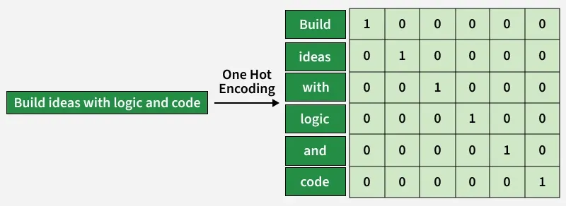

이렇게 하니 이제 앞의 문제들이 해결된 것처럼 보이네요.

- 모든 벡터의 길이가 vocab_size만큼이라 어떤 토큰도 더 큰 값으로 들어가지 않습니다.
- 어떤 두 토큰이든 거리가 똑같습니다. vocab 등록 순서와 상관없이 모든 토큰이 같은 간격으로 떨어져 있으니, 가짜 관계가 생기지 않습니다.

하지만 이 공평함에는 대가가 있습니다.

- <u>**토큰의 의미가 담기지 않습니다**</u>. `빠르다`와 `신속하다`의 유사도, `빠르다`와 `느리다`의 유사도가 0으로 똑같습니다. 가짜 관계를 없애기 위해 진짜 관계까지 함께 포기한 셈입니다.
- <u>**벡터가 너무 큽니다**</u>. vocab_size가 32,000이면 토큰 하나를 표현하는 데 32,000칸이 필요하고, 그중 31,999칸이 0인 <u>**희소 벡터(sparse vector)**</u>가 되어버립니다.
- <u>**문장이나 문서를 하나의 벡터로 나타낼 수 없습니다**</u>. 토큰 4개짜리 리뷰는 32,000칸짜리 벡터 4개, 토큰 100개짜리 리뷰는 벡터 100개로 표현됩니다. 그저 정수 id를 0과 1로 이루어진 희소 벡터로 옮겨놓은 것과 사실상 같습니다. 우리가 자연어를 처리해서 궁극적으로 얻고자 하는 목적 중 하나는, 리뷰 감성분석과 같이 리뷰를 보고, 그 리뷰가 <u>**긍정적인 리뷰인지, 부정적인 리뷰인지 판단**</u>해서 우리 제품의 전체적인 평가가 어떻게 이루어지고 있는지를 파악하는 것도 있을 수 있겠죠. 그런데 one-hot vector만으로는 리뷰와 리뷰의 감성을 구분할 수 없습니다.

### 3.1. 통계 기반 방식

#### 3.1.1. BoW (Bag of Words)

우선 세 번째 문제인, 문장이나 문서를 하나의 벡터로 나타낼 수 없다는 것부터 해결해보겠습니다. 리뷰 하나를 하나의 벡터로 나타내는 가장 간단한 방법은, <u>**리뷰에 나온 토큰들의 one-hot 벡터를 모두 더하는 것**</u>입니다.

![배송·빠르다·가격·저렴하다 네 토큰의 one-hot 벡터를 더해 BoW 벡터 [1, 1, 0, 1, 1, 0, 0, 0]을 만드는 모습](./image/bow-one-hot-sum.png)

위 이미지처럼, 더한 결과의 각 칸에는 그 <u>**토큰이 문서에 몇 번 나왔는지**</u>가 들어갑니다. 토큰의 순서는 버리고, 가방(bag)에 토큰(word)을 쏟아 넣은 뒤 종류별로 세는 것과 같다고 해서 <u>**Bag of Words(BoW)**</u>라고 부릅니다.

이제 BoW를 통해서 문장에 등장하는 토큰들의 빈도로 vocab_size만큼의 벡터를 문장(문서) 단위로 만들 수 있게 되었습니다!

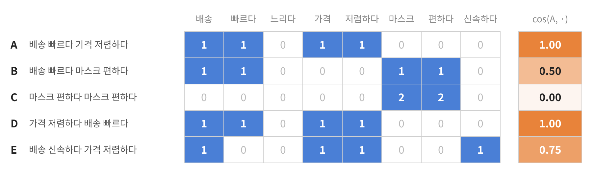

BoW에서 얻은 것은 분명합니다.

- 리뷰의 길이와 상관없이 <u>**모든 리뷰가 vocab_size만큼의 같은 길이 벡터**</u>가 됩니다. 이제 분류 모델에 바로 넣을 수 있습니다.
- 리뷰끼리 비교할 수 있습니다. 토큰을 두 개 공유하는 A(“배송 빠르다 가격 저렴하다”)와 B(“배송 빠르다 마스크 편하다”)는 0.5, 하나도 공유하지 않는 A(“배송 빠르다 가격 저렴하다”)와 C(“마스크 편하다 마스크 편하다”)는 0입니다. 토큰 하나하나는 서로 아무 관계가 없었지만, <u>**어떤 토큰들이 함께 나왔는지를 통해 문서 사이의 유사도**</u>가 생긴 것입니다.
- C처럼 같은 토큰이 여러 번 나오면 그 칸의 값이 커져서, <u>**문서에서 얼마나 강조된 토큰인지**</u>도 드러납니다.

하지만 그림의 D(”가격 저렴하다 배송 빠르다”)와 E(”배송 신속하다 가격 저렴하다”)에서 BoW의 한계도 보입니다. D는 A와 순서만 다른데 벡터가 완전히 같습니다. 그래서 <u>**"가격은 저렴하지 않고 배송이 빠르다"와 "가격은 저렴하고 배송이 빠르지 않다"처럼, 같은 토큰을 쓰지만 순서 때문에 뜻이 반대가 되는 리뷰를 구분할 수 없습니다**</u>. 또 E는 A와 뜻이 같은데도 유사도가 0.75에 그칩니다. BoW도 결국 토큰 단위로는 one-hot을 쓰기 때문에, `빠르다`와 `신속하다`가 비슷하다는 사실을 여전히 모르기 때문입니다.

#### 3.1.2. TF-IDF

BoW에는 한 가지 문제가 더 있습니다. 상품 리뷰라면 `배송`, `가격` 같은 토큰은 거의 모든 리뷰에 나옵니다. 이런 토큰은 리뷰마다 다 들어 있으니 리뷰를 구별하는 데 별 도움이 되지 않는데, BoW에서는 다른 토큰과 똑같이 카운트되고 유사도에도 똑같이 기여합니다. 반대로 `느리다`, `신속하다`처럼 몇몇 리뷰에만 나오는 토큰은 그 리뷰의 특징을 잘 보여 주는데도 똑같이 1로 카운트됩니다.

<u>**TF-IDF(Term Frequency - Inverse Document Frequency)**</u>는 이 문제를 토큰마다 가중치를 다르게 주는 방식으로 해결합니다.

- **TF(Term Frequency)**: 한 문서 안에서 자주 나온 토큰일수록 그 문서에서 중요합니다. <u>**토큰이 문서에서 등장한 횟수**</u>로, BoW 벡터가 곧 TF입니다.
- **IDF(Inverse Document Frequency)**: 하지만 여러 문서에 두루 나오는 토큰이라면 중요도를 깎습니다. <u>**토큰이 나온 문서 수를 DF(Document Frequency)**</u>라고 할 때, 전체 문서 수 N을 DF로 나눈 값에 log를 씌운 것이 IDF(Inverse Document Frequency)입니다.

$$
TF-IDF(t,d)=TF(t,d) \times \log{\frac{N}{DF(t)}}
$$

모든 문서에 나오는 토큰, 즉 어떤 리뷰든 공통적으로 등장하는 토큰은 $\frac{N}{DF} = 1$이라 IDF가 $\log{1} = 0$이 되고, <u>**드물게 나오는 토큰일수록 IDF가 커집니다**</u>.

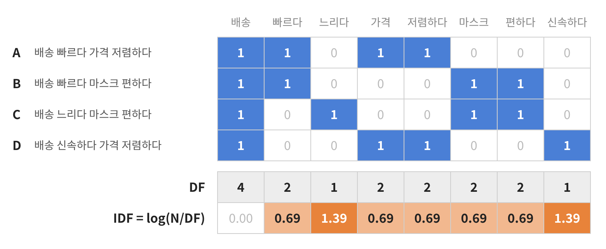

- `배송`은 4개 리뷰에 모두 나와서 $DF = 4$, $IDF = \log{(\frac{4}{4})} = 0$입니다.
- `느리다`와 `신속하다`는 한 리뷰에만 나와서 $IDF = \log(\frac{4}{1}) ≈ 1.39$로 가장 큽니다.

이렇게 구한 $IDF$를 각 리뷰의 $TF$에 곱하면 <u>**TF-IDF 벡터**</u>가 됩니다.

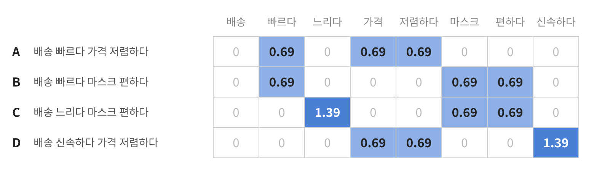

`배송`의 TF-IDF가 모든 문서에서 0이 되면서, 어디에나 나오는 토큰 때문에 부풀려졌던 유사도가 가라앉았습니다. A와 B는 BoW에서 `배송`과 `빠르다` 두 토큰을 공유해 0.50의 유사도를 보였지만, TF-IDF에서는 의미 있는 공통점인 `빠르다`만 남아 0.33으로 내려간 걸 확인할 수 있습니다.

실제로는 직접 계산하기보다 `scikit-learn`의 `TfidfVectorizer`를 많이 사용합니다.

```py
from sklearn.feature_extraction.text import TfidfVectorizer
from sklearn.metrics.pairwise import cosine_similarity

reviews = ['배송 빠르다 가격 저렴하다',
           '배송 빠르다 마스크 편하다',
           '배송 느리다 마스크 편하다',
           '배송 신속하다 가격 저렴하다']

vec = TfidfVectorizer(token_pattern=r'\S+')   # 이미 토큰화된 문장이라 가정, 공백으로만 나눔
X = vec.fit_transform(reviews)

print(vec.get_feature_names_out())
print('IDF:', vec.idf_.round(2))
print(cosine_similarity(X).round(2))

>>> ['가격' '느리다' '마스크' '배송' '빠르다' '신속하다' '저렴하다' '편하다']
>>> IDF: [1.51 1.92 1.51 1.   1.51 1.92 1.51 1.51]
>>> [[1.   0.42 0.12 0.65]
>>>  [0.42 1.   0.65 0.12]
>>>  [0.12 0.65 1.   0.11]
>>>  [0.65 0.12 0.11 1.  ]]
```

숫자가 앞의 계산과 조금 다른 것은 `TfidfVectorizer`가 기본으로 IDF를 다음과 같이 계산하기 때문입니다.

$$
IDF = log(\frac{(1 + N)}{(1 + DF)}) + 1
$$

분모가 0이 되는 것을 막고(smoothing), 모든 문서에 나오는 `배송`도 가중치가 완전히 0이 되지 않고 가장 작은 값(1.0)을 갖도록 한 것입니다. 계산 방식은 조금 달라도, 흔한 토큰일수록 가중치가 작아진다는 결과는 같습니다.

#### 통계 기반 방식의 한계

TF-IDF로 흔한 토큰의 문제는 해결했지만, 유사도를 다시 보면 이상한 점이 있습니다.

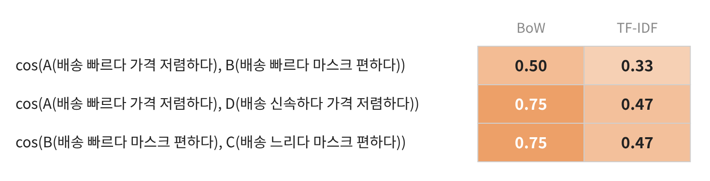

A와 D는 `빠르다`와 `신속하다`만 다른, 사실상 같은 뜻의 리뷰입니다. 이런 리뷰는 유사도가 1에 가깝게 나와야겠죠. 그런데 TF-IDF 벡터 유사도는 0.47입니다. B와 C는 `빠르다`와 `느리다`만 다른, 정반대 뜻의 리뷰입니다. 그런데 이 쌍도 TF-IDF 벡터 유사도는 0.47로 똑같습니다.

이유는 3장 처음에 보았던 <u>**one-hot의 한계 그대로**</u>입니다. BoW와 TF-IDF는 문서를 토큰 칸의 합으로 표현할 뿐, 각 토큰의 칸은 여전히 one-hot처럼 서로 독립되어 있습니다. 그래서 <u>**모델 입장에서 `빠르다`와 `신속하다`의 관계는 `빠르다`와 `느리다`의 관계와 똑같이 "다른 토큰"**</u>일 뿐입니다. vocab_size만큼 길고 대부분이 0인 희소 벡터라는 점도 그대로입니다.

결국 필요한 것은 문서가 아니라 <u>**토큰 하나하나에 의미를 담는 것**</u>입니다. `빠르다`와 `신속하다`는 가깝게, `빠르다`와 `느리다`는 다르게 놓이는 어떠한 벡터가 있으면 이 문제를 해결할 수 있을 것 같습니다.

### 3.2. 추론 기반 방식

토큰 하나하나에 의미를 담으면서, 비슷한 의미의 토큰은 비슷한 벡터를, 반대 의미의 토큰들은 서로 반대의 벡터를 담을 수 있도록 하려면 어떻게 해야 할까요?

우선 토큰 수준으로 임베딩을 할 수 있어야겠습니다. 토큰을 임베딩한다는 건 무슨 의미일까요? 그 전에 우선 MBTI로 사람의 성격을 나타내는 걸 예시로 한번 봐보겠습니다.

제 MBTI 검사 결과가 <strong>I 40%, S 30%, T 60%, P 20%</strong>로 나왔다고 해봅시다.

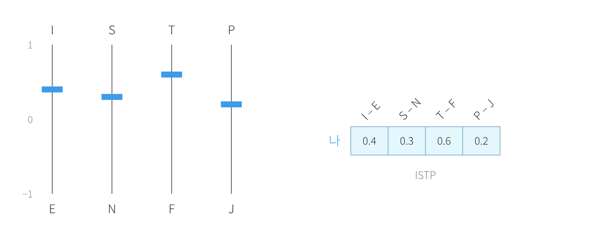

우리가 눈으로 보기 쉽게 하기 위해서 마지막 P는 지우고 3차원으로 나타내볼게요.

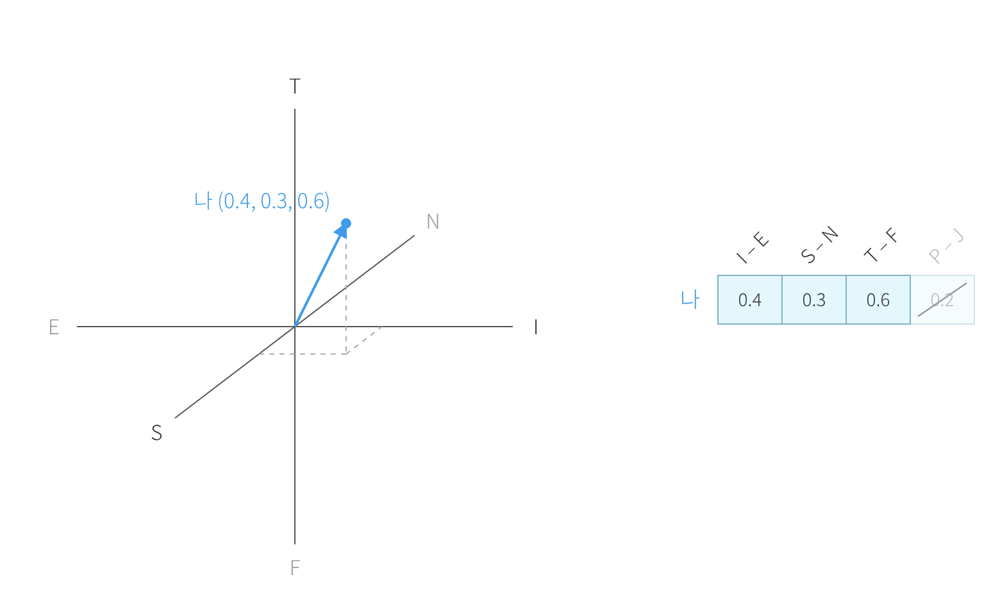

어떤가요? 이게 바로 사람의 성격을 벡터로 임베딩한 것입니다. MBTI는 사람의 성격을 4차원으로 규정하지만, 사람의 성격을 결정하는 특성(feature)은 이것보다 훨씬 더 많겠죠? 그러면 방금 했던 것과 마찬가지 방식으로 100차원이든 200차원이든 한 사람을 벡터로 나타낼 수 있습니다.

이제 벡터로 사람을 나타내는 게 왜 중요한지 알아볼게요. 만약 제가 버스에 치여서 응급실에 실려갔다고 해볼게요. 그러면 이제 제가 맡은 일을 대신 해줄 사람을 찾아야 하는데, 특히 저랑 성격이나 특징이 제일 비슷한 사람을 찾는 게 좋겠죠? 우리가 방금 위에서 사람을 벡터로 표현해놨기 때문에, 서로 다른 두 사람의 성격을 벡터 간의 유사도로 비교할 수 있습니다. cosine similarity로 벡터 간의 유사도 점수를 매길 수 있습니다.

$$
\text{Cosine Similarity}(A, B) = \frac{A \cdot B}{\|A\| \|B\|} = \frac{\sum_{i=1}^{n} A_i B_i}{\sqrt{\sum_{i=1}^{n} A_i^2} \sqrt{\sum_{i=1}^{n} B_i^2}}
$$

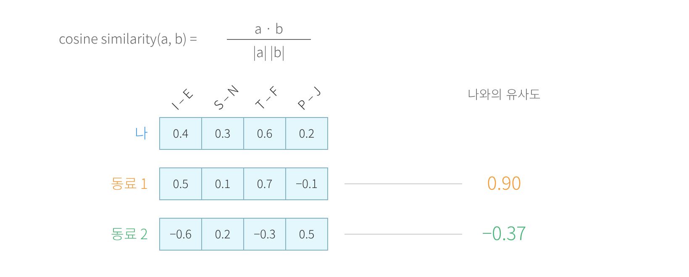

즉, 이렇게 벡터로 사람을 표현함으로써 다음 두 가지를 얻을 수 있습니다.

1. 사람의 특징을 수치로 정량화해 <u>**계산을 편하게**</u> 할 수 있다.
2. 서로 다른 <u>**두 벡터의 유사도**</u>를 손쉽게 계산할 수 있다.

즉, <u>**토큰**</u>도 사람처럼 특징을 정의하고, <u>**공간(feature space)에 투영**</u>해서 토큰을 벡터화할 수 있겠죠?

#### 3.2.1. Word2Vec

<u>**토큰의 특징을 어떻게 정의할 수 있을까**</u>에 대해 대답한 이론은 바로 <u>**분포 가설(Distributional Hypothesis)**</u>으로, “비슷한 문맥에서 쓰이는 단어들은 비슷한 의미를 가진다”는 이론입니다. 이런 관점은 언어학자 J. R. Firth의 <em>"단어는 함께 쓰이는 말들을 보면 알 수 있다(You shall know a word by the company it keeps)"</em>와 Zellig Harris의 분포 이론(Distributional Semantics)에서 출발했습니다.

분포 가설에 기반한 임베딩 알고리즘 중 하나로 <u>**Word2Vec**</u>이 있으며, 두 가지 학습 방식이 있습니다.

- **CBOW(Continuous Bag of Words)**: context word들을 보고 center word를 맞히는 방식
- **Skip-gram**: center word 하나를 보고 context word들을 맞히는 방식

> Word2Vec을 다루는 논문과 강의에서는 관습적으로 가운데 토큰을 center word, 그 주변의 토큰을 context word라고 부릅니다. ‘word’라는 이름 때문에 ‘자연어 단어’라고 오해할 수도 있지만, 여기서의 word는 token과 같은 의미입니다.

이 글에서는 실제로 더 많이 쓰이는 **Skip-gram**과, Word2Vec을 대용량 corpus에서도 빠르게 학습할 수 있게 만든 핵심 트릭인 **Negative Sampling**을 함께 살펴보겠습니다.

영어 리뷰 문장 `the mask arrived fast and fits well`을 예로 들어 보겠습니다. 참고로, Word2Vec이 사용하는 핵심 개념에는 <u>**window_size**</u>라는 게 있는데, <u>**center word를 기준으로 window_size만큼 주변에 있는 토큰들과 유사도를 올려나가겠다**</u>는 의미입니다. 즉, “함께 쓰이는 토큰”의 기준을 window_size만큼으로 한정하겠다는 의미이죠.

아래 사진과 같이 만약 window_size = 2라면, center word인 fast를 기준으로 앞의 토큰 2개, 뒤의 토큰 2개를 context word로 치고 이 토큰들이 유사한 벡터를 갖도록 임베딩을 만들겠다는 의미입니다.

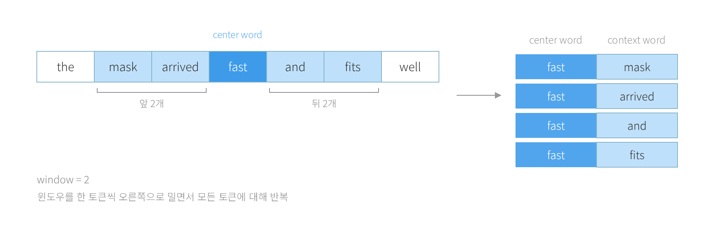

이렇게 하면 center word 하나에서 `(fast, mask)`, `(fast, arrived)`, `(fast, and)`, `(fast, fits)` 네 개의 학습 쌍이 나옵니다. 윈도우를 한 토큰씩 오른쪽으로 밀면서 말뭉치 전체에 반복해서 수많은 학습 쌍을 만듭니다. 여기서 모델의 목적은 center word `fast`가 주어졌을 때 context word로 `mask`, `arrived`, `and`, `fits`가 올 확률을 올리는 것이고 이를 식으로 표현하면 다음과 같습니다.

$$
P(o | c)
\\ \text{where, o: context word, c: center word}
$$

#### 기본적인 모델 아키텍처: Softmax 사용

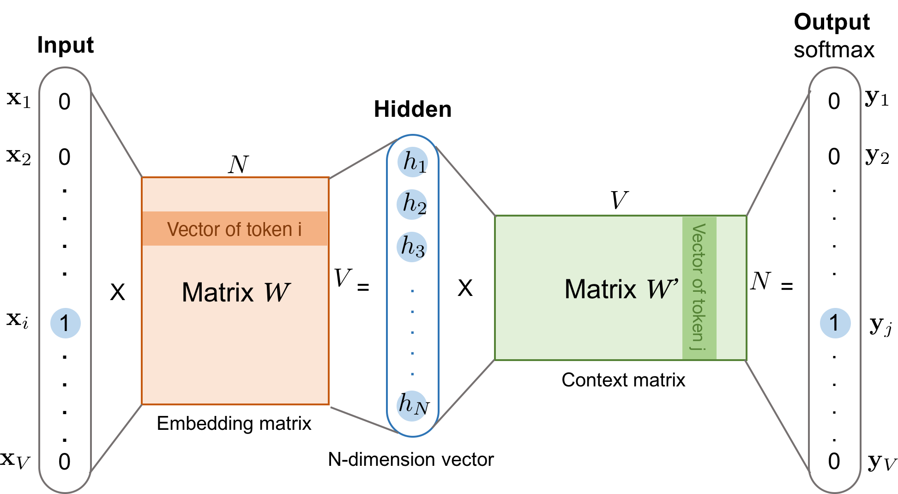

모든 토큰은 두 개의 Embedding Matrix에 벡터를 하나씩 가지고, 각 벡터는 해당 토큰이 center word일 때와 context word일 때를 담당합니다.

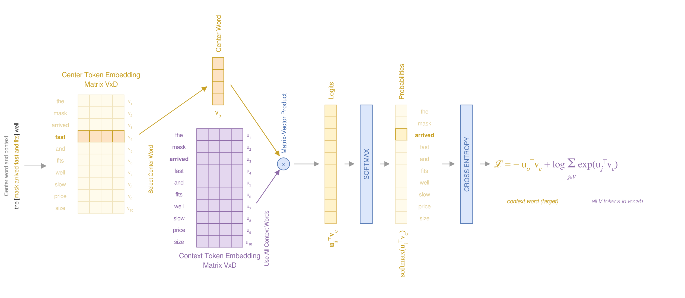

1. Embedding Matrix W에서 center word `fast`에 해당되는 행 `v`를 꺼냅니다.
2. Embedding Matrix W’의 **모든 행**과 내적해 점수 V개를 만들어 vocab의 각 토큰과의 유사도를 계산합니다.
3. softmax로 V개의 점수를 확률로 바꿉니다.
4. 정답 `arrived`의 확률에 −log를 취해 손실(Cross Entropy)을 구합니다.

   $$
   J(W) = -\frac{1}{T}\sum_{t=1}^{T}\sum_{-m \le j \le m,\ j \ne 0} \log P(w_{t+j} \mid w_t)
   $$

5. 이제 이 손실이 줄어들도록 모든 학습 쌍에 대해서 1\~4단계를 반복하고, 여러 epoch을 돌립니다.
6. 그러면 Embedding Matrix W, W’이 가까이에 있는 토큰의 벡터 유사도가 올라가는 방향으로 조금씩 수정되며, 최종적으로는 같이 자주 등장한 토큰들의 벡터는 밀집되어 있는 형태가 됩니다.
7. Embedding Matrix W를 최종 Embedding Matrix로 사용합니다.

하지만 이 방식에는 치명적인 단점이 있습니다. 바로 손실을 계산할 때 계산비용이 너무 많다는 것입니다.

$J(W)$는 수학적으로는 깔끔합니다. 모든 확률이 0과 1 사이이고 합이 1이 되니까요. 하지만 문제는 **분모**입니다. 정답 토큰 하나의 확률을 구하려면 <u>**vocab의 모든 토큰에 대해 점수를 계산**</u>하고, 그 <u>**합으로 나눠**</u>야 하고, <u>**기울기도 전부**</u>에 흘려보내야 합니다.

- vocab이 10만 개면 **학습 쌍 하나마다 내적 10만 번**을 해야 합니다.
- Skip-gram은 center word 하나에서 context word 수만큼(window = 5면 최대 10개) softmax를 계산하므로, 비용이 vocab 크기와 윈도우 크기에 함께 비례해서 커집니다.
- 정작 우리가 관심 있는 건 `(fast, arrived)`의 연결을 강하게 하는 것뿐인데, <u>**나머지 9만 9천여 개 토큰의 확률까지 매번 다시 맞추느라 계산의 대부분이 낭비**</u>됩니다.

데이터가 많을수록 임베딩이 좋아지는데, 대용량 corpus로 학습시킬 때는 vocab_size가 필연적으로 많아집니다. 이 때문에 softmax 층의 계산 효율이 너무 나빠져 학습이 지나치게 오래 걸리는 단점이 있었습니다. 그래서 나온 방법이 <u>**Negative Sampling**</u>입니다.

#### Negative Sampling: 연산 효율화

Negative Sampling의 핵심은 softmax를 빠르게 계산하는 획기적인 아이디어가 아니라, 애초에 문제의 풀이 방식 자체를 바꾸는 접근입니다.

- 기존: "`fast`의 이웃은 vocab 10만 개 중 무엇인가?" → **다중 분류**(V개 중 하나)
- Negative Sampling: "`fast`와 `arrived`는 진짜 이웃인가?" → **이진 분류**(예 / 아니오)

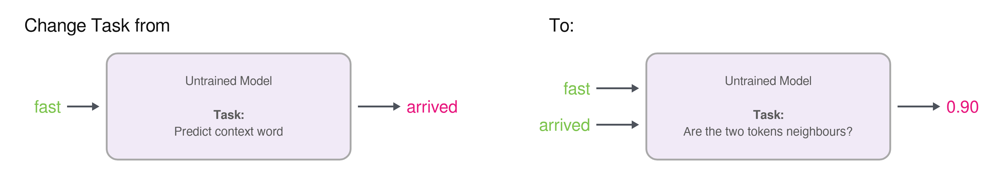

이렇게 문제 접근 방식을 바꾸면, 데이터셋부터 다시 바꿔야 합니다. 즉, 학습 쌍을 놓고, 그 쌍들이 이웃한다는 의미의 라벨을 달아주는 방식이죠.

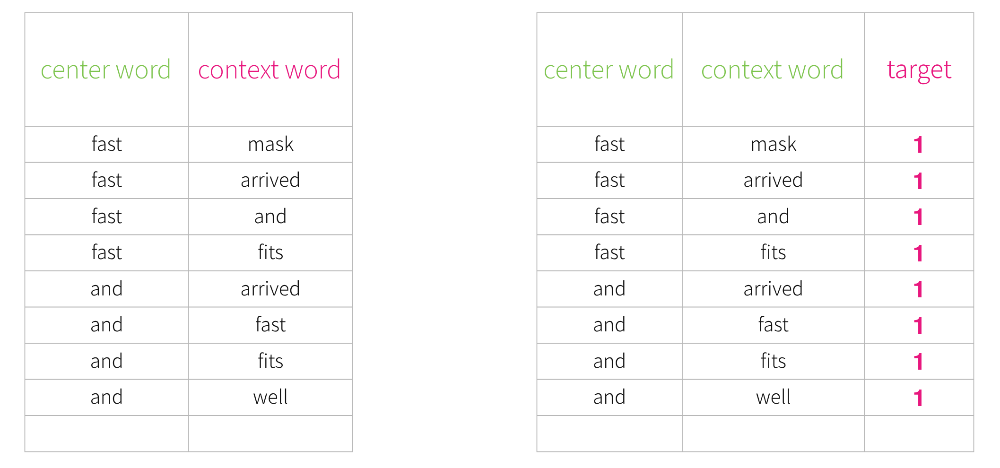

그런데 corpus에서 뽑은 쌍은 전부 진짜 이웃이라 정답이 모두 1입니다. 이러면 모든 쌍에 "예"라고만 답하는 모델도 만점을 받고, 아무것도 배우지 못합니다. 그래서 진짜 쌍(**positive**) 하나마다 가짜 쌍(**negative**)을 K개씩 만들어 정답 0을 붙여 줍니다. 가짜 쌍은 center word는 그대로 두고, context word 자리의 토큰만 vocab에서 무작위로 뽑아 바꾼 것입니다.

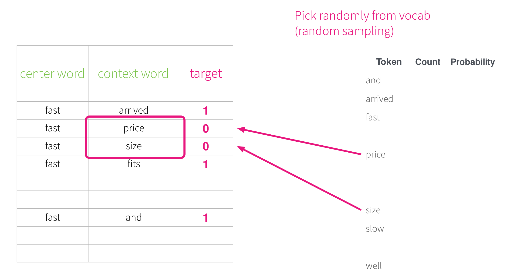

이제 모델이 푸는 문제가 <u>**"이 쌍은 실제 텍스트에서 왔나, 무작위 노이즈인가?"라는 분류 문제**</u>가 됐습니다. 이렇게 Negative Sampling과 Skip-gram을 쓰는 학습 방식을 <u>**SGNS(Skip-Gram with Negative Sampling)**</u>라고 부릅니다.

#### SGNS(Skip-Gram with Negative Sampling)

SGNS의 아키텍처는 이전에 Softmax를 썼을 때와 거의 비슷하지만, 두 가지가 달라졌습니다.

1. Context 행렬에서 **필요한 행만 꺼내고**,
2. 마지막의 softmax 자리에 **sigmoid**가 들어갑니다.

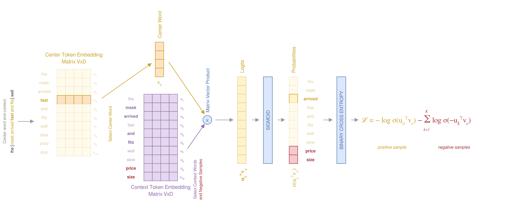

1. **center word 벡터 꺼내기**: Embedding Matrix W에서 `fast`의 행 `v`를 가져옵니다.
2. **context word + negative 벡터 꺼내기**: Embedding Matrix W’에서 진짜 context word `arrived`와, 무작위로 뽑은 `price`, `size`의 행만 가져옵니다. 나머지 행은 이번 스텝에서 아예 쓰이지 않습니다.
3. **내적**: v와 꺼낸 행 K+1개를 각각 내적해 <u>**점수 K+1개**</u>를 얻습니다.
4. **sigmoid**: 각 점수를 0\~1 사이 값으로 바꿔 각 쌍의 "진짜 이웃일 확률"을 계산합니다. softmax와 달리 다른 토큰들에 확률이 나눠지지 않고, 쌍마다 독립적으로 판단합니다.
5. **binary cross entropy**: target(positive는 1, negative는 0)과 비교해 손실을 계산합니다.

   $$
   \mathcal{L}(c, o) = -\log \sigma(u_o^\top v_c) \; - \; \sum_{k=1}^{K} \log \sigma(-u_{w_k}^\top v_c)\\ w_k\text{: negative로 뽑힌 토큰}
   $$

   - **첫 번째 항 (positive)**: 진짜 context word o와의 내적을 키워서 $\sigma$를 1에 가깝게 만듭니다.
   - **두 번째 항 (negative)**: 무작위 토큰들과의 내적은 줄여서 $\sigma$를 0에 가깝게 만듭니다. $σ(−x) = 1 − σ(x)$이므로 $log σ(−uᵀv)$는 "가짜 쌍일 확률"의 log입니다.

   즉 이 식은 target이 1(positive)과 0(negative)인 **binary cross entropy**를 K+1개 쌍에 대해 더한 것입니다.

쌍 하나를 학습할 때 필요한 건 positive 1개와 negative K개, 총 **K+1번의 내적**뿐입니다. K = 10이면 vocab_size가 10만이든 100만이든 내적은 11번만 하면 됩니다. 실제로는 positive 하나당 negative 5\~20개 정도면 좋은 임베딩을 얻을 수 있습니다. 이 덕분에 Word2Vec을 수십억 토큰 규모의 corpus에서도 학습할 수 있게 되었습니다.

학습이 끝나면 W’ 행렬은 버리고, W **행렬의 각 행을 그 토큰의 임베딩**으로 씁니다.

#### Gensim으로 직접 사용해보기

실제로는 직접 구현하기보다 `gensim`의 `Word2Vec`을 많이 씁니다.

```py
from gensim.models import Word2Vec

reviews = [
    ['the', 'mask', 'arrived', 'fast', 'and', 'fits', 'well'],
    ['delivery', 'was', 'fast', 'and', 'cheap'],
    ['delivery', 'was', 'slow', 'but', 'cheap'],
    ['the', 'mask', 'arrived', 'quick', 'and', 'fits', 'well'],
]

model = Word2Vec(
    sentences=reviews,
    vector_size=100,  # 임베딩 차원 D
    window=5,         # 앞뒤로 볼 context word 수
    sg=1,             # 1 = Skip-gram, 0 = CBOW
    negative=5,       # negative 샘플 수 K (0이면 negative sampling 안 씀)
    hs=0,             # 1이면 hierarchical softmax 사용
    ns_exponent=0.75, # negative 샘플링 분포의 지수 (3/4제곱)
    min_count=1,      # 이보다 적게 나온 토큰은 vocab에서 제외
    epochs=50,
    seed=42,
)

print(model.wv['fast'].shape)
print(model.wv.most_similar('fast', topn=3))

>>> (100,)
>>> [('quick', 0.314...), ('arrived', 0.162...), ('cheap', 0.026...)]
```

| 인자 | 기본값 | 의미 |
| --- | --- | --- |
| `vector_size` | 100 | 임베딩 차원. 클수록 더 세밀한 표현이 가능하지만 데이터가 더 많이 필요합니다. 보통 100\~300으로 맞춥니다. |
| `window` | 5 | 작으면(2\~15) 바꿔 쓸 수 있는 토큰이 가까워지고, 크면(15\~50) 같은 주제의 토큰이 가까워집니다 |
| `sg` | 0 | 1이면 Skip-gram, 0이면 CBOW |
| `negative` | 5 | negative 샘플 수 K |
| `ns_exponent` | 0.75 | negative 샘플링 분포의 지수 |
| `min_count` | 5 | 드문 토큰을 vocab에서 빼는 기준 |

**윈도우 크기(Window Size)는 토큰이 '어떤 종류의 의미적 관계'를 학습할지를 결정하는 가장 중요한 하이퍼파라미터**입니다.

1. <u>**윈도우 크기가 작으면: 2\~15**</u>

   center word 바로 앞뒤에 붙는 **조사, 관사, 동사, 형용사 등 문법적 구조와 직접적인 수식 관계**를 주로 보게 됩니다.

   - **핵심 특징**: 문장 내에서 **자리를 맞바꾸어도 문법적으로 자연스러운 토큰들**이 서로 가까워집니다.
   - **즉, 반의어의 벡터가 가까워질 수도 있습니다.**
     - 예문 1: *"This movie is **good**."*
     - 예문 2: *"This movie is **bad**."*
     - 윈도우 크기가 작으면 `good`과 `bad` 모두 앞에는 `is`, 뒤에는 마침표(`.`)라는 **완벽히 동일한 context word**를 가집니다. 모델 입장에서는 두 토큰의 문맥이 100% 같으므로 벡터 공간에서 두 토큰을 매우 가깝게(높은 유사도) 배치합니다.
   - **활용 분야**: 품사 태깅, 문법 교정, 동의어/유의어 사전 구축 등 <u>**토큰의 기능적·구문적 역할**</u>이 중요한 태스크에 유리합니다.
2. <u>**윈도우 크기가 크면: 15\~50 이상**</u>

   문법적인 어순보다는 **문단이나 문서 전체의 주제(Topic)를 구성하는 토큰들**을 함께 보게 됩니다.

   - **핵심 특징**: 품사가 다르거나 문장에서 대체할 수 없더라도, **같은 상황이나 주제에 함께 등장하는 토큰들**이 가까워집니다.
     - 예를 들어, '병원'이라는 토큰 주변에 넓게 보면 '의사', '진료하다', '아프다', '약국', '청진기' 같은 토큰들이 자주 등장합니다. 이들은 문법적으로 서로 대체할 수 없지만, **'의료'라는 동일한 도메인(주제)으로 묶입니다.**
   - **활용 분야**: 문서 분류, 감성 분석, 추천 시스템, 정보 검색 등 <u>**글의 전반적인 맥락이나 도메인 지식**</u>을 파악해야 하는 태스크에 유리합니다.

#### 3.2.2. FastText

FastText의 동작을 한 문장으로 요약하면, Tokenizer가 할 일을 Embedder가 한다고 요약할 수 있습니다. Word2Vec의 경우, Tokenizer가 예쁘게 잘라놓은 토큰을 그대로 활용해서 center word와 context word의 벡터가 가까워지게 학습하죠. 그 결과 Tokenizer가 만들어놓은 vocab에 1:1 대응되는 lookup table(= Embedding matrix)가 얻어지는 거였죠.

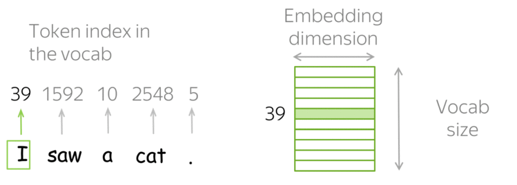

이 방식에는 단점이 있습니다.

1. **OOV (Out of Vocabulary)**

   Word2Vec에서는 하나의 토큰에 하나의 embedding만 매칭됩니다. 따라서 학습 때 vocab에 없던 토큰이 현실에서 들어오면 그건 `UNK`로 처리될 수밖에 없다는 단점이 있습니다. 예를 들어, 학습 시에 tensor와 flow는 vocab에 있어서 그에 대한 벡터는 있더라도, 테스트나 현실에서 tensorflow라는 토큰이 주어졌을 때 이와 1:1 매칭되는 임베딩이 없으므로 이건 UNK 처리되는 거죠.

   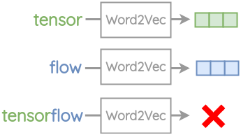

2. **Morphology**

   Word2Vec에서는 토큰과 임베딩을 1:1로 생성하기 때문에 접미사만 다른 단어가 각각 별개의 토큰이 되면, 이 모든 토큰에 대해서 서로 다른 임베딩을 부여할 수밖에 없습니다. 이는 비효율적이겠죠.

   

   > 🔗 물론 이 작업은 충분히 토크나이저가 수행할 수 있습니다. 형태소 단위 토크나이저나 데이터 기반 토크나이저가 충분히 동사와 접미사를 구분해 토크나이징해서 Word2Vec에서도 Morphology 문제를 충분히 다룰 수 있긴 합니다.

하지만 FastText는 동작이 다릅니다. Word2Vec과 비슷하게 이웃 토큰들의 벡터가 유사하게 학습되기는 하지만, Tokenizer가 잘라놓은 토큰을 FastText 내부에서 <u>**한 번 더 잘라서 더 세밀한 단위로 쪼개서 각각에 벡터를 부여**</u>하고, 이와 함께, 이 조각 벡터들을 조합해서 Tokenizer가 만들어놓은 vocab에 1:1 대응되는 lookup table을 같이 최종 결과로 내어줍니다!

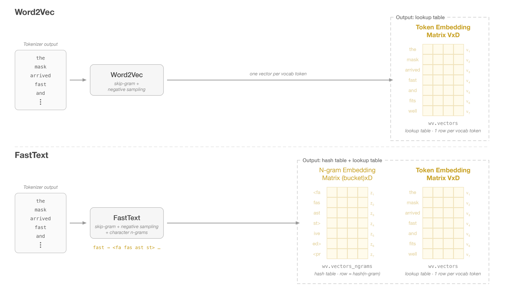

이를 통해 <u>**토큰의 내부 구조를 사용**</u>해서 skip-gram으로부터 얻어지는 vector representation을 더 풍부하게 가져갈 수 있게 되었습니다.

#### 1. Sub-word generation

토큰 `eating`이 있으면 앞뒤에 경계 기호를 붙여 `<eating>`로 만들고,


길이 3\~6의 character n-gram을 뽑습니다 (기본값 `minn=3`, `maxn=6`).


| **Token** | **Length(n)** | **Character n-grams** |
| --- | --- | --- |
| eating | 3 | &lt;ea, eat, ati, tin, ing, ng> |
| eating | 4 | &lt;eat, eati, atin, ting, ing> |
| eating | 5 | &lt;eati, eatin, ating, ting> |
| eating | 6 | &lt;eatin, eating, ating> |

위 예시만 봐도 `eating`이라는 토큰 하나가 18개로 분리되었으니, vocab에 있는 모든 토큰을 이런 방식으로 쪼개면 그 수가 아주 많아지겠죠? 그래서 lookup의 효율성과 메모리 효율성을 위해서 <u>**hash table**</u>을 활용해서 이 n-gram들을 저장합니다.

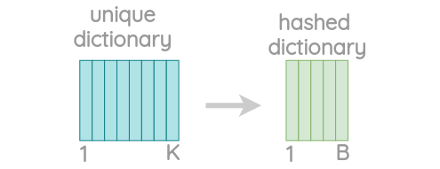

이 각각의 n-gram에 대해서 모두 임베딩을 학습하는 게 아니라, B개만큼의 n-gram에만 임베딩을 학습합니다. 여기서 B는 해시 테이블의 사이즈(Bucket size)를 의미하고, 논문에서는 200만을 사용했습니다.

각각의 character n-gram은 1부터 B 사이의 정수로 해시됩니다. 그래서 서로 다른 character n-gram이 같은 행을 쓰는 충돌(collision)이 생길 수는 있지만, 그냥 무시한다고 하네요. 논문에서는 FNV-1a 함수를 통해서 캐릭터 시퀀스를 정수값으로 해시하는 데 사용했습니다.


중요한 점은 n-gram 행렬을 모든 토큰이 함께 쓴다는 것입니다. eat, eating, eaten은 서로 다른 토큰이지만 `<eat`이라는 같은 n-gram을 공유할 수 있게 되었습니다.

#### 2. Skip-gram with negative sampling

여기는 Word2Vec과 학습 방법이 거의 유사합니다. 단, center word를 꺼낼 때 hash bucket에서 character n-gram을 꺼내서 합(실제 구현에서는 평균)해서 사용한다는 점, 그리고 negative sample을 미리 만들어놓지 않고 기존 vocab에서 무작위로 뽑는다는 점만 다릅니다.

Word2Vec에서 계속 들었던 예시인 “The mask arrived fast and fits well” 예문에서 `fast`가 center word, `window_size=2`인 상태로 한 번 예시를 들어보겠습니다.

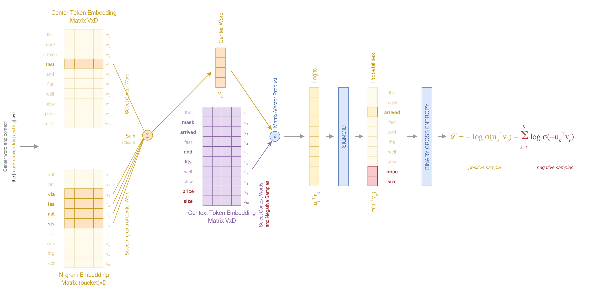

1. **n-gram 벡터 꺼내고 합치기**: center word인 fast의 벡터를 구하기 위해 hash bucket에서 `<fa`, `fas`, `ast`, `st>`, `<fas`, `fast`, `ast>`, `<fast`, `fast>`, `<fast>`를 찾고 Center Token Embedding Matrix에서 찾은 `fast`를 모두 합치거나 평균 내서(논문은 합, 실제 구현은 평균) `fast`라는 한 토큰의 벡터를 구합니다.
2. **context word, negative sample 꺼내기**: 실제로 이웃한 context word는 n-gram들을 합치거나 하는 방식으로 구하지 않고, Context Token Embedding Matrix(VxD)에서 바로 꺼냅니다. 그리고 negative sample은 토큰의 등장 빈도를 0.75제곱한 값에 비례하는 분포(`ns_exponent=0.75`)에 따라 같은 Context Token Embedding Matrix(VxD)에서 무작위로 추출합니다.
3. **내적 → sigmoid**: v와 꺼낸 행 K+1개를 각각 내적하고, sigmoid로 각 쌍이 "진짜 이웃일 확률"을 구합니다.
4. **binary cross entropy**: target(positive는 1, negative는 0)과 비교해 손실을 계산합니다. 식도 SGNS와 같습니다.

   $$
   \mathcal{L}(c, o) = -\log \sigma\Big(u_o^\top \sum_{g \in G_c} z_g\Big) \; - \; \sum_{k=1}^{K} \log \sigma\Big(-u_{w_k}^\top \sum_{g \in G_c} z_g\Big)
   $$

5. **업데이트**: 기울기는 v를 만든 행 모두에 똑같이 흘러갑니다. 그래서 `fast`를 학습하면 `<fa`, `ast` 같은 n-gram을 가진 다른 토큰(`faster`, `last` 등)의 벡터에도 영향을 주게 됩니다.

학습이 끝나고 나서는 vocab 토큰마다 (Center Token Embedding Matrix\[해당 토큰\] + n-gram Embedding Matrix\[그 토큰의 n-gram들\]) ÷ (n-gram 수 + 1)을 계산해 새로운 제3의 행렬인 `wv.vectors(V × D)`에 미리 담아 둡니다(adjust_vectors). 이때, `Center Token Embedding Matrix`와 `n-gram Embedding Matrix`는 버리지 않고 남겨둡니다.

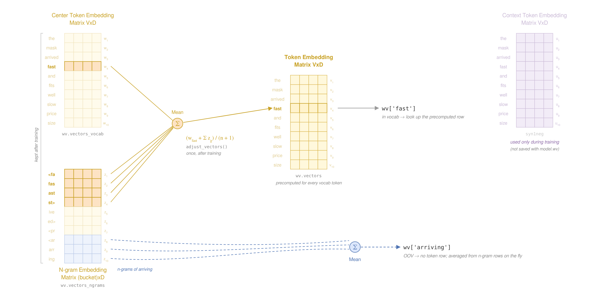

#### FastText의 장점: OOV에 강하다

실전에서는 다음과 같은 흐름으로 이어집니다.

1. **학습 때와 같은 토크나이저로** 토큰화합니다.
2. 토큰마다 벡터를 구합니다.

   - **Word2Vec**: vocab에 있으면 그 행을 가져오고, 없으면 `UNK`로 처리하거나 버립니다.
   - **FastText**: vocab에 있으면 `Token Embedding Matrix`에서 look-up, 없으면 `mean(n-gram 벡터만)`을 씁니다.

FastText는 학습에 사용했던 두 행렬, Center Token Embedding Matrix와 n-gram Embedding Matrix를 버리지 않고 남겨뒀으니, 이제 실전에서 이걸 활용해서 학습 시점에 보지 못한 토큰이 입력으로 들어와도, 기존에 알고 있던 n-gram 벡터들을 조합해서 처음 보는 토큰에 대한 벡터를 만들어낼 수 있는 거죠.

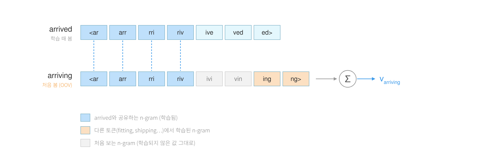

학습 corpus에 `arrived`는 있었지만 `arriving`은 한 번도 나오지 않았다고 해 보겠습니다.

- **Word2Vec**: Embedding Matrix에 `arriving` 행이 없으니 벡터를 만들 수 없고 `UNK` 처리됩니다.
- **FastText**: `arriving`을 n-gram으로 나누면 `<ar`, `arr`, `rri`, `riv`, `ivi`, `vin`, `ing`, `ng>`가 나옵니다. 이 중 `<ar`, `arr`, `rri`, `riv`는 `arrived`를 학습하면서 이미 배운 n-gram입니다. `ing`, `ng>`는 `fitting`, `shipping` 같은 다른 토큰에서 배웠을 수 있죠.

  하지만 `ivi`, `vin`은 학습 corpus의 어떤 토큰에도 나오지 않은 n-gram이니, gensim이 초기에 생성해놓은 무작위 벡터값을 그대로 사용합니다.

  이런 식으로 **n-gram 벡터만 더하고 평균 내서** `arriving`의 벡터를 만들 수 있습니다.

같은 원리로 **오타**(`arrivd`)나 **신조어**도 아는 n-gram이 있는 한 벡터를 얻을 수 있고, 철자가 비슷한 토큰 근처로 벡터가 생성됩니다.

#### FastText의 한계

n-gram을 공유한다는 것이 항상 좋은 것만은 아닙니다.

- **철자만 비슷하고 뜻은 다른 토큰도 가까워질 수 있습니다.** `price`와 `prize`는 `<pr`, `pri`를 공유해서, 문맥이 달라도 벡터가 어느 정도 가까워집니다. 반대로 `good`과 `great`처럼 뜻은 비슷하지만 철자가 다른 토큰은 n-gram의 도움을 받지 못합니다.
- **메모리와 속도 비용이 큽니다.** 토큰 행에 더해 n-gram bucket 행(기본 200만 개)까지 갖고 있어야 해서 모델 파일이 훨씬 커지고, 토큰마다 수십 개의 벡터를 더해야 해서 학습도 느립니다.
- **문맥을 보지 않는 정적 임베딩이라는 점은 그대로입니다.** `bank`가 은행이든 강둑이든 같은 벡터 하나를 갖는 건 Word2Vec과 똑같습니다.

#### FastText는 토크나이저 종류에 따라서 이점이 있을 수도, 없을 수도 있습니다.

예를 들어 학습 코퍼스에 "떡볶이를 먹었다"가 있었고, 실전에서 "로제떡볶이 먹었음"이 들어왔다고 해 봅시다. 아래 분할 결과는 이해를 돕기 위한 예시입니다.

1. **공백 / nltk 같은 단어 단위 (토큰 ≈ 단어)**

   vocab이 폭발적으로 커지고, 빈도가 낮은 토큰이 길게 꼬리를 이룹니다. `로제떡볶이`와 `먹었음`은 둘 다 vocab에 없습니다. Word2Vec은 UNK를 내지만, FastText는 `떡볶이`, `<먹었` n-gram으로 그럴듯한 벡터를 만듭니다. **이점이 가장 큰 경우**이고, 흔히 보는 Word2Vec과 FastText 비교가 바로 이 설정입니다.

2. **형태소 분석기 (Kiwi 등)**

   어미와 조사가 분리됩니다. `먹었음`은 `먹 / 었 / 음`으로 쪼개지고 셋 다 vocab에 있으니, 토큰 단위에서는 OOV가 크게 줄어 Word2Vec으로도 충분합니다. FastText에 남는 이점은 분석기 사전에 없는 신조어·고유명사·복합명사(예: `로제떡볶이`가 한 덩어리로 나오는 경우), 오타, 분석 오류 정도입니다. **이점은 중간 정도**입니다.

   참고로 `먹/VV`처럼 품사 태그를 붙여 학습하면 `/VV>` 같은 n-gram을 모든 동사가 공유하게 됩니다. 품사 정보 역할을 하기도 하고, 노이즈가 되기도 합니다.

3. **BPE / Unigram (데이터 기반 서브워드)**

   vocab 크기가 고정돼 있고, byte-level BPE나 byte fallback을 쓰면 **원리상 OOV가 생기지 않습니다**. FastText의 대표 장점이 사라지는 셈입니다. 게다가 토큰이 짧아서 n-gram이 추가로 주는 정보가 거의 없습니다. 예를 들어 `볶이`의 n-gram은 `<볶이`, `볶이>`, `<볶이>`뿐이라 사실상 토큰 자체와 같습니다.

   그래도 남는 이점이 두 가지 있습니다.

   - **표기만 다른 토큰끼리 정보를 나눔**: `▁happy`, `happy`, `▁Happy`는 서로 다른 ID지만 `app`, `ppy`를 공유합니다. 다만 토큰이 길 때만 해당되고, `▁먹`과 `먹`은 minn=3에서 겹치는 n-gram이 하나도 없습니다.
   - **vocab에는 있지만 드문 토큰**: 토크나이저를 학습한 코퍼스와 임베딩을 학습할 코퍼스가 다르면 이런 토큰이 생기는데, FastText가 조금 도와줍니다.

   비용은 커집니다. 3만 개짜리 vocab보다 훨씬 큰 200만 × d 버킷 행렬을 들고 다녀야 합니다. **이점이 작고, 비용 대비 효과도 애매한 경우**입니다.

   | 토크나이저 | 토큰 안에 남은 문자 정보 | 실전 토큰 OOV | FastText 이점 |
   | --- | --- | --- | --- |
   | 공백 / nltk | 많음 (굴절·조사 포함) | 자주 생김 | 큼 |
   | 형태소 (Kiwi) | 중간 | 미등록어·오타 정도 | 중간 |
   | BPE / Unigram | 적음 (짧은 조각) | 원리상 없음 | 작음 |

#### FastText와 서브워드 토크나이저는 같은 일을 어디서 하느냐 그 순서의 차이입니다

BPE와 FastText의 n-gram이 **같은 일을 다른 위치에서 하는 대체재**입니다.

|  | BPE + Word2Vec | 공백 + FastText |
| --- | --- | --- |
| 분해하는 곳 | 임베딩 전, 토크나이저에서 | 임베딩 내부에서 |
| 분할 방식 | 분할 하나, 조각끼리 안 겹침, 결정적 | 가능한 모든 n-gram, 겹침 |
| 문맥 예측 단위 / 윈도우 | 조각 (단어 기준으로는 윈도우가 짧아짐) | 단어 |
| 단어 벡터 | 없음 (조각을 합치는 건 사용자 몫) | 모델이 바로 줌 |
| OOV | 없음 | 없음 (n-gram으로 근사) |

그래서 FastText는 "학습 가능한, 겹쳐 쪼개는 서브워드 분해를 임베딩 층 안에 넣은 모델"로 볼 수 있습니다. 토크나이저가 이미 잘게 쪼개 놓았다면 FastText가 할 일이 거의 남지 않습니다. FastText를 원래 의도대로 쓰려면 **단어에 가까운 토큰을 넣고, 서브워드 처리는 FastText에 맡기는 것**입니다.

#### FastText 사용해보기

```py
from gensim.models import FastText, Word2Vec

reviews = [
    ['the', 'mask', 'arrived', 'fast', 'and', 'fits', 'well'],
    ['delivery', 'was', 'fast', 'and', 'cheap'],
    ['delivery', 'was', 'slow', 'but', 'cheap'],
    ['the', 'mask', 'arrived', 'quick', 'and', 'fits', 'well'],
]

w2v = Word2Vec(reviews, vector_size=100, window=5, sg=1, negative=5,
               min_count=1, epochs=50, seed=42)
ft = FastText(reviews, vector_size=100, window=5, sg=1, negative=5,
              min_count=1, epochs=50, seed=42,
              min_n=3, max_n=6)   # 3~6글자 n-gram 사용

print('arriving' in ft.wv.key_to_index)   # 학습 vocab에 있나?
print(ft.wv['arriving'].shape)            # 그래도 벡터는 만들 수 있다
print(ft.wv.most_similar('arriving', topn=3))

w2v.wv['arriving']                        # Word2Vec은?

>>> False
>>> (100,)
>>> [('arrived', 0.414...), ('well', 0.128...), ('fits', 0.123...)]
>>> KeyError: "Key 'arriving' not present"
```

`arriving`은 학습 vocab에 없는데도 FastText는 벡터를 만들었고, 가장 가까운 토큰으로 `arrived`를 찾았습니다. 같은 조건에서 Word2Vec은 `KeyError`를 냅니다.

| 인자 | 기본값 | 의미 |
| --- | --- | --- |
| `vector_size`, `window`, `sg`, `negative`, `min_count` | 100, 5, 0, 5, 5 | Word2Vec과 같습니다 |
| `min_n` | 3 | 가장 짧은 n-gram의 길이 |
| `max_n` | 6 | 가장 긴 n-gram의 길이. `min_n`보다 작게 두면 n-gram을 쓰지 않아 Word2Vec과 같아집니다 |
| `bucket` | 2,000,000 | n-gram을 해시해서 담을 행의 개수. 크면 충돌이 줄지만 메모리를 많이 씁니다 |

**n-gram 길이(`min_n`, `max_n`)는 FastText가 토큰의 어떤 n-gram을 정보로 쓸지를 정하는 하이퍼파라미터**입니다.

1. **n이 작으면: 1\~2**
   - `ar`, `ed` 같은 n-gram은 너무 많은 토큰에 들어 있어서, 서로 상관없는 토큰들까지 비슷해집니다.
   - 대신 아무리 이상한 오타여도 거의 항상 아는 n-gram이 있어서 OOV에는 강합니다.
2. **n이 크면: 5\~6 이상**
   - `arriv`, `rived`처럼 어근이나 어미에 가까운 n-gram을 보게 되어, 뜻이 있는 단위끼리 정보를 나눕니다.
   - 대신 짧은 토큰은 n-gram이 거의 안 나오고, 처음 보는 토큰과 겹치는 n-gram도 줄어듭니다.

영어는 기본값 3\~6이 무난하다고 합니다. 한국어를 음절 단위로 넣는다면 글자 하나에 담긴 정보가 많으니 n을 더 작게(예: 1\~3) 잡고, 자모 단위(ㄱㄴㄷ)로 풀어서 넣는다면 더 크게 잡는 쪽이 좋다고 합니다.

#### 3.2.3. GloVe

지금까지 본 방법은 크게 두 부류입니다

- **통계 기반(BoW, TF-IDF)**: corpus 전체를 한 번에 세어서 **전역 통계**를 씁니다. 하지만 토큰 사이의 의미 관계를 벡터 연산(king − man + woman ≈ queen)으로 풀어내는 데는 약합니다.
- **추론 기반(Word2Vec, FastText)**: 이런 벡터 연산에는 강하지만, window 안의 학습 쌍을 하나씩 훑으며 학습합니다. `(fast, and)`가 corpus에 수천 번 나오면 같은 업데이트를 수천 번 반복할 뿐, "전체에서 몇 번 함께 나왔다"는 전역 통계를 직접 보지는 않습니다.

두 방식의 장점만 합칠 수는 없을까요? 2014년 Stanford의 Pennington, Socher, Manning이 발표한 **GloVe**(Global Vectors)가 바로 그 시도입니다. 논문은 skip-gram 같은 방법이 유추(analogy)에는 더 잘하지만, 전역 동시 등장 횟수 대신 따로따로인 로컬 window에서 학습하기 때문에 corpus의 통계를 제대로 활용하지 못한다고 지적합니다.

GloVe의 아이디어는 두 단계로 요약할 수 있습니다.

1. corpus를 한 번 훑어서 **토큰끼리 몇 번 함께 나왔는지 행렬로 세어 둡니다.** (통계 기반의 장점)
2. 그 행렬을 보면서, 두 토큰 벡터의 내적이 **함께 나온 횟수의 log**와 같아지도록 벡터를 학습합니다. (추론 기반의 장점)

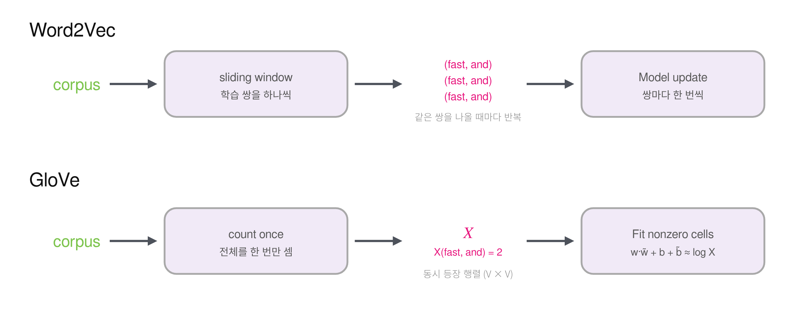

#### 동시 등장 행렬(Co-occurrence Matrix) 만들기

첫 단계는 corpus를 통계로 바꾸는 것입니다. Word2Vec에서 쓰던 리뷰 4개를 공백 기준으로 토큰화하고, window = 2로 두고 센다고 해 보겠습니다.

```py
reviews = [
    ['the', 'mask', 'arrived', 'fast', 'and', 'fits', 'well'],
    ['delivery', 'was', 'fast', 'and', 'cheap'],
    ['delivery', 'was', 'slow', 'but', 'cheap'],
    ['the', 'mask', 'arrived', 'quick', 'and', 'fits', 'well'],
]
```

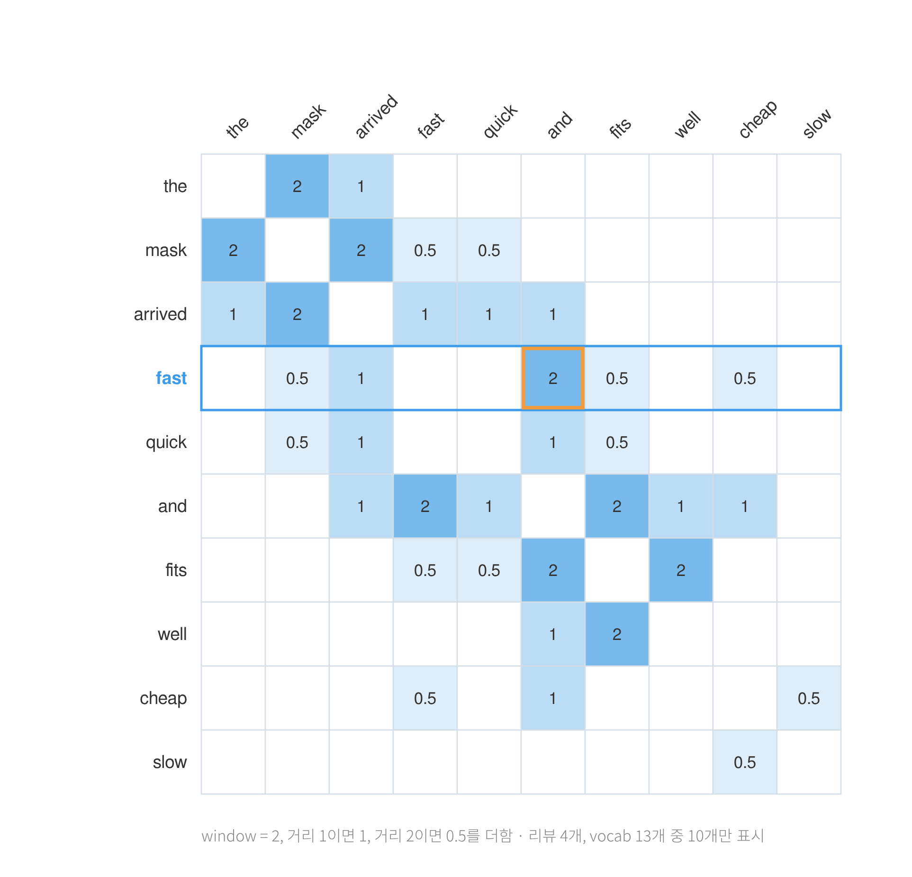

동시 등장 행렬 X는 **V × V** 크기입니다. $X_{ij}$는 "토큰 i의 window 안에 토큰 j가 몇 번 나왔는가"를 나타냅니다.

원래 GloVe 구현은 거리도 반영해서, 바로 옆(거리 1)이면 1, 한 칸 건너(거리 2)면 1/2을 더합니다. 예를 들어 `fast` 바로 뒤의 `and`는 리뷰 1과 2에 한 번씩 나오므로 $X_{(fast, and)} = 1 + 1 = 2$이고, `fast` 두 칸 앞의 `mask`는 리뷰 1에만 나오므로 $X_{(fast, mask)} = 0.5$입니다.

이 행렬에는 두 가지 특징이 있습니다.

- **대칭입니다.** window를 양쪽으로 보니 $X_{ij} = X_{ji}$입니다.
- **희소행렬입니다.** 예문에서도 13 × 13 = 169칸 중 0이 아닌 칸은 54개뿐이고, vocab이 수십만 개인 실제 corpus에서는 비율이 훨씬 더 작아집니다. GloVe는 이 **0이 아닌 칸만** 학습에 씁니다.

#### 핵심 아이디어: 동시 등장 확률의 비율

과연 벡터가 corpus의 어떤 통계를 담도록 학습시켜야 <u>**벡터의 차이에 의미가 담기도록**</u> 만들 수 있을까요? 즉, $king − man + woman ≈ queen$ 같은 관계가 성립되도록 벡터를 만들려면 도대체 corpus의 어떤 특징에 집중해야 하냐는 게 연구진들의 질문이었어요.

그래서 저자들은 <u>**동시 등장 횟수를 확률로 만들고, 확률들의 비율을 활용해서 서로 다른 두 토큰의 차이를 유추하자는 아이디어**</u>로 접근합니다.

먼저 동시 등장 횟수를 <u>**확률**</u>로 바꿉니다. 토큰 $i$의 행을 모두 더한 값을 $X_i$라고 하면, “토큰 $i$ 주변에 토큰 $k$가 나올 확률” $P(k \mid i)$은 다음과 같습니다.

$$
P(k \mid i) = \frac{X_{ik}}{X_i}, \qquad X_i = \sum_k X_{ik}
$$

저자들은 corpus에서 “두 토큰의 차이”에 해당하는 통계가 무엇인지 찾아야 했고, 그 관계를 ice와 steam의 관계를 비교하며 찾아나갔습니다. 둘 다 물의 상태라서 비슷하지만 <u>**고체냐 기체냐**</u>에서만 다른, 유추 문제에 딱 맞는 쌍이기 때문입니다.

분포 가설에서 토큰의 의미는 "주변에 어떤 토큰이 나오나"로 정해집니다. 그러니 ice와 steam의 차이도 둘의 주변을 비교해서 알아낼 수밖에 없습니다. context word k를 하나 넣을 때마다 “k야, 너는 ice 옆에 더 자주 나오니, steam 옆에 더 자주 나오니?”라고 물으면서 그 단서를 알아가고자 했고, 이를 위해서는 <u>**확률 자체보다 확률의 비율이 의미를 더 잘 드러낸다**</u>는 점에 주목합니다.

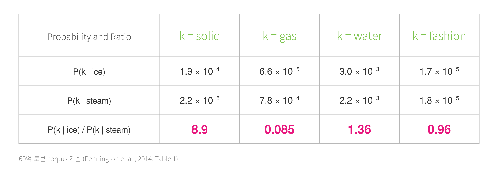

예를 들어, $P(solid \mid ice)$와 $P(solid \mid steam)$의 비율을 봤을 때 알 수 있는 점은 이렇게 정리할 수 있습니다.

- **비율이 0에 가깝다** → `solid`는 `ice`보다는 `steam`과 함께 많이 등장한다.
- **비율이 1에 가깝다** → `solid`가 `ice`이든 `steam`이든 비슷하게 함께 등장한다.

  - 이 경우에는 `solid`가 `ice`와 `steam`에 연관이 깊은 토큰일 수도, 연관이 낮은 토큰일 수도 있겠죠.
- **비율이 1보다 크다** → `solid`는 `steam`보다 `ice`와 함께 많이 등장한다.

다시 위 표를 살펴보면 다음과 같이 해석할 수 있겠죠.

- `solid`는 `ice` 쪽이라고 답합니다 (8.9).
- `gas`는 `steam` 쪽이라고 답합니다 (0.085).
- `water`와 `fashion`은 둘이 똑같다고 답합니다 (≈ 1).

이 답들을 모으면 <strong>"ice와 steam은 고체/기체 축에서 다르고 나머지는 같다"</strong>는 차이가 드러납니다.

그래서 학습 목표가 다음과 같이 정해집니다.

- 원하는 것: 벡터의 차이($w_{ice} - w_{steam}$)가 의미를 갖도록 만들기
- corpus에서 활용할 것: 확률의 비율 $P(k \mid ice) / P(k \mid steam)$
- 차이와 비율을 잇는 다리: $\log$, 즉 $\log(\frac{a}{b}) = \log a - \log b$

가장 먼저 떠오르는 식은 벡터의 차이를 log 비율과 같다고 놓는 것입니다.

$$
w_{ice} - w_{steam} \approx \log \frac{P(k \mid ice)}{P(k \mid steam)}
$$

하지만 이 식은 성립할 수 없습니다.

1. **좌변은 벡터(D차원)이고, 우변은 숫자 하나(스칼라)입니다.** 벡터와 숫자는 같다고 놓을 수 없습니다.
2. **우변은 k마다 다른 값인데, 좌변에는 k가 없습니다.** `solid`를 넣으면 $\log 8.9 \approx 2.2$, `gas`를 넣으면 $\log 0.085 \approx -2.5$인데, k와 상관없이 고정된 $w_{ice} - w_{steam}$ 하나가 이 값들과 동시에 같을 수는 없습니다.

그래서 좌변에 **k에 따라 달라지면서 벡터를 숫자로 바꿔 주는 것**이 필요합니다. 토큰 k마다 벡터 $\tilde{w}_k$를 하나씩 두고, 가장 단순한 방법인 **내적**으로 숫자를 만듭니다.

$$
(w_{ice} - w_{steam})^\top \tilde{w}_k \approx \log \frac{P(k \mid ice)}{P(k \mid steam)}
$$

"ice와 steam의 차이 벡터를 질문 k의 방향으로 투영한 값이 log 비율이 된다"로 읽을 수 있습니다. `solid` 방향으로 투영하면 큰 양수, `gas` 방향이면 큰 음수, `water`나 `fashion` 방향이면 0 근처가 나와야 합니다.

내적을 쓰는 또 다른 이유는 **분배법칙**이 가능하기 때문입니다. 좌변과 우변을 각각 풀어 쓰면 다음과 같습니다.

$$
w_{ice}^\top \tilde{w}_k - w_{steam}^\top \tilde{w}_k \approx \log P(k \mid ice) - \log P(k \mid steam)
$$

양쪽 모두 "ice에 관한 항 − steam에 관한 항"의 모양이 되었으니, 각 항끼리 맞추면 됩니다.

$$
w_{ice}^\top \tilde{w}_k \approx \log P(k \mid ice), \qquad w_{steam}^\top \tilde{w}_k \approx \log P(k \mid steam)
$$

이제 "두 토큰의 차이"에 관한 조건이 **"토큰 하나와 k"** 사이의 조건으로 바뀌었습니다. 그래서 동시 등장 행렬의 한 칸 $(i, k)$만 보고 학습할 수 있습니다. ice와 steam을 일반화해서 토큰 $i$로 쓰고 확률을 횟수로 풀면 다음과 같습니다.

$$
w_i^\top \tilde{w}_k \approx \log P(k \mid i) = \log({\frac{X_{i,k}}{X_{i}}}) = \log X_{ik} - \log X_i
$$

여기서 $\log X_i$는 "토큰 i 주변에 나온 토큰 총 개수"의 log라서, k가 `solid`든 `gas`든 `water`든 값이 같습니다. 모든 k에 똑같이 더해지는 상수이므로, 직접 계산하지 않고 <strong>토큰마다 하나씩 있는 학습 파라미터 $b_i$</strong>로 흡수시키는 트릭을 사용합니다.

$$
w_i^\top \tilde{w}_k + b_i \approx \log X_{ik}
$$

마지막으로 $\tilde{b}_k$가 하나 더 붙습니다. 앞에서 차이 식 하나를 두 식으로 쪼갰는데, 사실 두 식에 **k에만 달린 값**을 똑같이 더해도 빼면 사라지므로 차이 식은 그대로 성립합니다. 이 "빼면 사라지는 k의 몫"을 편향 $\tilde{b}_k$로 둡니다.

그래서 GloVe는 동시 등장 행렬의 **0이 아닌 각 칸**에서 다음 식이 성립하도록 학습합니다.

$$
w_i^\top \tilde{w}_k + b_i + \tilde{b}_k \approx \log X_{ik}
$$

- $w_i$: center word i의 벡터, $\tilde{w}_k$: context word k의 벡터 (질문 k의 방향)
- $b_i$: $\log X_i$를 흡수하는 편향, $\tilde{b}_k$: k의 몫을 담는 편향

이 식이 정말 처음의 목표를 만족하는지 확인해 보겠습니다. 칸 $(ice, k)$와 칸 $(steam, k)$의 식은 다음과 같습니다.

$$
w_{ice}^\top \tilde{w}_k + b_{ice} + \tilde{b}_k \approx \log X_{ice,k}
$$

$$
w_{steam}^\top \tilde{w}_k + b_{steam} + \tilde{b}_k \approx \log X_{steam,k}
$$

두 식을 빼면 $\tilde{b}_k$는 사라집니다.

$$
(w_{ice} - w_{steam})^\top \tilde{w}_k + (b_{ice} - b_{steam}) \approx \log X_{ice,k} - \log X_{steam,k}
$$

$b_{ice} - b_{steam}$이 분모 항 $\log X_{ice} - \log X_{steam}$의 역할을 하므로, 결국 처음에 원했던 식으로 돌아옵니다.

$$
(w_{ice} - w_{steam})^\top \tilde{w}_k \approx \log \frac{X_{ice,k} / X_{ice}}{X_{steam,k} / X_{steam}} = \log \frac{P(k \mid ice)}{P(k \mid steam)}
$$

한 줄로 말하면 **두 토큰 벡터의 내적 ≈ 함께 나온 횟수의 log**가 되도록 학습하는 것이 GloVe입니다. 칸 하나하나에서는 횟수의 log만 맞추지만, 두 칸을 빼면 벡터의 차이가 확률의 비율을 담게 됩니다.

#### GloVe 학습 아키텍처: 동시 등장 행렬을 보고 학습하기

GloVe도 Word2Vec처럼 <strong>Center Token Embedding Matrix $W$</strong>와 <strong>Context Token Embedding Matrix $W'$</strong> 두 개를 둡니다. 여기에 토큰마다 편향 b, b̃가 하나씩 더 있습니다. 다른 점은 학습 데이터입니다. Word2Vec은 corpus의 window를 하나씩 밀며 학습 쌍을 만들었지만, GloVe는 **동시 등장 행렬 X의 0이 아닌 칸 하나하나가 학습 데이터**입니다.

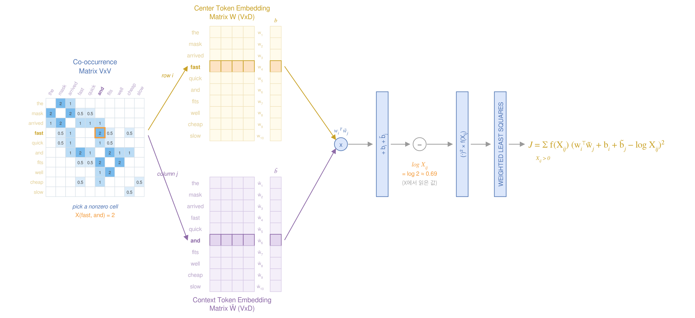

`(fast, and)` 칸(X = 2) 하나로 한 스텝을 따라가 보겠습니다.

1. **칸 고르기**: X에서 0이 아닌 칸 하나를 고릅니다. 여기서는 $i$ = `fast`, $j$ = `and`, $X_{ij}$ = 2입니다.
2. **벡터 꺼내기**: $W$에서 `fast`의 행 $w_i$를, $W'$에서 `and`의 행 $w̃_j$를 꺼냅니다. 편향 $b_i$, $b̃_j$도 함께 가져옵니다.
3. **예측값 계산**: $w_i^\top \tilde w_j + b_i + b̃_j$를 계산합니다. 이 값이 맞혀야 할 정답은 $log X_{ij} = log 2 ≈ 0.69$입니다.
4. **오차 제곱**: $(\text{예측값} − log X_{ij})²$를 구합니다. sigmoid도 cross entropy도 없는, 숫자 하나를 맞히는 **회귀 문제**입니다.
5. **가중치 곱하기**: 칸마다 중요도가 다르므로 $f(X_{ij})$를 곱합니다.

   - $f$는 가중치 함수로, 각 칸마다 손실에 가중치를 부여합니다.

     $$
     f(x) = \begin{cases} (x / x_{\max})^{\alpha} & x < x_{\max} \\ 1 & \text{otherwise} \end{cases}\qquad (x_{\max} = 100,\ \alpha = 3/4)
     $$

     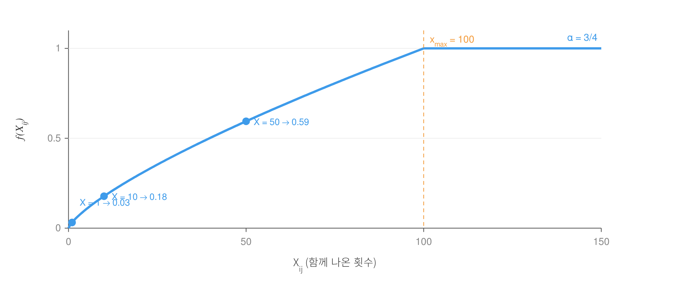

6. **업데이트**: 이 손실이 줄어들도록 $w_i$, $w̃_j$, $b_i$, $b̃_j$ 네 개만 업데이트합니다. 논문은 최적화에 AdaGrad를 씁니다.

학습이 끝나면 **$W$와 $W'$를 더해서** 사용합니다.

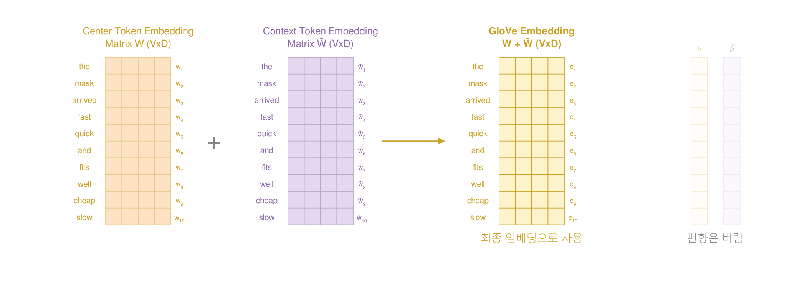

#### GloVe의 강점과 한계

**강점**

- **학습 효율이 좋습니다.** 동시 등장 행렬을 만드는 데 한 번 훑고 나면, 학습은 행렬의 0이 아닌 칸만 반복합니다. 같은 쌍이 아무리 많이 나와도 칸 하나이므로, corpus가 커져도 <u>**epoch당 계산량이 그만큼 늘지 않습니다.**</u>
- **전역 통계를 직접 맞춥니다.** "전체 corpus에서 몇 번 함께 나왔는가"를 목표값으로 쓰기 때문에, 토큰 사이의 관계가 벡터의 차이로 잘 드러납니다. 유추(king − man + woman) 같은 평가에서 강합니다.
- **사전학습 벡터를 쉽게 구할 수 있습니다.** Stanford가 Wikipedia + Gigaword(60억 토큰), Common Crawl(420억 토큰) 등으로 학습한 벡터를 <u>**공개**</u>해 두었습니다.

**한계**

- **vocab 밖의 토큰은 벡터가 없습니다.** 토큰마다 독립된 행을 두는 lookup table이라는 점은 Word2Vec과 같습니다. FastText가 풀었던 문제는 그대로 남습니다. OOV에 약하다는 거죠.
- **동시 등장 행렬을 만들 메모리가 필요합니다.** 행렬은 V × V라서, 희소 행렬로 저장해도 vocab과 corpus가 커지면 이 단계가 부담이 됩니다.
- **문맥을 보지 않는 정적 임베딩입니다.** `apple`이 사과든 회사 애플이든 벡터 하나를 갖는 건 Word2Vec, FastText와 똑같습니다.

## 📚 참고자료

- [One-Hot Encoding in NLP - GeeksforGeeks](https://www.geeksforgeeks.org/nlp/one-hot-encoding-in-nlp/)
- [Word2Vec — Negative Sampling](https://medium.com/@tnodecode/word2vec-negative-sampling-63995b13464f)
- [Word Embeddings](https://lena-voita.github.io/nlp_course/word_embeddings.html)
- [A Visual Guide to FastText Word Embeddings](https://amitness.com/posts/fasttext-embeddings)
- [Enriching Word Vectors with Subword Information](https://arxiv.org/abs/1607.04606)
- [FNV Hash](https://www.isthe.com/chongo/tech/comp/fnv/)
